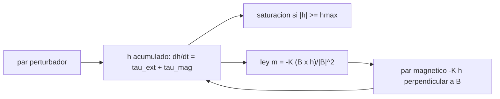

# B87-C14 — Saturación y descarga de momento

<!-- nav:top -->
[🏠 Programa](../../../../README.md) · [📚 Bloque B87](../../../tronco-comun/B87-sensores-y-control-de-actitud.md) · [← Anterior: B87-C13 — Propulsores de control de actitud](../B87-C13-propulsores-de-control-de-actitud/CLASE.md) · [Siguiente: B87-C15 — Apuntamiento de alta precisión →](../B87-C15-apuntamiento-de-alta-precision/CLASE.md)
<!-- /nav -->

## 1. Ubicación, nivel y alcance

Clase 14 del bloque B87. Nivel N3. Las perturbaciones externas con componente secular (gradiente de gravedad, resistencia, presión solar, dipolo residual) acumulan momento en las ruedas hasta saturarlas. La descarga con magnetopares devuelve ese momento al entorno. Aquí simulas 12 órbitas con un par perturbador de ejemplo `(2; −1; 4) µN·m` más una parte cíclica, una rueda de `0,05 N·m·s` y la ley `m = −K (B × h)/|B|²` limitada a `0,2 A·m²`. Todo es sintético.

## 2. Por qué esta clase existe

Una rueda saturada deja de controlar. La decisión central: **¿en cuánto tiempo se satura, cuánto par magnético hace falta para sostener la descarga y qué nivel de momento queda en régimen?** Una previa: el magnetopar solo actúa perpendicular a `B` (C12).

## 3. Lo que podrás hacer al terminar

1. Calcular el tiempo a saturación `h_max/|τ_sec|` y la amplitud cíclica `τ_c/n`.
2. Plantear `ḣ = τ_ext + τ_mag` con apuntamiento perfecto.
3. Aplicar la ley `m = −K (B × h)/|B|²` con límite de dipolo.
4. Comparar el momento con y sin descarga.
5. Interpretar el nivel permanente por la limitación de par.
6. Separar lo sintético de lo consultado y de lo no consultado.

La evidencia es la **histórico del momento de las ruedas con y sin descarga magnética** del ejercicio 12 (sección 20).

## 4. Con qué llegas y cómo comprobarlo

1. ¿Qué es una perturbación secular?
2. ¿Qué es una perturbación cíclica?
3. ¿Qué relación hay entre par e impulso angular?
4. ¿Cuándo satura una rueda?
5. ¿Qué par genera un magnetopar?

<details>
<summary>Ver respuestas</summary>

1. Una que no cambia de signo en promedio y acumula momento con el tiempo. 2. Una que oscila con la órbita y tiene promedio nulo. 3. `h = ∫τ dt`. 4. Cuando `|h|` llega a `h_max`. 5. `τ = m × B` (C12).
</details>

Con cuatro o cinco aciertos, sigue; si no, repasa los prerrequisitos.

## 5. Un caso de contexto y casos de referencia

El par secular de `4,58 µN·m` satura la rueda de `0,05 N·m·s` en `3,03 h` (`1,9` órbitas); sin descarga, el momento llega a `0,312 N·m·s` en 12 órbitas. Con descarga (`K = 1/600 s⁻¹`) queda acotado en `0,025 N·m·s`. Todo es **sintético**.

## 6. Vocabulario

La **saturación** es `|h| ≥ h_max`. La **descarga** (*desaturation*) usa un actuador externo para reducir `h`. La **ley de descarga** es `τ_mag = −K h_⊥B`, con `m = −K (B × h)/|B|²`. El **par secular** acumula; el **cíclico** oscila con amplitud `τ_c/n` en `h`. El **régimen** es el nivel de `h` al que la descarga iguala a la perturbación.

## 7. Modelo mental: llenar y vaciar un depósito



*Descripción textual:* la perturbación llena el depósito de momento; la ley magnética lo vacía con un par proporcional al momento perpendicular al campo; el nivel permanente es el equilibrio entre ambos.

Analogía: un depósito que se llena por un grifo (la perturbación) y se vacía por una válvula que solo funciona en ciertas direcciones (el campo). Límite: la válvula magnética es débil y la ley real debe cuidar que la descarga no perturbe el apuntamiento (aquí supuesto perfecto).

## 8. La explicación, paso a paso

### 8.1 Acumulación

Con apuntamiento perfecto, `ḣ = τ_ext + τ_mag`. El par secular de `(2; −1; 4) µN·m` tiene módulo `4,583 µN·m`; el tiempo teórico a saturación es `h_max/|τ| = 3,03 h`, y la simulación sin descarga cruza `0,05` a `3,05 h`. Un par cíclico de `20 µN·m` a la frecuencia orbital añade `±0,0181 N·m·s` de oscilación (amplitud `τ_c/n`).

### 8.2 Ley de descarga

`m = −K (B × h)/|B|²` da `τ_mag = m × B = −K h_⊥B`, la proyección de `h` perpendicular a `B`, con constante de tiempo `1/K = 600 s`. La parte de `h` paralela a `B` no se puede descargar en ese instante; como `B` gira, en promedio sí. El dipolo se limita a `0,2 A·m²`.

### 8.3 Resultados (12 órbitas)

| Caso | Momento máx. (N·m·s) | Momento final (N·m·s) |
|---|---|---|
| sin descarga | 0,3122 | 0,3122 |
| con descarga | 0,0254 | 0,0230 |

Con descarga, el momento al inicio de cada órbita es `0.0000 0.0170 0.0197 0.0211 0.0219 0.0223 0.0226` N·m·s y se estabiliza en `≈ 0,023 N·m·s`.

### 8.4 Por qué queda un nivel permanente

El dipolo está saturado el `97,8 %` del tiempo: el par magnético máximo (`m_max |B| ≈ 5–8 µN·m`) es comparable al par secular (`4,6 µN·m`) y la ley no puede vaciar más rápido de lo que la perturbación llena. El nivel de régimen `≈ τ_sec/K_efectivo` es una consecuencia de la **limitación de par**, no de la ganancia. Quedan fuera la perturbación del apuntamiento por el par magnético y la actitud real (cuerpo fijo en el sistema inercial de ejemplo).

## 9. Magnitudes, símbolos y unidades

| Símbolo | Qué es | Unidad | Valor / nota |
|---|---|---|---|
| `h` | momento de las ruedas | N·m·s | capacidad 0,05 |
| `τ_sec` | par secular (ejemplo) | N·m | 4,58 µN·m |
| `K` | ganancia de descarga | 1/s | 1/600 |
| `m` | dipolo | A·m² | máx. 0,2 |
| `n` | velocidad orbital | rad/s | 1,107e-03 |

## 10. Convenciones y referencias

Campo dipolar **sintético** (C05), órbita de `500 km` y `51,6°`, 12 órbitas, paso `2 s`; par `(2; −1; 4) µN·m + 20 µN·m·sin(nt)` en `y`; rueda de `0,05 N·m·s`. Tolerancias: tiempo a saturación dentro del 30 % del teórico, con descarga `h_max < 50 %` del caso sin descarga y `< 0,05`. Cuaternión `q = [qx, qy, qz, qw]` con la parte escalar al final, `v_B = A(q) v_I`, producto tal que `A(q⊗p) = A(q) A(p)`, cinemática `q̇ = ½ [ω; 0] ⊗ q` con `ω` del cuerpo respecto del sistema inercial expresada en el cuerpo (la biblioteca [adcs_comun.py](../adcs_comun.py) del bloque lo comprueba). Sistema inercial `I` de **ejemplo** (ejes sin relación con J2000), órbita circular de dos cuerpos con radio terrestre `6 378 137 m` y `μ = 3,986004418 × 10¹⁴ m³/s²` como valores adoptados de ejemplo. Satélite **sintético** `I = diag(0,35; 0,40; 0,30) kg·m²` salvo que la clase diga otra cosa. Todo dato es sintético con semilla fija.

## 11. De dónde sale lo que afirmamos

| ID | Fuente | Localizador | Respalda | Estado |
|---|---|---|---|---|
| — | Relaciones estándar de dinámica de actitud, estimación y control usadas en esta clase (ecuaciones de Euler, cinemática de cuaterniones, problema de Wahba, filtro de Kalman multiplicativo, estabilidad de Lyapunov, modelos de sensores y actuadores) | — | las verifica el laboratorio con una segunda vía (conservación, comparación entre métodos, propagación independiente o Monte Carlo) | No consultada en una fuente concreta |
| — | Libros de texto de actitud y control (p. ej. Wertz, Markley–Crassidis, Sidi) y hojas de datos de fabricantes | — | — | No consultada |
| — | Leyes de descarga magnética publicadas, modelos reales de perturbación secular (gradiente de gravedad, resistencia) y datos de ruedas | — | — | No consultada |

Límites: Esta clase no tiene fuente consultada propia: la ley de descarga con producto cruz y el balance `ḣ = τ_ext + τ_mag` son relaciones estándar que no se consultaron en una fuente concreta; el laboratorio las valida contra el tiempo a saturación teórico y el balance de momento.

## 12. Cómo ver el momento de las ruedas

| Magnitud | Valor |
|---|---|
| tiempo a saturación (teoría / simulación) | 3,03 / 3,05 h |
| momento máximo sin descarga | 0,312 N·m·s |
| momento máximo con descarga | 0,025 N·m·s |
| dipolo saturado | 98 % del tiempo |

Descripción larga: sin descarga la rueda satura a las 3 h; con descarga el momento sube a 0,023 y se estabiliza.

## 13. Ejemplo trabajado: cuándo satura la rueda

**Paso 1 · Par secular.** `|τ| = √(2² + 1² + 4²) = 4,583 µN·m`.

**Paso 2 · Tiempo a saturación.** `0,05/4,583e-06 = 10911 s = 3,03 h`.

**Paso 3 · Simulación.** Sin descarga cruza 0,05 a `3,05 h`.

**Paso 4 · Con descarga.** `h_max = 0,0254 N·m·s`.

**Paso 5 · Comprobación.** El dipolo satura el `98 %` del tiempo.

## 14. Distintas formas de describir la gestión del momento

**Descarga magnética** (esta clase): sin propergol, límite de par. **Descarga con propulsores:** rápida, consume propergol (C13). **Control de actitud que aprovecha el gradiente de gravedad:** reduce el momento secular al elegir la actitud (no tratado). Todos reducen `|h|` aplicando un par externo.

## 15. Práctica guiada

**Ejercicio 1 · con los pasos indicados.** Calcula `t_sat` para `τ = 5 µN·m` y `h_max = 0,05`. *Pasos:* `h_max/τ`.

<details><summary>Solución comentada</summary>

`0,05/(5×10⁻⁶) = 10 000 s = 2,78 h`.
</details>

**Ejercicio 2 · con una pista.** ¿Qué amplitud cíclica en `h` da un par de `20 µN·m` con `n = 1,107×10⁻³ rad/s`?

<details><summary>Solución comentada</summary>

`τ_c/n = 2×10⁻⁵/1,107×10⁻³ = 0,0181 N·m·s`.
</details>

**Ejercicio 3 · casi autónomo.** ¿Qué par magnético instantáneo da `K = 1/600`, `h = 0,02` perpendicular a `B`?

<details><summary>Solución comentada</summary>

`τ = K h = 33,3 µN·m`.
</details>

## 16. Práctica autónoma, transferencia e integrador

**Ejercicio 4 · autónomo.** Con `|B| = 30 µT` y `m_max = 0,2`, ¿cuál es el par magnético máximo? ¿Basta contra `4,58 µN·m`?

<details><summary>Solución comentada</summary>

`6 µN·m`; sí, pero con margen pequeño (1,3).
</details>

**Ejercicio 5 · autónomo.** ¿Por qué el nivel de régimen queda en 0,023 y no en 0?

<details><summary>Solución comentada</summary>

Porque el dipolo está limitado y el par magnético no puede superar en promedio el secular; el balance fija `h`.
</details>

**Ejercicio 6 · autónomo.** ¿Qué pasa con la componente de `h` paralela a `B`?

<details><summary>Solución comentada</summary>

No se descarga en ese instante; al girar `B` a lo largo de la órbita deja de ser paralela y se descarga.
</details>

**Ejercicio 7 · autónomo.** Si `K` se duplica, ¿cambia el nivel de régimen?

<details><summary>Solución comentada</summary>

Poco: el dipolo ya está saturado el 98 % del tiempo y el nivel lo fija el par máximo, no `K`.
</details>

**Ejercicio 8 · autónomo.** ¿Cómo cambia el tiempo a saturación con una rueda de `0,1 N·m·s`?

<details><summary>Solución comentada</summary>

Se duplica: `6,06 h`.
</details>

**Ejercicio 9 · transferencia.** **Transferencia.** **Transferencia.** Un colega usa `4,58 µN·m` como la perturbación de una misión. ¿Es válido?

<details><summary>Solución comentada</summary>

No: el par es un valor de ejemplo; el real depende de la actitud, la altitud, la geometría y la actividad solar (no consultados).
</details>

**Ejercicio 10 · transferencia.** **Transferencia.** **Transferencia.** ¿Qué pasa si el magnetopar descarga mientras el satélite apunta con alta precisión?

<details><summary>Solución comentada</summary>

Su par perturba la actitud y la rueda debe compensarlo; se coordina la descarga con los modos de observación.
</details>

**Ejercicio 11 · transferencia.** **Transferencia.** **Transferencia.** ¿Por qué se descarga en órbita baja con magnetopares y en alta con propulsores?

<details><summary>Solución comentada</summary>

Porque el campo decae como `1/r³`: lejos de la Tierra el par magnético es despreciable.
</details>

**Ejercicio 12 · integrador.** **Integrador.** **Integrador.** Elabora tu *histórico de momento con y sin descarga*: tiempo a saturación, momento máximo en ambos casos, fracción de dipolo saturado y lista de consultado y sintético.

<details><summary>Solución comentada</summary>

Secciones 8.1–8.4, 12 y la salida del laboratorio.
</details>

## 17. Laboratorio: saturación de ruedas y descarga con magnetopares

El script [descarga.py](descarga.py) integra el momento de las ruedas durante 12 órbitas bajo un par perturbador secular y cíclico, sin y con la ley de descarga magnética limitada a `0,2 A·m²`, y mide el tiempo de saturación, los máximos y la fracción de dipolo saturado (**comprueba** tiempo a saturación dentro del 30 % de la teoría y reducción del momento máximo a menos de la mitad). Usa la biblioteca común [adcs_comun.py](../adcs_comun.py) del bloque.

**Datos:** par perturbador y campo **sintéticos**; cuerpo fijo respecto del sistema inercial de ejemplo. **Predice antes de ejecutar:** ¿Se satura la rueda sin descarga en 12 órbitas? (sí, a unas 3 h.) **Ejecución del 2026-11-10 (Python 3.12.9, numpy 2.4.4):**

```text
Python 3.12.9 | numpy 2.4.4
B87-C14 saturacion y descarga | SINTETICO: par secular (2,-1,4) uN m + 20 uN m ciclico; rueda 0.05 N m s; m_max 0.2 A m^2; 12 orbitas
periodo orbital = 94.62 min ; |par secular| = 4.583 uN m
tiempo teorico a saturacion con el par secular = 3.03 h (1.9 orbitas)
sin descarga: momento maximo en 12 orbitas = 0.3122 N m s ; supera 0.05 a t = 3.05 h
con descarga (K = 1/600 1/s): momento maximo = 0.02543 N m s ; final = 0.02298 N m s ; dipolo saturado el 97.8 % del tiempo
momento al inicio de cada orbita con descarga [N m s]: 0.0000 0.0170 0.0197 0.0211 0.0219 0.0223 0.0226 0.0227 0.0228 0.0229 0.0229 0.0230 0.0230
amplitud ciclica del momento = tau_c / n = 0.0181 N m s
Pruebas superadas.
```

```bash
python programa/clases/B87/B87-C14-saturacion-y-descarga-de-momento/descarga.py
```

**Límites:** apuntamiento perfecto supuesto, sin acoplamiento giroscópico, campo dipolar sin armónicos, sin interacción con el control fino.

## 18. Errores frecuentes y cómo corregirlos

**Creer que la descarga vacía la rueda del todo.** Revisa el límite de par (8.4)

**Descargar sin tener en cuenta el apuntamiento.** Coordina con el modo de observación

**Usar una ganancia alta sin saturar el dipolo.** Limita `|m| ≤ m_max` (8.2)

## 19. Cómo sabrás que vas bien

Tras la sección 8: ¿qué tiempo a saturación esperabas? Si dudas, repasa el ejemplo 13. Tras el laboratorio: ¿qué comprueba? (ver sección 17).

## 20. Qué entregas y cómo se evalúa

El producto es tu **histórico del momento de las ruedas con y sin descarga magnética** (ejercicio 12).

| Criterio | Inicial | En desarrollo | Logrado | Destacado |
|---|---|---|---|---|
| Conceptos | Los confunde | Parciales | Explica el método y su dominio | Explica los límites y las alternativas |
| Cálculo | Sin unidades | Con errores | Resultados con unidades y comprobados | Resuelve casos nuevos |
| Numérico | Sin comprobar | Un caso | Verifica con una segunda vía en varios casos | Interpreta las diferencias y los fallos |
| Fuentes | Sin fuente | Sin fecha | Fuentes con fecha y estado | Declara lo sintético y lo no consultado |
| Límites | No los nombra | Uno | Tres | Discute qué falta del modelo |

**Condiciones críticas (no se compensan con promedio):** rotular los datos como sintéticos; verificar cada resultado con una segunda vía; citar solo lo consultado.

## 21. Ética, seguridad y límites

Clase educativa: los modelos son simplificados y los datos son sintéticos; ningún resultado describe una misión real ni sustituye el diseño y la verificación de un subsistema de actitud con herramientas validadas, ensayos y revisión de especialistas.  Accesibilidad: tablas equivalentes a las gráficas, fórmulas en texto, ejercicios sin conexión.

## 22. Para cerrar y seguir

Con `4,6 µN·m` de par secular, la rueda satura en `3,0 h`; la descarga magnética mantiene `|h| ≤ 0,025 N·m·s`. Queda una pregunta: ¿qué precisión de apuntamiento se logra con todo el lazo funcionando?

**Glosario español–inglés.** saturación · *saturation*; descarga de momento · *momentum dumping*; par secular · *secular torque*; magnetopar · *magnetorquer*; régimen · *steady state*; ley de control · *control law*.

**Continuidad.** [B87-C15](../B87-C15-apuntamiento-de-alta-precision/CLASE.md) trata el apuntamiento de alta precisión y sus índices de error.

**Referencias:** ver sección 11.

<!-- nav:bottom -->
---

[← Anterior: B87-C13 — Propulsores de control de actitud](../B87-C13-propulsores-de-control-de-actitud/CLASE.md) · [📚 Bloque B87](../../../tronco-comun/B87-sensores-y-control-de-actitud.md) · [Siguiente: B87-C15 — Apuntamiento de alta precisión →](../B87-C15-apuntamiento-de-alta-precision/CLASE.md)
<!-- /nav -->
