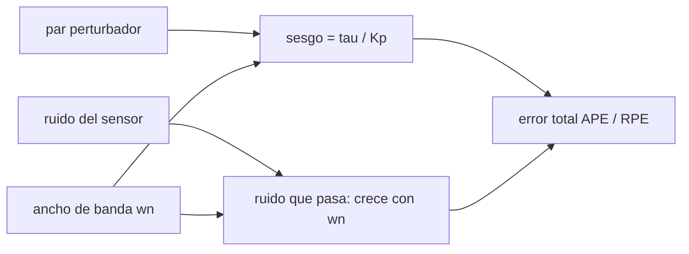

# B87-C15 — Apuntamiento de alta precisión

<!-- nav:top -->
[🏠 Programa](../../../../README.md) · [📚 Bloque B87](../../../tronco-comun/B87-sensores-y-control-de-actitud.md) · [← Anterior: B87-C14 — Saturación y descarga de momento](../B87-C14-saturacion-y-descarga-de-momento/CLASE.md) · [Siguiente: B87-C16 — Detumbling después del despliegue →](../B87-C16-detumbling-despues-del-despliegue/CLASE.md)
<!-- /nav -->

## 1. Ubicación, nivel y alcance

Clase 15 del bloque B87. Nivel N3. El apuntamiento de alta precisión se describe con índices estadísticos del error (media, desviación, error absoluto y error relativo en una ventana), no con un solo número. Aquí simulas un lazo PD de un eje con medida de actitud ruidosa (`20″` a 10 Hz), giroscopio con ruido, un par perturbador constante de `2 µN·m` y un ruido de par (jitter), para tres anchos de banda (`0,1; 0,3; 1,0 rad/s`). Todo es sintético.

## 2. Por qué esta clase existe

Un requisito de apuntamiento incompleto es ambiguo. La decisión central: **¿cómo se define y se mide el error de apuntamiento, y cómo cambia con el ancho de banda del lazo?** Subir el ancho de banda reduce el sesgo por perturbación, pero deja pasar más ruido del sensor: hay un equilibrio.

## 3. Lo que podrás hacer al terminar

1. Distinguir el sesgo (media), la desviación y el percentil 99,7 % del error.
2. Calcular un error relativo (RPE) en ventanas de `10 s`.
3. Predecir el sesgo por par constante `τ/K_p`.
4. Comparar tres anchos de banda y explicar el equilibrio sesgo–ruido.
5. Redactar un requisito de apuntamiento completo (valor, eje, índice, confianza, ventana).
6. Separar lo sintético de lo consultado y de lo no consultado.

La evidencia es la **estadísticos de apuntamiento de una serie temporal para tres anchos de banda** del ejercicio 12 (sección 20).

## 4. Con qué llegas y cómo comprobarlo

1. ¿Qué es la media de una serie y qué mide la desviación?
2. ¿Qué es un percentil?
3. ¿Qué es el ancho de banda de un lazo?
4. ¿Qué es el error en régimen permanente?
5. ¿Qué es el jitter?

<details>
<summary>Ver respuestas</summary>

1. La media es el sesgo; la desviación, la dispersión. 2. El valor por debajo del cual cae esa fracción de los datos. 3. Del orden de `ω_n`, la frecuencia hasta la que el lazo sigue y rechaza perturbaciones. 4. El error que queda con una perturbación constante: `τ/K_p`. 5. Variación rápida y pequeña del apuntamiento.
</details>

Con cuatro o cinco aciertos, sigue; si no, repasa los prerrequisitos.

## 5. Un caso de contexto y casos de referencia

Con `ω_n = 0,3 rad/s` el sesgo por el par de `2 µN·m` es `15,8″` (teoría `15,3″`), la desviación `1,88″` y el percentil 99,7 % de `|error|` `21,9″`. Con `ω_n = 1,0` el sesgo baja a `1,78″` pero la desviación sube a `3,63″`. Todo es **sintético**.

## 6. Vocabulario

El **error de apuntamiento absoluto** (APE) es la diferencia entre la actitud real y la deseada. El **error relativo** (RPE) es la variación del error en una ventana. La **media** es el sesgo. El **percentil 99,7 %** acota el error con confianza `≈ 3σ`. El **ancho de banda** es `ω_n`. El **jitter** es el componente rápido. Un requisito completo indica valor, eje, índice, interpretación estadística, confianza y ventana (S3).

## 7. Modelo mental: sesgo, ruido y ancho de banda



*Descripción textual:* un lazo más rápido reduce el sesgo por perturbaciones constantes pero transmite más ruido del sensor; el error total combina ambos y se resume con estadísticos.

Analogía: como sostener una cámara con la mano: si corriges despacio, el viento te desvía (sesgo); si corriges deprisa, tiemblas con cada lectura ruidosa (ruido). Límite: aquí un solo eje, ruido blanco y perturbación constante.

## 8. La explicación, paso a paso

### 8.1 Índices de error

Sea `e(t)` el error real (no el medido). La **media** `ē` es el sesgo; la **desviación** `σ_e` mide la dispersión; el **percentil 99,7 %** de `|e|` es un APE con alta confianza; el **RPE** es la desviación de `e` dentro de ventanas de `10 s`, promediada sobre la serie. Descartamos los primeros `100 s` (transitorio) y analizamos 500 s.

### 8.2 Lazo y errores

El lazo PD es `u = −K_p θ_m − K_d ω_m` con `K_p = I ω_n²` y `K_d = 2ζ ω_n I` (`ζ = 0,7`, `I = 0,30 kg·m²`). Un par constante `τ_d` da un sesgo `τ_d/K_p`. El ruido de medida (`20″`) y del giroscopio pasa al error con un filtrado de ancho de banda `≈ ω_n`.

### 8.3 Resultados

| `ω_n` (rad/s) | `K_p` (N·m/rad) | Media (″) | Desv. (″) | APE 99,7 % (″) | RPE 10 s (″) | `τ/K_p` (″) |
|---|---|---|---|---|---|---|
| 0,1 | 0,0030 | 138,25 | 1,40 | 141,69 | 0,30 | 137,51 |
| 0,3 | 0,0270 | 15,78 | 1,88 | 21,87 | 0,98 | 15,28 |
| 1,0 | 0,3000 | 1,78 | 3,63 | 12,31 | 3,04 | 1,38 |

### 8.4 Cómo leerlo

A `ω_n = 0,1` domina el sesgo (`138″`) y el RPE es pequeño; a `ω_n = 1,0` el sesgo casi desaparece pero el RPE crece a `3,0″`. El mejor APE (`12,3″`) se da en el ancho mayor, pero el mejor RPE en el menor: el requisito decide cuál importa (APE para apuntar a un blanco, RPE para exposiciones largas). Un requisito completo, según la descripción de ECSS consultada (S3), nombra índice, estadística, confianza y ventana.

## 9. Magnitudes, símbolos y unidades

| Símbolo | Qué es | Unidad | Valor / nota |
|---|---|---|---|
| `θ` | error de actitud (verdadero) | rad (″) | — |
| `ω_n` | ancho de banda del lazo | rad/s | 0,1; 0,3; 1,0 |
| `K_p`, `K_d` | ganancias PD | N·m/rad, N·m·s/rad | ver tabla 8.3 |
| `τ_d` | par perturbador | N·m | 2 µN·m + jitter |
| APE, RPE | error absoluto y relativo | ″ | ver tabla 8.3 |

## 10. Convenciones y referencias

Un eje, `I_z = 0,30 kg·m²`, `ζ = 0,7`, medida de actitud `20″` (1σ) a `10 Hz`, giroscopio `2×10⁻⁵ rad/s`, par `2 µN·m + 0,3 µN·m` blanco, `dt = 0,01 s`, `600 s` (semilla 20260521), se descartan los primeros `100 s`. Tolerancias: media simulada dentro de `15 %` del `τ/K_p` más un margen estadístico. Cuaternión `q = [qx, qy, qz, qw]` con la parte escalar al final, `v_B = A(q) v_I`, producto tal que `A(q⊗p) = A(q) A(p)`, cinemática `q̇ = ½ [ω; 0] ⊗ q` con `ω` del cuerpo respecto del sistema inercial expresada en el cuerpo (la biblioteca [adcs_comun.py](../adcs_comun.py) del bloque lo comprueba). Sistema inercial `I` de **ejemplo** (ejes sin relación con J2000), órbita circular de dos cuerpos con radio terrestre `6 378 137 m` y `μ = 3,986004418 × 10¹⁴ m³/s²` como valores adoptados de ejemplo. Satélite **sintético** `I = diag(0,35; 0,40; 0,30) kg·m²` salvo que la clase diga otra cosa. Todo dato es sintético con semilla fija.

## 11. De dónde sale lo que afirmamos

| ID | Fuente | Localizador | Respalda | Estado |
|---|---|---|---|---|
| S3 | ECSS, ECSS-E-ST-60-30C «Satellite attitude and orbit control system (AOCS) requirements» — https://ecss.nl/standard/ecss-e-st-60-30c-satellite-attitude-and-orbit-control-system-aocs-requirements/ (consultada 2026-11-10 mediante resultados de búsqueda; el PDF no se abrió) | descripción del estándar | es un conjunto base de requisitos de AOCS (funcionales y de FDIR, operacionales, de desempeño, de verificación y documentales) limitado al nivel AOCS; el método de presupuesto de errores viene de ECSS-E-ST-60-10C y su guía de ECSS-E-HB-60-10A y del manual ESSB-HB-E-003; un requisito de apuntamiento completo especifica valor, sistema y eje, índice de error (APE, MPE, RPE), interpretación estadística, nivel de confianza y periodo de evaluación | Consultada (solo descripciones y resultados de búsqueda) |
| — | Relaciones estándar de dinámica de actitud, estimación y control usadas en esta clase (ecuaciones de Euler, cinemática de cuaterniones, problema de Wahba, filtro de Kalman multiplicativo, estabilidad de Lyapunov, modelos de sensores y actuadores) | — | las verifica el laboratorio con una segunda vía (conservación, comparación entre métodos, propagación independiente o Monte Carlo) | No consultada en una fuente concreta |
| — | Libros de texto de actitud y control (p. ej. Wertz, Markley–Crassidis, Sidi) y hojas de datos de fabricantes | — | — | No consultada |
| — | Texto completo de ECSS-E-ST-60-10C y del manual ESSB-HB-E-003 (no abiertos) | — | — | No consultada |

Límites: S3 se consultó solo como descripción y resultados de búsqueda: respalda que un requisito completo especifica valor, eje, índice de error (APE, MPE, RPE), interpretación estadística, confianza y periodo; las definiciones formales de ECSS-E-ST-60-10C no se abrieron y los índices de esta clase son versiones simplificadas.

## 12. Cómo comparar los anchos de banda

| Magnitud | Valor |
|---|---|
| sesgo `ω_n` 0,1 / 0,3 / 1,0 | 138,2 / 15,8 / 1,78″ |
| desviación | 1,40 / 1,88 / 3,63″ |
| APE 99,7 % | 141,7 / 21,9 / 12,3″ |
| RPE 10 s | 0,30 / 0,98 / 3,04″ |

Descripción larga: el sesgo baja con el ancho de banda y el ruido sube; el APE mejora con el ancho y el RPE empeora.

## 13. Ejemplo trabajado: sesgo y ruido con `ω_n = 0,3`

**Paso 1 · Ganancia.** `K_p = 0,30·0,09 = 0,0270 N·m/rad`.

**Paso 2 · Sesgo teórico.** `τ/K_p = 2×10⁻⁶/0,0270 = 15,3″`.

**Paso 3 · Simulación.** Media `15,8″`, desviación `1,88″`.

**Paso 4 · APE.** Percentil 99,7 %: `21,9″`.

**Paso 5 · RPE.** `0,98″` en ventanas de 10 s.

## 14. Distintas formas de describir el error de apuntamiento

**Absoluto (APE):** frente a la actitud deseada. **Relativo (RPE):** dentro de una ventana. **Conocimiento:** el error de la actitud estimada, no la real. Cada requisito pide uno; esta clase calcula los dos primeros desde la actitud real.

## 15. Práctica guiada

**Ejercicio 1 · con los pasos indicados.** Calcula `K_p` para `ω_n = 0,5 rad/s` e `I = 0,30`. *Pasos:* `I ω_n²`.

<details><summary>Solución comentada</summary>

`0,30·0,25 = 0,075 N·m/rad`.
</details>

**Ejercicio 2 · con una pista.** ¿Qué sesgo da un par de `2 µN·m` con ese `K_p`? *Pista:* `τ/K_p`.

<details><summary>Solución comentada</summary>

`2×10⁻⁶/0,075 = 2,67×10⁻⁵ rad = 5,5″`.
</details>

**Ejercicio 3 · casi autónomo.** ¿Cuántas veces menor es el sesgo a `ω_n = 1` que a `0,1`?

<details><summary>Solución comentada</summary>

`100` veces: `K_p ∝ ω_n²`; en el laboratorio `78`.
</details>

## 16. Práctica autónoma, transferencia e integrador

**Ejercicio 4 · autónomo.** Si la media es `15,8″` y la desviación `1,9″`, ¿cuánto vale el APE a 3σ aproximado?

<details><summary>Solución comentada</summary>

`15,8 + 3·1,9 = 21,5″` (el laboratorio da `21,9″` con percentil).
</details>

**Ejercicio 5 · autónomo.** ¿Cuál de los tres anchos de banda da menor RPE y por qué?

<details><summary>Solución comentada</summary>

El de `0,1 rad/s`, `0,30″`: deja pasar menos ruido.
</details>

**Ejercicio 6 · autónomo.** ¿Qué índice usarías para una exposición de 10 s de un telescopio?

<details><summary>Solución comentada</summary>

El RPE en ventanas de 10 s (estabilidad durante la exposición); el APE importa menos.
</details>

**Ejercicio 7 · autónomo.** Redacta un requisito completo para apuntar una antena.

<details><summary>Solución comentada</summary>

«El error de apuntamiento absoluto del eje x de la antena será `< 60″` (99,7 %, valor medio más 3σ), medido sobre ventanas de 600 s en modo nominal»; incluye valor, eje, índice, estadística, confianza y periodo (S3).
</details>

**Ejercicio 8 · autónomo.** ¿Qué ocurre con el RPE si el jitter de la rueda sube?

<details><summary>Solución comentada</summary>

Sube: el jitter es de alta frecuencia y se ve en ventanas cortas; no depende del sesgo.
</details>

**Ejercicio 9 · transferencia.** **Transferencia.** **Transferencia.** Un colega usa estos `″` como precisión de un telescopio real. ¿Es válido?

<details><summary>Solución comentada</summary>

No: son sintéticos, de un eje, ruido blanco y perturbación constante; un telescopio real exige un presupuesto de error completo (C22).
</details>

**Ejercicio 10 · transferencia.** **Transferencia.** **Transferencia.** ¿Por qué el APE medido desde el sensor no es el APE real?

<details><summary>Solución comentada</summary>

Porque el sensor tiene su propio error (conocimiento); el APE real incluye el error del estimador.
</details>

**Ejercicio 11 · transferencia.** **Transferencia.** **Transferencia.** ¿Cómo bajarías el sesgo sin subir el ruido?

<details><summary>Solución comentada</summary>

Con acción integral o con alimentación directa del par perturbador estimado; el modelo de esta clase no la incluye.
</details>

**Ejercicio 12 · integrador.** **Integrador.** **Integrador.** Elabora tu *tabla de estadísticos de apuntamiento* para los tres anchos de banda, con el requisito redactado y la lista de consultado y sintético.

<details><summary>Solución comentada</summary>

Secciones 8.1–8.4, 12 y la salida del laboratorio.
</details>

## 17. Laboratorio: índices de apuntamiento de un lazo PD

El script [apuntamiento.py](apuntamiento.py) simula `600 s` del lazo PD con medida ruidosa y par perturbador, descarta el transitorio y calcula media, desviación, percentil 99,7 % de `|e|` y RPE en ventanas de 10 s para tres anchos de banda (**comprueba** media dentro de `15 %` del `τ/K_p` y sesgo decreciente con `ω_n`). Usa la biblioteca común [adcs_comun.py](../adcs_comun.py) del bloque.

**Datos:** medida, giroscopio y par **sintéticos** de semilla 20260521. **Predice antes de ejecutar:** ¿Qué ancho de banda dará menor sesgo y cuál menor RPE? (`1,0` y `0,1`.) **Ejecución del 2026-11-10 (Python 3.12.9, numpy 2.4.4):**

```text
Python 3.12.9 | numpy 2.4.4
B87-C15 apuntamiento fino de un eje | SINTETICO (semilla 20260521): medida 20 arcsec a 10 Hz, par constante 2 uN m + jitter
wn [rad/s]  Kp [N m/rad]  Kd [N m s/rad]  media [arcsec]  desv. [arcsec]  APE 99.7% [arcsec]  RPE 10 s [arcsec]  sesgo teorico tau/Kp [arcsec]
       0.1        0.0030          0.0420          138.25            1.40              141.69              0.30                      137.51
       0.3        0.0270          0.1260           15.78            1.88               21.87              0.98                       15.28
       1.0        0.3000          0.4200            1.78            3.63               12.31              3.04                        1.38
Pruebas superadas.
```

```bash
python programa/clases/B87/B87-C15-apuntamiento-de-alta-precision/apuntamiento.py
```

**Límites:** un eje, ruido blanco, perturbación constante, sin retardo ni flexibilidad; no se calcula MPE ni espectros.

## 18. Errores frecuentes y cómo corregirlos

**Dar un solo número como «precisión».** Indica índice, estadística, confianza y ventana (8.1)

**Confundir error real con error medido.** Calcula el real (8.4)

**Subir el ancho de banda sin mirar el ruido.** Evalúa ambos (8.3)

## 19. Cómo sabrás que vas bien

Tras la sección 8: ¿qué ancho de banda esperabas mejor para el sesgo? Si dudas, repasa el ejemplo 13. Tras el laboratorio: ¿qué comprueba? (ver sección 17).

## 20. Qué entregas y cómo se evalúa

El producto es tu **estadísticos de apuntamiento de una serie temporal para tres anchos de banda** (ejercicio 12).

| Criterio | Inicial | En desarrollo | Logrado | Destacado |
|---|---|---|---|---|
| Conceptos | Los confunde | Parciales | Explica el método y su dominio | Explica los límites y las alternativas |
| Cálculo | Sin unidades | Con errores | Resultados con unidades y comprobados | Resuelve casos nuevos |
| Numérico | Sin comprobar | Un caso | Verifica con una segunda vía en varios casos | Interpreta las diferencias y los fallos |
| Fuentes | Sin fuente | Sin fecha | Fuentes con fecha y estado | Declara lo sintético y lo no consultado |
| Límites | No los nombra | Uno | Tres | Discute qué falta del modelo |

**Condiciones críticas (no se compensan con promedio):** rotular los datos como sintéticos; verificar cada resultado con una segunda vía; citar solo lo consultado.

## 21. Ética, seguridad y límites

Clase educativa: los modelos son simplificados y los datos son sintéticos; ningún resultado describe una misión real ni sustituye el diseño y la verificación de un subsistema de actitud con herramientas validadas, ensayos y revisión de especialistas.  Accesibilidad: tablas equivalentes a las gráficas, fórmulas en texto, ejercicios sin conexión.

## 22. Para cerrar y seguir

Subir `ω_n` de `0,1` a `1,0` baja el sesgo de `138″` a `1,8″` pero sube el RPE de `0,3″` a `3,0″`. Queda una pregunta: ¿cómo se recupera un satélite que gira sin control después del despliegue?

**Glosario español–inglés.** error de apuntamiento absoluto · *absolute pointing error*; error relativo · *relative pointing error*; ancho de banda · *bandwidth*; percentil · *percentile*; vibración · *jitter*; ventana · *window*.

**Continuidad.** [B87-C16](../B87-C16-detumbling-despues-del-despliegue/CLASE.md) trata el detumbling con la ley B-dot tras el despliegue.

**Referencias:** ver sección 11.

<!-- nav:bottom -->
---

[← Anterior: B87-C14 — Saturación y descarga de momento](../B87-C14-saturacion-y-descarga-de-momento/CLASE.md) · [📚 Bloque B87](../../../tronco-comun/B87-sensores-y-control-de-actitud.md) · [Siguiente: B87-C16 — Detumbling después del despliegue →](../B87-C16-detumbling-despues-del-despliegue/CLASE.md)
<!-- /nav -->
