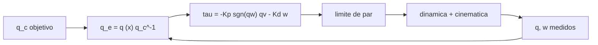

# B87-C17 — Control de tres ejes

<!-- nav:top -->
[🏠 Programa](../../../../README.md) · [📚 Bloque B87](../../../tronco-comun/B87-sensores-y-control-de-actitud.md) · [← Anterior: B87-C16 — Detumbling después del despliegue](../B87-C16-detumbling-despues-del-despliegue/CLASE.md) · [Siguiente: B87-C18 — Estabilidad ante perturbaciones →](../B87-C18-estabilidad-ante-perturbaciones/CLASE.md)
<!-- /nav -->

## 1. Ubicación, nivel y alcance

Clase 17 del bloque B87. Nivel N3. El control de actitud de tres ejes lleva al satélite desde una orientación hasta otra con un par proporcional al error de cuaternión y a la velocidad angular: `τ = −K_p sgn(q_{e,w}) q_{e,v} − K_d ω`. Aquí simulas con RK4 una maniobra de `60°` alrededor de `(1; 2; 3)/√14` con `ω_n = 0,2 rad/s` y `ζ = 0,8`, con y sin límite de par, y verificas con una función de Lyapunov. Todo es sintético.

## 2. Por qué esta clase existe

Es el lazo central del subsistema de actitud. La decisión central: **¿cómo se eligen las ganancias para un tiempo de asentamiento dado, cómo se evita el camino largo (el cuaternión doble) y qué pasa cuando el par se satura?**

## 3. Lo que podrás hacer al terminar

1. Calcular el error de cuaternión `q_e = q ⊗ q_c⁻¹` y elegir el signo de `q_{e,w}`.
2. Fijar `K_p = 2 I_m ω_n²` y `K_d = 2 ζ ω_n I` por eje.
3. Simular la maniobra y medir el tiempo de asentamiento al 2 %.
4. Verificar `V̇ ≤ 0` con `V = ½ ωᵀIω + 2 K_p (1 − |q_{e,w}|)`.
5. Comparar con y sin límite de par.
6. Separar lo sintético de lo consultado y de lo no consultado.

La evidencia es la **maniobra de 60° con su tiempo de asentamiento, con y sin límite de par** del ejercicio 12 (sección 20).

## 4. Con qué llegas y cómo comprobarlo

1. ¿Qué es el error de cuaternión?
2. ¿Qué es un sistema de segundo orden con `ω_n` y `ζ`?
3. ¿Qué es una función de Lyapunov?
4. ¿Por qué hay doble cobertura?
5. ¿Qué es la saturación de actuador?

<details>
<summary>Ver respuestas</summary>

1. La rotación que falta para llegar al objetivo: `q_e = q ⊗ q_c⁻¹`. 2. `θ̈ + 2ζω_n θ̇ + ω_n² θ = 0`. 3. Una función positiva cuya derivada es negativa a lo largo de las trayectorias. 4. `q` y `−q` son la misma actitud (C02). 5. El límite máximo de par que se puede aplicar.
</details>

Con cuatro o cinco aciertos, sigue; si no, repasa los prerrequisitos.

## 5. Un caso de contexto y casos de referencia

Con `ω_n = 0,2 rad/s` y `ζ = 0,8`, la teoría lineal da un asentamiento de `25,0 s`; la simulación sin límite de par asienta al 2 % en `25,5 s` con un par máximo de `11,22 mN·m`; con límite de `4 mN·m` asienta en `26,8 s` (saturado el `2,9 %`). Todo es **sintético**.

## 6. Vocabulario

El **error de cuaternión** es `q_e = q ⊗ q_c⁻¹`. La **ley PD en cuaterniones** (Wie) es `τ = −K_p sgn(q_{e,w}) q_{e,v} − K_d ω`. El **ancho de banda** `ω_n` y el **amortiguamiento** `ζ` fijan las ganancias. La **función de Lyapunov** es `V = ½ ωᵀIω + 2K_p(1 − |q_{e,w}|)`. El **eje de Euler** de la maniobra es `(1; 2; 3)/√14`. La **saturación** limita `|τ_i| ≤ τ_max`.

## 7. Modelo mental: un resorte y un amortiguador en cuaterniones



*Descripción textual:* el error de cuaternión actúa como un resorte hacia la actitud objetivo y la velocidad como amortiguador; el par se limita y alimenta la dinámica.

Analogía: un péndulo con resorte y amortiguador: al soltarlo oscila y se asienta; con más amortiguamiento no oscila y con más rigidez es más rápido. Límite: la rigidez efectiva es `K_p/2` porque `q_{e,v} ≈ θ/2` para ángulos pequeños.

## 8. La explicación, paso a paso

### 8.1 La ley y su linealización

Para ángulos pequeños, `q_{e,v} ≈ θ/2` y la ley da `I θ̈ = −(K_p/2) θ − K_d θ̇`, es decir `ω_n² = K_p/(2 I)`. Por eso `K_p = 2 I_m ω_n² = 0,0280 N·m` (con `I_m = 0,35`) y `K_d = 2 ζ ω_n I` por eje. Se toma `sgn(q_{e,w}) = +1` si `q_{e,w} ≥ 0` y `−1` si no, para ir por el camino corto.

### 8.2 Estabilidad

`V = ½ ωᵀIω + 2K_p(1 − |q_{e,w}|)` cumple `V̇ = −ωᵀK_d ω ≤ 0`. El laboratorio comprueba que `V` no crece (con `K_p` escalar, `K_d` diagonal): `V monótona = True`. Con límite de par esta prueba ya no vale y no se evalúa.

### 8.3 Resultados

| Caso | Asentamiento 2 % (s) | Par máx. (mN·m) | Saturado (%) | Error final (°) |
|---|---|---|---|---|
| sin límite | 25,5 | 11,22 | 0,0 | 1,9e-09 |
| límite 4 mN·m | 26,8 | 4,00 | 2,9 | 2,1e-09 |

La teoría lineal (`4/(ζ ω_n) = 25,0 s`) es una cota ligeramente optimista; el límite de par alarga el asentamiento en `1,3 s`.

### 8.4 Qué no incluye

Actuadores ideales (par directo sobre el cuerpo), sin ruedas ni magnetopares reales, sin retardo ni ruido de sensor, sin perturbaciones y con el estado exacto; la maniobra de `60°` queda dentro del rango en que el caso lineal es buena guía. Los efectos de ruido y retardo se verán en C15 y C19.

## 9. Magnitudes, símbolos y unidades

| Símbolo | Qué es | Unidad | Valor / nota |
|---|---|---|---|
| `q_e` | error de cuaternión | — | norma 1 |
| `K_p` | rigidez | N·m | 0,0280 |
| `K_d` | amortiguamiento (por eje) | N·m·s | 2ζω_n I |
| `ω_n`, `ζ` | ancho de banda y amortiguamiento | rad/s, — | 0,2; 0,8 |
| `V` | función de Lyapunov | J | no creciente |

## 10. Convenciones y referencias

`I = diag(0,35; 0,40; 0,30) kg·m²`, par aplicado directamente sobre el cuerpo (actuador ideal); RK4 con `dt = 0,01 s`; 150 s; maniobra desde la actitud identidad al objetivo de `60°` alrededor de `(1; 2; 3)/√14`. Tolerancias: error final `< 10⁻³°`, `V` monótona (caso sin límite), par `≤ 4 mN·m` con el límite. Cuaternión `q = [qx, qy, qz, qw]` con la parte escalar al final, `v_B = A(q) v_I`, producto tal que `A(q⊗p) = A(q) A(p)`, cinemática `q̇ = ½ [ω; 0] ⊗ q` con `ω` del cuerpo respecto del sistema inercial expresada en el cuerpo (la biblioteca [adcs_comun.py](../adcs_comun.py) del bloque lo comprueba). Sistema inercial `I` de **ejemplo** (ejes sin relación con J2000), órbita circular de dos cuerpos con radio terrestre `6 378 137 m` y `μ = 3,986004418 × 10¹⁴ m³/s²` como valores adoptados de ejemplo. Satélite **sintético** `I = diag(0,35; 0,40; 0,30) kg·m²` salvo que la clase diga otra cosa. Todo dato es sintético con semilla fija.

## 11. De dónde sale lo que afirmamos

| ID | Fuente | Localizador | Respalda | Estado |
|---|---|---|---|---|
| S2 | B. Graf, «Quaternions and dynamics», arXiv:0811.2889 — https://arxiv.org/abs/0811.2889 (consultada 2026-11-10) | solo la página de resumen | introducción autocontenida a los cuaterniones en dinámica, con la dinámica del cuerpo rígido y, en un apéndice, un satélite con ruedas inerciales; sostiene que los cuaterniones, a diferencia de los ángulos de Euler, permiten escribir a mano dinámicas complejas | Consultada (solo el resumen) |
| — | Relaciones estándar de dinámica de actitud, estimación y control usadas en esta clase (ecuaciones de Euler, cinemática de cuaterniones, problema de Wahba, filtro de Kalman multiplicativo, estabilidad de Lyapunov, modelos de sensores y actuadores) | — | las verifica el laboratorio con una segunda vía (conservación, comparación entre métodos, propagación independiente o Monte Carlo) | No consultada en una fuente concreta |
| — | Libros de texto de actitud y control (p. ej. Wertz, Markley–Crassidis, Sidi) y hojas de datos de fabricantes | — | — | No consultada |
| — | Wie, Weiss y Arapostathis (1989) y otros artículos sobre control de cuaterniones por realimentación | — | — | No consultada |

Límites: Graf (S2) respalda, desde su resumen, que los cuaterniones permiten escribir dinámicas complejas a mano; la ley PD en cuaterniones y la función de Lyapunov no se consultaron en una fuente concreta y se validan por la monotonía de `V` y la convergencia.

## 12. Cómo ver la maniobra

| Magnitud | Valor |
|---|---|
| asentamiento (teoría lineal) | 25,0 s |
| asentamiento sin límite / con límite | 25,5 / 26,8 s |
| par máximo sin límite | 11,22 mN·m |
| saturación con límite | 2,9 % |

Descripción larga: la maniobra asienta en unos 25 s; el límite de par de 4 mN·m la retrasa poco porque satura menos del 3 % del tiempo.

## 13. Ejemplo trabajado: maniobra de 60° con ganancias por `ω_n`

**Paso 1 · Ganancias.** `K_p = 2·0,35·0,04 = 0,0280`; `K_d,x = 2·0,8·0,2·0,35 = 0,1120`.

**Paso 2 · Error.** `q_e = q ⊗ q_c⁻¹`; ángulo inicial `60°`.

**Paso 3 · Simulación.** Asentamiento al 2 % en `25,5 s`.

**Paso 4 · Par.** Máximo `11,22 mN·m` (al inicio).

**Paso 5 · Comprobación.** `V` no crece; el error final es `1,9e-09°`.

## 14. Distintas formas de describir la ley de control de actitud

**PD en cuaterniones** (esta clase): simple y global (con el signo). **LQR linealizado:** ganancia óptima para ángulos pequeños (B16, no tratado aquí). **MPC:** con restricciones explícitas (C21). **Control por modos deslizantes:** robusto (no tratado).

## 15. Práctica guiada

**Ejercicio 1 · con los pasos indicados.** Calcula `K_p` para `ω_n = 0,1` e `I_m = 0,35`. *Pasos:* `2 I_m ω_n²`.

<details><summary>Solución comentada</summary>

`2·0,35·0,01 = 0,0070 N·m`.
</details>

**Ejercicio 2 · con una pista.** ¿Qué `K_d` da `ζ = 1` con `ω_n = 0,2` e `I = 0,40`?

<details><summary>Solución comentada</summary>

`2·1·0,2·0,40 = 0,16 N·m·s`.
</details>

**Ejercicio 3 · casi autónomo.** ¿Cuál es el tiempo de asentamiento lineal para `ζ = 0,8`, `ω_n = 0,4`?

<details><summary>Solución comentada</summary>

`4/(0,8·0,4) = 12,5 s`.
</details>

## 16. Práctica autónoma, transferencia e integrador

**Ejercicio 4 · autónomo.** ¿Por qué se usa `sgn(q_{e,w})`?

<details><summary>Solución comentada</summary>

Para tomar el camino corto: si `q_{e,w} < 0`, `−q_e` es la misma rotación pero con ángulo `< 180°`.
</details>

**Ejercicio 5 · autónomo.** Si el par máximo es `4 mN·m` y la maniobra pide `11 mN·m` al inicio, ¿cuántas veces se satura?

<details><summary>Solución comentada</summary>

Se limita al inicio; en el laboratorio solo el `2,9 %` de los pasos.
</details>

**Ejercicio 6 · autónomo.** ¿Qué pasa con `V` si `K_d = 0`?

<details><summary>Solución comentada</summary>

`V̇ = 0`: la maniobra no amortigua y el satélite oscila indefinidamente.
</details>

**Ejercicio 7 · autónomo.** ¿Cuánto vale el par inicial para un error de `60°` con `K_p = 0,028`?

<details><summary>Solución comentada</summary>

`q_{e,v} = sin 30° = 0,5` en el eje; `|τ| = 0,028·0,5 = 14 mN·m` en módulo, repartido en los tres ejes.
</details>

**Ejercicio 8 · autónomo.** ¿Qué ocurre con `ω_n` si la inercia sube un 20 %?

<details><summary>Solución comentada</summary>

`ω_n = √(K_p/2I)` baja un `8,7 %`; el asentamiento se alarga (C19).
</details>

**Ejercicio 9 · transferencia.** **Transferencia.** **Transferencia.** Un colega usa `25,5 s` como el tiempo de maniobra de una misión. ¿Es válido?

<details><summary>Solución comentada</summary>

No: es de un satélite sintético con actuadores ideales y sin perturbaciones ni ruido.
</details>

**Ejercicio 10 · transferencia.** **Transferencia.** **Transferencia.** ¿Por qué un PD simple no elimina el error con un par perturbador constante?

<details><summary>Solución comentada</summary>

Porque deja un error permanente `τ_d/(K_p/2)`; se añade acción integral o alimentación directa (C18).
</details>

**Ejercicio 11 · transferencia.** **Transferencia.** **Transferencia.** ¿Qué cambia si el par lo dan ruedas con momento limitado?

<details><summary>Solución comentada</summary>

Hay que vigilar el momento acumulado y su saturación (C11, C14).
</details>

**Ejercicio 12 · integrador.** **Integrador.** **Integrador.** Elabora tu *maniobra de 60°*: ganancias, tabla de 8.3, comprobación de `V` y lista de consultado y sintético.

<details><summary>Solución comentada</summary>

Secciones 8.1–8.4, 12 y la salida del laboratorio.
</details>

## 17. Laboratorio: maniobra de tres ejes con PD en cuaterniones

El script [control_tres_ejes.py](control_tres_ejes.py) simula una maniobra de `60°` con RK4, ganancias `K_p = 2 I_m ω_n²` y `K_d = 2ζω_n I`, con y sin límite de par de `4 mN·m`, y mide el asentamiento al 2 %, el par máximo, la saturación y la monotonía de `V` (**comprueba** error final `< 10⁻³°`, `V` no creciente y par limitado). Usa la biblioteca común [adcs_comun.py](../adcs_comun.py) del bloque.

**Datos:** satélite y maniobra **sintéticos**; sin ruido ni perturbaciones. **Predice antes de ejecutar:** ¿Alargará mucho el límite de par el asentamiento? (poco: satura menos del 3 %.) **Ejecución del 2026-11-10 (Python 3.12.9, numpy 2.4.4):**

```text
Python 3.12.9 | numpy 2.4.4
B87-C17 control de tres ejes | SINTETICO: maniobra de 60 deg, wn = 0.2 rad/s, zeta = 0.8, I = diag(0.35, 0.40, 0.30) kg m^2
sin limite de par: asentamiento al 2 % = 25.5 s ; par maximo = 11.22 mN m ; saturado 0.0 % ; error final = 1.89e-09 deg ; V monotona = True
limite 0.004 N m por eje: asentamiento al 2 % = 26.8 s ; par maximo = 4.00 mN m ; saturado 2.9 % ; error final = 2.09e-09 deg ; V monotona = no evaluada
teoria lineal (4/(zeta wn)) = 25.0 s
Pruebas superadas.
```

```bash
python programa/clases/B87/B87-C17-control-de-tres-ejes/control_tres_ejes.py
```

**Límites:** actuador ideal, sin ruido ni retardo, sin perturbaciones, estado exacto; el límite de par es por eje.

## 18. Errores frecuentes y cómo corregirlos

**Usar `K_p = I ω_n²` sin el factor 2.** Linealiza: `q_{e,v} ≈ θ/2` (8.1)

**Ignorar el signo de `q_{e,w}`.** Usa `sgn(q_{e,w})` (8.1)

**Creer que el límite de par no afecta.** Compara con y sin límite (8.3)

## 19. Cómo sabrás que vas bien

Tras la sección 8: ¿qué asentamiento esperabas? Si dudas, repasa el ejemplo 13. Tras el laboratorio: ¿qué comprueba? (ver sección 17).

## 20. Qué entregas y cómo se evalúa

El producto es tu **maniobra de 60° con su tiempo de asentamiento, con y sin límite de par** (ejercicio 12).

| Criterio | Inicial | En desarrollo | Logrado | Destacado |
|---|---|---|---|---|
| Conceptos | Los confunde | Parciales | Explica el método y su dominio | Explica los límites y las alternativas |
| Cálculo | Sin unidades | Con errores | Resultados con unidades y comprobados | Resuelve casos nuevos |
| Numérico | Sin comprobar | Un caso | Verifica con una segunda vía en varios casos | Interpreta las diferencias y los fallos |
| Fuentes | Sin fuente | Sin fecha | Fuentes con fecha y estado | Declara lo sintético y lo no consultado |
| Límites | No los nombra | Uno | Tres | Discute qué falta del modelo |

**Condiciones críticas (no se compensan con promedio):** rotular los datos como sintéticos; verificar cada resultado con una segunda vía; citar solo lo consultado.

## 21. Ética, seguridad y límites

Clase educativa: los modelos son simplificados y los datos son sintéticos; ningún resultado describe una misión real ni sustituye el diseño y la verificación de un subsistema de actitud con herramientas validadas, ensayos y revisión de especialistas.  Accesibilidad: tablas equivalentes a las gráficas, fórmulas en texto, ejercicios sin conexión.

## 22. Para cerrar y seguir

Con `ω_n = 0,2 rad/s` y `ζ = 0,8`, la maniobra de `60°` asienta en `25 s` (teoría `25 s`) y `V` decrece de forma monótona. Queda una pregunta: ¿qué perturbaciones actúan sobre el satélite y qué error dejan?

**Glosario español–inglés.** control PD · *PD control*; error de cuaternión · *quaternion error*; ancho de banda · *bandwidth*; amortiguamiento · *damping ratio*; función de Lyapunov · *Lyapunov function*; saturación · *saturation*.

**Continuidad.** [B87-C18](../B87-C18-estabilidad-ante-perturbaciones/CLASE.md) trata las perturbaciones y el error en régimen permanente.

**Referencias:** ver sección 11.

<!-- nav:bottom -->
---

[← Anterior: B87-C16 — Detumbling después del despliegue](../B87-C16-detumbling-despues-del-despliegue/CLASE.md) · [📚 Bloque B87](../../../tronco-comun/B87-sensores-y-control-de-actitud.md) · [Siguiente: B87-C18 — Estabilidad ante perturbaciones →](../B87-C18-estabilidad-ante-perturbaciones/CLASE.md)
<!-- /nav -->
