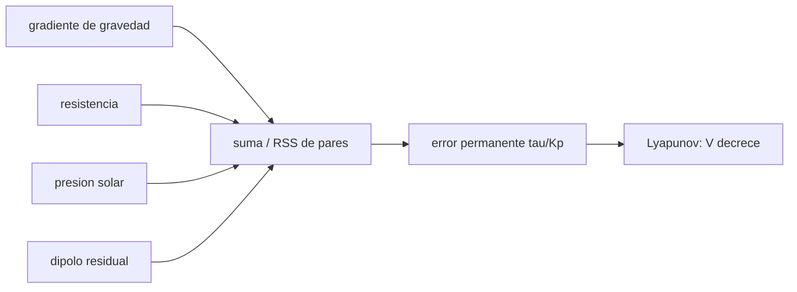

# B87-C18 — Estabilidad ante perturbaciones

<!-- nav:top -->
[🏠 Programa](../../../../README.md) · [📚 Bloque B87](../../../tronco-comun/B87-sensores-y-control-de-actitud.md) · [← Anterior: B87-C17 — Control de tres ejes](../B87-C17-control-de-tres-ejes/CLASE.md) · [Siguiente: B87-C19 — Verificación de ley de control →](../B87-C19-verificacion-de-ley-de-control/CLASE.md)
<!-- /nav -->

## 1. Ubicación, nivel y alcance

Clase 18 del bloque B87. Nivel N3. Cuatro perturbaciones dominan en órbita baja: el gradiente de gravedad, la resistencia atmosférica, la presión de radiación solar y el dipolo magnético residual. Esta clase las estima para un microsatélite sintético a `500 km`, calcula el error en régimen permanente de un lazo PD y comprueba una función de Lyapunov. Los coeficientes (densidad, presión solar, `C_d`, área, brazos, dipolo residual) son valores adoptados de ejemplo, no consultados.

## 2. Por qué esta clase existe

El presupuesto de par decide el tamaño de las ruedas y de los magnetopares. La decisión central: **¿qué perturbación domina, qué error permanente deja en el lazo y se mantiene la estabilidad?** En el ejemplo domina el dipolo residual, algo que la intuición («gradiente de gravedad») no anticipa.

## 3. Lo que podrás hacer al terminar

1. Estimar el par máximo de gradiente de gravedad `(3μ/2r³)|I_max − I_min|`.
2. Estimar el par aerodinámico y el de presión solar con brazo `cp−cg`.
3. Estimar el par del dipolo residual `m_res B`.
4. Calcular el error permanente `τ/K_p` de un lazo PD y verificarlo por simulación.
5. Verificar la no-creciencia de una función de Lyapunov con perturbación constante.
6. Separar lo sintético de lo consultado y de lo no consultado.

La evidencia es la **tabla de pares perturbadores y error permanente del lazo** del ejercicio 12 (sección 20).

## 4. Con qué llegas y cómo comprobarlo

1. ¿Qué es el gradiente de gravedad?
2. ¿Qué es el brazo `cp−cg`?
3. ¿Qué es un dipolo residual?
4. ¿Qué es el error en régimen permanente?
5. ¿Qué es la presión de radiación solar?

<details>
<summary>Ver respuestas</summary>

1. La variación de la gravedad con la distancia, que genera un par sobre un cuerpo no esférico. 2. La distancia entre el centro de presión y el de masa. 3. Un momento magnético no deseado de los equipos del satélite. 4. El error que queda con una perturbación constante: `τ/K_p`. 5. La fuerza por unidad de área de la luz solar, `≈ 4,56×10⁻⁶ N/m²` (valor de ejemplo adoptado).
</details>

Con cuatro o cinco aciertos, sigue; si no, repasa los prerrequisitos.

## 5. Un caso de contexto y casos de referencia

A `500 km`, con `I = diag(0,35; 0,40; 0,30)`: gradiente de gravedad `184 nN·m`, resistencia `19,1 nN·m`, presión solar `4,10 nN·m` y dipolo residual `498 nN·m`. Suma `705 nN·m`; con `ω_n = 0,2 rad/s`, el error permanente es `12,11″`. Todo es **sintético**.

## 6. Vocabulario

El **gradiente de gravedad** da `τ_gg = (3μ/2r³)|I_max − I_min| sin 2θ`. La **resistencia** da `τ_a = ½ ρ v² C_d A (cp−cg)`. La **presión solar** da `τ_s = P A (1+ρ_r)(cp−cg)`. El **dipolo residual** da `τ_m = m_res B`. El **error permanente** es `τ/K_p`. La **función de Lyapunov** `V` incluye el desplazamiento del equilibrio.

## 7. Modelo mental: un presupuesto de pares



*Descripción textual:* las cuatro perturbaciones se suman (o se combinan en RSS) para dar un par; el lazo PD lo convierte en un error permanente y la función de Lyapunov desplazada confirma la estabilidad.

Analogía: como viento lateral sobre una veleta con resorte: el viento total desplaza el equilibrio un ángulo `τ/K`; la veleta no oscila porque hay amortiguamiento. Límite: el modelo es constante, pero cada par real varía con la actitud, la órbita y la actividad solar.

## 8. La explicación, paso a paso

### 8.1 Pares perturbadores

Con `a = 6 878 137 m`, `μ = 3,986×10¹⁴`, `v = 7613 m/s`:

| Perturbación | Fórmula | Par (nN·m) |
|---|---|---|
| gradiente de gravedad (máx.) | `(3μ/2a³)(I_max − I_min)` | 183,7 |
| resistencia | `½ρv²C_dA·0,01 m` (`ρ = 5×10⁻¹³`) | 19,1 |
| presión solar | `P A (1+0,5)·0,01 m` | 4,10 |
| dipolo residual | `0,01 A·m² × B_polar` | 497,6 |

La suma en el peor caso es `705 nN·m` y la raíz de la suma de cuadrados `531 nN·m`.

### 8.2 Error permanente

Un par constante `τ_d` en un lazo PD con `K_p = I ω_n² = 0,0120 N·m/rad` (`ω_n = 0,2`, `I = 0,30`) deja `θ_ss = τ_d/K_p`. Con la suma de `705 nN·m`: `12,11″` (teoría) frente a `12,11″` (simulado).

### 8.3 Lyapunov con perturbación

Con `V = ½ I ω² + ½ K_p (θ − θ_ss)²`, `V̇ = −K_d ω² ≤ 0`: `V` no crece. El laboratorio mide un incremento máximo por paso de `1,5e-38` (cero salvo redondeo) y `V₀ = 2,07e-11`.

### 8.4 Qué manda

El dipolo residual domina con estos valores de ejemplo (`m_res = 0,01 A·m²`); si el dipolo fuera diez veces menor, el gradiente de gravedad mandaría. Quedan fuera la variación con la actitud (`sin 2θ`), el ciclo solar, el eclipse y el movimiento del propergol; los valores adoptados no se consultaron y el presupuesto es de orden de magnitud.

## 9. Magnitudes, símbolos y unidades

| Símbolo | Qué es | Unidad | Valor / nota |
|---|---|---|---|
| `τ_gg` | gradiente de gravedad | N·m | 184 nN·m |
| `τ_a` | resistencia | N·m | 19,1 nN·m |
| `τ_s` | presión solar | N·m | 4,10 nN·m |
| `τ_m` | dipolo residual | N·m | 498 nN·m |
| `θ_ss` | error permanente | rad (″) | 12,11″ |

## 10. Convenciones y referencias

Altitud `500 km`, `I = diag(0,35; 0,40; 0,30) kg·m²`. Valores **adoptados de ejemplo (no consultados)**: `ρ = 5×10⁻¹³ kg/m³`, `P = 4,56×10⁻⁶ N/m²`, `C_d = 2,2`, `A = 0,06 m²`, brazo `0,01 m`, reflectividad `0,5`, `m_res = 0,01 A·m²`. Tolerancias: `θ_ss` simulado dentro del 1 % de `τ/K_p`; `V` no crece. Cuaternión `q = [qx, qy, qz, qw]` con la parte escalar al final, `v_B = A(q) v_I`, producto tal que `A(q⊗p) = A(q) A(p)`, cinemática `q̇ = ½ [ω; 0] ⊗ q` con `ω` del cuerpo respecto del sistema inercial expresada en el cuerpo (la biblioteca [adcs_comun.py](../adcs_comun.py) del bloque lo comprueba). Sistema inercial `I` de **ejemplo** (ejes sin relación con J2000), órbita circular de dos cuerpos con radio terrestre `6 378 137 m` y `μ = 3,986004418 × 10¹⁴ m³/s²` como valores adoptados de ejemplo. Satélite **sintético** `I = diag(0,35; 0,40; 0,30) kg·m²` salvo que la clase diga otra cosa. Todo dato es sintético con semilla fija.

## 11. De dónde sale lo que afirmamos

| ID | Fuente | Localizador | Respalda | Estado |
|---|---|---|---|---|
| — | Relaciones estándar de dinámica de actitud, estimación y control usadas en esta clase (ecuaciones de Euler, cinemática de cuaterniones, problema de Wahba, filtro de Kalman multiplicativo, estabilidad de Lyapunov, modelos de sensores y actuadores) | — | las verifica el laboratorio con una segunda vía (conservación, comparación entre métodos, propagación independiente o Monte Carlo) | No consultada en una fuente concreta |
| — | Libros de texto de actitud y control (p. ej. Wertz, Markley–Crassidis, Sidi) y hojas de datos de fabricantes | — | — | No consultada |
| — | Modelos de densidad atmosférica (NRLMSISE, JB2008) y de presión solar de referencia; datos reales de dipolos residuales | — | — | No consultada |

Límites: Esta clase no tiene fuente consultada propia: los coeficientes son de ejemplo y las fórmulas de los pares son estándar, no consultadas; el laboratorio verifica el error permanente contra `τ/K_p` y la monotonía de `V`.

## 12. Cómo ver el presupuesto de par

| Magnitud | Valor |
|---|---|
| par máximo por perturbación | 498 (dipolo) > 184 (gradiente) > 19,1 (resistencia) > 4,10 nN·m (solar) |
| suma / RSS | 705 / 531 nN·m |
| error permanente (sim / teoría) | 12,11 / 12,11″ |

Descripción larga: el dipolo residual y el gradiente de gravedad dominan; la presión solar es dos órdenes menor.

## 13. Ejemplo trabajado: par total y error permanente

**Paso 1 · Gradiente.** `1,5·μ/a³·0,10 = 183,7 nN·m`.

**Paso 2 · Dipolo.** `0,01·49,8 µT = 498 nN·m`.

**Paso 3 · Suma.** `705 nN·m`.

**Paso 4 · Error.** `θ_ss = 7,045e-07/0,0120 = 12,11″`.

**Paso 5 · Lyapunov.** `V̇ ≤ 0` (máx. incremento `2e-38`).

## 14. Distintas formas de describir la estabilidad con perturbaciones

**Error permanente de un PD** (esta clase). **Acción integral:** elimina el error con perturbación constante. **Alimentación directa:** resta el par estimado. **Análisis de Lyapunov:** prueba la estabilidad con la perturbación como desplazamiento del equilibrio.

## 15. Práctica guiada

**Ejercicio 1 · con los pasos indicados.** Calcula el par de gradiente de gravedad con `I_max − I_min = 0,05 kg·m²` a `500 km`. *Pasos:* `1,5 μ/a³ ΔI`.

<details><summary>Solución comentada</summary>

`μ/a³ = 1,225e-06`; `τ = 91,9 nN·m`.
</details>

**Ejercicio 2 · con una pista.** ¿Cómo escala el par aerodinámico si la densidad se duplica?

<details><summary>Solución comentada</summary>

Se duplica (`τ ∝ ρ`): de `19,1` a `38,2 nN·m`.
</details>

**Ejercicio 3 · casi autónomo.** Con `K_p = 0,012` y `τ = 700 nN·m`, ¿qué error permanente da?

<details><summary>Solución comentada</summary>

`7×10⁻⁷/0,012 = 5,83×10⁻⁵ rad = 12,0″`.
</details>

## 16. Práctica autónoma, transferencia e integrador

**Ejercicio 4 · autónomo.** ¿Qué `ω_n` hace falta para reducirlo a `1″`?

<details><summary>Solución comentada</summary>

`K_p = τ/θ = 7×10⁻⁷/4,85×10⁻⁶ = 0,144 N·m/rad`; `ω_n = √(K_p/I) = 0,69 rad/s`.
</details>

**Ejercicio 5 · autónomo.** ¿Por qué `V = ½Iω² + ½K_p(θ−θ_ss)²` y no sin `θ_ss`?

<details><summary>Solución comentada</summary>

Porque con perturbación constante el equilibrio es `θ_ss`, no cero; con `θ_ss` en `V`, `V̇ = −K_dω²`.
</details>

**Ejercicio 6 · autónomo.** ¿Qué pasa con el gradiente de gravedad si el eje de mayor inercia apunta al nadir?

<details><summary>Solución comentada</summary>

`sin 2θ = 0`: es un equilibrio y el par es nulo; es la base del control pasivo por gradiente de gravedad.
</details>

**Ejercicio 7 · autónomo.** ¿Qué perturbación crece con la actividad solar?

<details><summary>Solución comentada</summary>

La resistencia, por la densidad (`ρ` sube); la presión solar casi no cambia.
</details>

**Ejercicio 8 · autónomo.** Con la RSS en lugar de la suma, ¿cuánto baja el par?

<details><summary>Solución comentada</summary>

De `705` a `531 nN·m` (un `25 %`).
</details>

**Ejercicio 9 · transferencia.** **Transferencia.** **Transferencia.** Un colega usa estos `nN·m` para dimensionar una misión. ¿Es válido?

<details><summary>Solución comentada</summary>

No: coeficientes de ejemplo, no consultados; un presupuesto real usa el diseño, la órbita y modelos validados.
</details>

**Ejercicio 10 · transferencia.** **Transferencia.** **Transferencia.** ¿Cómo reducirías el dipolo residual?

<details><summary>Solución comentada</summary>

Con diseño de cableado (pares trenzados), materiales no magnéticos y compensación magnética en tierra.
</details>

**Ejercicio 11 · transferencia.** **Transferencia.** **Transferencia.** ¿Qué diferencia hay entre par secular y cíclico para las ruedas?

<details><summary>Solución comentada</summary>

El cíclico oscila (promedio cero) y llena solo `τ_c/n`; el secular acumula y satura (C14).
</details>

**Ejercicio 12 · integrador.** **Integrador.** **Integrador.** Elabora tu *tabla de pares perturbadores y error permanente*: tabla de 8.1, suma y RSS, error permanente, `V` y lista de consultado y sintético.

<details><summary>Solución comentada</summary>

Secciones 8.1–8.4, 12 y la salida del laboratorio.
</details>

## 17. Laboratorio: presupuesto de pares y error permanente

El script [perturbaciones.py](perturbaciones.py) calcula los pares de gradiente de gravedad, resistencia, presión solar y dipolo residual con valores de ejemplo, su suma y RSS, simula un lazo PD de un eje con el par total constante durante 200 s y compara el error final con `τ/K_p`, además de la monotonía de `V` (**comprueba** acuerdo `< 1 %`, `V̇ ≤ 0` y el orden de magnitud de los pares). Usa la biblioteca común [adcs_comun.py](../adcs_comun.py) del bloque.

**Datos:** satélite y coeficientes **sintéticos** (de ejemplo, no consultados). **Predice antes de ejecutar:** ¿Qué perturbación mandará? (el dipolo residual con estos valores de ejemplo.) **Ejecución del 2026-11-10 (Python 3.12.9, numpy 2.4.4):**

```text
Python 3.12.9 | numpy 2.4.4
B87-C18 perturbaciones y estabilidad | microsatelite SINTETICO a 500 km; coeficientes de ejemplo (no consultados)
gradiente de gravedad (max) = 183.7 nN m ; resistencia = 19.1 nN m ; presion solar = 4.10 nN m ; dipolo residual = 497.6 nN m
suma (peor caso) = 704.5 nN m ; raiz de la suma de cuadrados = 530.8 nN m
lazo PD wn = 0.2 rad/s: Kp = 0.0120 N m/rad ; error permanente simulado = 12.11 arcsec ; teorico tau/Kp = 12.11 arcsec
V = 1/2 I w^2 + 1/2 Kp (th - th_ss)^2: V0 = 2.068e-11 ; mayor incremento por paso = 1.52e-38 (<= ~0)
Pruebas superadas.
```

```bash
python programa/clases/B87/B87-C18-estabilidad-ante-perturbaciones/perturbaciones.py
```

**Límites:** valores constantes, un eje, sin variación con la actitud ni con el ciclo solar; los coeficientes de ejemplo no representan un satélite real.

## 18. Errores frecuentes y cómo corregirlos

**Suponer que el gradiente de gravedad siempre manda.** Calcula todos los pares (8.1)

**Olvidar el desplazamiento del equilibrio en `V`.** Incluye `θ_ss` (8.3)

**Tomar coeficientes de ejemplo como reales.** Declara su origen (sección 10)

## 19. Cómo sabrás que vas bien

Tras la sección 8: ¿qué perturbación esperabas mayor? Si dudas, repasa el ejemplo 13. Tras el laboratorio: ¿qué comprueba? (ver sección 17).

## 20. Qué entregas y cómo se evalúa

El producto es tu **tabla de pares perturbadores y error permanente del lazo** (ejercicio 12).

| Criterio | Inicial | En desarrollo | Logrado | Destacado |
|---|---|---|---|---|
| Conceptos | Los confunde | Parciales | Explica el método y su dominio | Explica los límites y las alternativas |
| Cálculo | Sin unidades | Con errores | Resultados con unidades y comprobados | Resuelve casos nuevos |
| Numérico | Sin comprobar | Un caso | Verifica con una segunda vía en varios casos | Interpreta las diferencias y los fallos |
| Fuentes | Sin fuente | Sin fecha | Fuentes con fecha y estado | Declara lo sintético y lo no consultado |
| Límites | No los nombra | Uno | Tres | Discute qué falta del modelo |

**Condiciones críticas (no se compensan con promedio):** rotular los datos como sintéticos; verificar cada resultado con una segunda vía; citar solo lo consultado.

## 21. Ética, seguridad y límites

Clase educativa: los modelos son simplificados y los datos son sintéticos; ningún resultado describe una misión real ni sustituye el diseño y la verificación de un subsistema de actitud con herramientas validadas, ensayos y revisión de especialistas.  Accesibilidad: tablas equivalentes a las gráficas, fórmulas en texto, ejercicios sin conexión.

## 22. Para cerrar y seguir

El presupuesto de ejemplo suma `705 nN·m`, domina el dipolo residual y deja un error permanente de `12,1″` con `ω_n = 0,2 rad/s`; `V` decrece. Queda una pregunta: ¿cómo se comprueba que la ley de control cumple sus requisitos?

**Glosario español–inglés.** gradiente de gravedad · *gravity gradient*; presión de radiación solar · *solar radiation pressure*; dipolo residual · *residual dipole*; error permanente · *steady-state error*; Lyapunov · *Lyapunov*; perturbación · *disturbance*.

**Continuidad.** [B87-C19](../B87-C19-verificacion-de-ley-de-control/CLASE.md) trata la verificación de la ley de control con márgenes y Monte Carlo.

**Referencias:** ver sección 11.

<!-- nav:bottom -->
---

[← Anterior: B87-C17 — Control de tres ejes](../B87-C17-control-de-tres-ejes/CLASE.md) · [📚 Bloque B87](../../../tronco-comun/B87-sensores-y-control-de-actitud.md) · [Siguiente: B87-C19 — Verificación de ley de control →](../B87-C19-verificacion-de-ley-de-control/CLASE.md)
<!-- /nav -->
