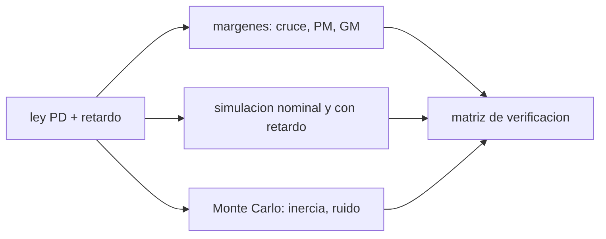

# B87-C19 — Verificación de ley de control

<!-- nav:top -->
[🏠 Programa](../../../../README.md) · [📚 Bloque B87](../../../tronco-comun/B87-sensores-y-control-de-actitud.md) · [← Anterior: B87-C18 — Estabilidad ante perturbaciones](../B87-C18-estabilidad-ante-perturbaciones/CLASE.md) · [Siguiente: B87-C20 — Simulación ADCS integral →](../B87-C20-simulacion-adcs-integral/CLASE.md)
<!-- /nav -->

## 1. Ubicación, nivel y alcance

Clase 19 del bloque B87. Nivel N3. Verificar una ley de control es demostrar, con evidencia, que cumple sus requisitos. Aquí verificas un lazo PD de un eje (`ω_n = 0,2 rad/s`, `ζ = 0,7`) por tres vías: los márgenes de ganancia y fase con un retardo, la simulación en el tiempo (nominal y con retardo excesivo) y un Monte Carlo con la inercia `±20 %` y ruido de medida de `20″`. Todo es sintético.

## 2. Por qué esta clase existe

Una ley que funciona en el caso nominal puede fallar con un retardo o con una inercia distinta. La decisión central: **¿cuánto retardo e incertidumbre tolera y con qué tasa de cumplimiento se cumple el requisito?** Los márgenes son lineales; el Monte Carlo es no lineal y estadístico: se complementan.

## 3. Lo que podrás hacer al terminar

1. Escribir la función de lazo `L(s) = (K_d s + K_p) e^{−sT_d}/(I s²)`.
2. Calcular la frecuencia de cruce, el margen de fase y el de ganancia numéricamente.
3. Relacionar el margen de fase con el retardo `≈ ω_c T_d`.
4. Simular un caso nominal y uno con retardo excesivo e identificar la inestabilidad.
5. Montar un Monte Carlo con inercia y ruido inciertos y calcular la tasa de cumplimiento.
6. Separar lo sintético de lo consultado y de lo no consultado.

La evidencia es la **matriz de verificación con márgenes y tasa de cumplimiento** del ejercicio 12 (sección 20).

## 4. Con qué llegas y cómo comprobarlo

1. ¿Qué es el margen de fase?
2. ¿Qué es el margen de ganancia?
3. ¿Qué hace un retardo en la fase?
4. ¿Qué es un Monte Carlo?
5. ¿Qué es un requisito verificable?

<details>
<summary>Ver respuestas</summary>

1. El ángulo que falta para `−180°` en la frecuencia de cruce de `|L| = 1`. 2. El factor por el que se puede subir la ganancia antes de la inestabilidad. 3. Resta `ω T_d` rad, sin cambiar la magnitud. 4. Muchas simulaciones con parámetros sorteados. 5. Uno con criterio medible y método de comprobación.
</details>

Con cuatro o cinco aciertos, sigue; si no, repasa los prerrequisitos.

## 5. Un caso de contexto y casos de referencia

El lazo nominal tiene cruce en `0,309 rad/s` con margen de fase `65,2°`. Con retardo de `1 s` el margen baja a `47,5°` (ganancia `14,4 dB`), con `5 s` es `-23,2°`: inestable. El Monte Carlo de 200 casos (retardo `0,2 s`, inercia `±20 %`, ruido `20″`) cumple el requisito (asentamiento `< 60 s`, sobreimpulso `< 20 %`) el `100,0 %` de las veces. Todo es **sintético**.

## 6. Vocabulario

La **función de lazo** `L(s)`. El **margen de fase** `PM = 180° + ∠L(jω_c)` y el **de ganancia** `GM = −20 log|L|` donde `∠L = −180°`. El **retardo** `T_d` añade `−ω T_d` a la fase. El **Monte Carlo** sortea parámetros. La **tasa de cumplimiento** es la fracción de casos que cumplen. La **matriz de verificación** vincula cada requisito con su método y evidencia.

## 7. Modelo mental: tres miradas a la misma ley



*Descripción textual:* el análisis lineal da márgenes; la simulación no lineal muestra el comportamiento temporal y el Monte Carlo cuantifica la robustez frente a la incertidumbre; los tres resultados llenan la matriz de verificación.

Analogía: probar un puente por cálculo (márgenes), con una maqueta (simulación) y con cientos de cargas aleatorias (Monte Carlo): cada prueba cubre lo que las otras no. Límite: ninguna prueba cubre lo no modelado (flexibilidad, fallas).

## 8. La explicación, paso a paso

### 8.1 Márgenes

Con `K_p = I ω_n²`, `K_d = 2ζω_n I` y retardo `T_d`, `L(jω)` se evalúa en una malla de `200 000` frecuencias. Resultados:

| Retardo (s) | Cruce (rad/s) | Margen de fase (°) | Margen de ganancia (dB) |
|---|---|---|---|
| 0,0 | 0,3085 | 65,2 | infinito |
| 0,5 | 0,3085 | 56,3 | 20,7 |
| 1,0 | 0,3085 | 47,5 | 14,4 |
| 2,0 | 0,3085 | 29,8 | 7,5 |
| 5,0 | 0,3085 | -23,2 | -6,0 |

El margen de fase baja `≈ ω_c T_d` (en grados: `0,3085·T_d·57,3 = 17,7°` por segundo de retardo); con `T_d = 5 s` es negativo: **inestable**.

### 8.2 Simulación temporal

Sin retardo, un giro de `10°` asienta al 2 % en `29,8 s` con sobreimpulso `4,6 %`. Con retardo de `5 s` el lazo es inestable (`estable = False`), de acuerdo con el margen negativo: la simulación confirma el análisis lineal.

### 8.3 Monte Carlo

200 casos con `I = 0,30·U(0,8; 1,2)`, retardo `0,2 s` y ruido de `20″`: asentamiento medio `28,5 s` (máx. `32,2 s`), sobreimpulso medio `4,8 %` (máx. `7,5 %`) y cumplimiento `100,0 %` del requisito de ejemplo (asentamiento `< 60 s`, sobreimpulso `< 20 %`).

### 8.4 Matriz de verificación

| Requisito | Método | Evidencia |
|---|---|---|
| margen de fase `> 45°` con retardo `≤ 1 s` | análisis | PM = 47,5° a 1 s |
| asentamiento `< 60 s` y sobreimpulso `< 20 %` | Monte Carlo | 100 % de 200 casos |
| estabilidad con retardo excesivo | simulación | inestable a 5 s (esperado) |

Un 100 % en un Monte Carlo no es una prueba: dice que, con las incertidumbres supuestas, no se encontró fallo en 200 casos.

## 9. Magnitudes, símbolos y unidades

| Símbolo | Qué es | Unidad | Valor / nota |
|---|---|---|---|
| `L(s)` | función de lazo | — | con retardo |
| `PM`, `GM` | márgenes de fase y ganancia | °, dB | ver tabla 8.1 |
| `T_d` | retardo | s | 0 a 5 |
| `I` | inercia (incierta) | kg·m² | 0,30 ± 20 % |
| `n` | casos del Monte Carlo | — | 200 |

## 10. Convenciones y referencias

`ω_n = 0,2 rad/s`, `ζ = 0,7`, `I = 0,30 kg·m²`; giro de `10°`; retardo modelado por un buffer de `T_d/dt` pasos con `dt = 0,01 s`; Monte Carlo con semilla 20260523. Requisito de ejemplo: asentamiento al 2 % `< 60 s` y sobreimpulso `< 20 %`. Tolerancias: PM nominal `> 60°`, PM(5 s) `< 0`, PM decreciente con el retardo, cumplimiento `≥ 90 %`. Cuaternión `q = [qx, qy, qz, qw]` con la parte escalar al final, `v_B = A(q) v_I`, producto tal que `A(q⊗p) = A(q) A(p)`, cinemática `q̇ = ½ [ω; 0] ⊗ q` con `ω` del cuerpo respecto del sistema inercial expresada en el cuerpo (la biblioteca [adcs_comun.py](../adcs_comun.py) del bloque lo comprueba). Sistema inercial `I` de **ejemplo** (ejes sin relación con J2000), órbita circular de dos cuerpos con radio terrestre `6 378 137 m` y `μ = 3,986004418 × 10¹⁴ m³/s²` como valores adoptados de ejemplo. Satélite **sintético** `I = diag(0,35; 0,40; 0,30) kg·m²` salvo que la clase diga otra cosa. Todo dato es sintético con semilla fija.

## 11. De dónde sale lo que afirmamos

| ID | Fuente | Localizador | Respalda | Estado |
|---|---|---|---|---|
| S3 | ECSS, ECSS-E-ST-60-30C «Satellite attitude and orbit control system (AOCS) requirements» — https://ecss.nl/standard/ecss-e-st-60-30c-satellite-attitude-and-orbit-control-system-aocs-requirements/ (consultada 2026-11-10 mediante resultados de búsqueda; el PDF no se abrió) | descripción del estándar | es un conjunto base de requisitos de AOCS (funcionales y de FDIR, operacionales, de desempeño, de verificación y documentales) limitado al nivel AOCS; el método de presupuesto de errores viene de ECSS-E-ST-60-10C y su guía de ECSS-E-HB-60-10A y del manual ESSB-HB-E-003; un requisito de apuntamiento completo especifica valor, sistema y eje, índice de error (APE, MPE, RPE), interpretación estadística, nivel de confianza y periodo de evaluación | Consultada (solo descripciones y resultados de búsqueda) |
| — | Relaciones estándar de dinámica de actitud, estimación y control usadas en esta clase (ecuaciones de Euler, cinemática de cuaterniones, problema de Wahba, filtro de Kalman multiplicativo, estabilidad de Lyapunov, modelos de sensores y actuadores) | — | las verifica el laboratorio con una segunda vía (conservación, comparación entre métodos, propagación independiente o Monte Carlo) | No consultada en una fuente concreta |
| — | Libros de texto de actitud y control (p. ej. Wertz, Markley–Crassidis, Sidi) y hojas de datos de fabricantes | — | — | No consultada |
| — | Tratados de control para los márgenes (por ejemplo, Franklin, Powell y Emami-Naeini) y la Guía de verificación del manual de ingeniería de sistemas de NASA | — | — | No consultada |

Límites: S3 se consultó solo como descripción y resultados de búsqueda: respalda que ECSS-E-ST-60-30C incluye requisitos de verificación del AOCS; no se abrió el texto. Los márgenes se calculan numéricamente y no se consultó una fuente concreta para las definiciones, que son estándar.

## 12. Cómo ver la verificación

| Magnitud | Valor |
|---|---|
| PM con retardo 0 / 1 / 5 s | 65,2 / 47,5 / -23,2° |
| estable con 5 s de retardo | False |
| cumplimiento Monte Carlo | 100,0 % |
| asentamiento medio / máx. | 28,5 / 32,2 s |

Descripción larga: el margen de fase pierde unos 17,7° por segundo de retardo y la ley cumple el requisito en todos los casos con retardo de 0,2 s.

## 13. Ejemplo trabajado: margen de fase con retardo de 1 s

**Paso 1 · Cruce.** `|L(jω_c)| = 1` en `ω_c = 0,3085 rad/s`.

**Paso 2 · Fase sin retardo.** `PM = 65,2°`.

**Paso 3 · Retardo.** Resta `ω_c T_d = 17,7°` por segundo.

**Paso 4 · Con 1 s.** `PM = 47,5°`, `GM = 14,4 dB`.

**Paso 5 · Comprobación.** Con 5 s el margen es `-23,2°` y la simulación diverge.

## 14. Distintas formas de describir la verificación

**Análisis:** márgenes y estabilidad (esta clase). **Simulación:** casos nominales y de falla. **Monte Carlo:** incertidumbres. **Ensayo:** hardware en el lazo (no tratado). Una matriz de verificación asigna a cada requisito un método y su evidencia.

## 15. Práctica guiada

**Ejercicio 1 · con los pasos indicados.** Calcula el retardo máximo para `PM ≥ 30°` si sin retardo `PM = 65,2°` y `ω_c = 0,3085`. *Pasos:* `ΔPM = ω_c T_d`.

<details><summary>Solución comentada</summary>

`ΔPM = 35,2° = 0,614 rad`; `T_d = 0,614/0,3085 = 1,99 s`.
</details>

**Ejercicio 2 · con una pista.** Si el margen de ganancia es `14,4 dB`, ¿por cuánto se puede multiplicar la ganancia?

<details><summary>Solución comentada</summary>

`10^{14,4/20} = 5,25`.
</details>

**Ejercicio 3 · casi autónomo.** ¿Por qué el margen de fase baja con el retardo y la magnitud no?

<details><summary>Solución comentada</summary>

`e^{−jωT_d}` tiene módulo 1 y fase `−ωT_d`.
</details>

## 16. Práctica autónoma, transferencia e integrador

**Ejercicio 4 · autónomo.** ¿Qué requisito de margen exigiría usted y por qué?

<details><summary>Solución comentada</summary>

Típicamente `PM > 45°` y `GM > 6 dB`; dan robustez a variaciones de inercia y retardo; los números se justifican con el análisis, no son de una norma consultada.
</details>

**Ejercicio 5 · autónomo.** El Monte Carlo cumple el `100 %`. ¿Es prueba de que siempre cumple?

<details><summary>Solución comentada</summary>

No: solo que con esas incertidumbres supuestas no hubo fallo en 200 casos; faltan fallas y modelos no considerados.
</details>

**Ejercicio 6 · autónomo.** ¿Cuántos casos hacen falta para afirmar un 99 % de cumplimiento con 95 % de confianza si no hay fallos?

<details><summary>Solución comentada</summary>

`n ≈ ln(0,05)/ln(0,99) ≈ 298` (regla de «cero fallos»).
</details>

**Ejercicio 7 · autónomo.** ¿Qué sucede con el margen si `I` baja un 20 %?

<details><summary>Solución comentada</summary>

`ω_n` sube `12 %` y el margen de fase con retardo baja; por eso se corre el Monte Carlo con `I ± 20 %`.
</details>

**Ejercicio 8 · autónomo.** ¿Qué pasa con el sobreimpulso al subir `ζ`?

<details><summary>Solución comentada</summary>

Baja; con `ζ = 1` desaparece, a costa de un asentamiento más lento.
</details>

**Ejercicio 9 · transferencia.** **Transferencia.** **Transferencia.** Un colega usa este Monte Carlo para certificar una ley de vuelo. ¿Es válido?

<details><summary>Solución comentada</summary>

No: el modelo es de un eje, sin flexibilidad, sin fallas y con distribuciones supuestas; la certificación exige un proceso de verificación formal (no consultado).
</details>

**Ejercicio 10 · transferencia.** **Transferencia.** **Transferencia.** ¿Cómo se verifica la ley ante un fallo de una rueda?

<details><summary>Solución comentada</summary>

Con casos de falla en simulación y en banco, además de los márgenes; este laboratorio no lo cubre.
</details>

**Ejercicio 11 · transferencia.** **Transferencia.** **Transferencia.** ¿Qué retardos reales existen en un lazo de actitud?

<details><summary>Solución comentada</summary>

El de muestreo, el de cálculo y el del actuador, sumando típicamente décimas de segundo; hay que medirlos y presupuestarlos.
</details>

**Ejercicio 12 · integrador.** **Integrador.** **Integrador.** Elabora tu *matriz de verificación*: requisitos, método, evidencia (márgenes, simulación, Monte Carlo), límites y lista de consultado y sintético.

<details><summary>Solución comentada</summary>

Secciones 8.1–8.4, 12 y la salida del laboratorio.
</details>

## 17. Laboratorio: márgenes, simulación y Monte Carlo

El script [verificacion.py](verificacion.py) calcula la función de lazo con retardo en una malla de `200 000` frecuencias y de ella el cruce, el margen de fase y el de ganancia; simula el lazo nominal y con retardo de `5 s`; y ejecuta 200 casos con inercia `±20 %`, retardo `0,2 s` y ruido, calculando asentamiento, sobreimpulso y tasa de cumplimiento (**comprueba** PM nominal `> 60°`, PM(5 s) `< 0`, monotonía, inestabilidad en la simulación y cumplimiento `≥ 90 %`). Usa la biblioteca común [adcs_comun.py](../adcs_comun.py) del bloque.

**Datos:** lazo, inercias y ruidos **sintéticos** (semilla 20260523). **Predice antes de ejecutar:** ¿Con cuántos segundos de retardo se vuelve inestable el lazo? (entre 2 y 5; el margen se anula a unos 3,7 s.) **Ejecución del 2026-11-10 (Python 3.12.9, numpy 2.4.4):**

```text
Python 3.12.9 | numpy 2.4.4
B87-C19 verificacion | SINTETICO: PD wn = 0.2, zeta = 0.7, I = 0.30 kg m^2 +-20 %, retardo y ruido; Monte Carlo semilla 20260523
retardo [s]  frecuencia de cruce [rad/s]  margen de fase [deg]  margen de ganancia [dB]
        0.0                       0.3085                  65.2                     inf
        0.5                       0.3085                  56.3                    20.7
        1.0                       0.3085                  47.5                    14.4
        2.0                       0.3085                  29.8                     7.5
        5.0                       0.3085                 -23.2                    -6.0
simulacion nominal (sin retardo): asentamiento = 29.8 s ; sobreimpulso = 4.6 % ; estable = True
simulacion con retardo de 5 s: estable = False ; sobreimpulso = diverge
Monte Carlo (200 casos, retardo 0.2 s, I +-20 %, ruido 20 arcsec): cumple 100.0 % ; asentamiento medio = 28.5 s (max 32.2) ; sobreimpulso medio = 4.8 % (max 7.5)
Pruebas superadas.
```

```bash
python programa/clases/B87/B87-C19-verificacion-de-ley-de-control/verificacion.py
```

**Límites:** un eje, sin flexibilidad ni fallas, distribuciones supuestas, un requisito de ejemplo; los márgenes numéricos suponen un solo cruce.

## 18. Errores frecuentes y cómo corregirlos

**Dar el Monte Carlo como prueba formal.** Declara hipótesis y límites (8.4)

**Verificar solo el caso nominal.** Añade retardo e inercia (8.3)

**Olvidar que el retardo cuesta fase.** Calcula `ω_c T_d` (8.1)

## 19. Cómo sabrás que vas bien

Tras la sección 8: ¿qué retardo esperabas tolerable? Si dudas, repasa el ejemplo 13. Tras el laboratorio: ¿qué comprueba? (ver sección 17).

## 20. Qué entregas y cómo se evalúa

El producto es tu **matriz de verificación con márgenes y tasa de cumplimiento** (ejercicio 12).

| Criterio | Inicial | En desarrollo | Logrado | Destacado |
|---|---|---|---|---|
| Conceptos | Los confunde | Parciales | Explica el método y su dominio | Explica los límites y las alternativas |
| Cálculo | Sin unidades | Con errores | Resultados con unidades y comprobados | Resuelve casos nuevos |
| Numérico | Sin comprobar | Un caso | Verifica con una segunda vía en varios casos | Interpreta las diferencias y los fallos |
| Fuentes | Sin fuente | Sin fecha | Fuentes con fecha y estado | Declara lo sintético y lo no consultado |
| Límites | No los nombra | Uno | Tres | Discute qué falta del modelo |

**Condiciones críticas (no se compensan con promedio):** rotular los datos como sintéticos; verificar cada resultado con una segunda vía; citar solo lo consultado.

## 21. Ética, seguridad y límites

Clase educativa: los modelos son simplificados y los datos son sintéticos; ningún resultado describe una misión real ni sustituye el diseño y la verificación de un subsistema de actitud con herramientas validadas, ensayos y revisión de especialistas.  Accesibilidad: tablas equivalentes a las gráficas, fórmulas en texto, ejercicios sin conexión.

## 22. Para cerrar y seguir

La ley PD tiene `PM = 65°` sin retardo y `47°` con 1 s; el Monte Carlo cumple el `100 %` de 200 casos. Queda una pregunta: ¿cómo se ve el lazo completo con sensores, filtro y actuadores juntos?

**Glosario español–inglés.** margen de fase · *phase margin*; margen de ganancia · *gain margin*; retardo · *delay*; Monte Carlo · *Monte Carlo*; tasa de cumplimiento · *compliance rate*; matriz de verificación · *verification matrix*.

**Continuidad.** [B87-C20](../B87-C20-simulacion-adcs-integral/CLASE.md) integra sensores, filtro, control y actuadores en una simulación completa.

**Referencias:** ver sección 11.

<!-- nav:bottom -->
---

[← Anterior: B87-C18 — Estabilidad ante perturbaciones](../B87-C18-estabilidad-ante-perturbaciones/CLASE.md) · [📚 Bloque B87](../../../tronco-comun/B87-sensores-y-control-de-actitud.md) · [Siguiente: B87-C20 — Simulación ADCS integral →](../B87-C20-simulacion-adcs-integral/CLASE.md)
<!-- /nav -->
