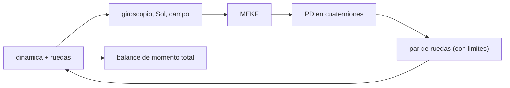

# B87-C20 — Simulación ADCS integral

<!-- nav:top -->
[🏠 Programa](../../../../README.md) · [📚 Bloque B87](../../../tronco-comun/B87-sensores-y-control-de-actitud.md) · [← Anterior: B87-C19 — Verificación de ley de control](../B87-C19-verificacion-de-ley-de-control/CLASE.md) · [Siguiente: B87-C21 — Control predictivo basado en modelo (MPC) para vehículos espaciales →](../B87-C21-control-predictivo-basado-en-modelo-mpc-para-vehiculos-espaciales/CLASE.md)
<!-- /nav -->

## 1. Ubicación, nivel y alcance

Clase 20 del bloque B87. Nivel N3. Una simulación ADCS integral cierra el lazo completo: dinámica del cuerpo con ruedas, sensores (giroscopio a 10 Hz, Sol y campo a 1 Hz), estimador MEKF, control PD en cuaterniones y un par perturbador constante. Aquí la ejecutas 600 s con un error inicial de `20°` y verificas el resultado con una segunda vía: el momento angular total solo cambia por la integral del par perturbador. Todo es sintético.

## 2. Por qué esta clase existe

Cada pieza funciona sola; juntas pueden interactuar (el ruido del estimador entra al control, el control mueve la actitud que mide el sensor). La decisión central: **¿qué apuntamiento real se logra con el lazo completo y cómo se sabe que la simulación es coherente?** La conservación del momento es una prueba independiente de los controladores.

## 3. Lo que podrás hacer al terminar

1. Armar el lazo sensores–MEKF–PD–ruedas–dinámica con tasas distintas (10 Hz y 1 Hz).
2. Separar el error de apuntamiento real del error de estimación.
3. Medir el tiempo de convergencia y el error en régimen permanente.
4. Verificar el balance de momento `ΔH_total = ∫τ_ext dt` con la regla del trapecio.
5. Vigilar los límites de par y de momento de las ruedas.
6. Separar lo sintético de lo consultado y de lo no consultado.

La evidencia es la **informe de una simulación ADCS integral** del ejercicio 12 (sección 20).

## 4. Con qué llegas y cómo comprobarlo

1. ¿Qué es una simulación de lazo cerrado?
2. ¿Qué es el error de estimación?
3. ¿Qué es el momento angular total?
4. ¿Por qué se usan tasas distintas?
5. ¿Qué es la regla del trapecio?

<details>
<summary>Ver respuestas</summary>

1. Una que integra la planta y el controlador juntos. 2. La diferencia entre la actitud estimada y la verdadera. 3. `H = Iω + h` (cuerpo más ruedas), en el sistema inercial. 4. El giroscopio es rápido y los vectores lentos; el filtro las combina. 5. `∫f ≈ (f_k + f_{k+1})Δt/2`, de segundo orden.
</details>

Con cuatro o cinco aciertos, sigue; si no, repasa los prerrequisitos.

## 5. Un caso de contexto y casos de referencia

Con error inicial de `20°`, el lazo entra a `2°` a los `24 s` y mantiene un apuntamiento rms de `0″` los últimos 200 s (error de estimación rms `0″`). El par de rueda máximo es `2,11 mN·m` (límite 10) y el momento de rueda máximo `0,0072 N·m·s`. El balance de momento cierra a `1,6e-13 N·m·s` frente a una integral de `2,24e-03 N·m·s`. Todo es **sintético**.

## 6. Vocabulario

El **lazo integral** une dinámica, sensores, estimador, control y actuadores. El **error de apuntamiento** es verdadero frente al objetivo; el **error de estimación**, estimado frente al verdadero. El **momento total** `H` se verifica con `ΔH = ∫τ_ext dt`. La **regla del trapecio** integra el par en ejes inerciales. Los **límites** son de par de rueda y de momento.

## 7. Modelo mental: el lazo completo y su prueba independiente



*Descripción textual:* la dinámica genera las medidas; el filtro estima la actitud; el control calcula el par de las ruedas; y, aparte, el balance de momento total comprueba que la integración es coherente.

Analogía: un simulador de vuelo completo: cada subsistema se probó por separado, y ahora se prueba el conjunto con una verificación externa (el balance de energía en un avión, el balance de momento aquí). Límite: la verificación del momento no prueba el desempeño del control, solo la coherencia de la física.

## 8. La explicación, paso a paso

### 8.1 Qué se simula

`I = diag(0,35; 0,40; 0,30)`; actitud objetivo `q_c` (20° sobre `(1; 1; 0,5)`); giroscopio con ARW `0,2 °/√h`, RRW `2 °/h/√h` y sesgo `(0,05; −0,03; 0,02) °/s`; Sol `0,5°` y campo `1,0°` a 1 Hz; MEKF de 6 estados (C10); control `τ = −K_p sgn(q_{e,w}) q_{e,v} − K_d ω̂` con `ω_n = 0,15 rad/s`, `ζ = 0,9`; ruedas con `|u| ≤ 10 mN·m`; par perturbador `(2; −1; 3) µN·m`.

### 8.2 Resultados

| Magnitud | Valor |
|---|---|
| error de apuntamiento inicial | 20,00° |
| entra a `2°` en | 24 s |
| rms de apuntamiento, últimos 200 s | 296,3″ |
| error final | 260,4″ |
| rms del error de estimación, últimos 200 s | 240,0″ |
| error del sesgo estimado | 1,2 °/h |
| par de rueda máximo | 2,11 mN·m |
| momento de rueda máximo | 0,0072 N·m·s |

### 8.3 Segunda vía: balance de momento

`H_I = Aᵀ(Iω + h)` cambia solo por `∫Aᵀ τ_ext dt`. La diferencia es `1,6e-13 N·m·s` (con la regla del trapecio; con la regla rectangular se obtuvo `~6×10⁻⁸` en una versión previa, lo que ilustra el error de integración de primer orden).

### 8.4 Cómo leerlo

El apuntamiento real (`296″`) está dominado por el error de estimación (`240″`), que viene de los sensores de vector (`0,5°`–`1°`): sin rastreador estelar no se baja de ahí. El lazo no sobrepasa los límites de par ni de momento. Quedan fuera las perturbaciones variables, el ruido de las ruedas, el retardo y los eclipses.

## 9. Magnitudes, símbolos y unidades

| Símbolo | Qué es | Unidad | Valor / nota |
|---|---|---|---|
| `q_c` | actitud objetivo | — | 20° sobre (1,1,0,5) |
| `ω_n`, `ζ` | ancho de banda y amortiguamiento | rad/s, — | 0,15; 0,9 |
| `u` | par de rueda | N·m | máx. 2,11 mN·m |
| `h` | momento de rueda | N·m·s | máx. 0,0072 |
| `ΔH` | diferencia del balance | N·m·s | 1,6e-13 |

## 10. Convenciones y referencias

Duración `600 s`, `dt = 0,1 s`, semilla 20260524; error inicial de estimación `3°`; vectores de referencia fijos en `I`; ruedas ideales. Tolerancias: rms de apuntamiento `< 600″`, rms de estimación `< 0,2°`, balance de momento `< 10⁻⁷ N·m·s`, par `≤ 10 mN·m`. Cuaternión `q = [qx, qy, qz, qw]` con la parte escalar al final, `v_B = A(q) v_I`, producto tal que `A(q⊗p) = A(q) A(p)`, cinemática `q̇ = ½ [ω; 0] ⊗ q` con `ω` del cuerpo respecto del sistema inercial expresada en el cuerpo (la biblioteca [adcs_comun.py](../adcs_comun.py) del bloque lo comprueba). Sistema inercial `I` de **ejemplo** (ejes sin relación con J2000), órbita circular de dos cuerpos con radio terrestre `6 378 137 m` y `μ = 3,986004418 × 10¹⁴ m³/s²` como valores adoptados de ejemplo. Satélite **sintético** `I = diag(0,35; 0,40; 0,30) kg·m²` salvo que la clase diga otra cosa. Todo dato es sintético con semilla fija.

## 11. De dónde sale lo que afirmamos

| ID | Fuente | Localizador | Respalda | Estado |
|---|---|---|---|---|
| S2 | B. Graf, «Quaternions and dynamics», arXiv:0811.2889 — https://arxiv.org/abs/0811.2889 (consultada 2026-11-10) | solo la página de resumen | introducción autocontenida a los cuaterniones en dinámica, con la dinámica del cuerpo rígido y, en un apéndice, un satélite con ruedas inerciales; sostiene que los cuaterniones, a diferencia de los ángulos de Euler, permiten escribir a mano dinámicas complejas | Consultada (solo el resumen) |
| S3 | ECSS, ECSS-E-ST-60-30C «Satellite attitude and orbit control system (AOCS) requirements» — https://ecss.nl/standard/ecss-e-st-60-30c-satellite-attitude-and-orbit-control-system-aocs-requirements/ (consultada 2026-11-10 mediante resultados de búsqueda; el PDF no se abrió) | descripción del estándar | es un conjunto base de requisitos de AOCS (funcionales y de FDIR, operacionales, de desempeño, de verificación y documentales) limitado al nivel AOCS; el método de presupuesto de errores viene de ECSS-E-ST-60-10C y su guía de ECSS-E-HB-60-10A y del manual ESSB-HB-E-003; un requisito de apuntamiento completo especifica valor, sistema y eje, índice de error (APE, MPE, RPE), interpretación estadística, nivel de confianza y periodo de evaluación | Consultada (solo descripciones y resultados de búsqueda) |
| — | Relaciones estándar de dinámica de actitud, estimación y control usadas en esta clase (ecuaciones de Euler, cinemática de cuaterniones, problema de Wahba, filtro de Kalman multiplicativo, estabilidad de Lyapunov, modelos de sensores y actuadores) | — | las verifica el laboratorio con una segunda vía (conservación, comparación entre métodos, propagación independiente o Monte Carlo) | No consultada en una fuente concreta |
| — | Libros de texto de actitud y control (p. ej. Wertz, Markley–Crassidis, Sidi) y hojas de datos de fabricantes | — | — | No consultada |
| — | Simuladores de actitud profesionales y datos de misiones reales | — | — | No consultada |

Límites: Graf (S2) respalda solo desde su resumen la dinámica con ruedas inerciales; S3 respalda solo la descripción de ECSS-E-ST-60-30C. El lazo integral se valida por el balance de momento y por comparación de los resultados con las clases anteriores; no hay comparación con una simulación externa.

## 12. Cómo ver el lazo integral

| Magnitud | Valor |
|---|---|
| apuntamiento rms (últimos 200 s) | 296″ |
| estimación rms | 240″ |
| balance de momento | 1,6e-13 N·m·s |
| par máximo de rueda | 2,11 mN·m |

Descripción larga: el error de apuntamiento está limitado por la estimación; el balance de momento cierra a nivel de redondeo.

## 13. Ejemplo trabajado: lectura de la simulación integral

**Paso 1 · Entrada.** Error inicial `20°`.

**Paso 2 · Convergencia.** Entra a `2°` a los `24 s`.

**Paso 3 · Régimen.** Apuntamiento `296″` rms; estimación `240″`.

**Paso 4 · Actuadores.** Par `2,11 mN·m`, momento `0,0072 N·m·s`: sin saturar.

**Paso 5 · Segunda vía.** `|ΔH − ∫τ dt| = 1,6e-13 N·m·s`.

## 14. Distintas formas de describir la simulación del subsistema

**Lazo integral de tiempo discreto** (esta clase). **Software-in-the-loop:** el código de vuelo se ejecuta contra la simulación (no tratado). **Hardware-in-the-loop:** sensores o actuadores reales (no tratado). Todas exigen una verificación independiente de la física.

## 15. Práctica guiada

**Ejercicio 1 · con los pasos indicados.** Estima la velocidad angular máxima de la maniobra de `20°` con `ω_n = 0,15`. *Pasos:* `≈ ω_n θ`.

<details><summary>Solución comentada</summary>

`0,15·0,349 = 0,052 rad/s = 3,00 °/s` (cota alta).
</details>

**Ejercicio 2 · con una pista.** Si el rms de estimación es `240″`, ¿qué apuntamiento mínimo se espera?

<details><summary>Solución comentada</summary>

Del mismo orden: el control no mejora lo que el estimador no ve.
</details>

**Ejercicio 3 · casi autónomo.** ¿Qué par de rueda máximo esperarías del PD con `K_p = 2·0,35·0,0225`?

<details><summary>Solución comentada</summary>

`K_p = 0,0158 N·m`; `τ ≈ K_p·sin(10°) = 2,73 mN·m` al inicio.
</details>

## 16. Práctica autónoma, transferencia e integrador

**Ejercicio 4 · autónomo.** ¿Por qué se compara con `∫Aᵀτ dt` y no con `∫τ dt`?

<details><summary>Solución comentada</summary>

Porque `H` se conserva en el sistema inercial; el par está en ejes del cuerpo y hay que rotarlo.
</details>

**Ejercicio 5 · autónomo.** ¿Qué cambia si la regla rectangular reemplaza al trapecio?

<details><summary>Solución comentada</summary>

El balance empeora de `10⁻¹³` a `~6×10⁻⁸`: error de primer orden en la integral, no en la física.
</details>

**Ejercicio 6 · autónomo.** ¿Cuánto crece `h` en 600 s con el par perturbador de `3,74 µN·m` sin control magnético?

<details><summary>Solución comentada</summary>

`3,74×10⁻⁶·600 = 0,0022 N·m·s` (el laboratorio dio `0,0072` como máximo de la rueda).
</details>

**Ejercicio 7 · autónomo.** ¿Qué sensor añadirías para bajar el error de apuntamiento a segundos de arco?

<details><summary>Solución comentada</summary>

Un rastreador estelar (C07), que da `~1″` por eje transversal.
</details>

**Ejercicio 8 · autónomo.** ¿Qué ocurre con el sesgo del giroscopio estimado?

<details><summary>Solución comentada</summary>

Converge a `1,2 °/h` de error de los `221 °/h` verdaderos.
</details>

**Ejercicio 9 · transferencia.** **Transferencia.** **Transferencia.** Un colega usa `296″` como el apuntamiento de una misión. ¿Es válido?

<details><summary>Solución comentada</summary>

No: lazo sintético sin perturbaciones variables, ruido de ruedas, eclipses ni desalineaciones.
</details>

**Ejercicio 10 · transferencia.** **Transferencia.** **Transferencia.** ¿Qué añadirías para una simulación de misión real?

<details><summary>Solución comentada</summary>

Órbita y efemérides reales, el campo IGRF, perturbaciones con modelos, sensores calibrados, retardos, modos de operación y fallas.
</details>

**Ejercicio 11 · transferencia.** **Transferencia.** **Transferencia.** ¿Por qué la verificación de momento no basta para validar el control?

<details><summary>Solución comentada</summary>

Porque cualquier ley de control, buena o mala, conserva el momento; solo prueba la dinámica.
</details>

**Ejercicio 12 · integrador.** **Integrador.** **Integrador.** Elabora tu *informe de simulación integral*: configuración, tabla de 8.2, balance de momento, límites y lista de consultado y sintético.

<details><summary>Solución comentada</summary>

Secciones 8.1–8.4, 12 y la salida del laboratorio.
</details>

## 17. Laboratorio: lazo ADCS completo

El script [adcs_integral.py](adcs_integral.py) integra 600 s del satélite con ruedas, giroscopio, Sol y campo, MEKF y control PD, con límites de par, y calcula el error de apuntamiento verdadero, el de estimación, el par y el momento de ruedas y el balance de momento total frente a `∫Aᵀτ dt` con la regla del trapecio (**comprueba** apuntamiento `< 600″`, estimación `< 0,2°`, balance `< 10⁻⁷ N·m·s` y par limitado). Usa la biblioteca común [adcs_comun.py](../adcs_comun.py) del bloque.

**Datos:** satélite, sensores y perturbación **sintéticos** (semilla 20260524). **Predice antes de ejecutar:** ¿Qué limitará el apuntamiento: el control o el estimador? (el estimador.) **Ejecución del 2026-11-10 (Python 3.12.9, numpy 2.4.4):**

```text
Python 3.12.9 | numpy 2.4.4
B87-C20 simulacion ADCS integral | SINTETICO (semilla 20260524): 600 s, giroscopio 10 Hz, Sol/campo 1 Hz, MEKF, PD con ruedas
error de apuntamiento (verdadero vs objetivo): inicial = 20.00 deg ; < 2 deg desde t = 24 s ; rms ultimos 200 s = 296.3 arcsec ; final = 260.4 arcsec
error de estimacion del MEKF (ultimos 200 s) rms = 240.0 arcsec ; error del sesgo estimado = 1.2 deg/h
par de rueda maximo = 2.11 mN m (limite 10) ; momento de rueda maximo = 0.0072 N m s
segunda via: |Delta H_total - integral del par perturbador| = 1.60e-13 N m s (integral = 2.24e-03)
Pruebas superadas.
```

```bash
python programa/clases/B87/B87-C20-simulacion-adcs-integral/adcs_integral.py
```

**Límites:** un caso de semilla, vectores de referencia fijos, perturbación constante, ruedas ideales, sin rastreador estelar; no hay eclipse ni retardo.

## 18. Errores frecuentes y cómo corregirlos

**Comprobar el momento en el cuerpo.** Hazlo en el sistema inercial (8.3)

**Culpar al control por el error de estimación.** Separa ambos errores (8.2)

**Confiar en una sola semilla.** Repite con otras semillas antes de concluir

## 19. Cómo sabrás que vas bien

Tras la sección 8: ¿qué error esperabas en régimen? Si dudas, repasa el ejemplo 13. Tras el laboratorio: ¿qué comprueba? (ver sección 17).

## 20. Qué entregas y cómo se evalúa

El producto es tu **informe de una simulación ADCS integral** (ejercicio 12).

| Criterio | Inicial | En desarrollo | Logrado | Destacado |
|---|---|---|---|---|
| Conceptos | Los confunde | Parciales | Explica el método y su dominio | Explica los límites y las alternativas |
| Cálculo | Sin unidades | Con errores | Resultados con unidades y comprobados | Resuelve casos nuevos |
| Numérico | Sin comprobar | Un caso | Verifica con una segunda vía en varios casos | Interpreta las diferencias y los fallos |
| Fuentes | Sin fuente | Sin fecha | Fuentes con fecha y estado | Declara lo sintético y lo no consultado |
| Límites | No los nombra | Uno | Tres | Discute qué falta del modelo |

**Condiciones críticas (no se compensan con promedio):** rotular los datos como sintéticos; verificar cada resultado con una segunda vía; citar solo lo consultado.

## 21. Ética, seguridad y límites

Clase educativa: los modelos son simplificados y los datos son sintéticos; ningún resultado describe una misión real ni sustituye el diseño y la verificación de un subsistema de actitud con herramientas validadas, ensayos y revisión de especialistas.  Accesibilidad: tablas equivalentes a las gráficas, fórmulas en texto, ejercicios sin conexión.

## 22. Para cerrar y seguir

El lazo integral asienta en `24 s`, apunta a `296″` rms y su balance de momento cierra a `2e-13 N·m·s`. Queda una pregunta: ¿cómo se controla con restricciones explícitas de par y de velocidad?

**Glosario español–inglés.** simulación integral · *end-to-end simulation*; lazo cerrado · *closed loop*; balance de momento · *momentum balance*; error de estimación · *estimation error*; verificación · *verification*; regla del trapecio · *trapezoidal rule*.

**Continuidad.** [B87-C21](../B87-C21-control-predictivo-basado-en-modelo-mpc-para-vehiculos-espaciales/CLASE.md) presenta el control predictivo (MPC) con restricciones explícitas.

**Referencias:** ver sección 11.

<!-- nav:bottom -->
---

[← Anterior: B87-C19 — Verificación de ley de control](../B87-C19-verificacion-de-ley-de-control/CLASE.md) · [📚 Bloque B87](../../../tronco-comun/B87-sensores-y-control-de-actitud.md) · [Siguiente: B87-C21 — Control predictivo basado en modelo (MPC) para vehículos espaciales →](../B87-C21-control-predictivo-basado-en-modelo-mpc-para-vehiculos-espaciales/CLASE.md)
<!-- /nav -->
