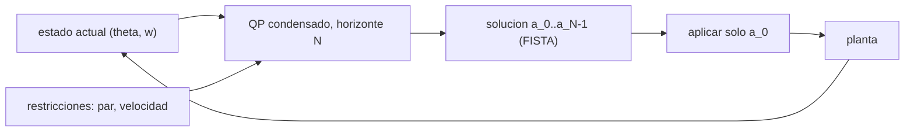

# B87-C21 — Control predictivo basado en modelo (MPC) para vehículos espaciales

<!-- nav:top -->
[🏠 Programa](../../../../README.md) · [📚 Bloque B87](../../../tronco-comun/B87-sensores-y-control-de-actitud.md) · [← Anterior: B87-C20 — Simulación ADCS integral](../B87-C20-simulacion-adcs-integral/CLASE.md) · [Siguiente: B87-C22 — Presupuesto de error de apuntamiento →](../B87-C22-presupuesto-de-error-de-apuntamiento/CLASE.md)
<!-- /nav -->

## 1. Ubicación, nivel y alcance

Clase 21 del bloque B87. Nivel N3. El control predictivo basado en modelo (MPC) resuelve en cada paso un problema de optimización sobre un horizonte futuro, respetando de forma explícita las restricciones del actuador y del vehículo. Es el complemento de las leyes PD, LQR y robustas de B16, que no lo tratan. Aquí lo aplicas a un eje de actitud (doble integrador, `I_z = 0,30 kg·m²`) con `|u| ≤ 0,01 N·m` (restricción dura) y `|ω| ≤ 0,08 rad/s` (penalización cuadrática), y lo comparas con un PD saturado. Todo es sintético.

## 2. Por qué esta clase existe

Un PD satura el par y no sabe de límites de velocidad: puede superar el máximo de la rueda o de la carga útil. La decisión central: **¿cómo formular un problema que respete par y velocidad, cuánto cuesta calcularlo y qué se gana?** Una previa: un MPC es tan bueno como su modelo.

## 3. Lo que podrás hacer al terminar

1. Discretizar el doble integrador y condensar la predicción `θ = θ₀ + G_θ a`, `ω = ω₀ + G_ω a`.
2. Formular el costo cuadrático con penalización de velocidad y la restricción de caja del par.
3. Resolver el QP condensado con gradiente proyectado acelerado (FISTA).
4. Aplicar el horizonte deslizante con arranque en caliente.
5. Comparar con un PD saturado en tiempo y velocidad pico.
6. Separar lo sintético de lo consultado y de lo no consultado.

La evidencia es la **comparación de MPC frente a PD saturado en una maniobra con límites de par y velocidad** del ejercicio 12 (sección 20).

## 4. Con qué llegas y cómo comprobarlo

1. ¿Qué es un problema de optimización cuadrático?
2. ¿Qué es el horizonte deslizante?
3. ¿Qué es una restricción de caja?
4. ¿Qué es una penalización cuadrática?
5. ¿Qué es el PD saturado?

<details>
<summary>Ver respuestas</summary>

1. Minimizar `½ aᵀHa + gᵀa` con restricciones. 2. Se resuelve a cada paso, se aplica la primera acción y se vuelve a resolver. 3. `a_min ≤ a ≤ a_max` por componente. 4. Un término `ρ (violación)²` que castiga infringir una restricción. 5. El PD (C17) con el par recortado al límite.
</details>

Con cuatro o cinco aciertos, sigue; si no, repasa los prerrequisitos.

## 5. Un caso de contexto y casos de referencia

Con `N = 40` pasos de `1 s`, el MPC lleva el eje `60°` a menos de `0,5°` en `26 s` con par máximo `10,0 mN·m` y velocidad pico `0,0812 rad/s` (límite `0,08`); el PD saturado entra en `27 s` pero llega a `0,0890 rad/s`, superando el límite en `11 %`. Todo es **sintético**.

## 6. Vocabulario

El **MPC** minimiza un costo sobre un **horizonte** `N` con un modelo. El **QP condensado** tiene como variables solo las acciones `a = (a₀…a_{N−1})`. La **restricción dura** de par `|a| ≤ u_max/I`. La **restricción blanda** de velocidad se castiga con `ρ max(0, |ω|−ω_max)²`. **FISTA** es un gradiente proyectado acelerado. El **arranque en caliente** reutiliza la solución anterior desplazada.

## 7. Modelo mental: optimizar hacia adelante y aplicar el primer paso



*Descripción textual:* en cada paso se predice el movimiento con el modelo, se optimiza la secuencia de acciones respetando las restricciones, se aplica solo la primera y se repite con el nuevo estado.

Analogía: un conductor que mira varios segundos adelante, planea cuánto frenar y acelerar para llegar sin pasarse de la velocidad máxima, y replanifica en cada instante. Límite: si el modelo (la carretera) es incorrecto, el plan también lo es; y la restricción de velocidad aquí es blanda.

## 8. La explicación, paso a paso

### 8.1 Modelo y predicción

Con `Δt = 1 s`: `θ_{k+1} = θ_k + ω_k Δt + ½ a_k Δt²`, `ω_{k+1} = ω_k + a_k Δt`, `a = u/I`. Apilando `N = 40` pasos: `θ = θ₀ + Δt·k·ω₀ + G_θ a` y `ω = ω₀ + G_ω a` con `G_ω[k,j] = Δt` y `G_θ[k,j] = Δt²(k − j + ½)` para `j ≤ k`.

### 8.2 Costo y restricciones

`J = Σ [q (θ_k − θ_ref)² + q_ω ω_k² + r a_k²] + ρ Σ max(0, |ω_k| − ω_max)²` con `q = 1`, `q_ω = 20`, `r = 50`, `ρ = 3000`; `|a_k| ≤ a_max = 0,0333 rad/s²`. La caja se impone por proyección y la velocidad por penalización (es **blanda**: se puede violar ligeramente).

### 8.3 Resolución

La constante de Lipschitz del gradiente es `4,451e+06`. FISTA con 1500 iteraciones por paso (arranque en caliente) converge: la diferencia máxima entre la solución a 1500 y a 15 000 iteraciones es `0,623 %` del límite y el residuo del gradiente proyectado `7,11e-01`.

### 8.4 Comparación (giro de 60°)

| Controlador | Entra a 0,5° (s) | Par máx. (mN·m) | Velocidad pico (rad/s) |
|---|---|---|---|
| MPC | 26 | 10,00 | 0,0812 |
| PD saturado | 27 | 10,00 | 0,0890 |

El límite de velocidad es `0,08 rad/s`. El MPC lo respeta con una violación de `1,5 %` (restricción blanda); el PD lo excede en `11 %`. El tiempo es casi el mismo: la ganancia es en respetar restricciones, no en velocidad. El costo computacional (unos 1500 iteraciones × 40 variables por paso) es modesto aquí y puede ser crítico a bordo.

## 9. Magnitudes, símbolos y unidades

| Símbolo | Qué es | Unidad | Valor / nota |
|---|---|---|---|
| `N` | horizonte | pasos | 40 (1 s) |
| `a_max` | aceleración máxima | rad/s² | 0,0333 |
| `ω_max` | velocidad máxima | rad/s | 0,08 |
| `q, q_ω, r, ρ` | pesos | — | 1; 20; 50; 3000 |
| `L` | constante de Lipschitz | — | 4,45e+06 |

## 10. Convenciones y referencias

Un eje, `I_z = 0,30 kg·m²`, `Δt = 1 s`, giro de `60°`, 150 s, sin ruido ni retardo ni perturbación (planta igual al modelo). Tolerancias: par `≤ 10 mN·m`; velocidad del MPC `< 1,05 ω_max` (restricción blanda); el PD excede `1,05 ω_max`; diferencia entre 1500 y 15 000 iteraciones `< 1 %` del límite. Cuaternión `q = [qx, qy, qz, qw]` con la parte escalar al final, `v_B = A(q) v_I`, producto tal que `A(q⊗p) = A(q) A(p)`, cinemática `q̇ = ½ [ω; 0] ⊗ q` con `ω` del cuerpo respecto del sistema inercial expresada en el cuerpo (la biblioteca [adcs_comun.py](../adcs_comun.py) del bloque lo comprueba). Sistema inercial `I` de **ejemplo** (ejes sin relación con J2000), órbita circular de dos cuerpos con radio terrestre `6 378 137 m` y `μ = 3,986004418 × 10¹⁴ m³/s²` como valores adoptados de ejemplo. Satélite **sintético** `I = diag(0,35; 0,40; 0,30) kg·m²` salvo que la clase diga otra cosa. Todo dato es sintético con semilla fija.

## 11. De dónde sale lo que afirmamos

| ID | Fuente | Localizador | Respalda | Estado |
|---|---|---|---|---|
| — | Relaciones estándar de dinámica de actitud, estimación y control usadas en esta clase (ecuaciones de Euler, cinemática de cuaterniones, problema de Wahba, filtro de Kalman multiplicativo, estabilidad de Lyapunov, modelos de sensores y actuadores) | — | las verifica el laboratorio con una segunda vía (conservación, comparación entre métodos, propagación independiente o Monte Carlo) | No consultada en una fuente concreta |
| — | Libros de texto de actitud y control (p. ej. Wertz, Markley–Crassidis, Sidi) y hojas de datos de fabricantes | — | — | No consultada |
| — | Literatura de MPC aeroespacial (Camacho y Bordons; Rawlings y Mayne), solvers de QP (OSQP, qpOASES) y aplicaciones de MPC a actitud | — | — | No consultada |

Límites: Esta clase no tiene fuente consultada propia: el MPC condensado, FISTA y la penalización son técnicas estándar no consultadas en una fuente concreta; el laboratorio valida la solución por convergencia (1500 frente a 15 000 iteraciones) y la respuesta por las restricciones de par y velocidad.

## 12. Cómo ver la comparación

| Magnitud | Valor |
|---|---|
| entra a 0,5° (MPC / PD) | 26 / 27 s |
| velocidad pico (MPC / PD) | 0,0812 / 0,0890 rad/s |
| par máximo | 10,0 mN·m |
| convergencia | 0,62 % del límite |

Descripción larga: el MPC respeta la velocidad máxima con el mismo tiempo de maniobra; el PD la excede.

## 13. Ejemplo trabajado: MPC frente a PD

**Paso 1 · Modelo.** Doble integrador, `a_max = 0,01/0,30 = 0,0333 rad/s²`.

**Paso 2 · QP.** 40 variables, costo cuadrático, caja y penalización de velocidad.

**Paso 3 · Solución.** FISTA, `0,62 %` de diferencia con la solución casi exacta.

**Paso 4 · Lazo.** Entra a 0,5° en `26 s`, velocidad pico `0,0812 rad/s`.

**Paso 5 · Comparación.** El PD llega a `0,0890 rad/s`: viola el límite.

## 14. Distintas formas de describir el control con restricciones

**MPC con QP** (esta clase): restricciones explícitas, mayor cómputo. **PD saturado:** simple, no conoce el límite de velocidad. **Gobernador de referencia:** filtra la orden para respetar límites sobre un lazo existente. **LQR:** óptimo sin restricciones (B16).

## 15. Práctica guiada

**Ejercicio 1 · con los pasos indicados.** Calcula `a_max` para `u_max = 0,005 N·m` e `I = 0,30`. *Pasos:* `u_max/I`.

<details><summary>Solución comentada</summary>

`0,005/0,30 = 0,0167 rad/s²`.
</details>

**Ejercicio 2 · con una pista.** Con `ω_max = 0,08` y `a_max = 0,0333`, ¿cuánto tarda en acelerar a `ω_max`?

<details><summary>Solución comentada</summary>

`0,08/0,0333 = 2,4 s`.
</details>

**Ejercicio 3 · casi autónomo.** ¿Qué horizonte mínimo hace falta para frenar desde `ω_max`?

<details><summary>Solución comentada</summary>

`N Δt ≥ ω_max/a_max = 2,4 s`: `N ≥ 3` con `Δt = 1 s`; 40 es muy conservador.
</details>

## 16. Práctica autónoma, transferencia e integrador

**Ejercicio 4 · autónomo.** ¿Qué pasa con el MPC si `ρ` se hace muy grande?

<details><summary>Solución comentada</summary>

La velocidad se respeta mejor, pero el problema se vuelve mal condicionado (la constante de Lipschitz crece `5,2` veces respecto de `ρ = 300`) y FISTA converge lento.
</details>

**Ejercicio 5 · autónomo.** ¿Por qué se aplica solo `a₀` y no toda la secuencia?

<details><summary>Solución comentada</summary>

Porque el modelo y el estado cambian; replanificar cada paso corrige errores (realimentación).
</details>

**Ejercicio 6 · autónomo.** ¿Qué es el arranque en caliente y por qué ayuda?

<details><summary>Solución comentada</summary>

Usar la solución anterior desplazada como valor inicial; la nueva solución es parecida y converge con menos iteraciones.
</details>

**Ejercicio 7 · autónomo.** Si el modelo usa `I = 0,30` y la planta tiene `0,36`, ¿qué ocurre?

<details><summary>Solución comentada</summary>

El MPC sigue funcionando con realimentación pero sobreestima la aceleración; la violación de velocidad puede crecer (se verifica como en C19).
</details>

**Ejercicio 8 · autónomo.** ¿Qué restricción es dura y cuál blanda en esta clase?

<details><summary>Solución comentada</summary>

El par es duro (proyección); la velocidad es blanda (penalización), por eso admite `1,5 %` de violación.
</details>

**Ejercicio 9 · transferencia.** **Transferencia.** **Transferencia.** Un colega afirma que el MPC es siempre mejor que el PD. ¿Es válido?

<details><summary>Solución comentada</summary>

No: aquí gana en respetar límites; en tiempo es igual, cuesta más cómputo y necesita modelo y solver verificados.
</details>

**Ejercicio 10 · transferencia.** **Transferencia.** **Transferencia.** ¿Cómo añadirías la restricción de momento de rueda?

<details><summary>Solución comentada</summary>

Como restricción adicional sobre `h_k = h₀ + Σ u` en el QP (blanda o dura); aquí no se modela.
</details>

**Ejercicio 11 · transferencia.** **Transferencia.** **Transferencia.** ¿Qué pasa si el solver no converge a tiempo en un computador de vuelo?

<details><summary>Solución comentada</summary>

Se aplica la mejor solución factible disponible o una ley de respaldo (PD); hay que verificar el peor caso de tiempo de cómputo.
</details>

**Ejercicio 12 · integrador.** **Integrador.** **Integrador.** Elabora tu *comparación MPC frente a PD saturado*: formulación, tabla de 8.4, convergencia y límites, y lista de consultado y sintético.

<details><summary>Solución comentada</summary>

Secciones 8.1–8.4, 12 y la salida del laboratorio.
</details>

## 17. Laboratorio: MPC con restricciones frente a PD saturado

El script [mpc.py](mpc.py) construye las matrices de predicción de un doble integrador, resuelve el QP condensado con FISTA (par por proyección y velocidad por penalización), aplica el horizonte deslizante durante 150 s para un giro de `60°` y lo compara con un PD saturado de igual `ω_n` (**comprueba** par `≤` límite, velocidad del MPC `< 1,05 ω_max`, PD por encima, convergencia `< 1 %`). Usa la biblioteca común [adcs_comun.py](../adcs_comun.py) del bloque.

**Datos:** planta y restricciones **sintéticas**; sin ruido ni perturbación. **Predice antes de ejecutar:** ¿Qué controlador respetará el límite de velocidad? (el MPC; el PD lo excede.) **Ejecución del 2026-11-10 (Python 3.12.9, numpy 2.4.4):**

```text
Python 3.12.9 | numpy 2.4.4
B87-C21 MPC | SINTETICO: doble integrador (Iz = 0.30), N = 40 a 1 s, |u| <= 0.01 N m, |w| <= 0.08 rad/s, giro de 60 deg
QP condensado de 40 variables: constante de Lipschitz = 4450839.1 ; aceleracion maxima = 0.0333 rad/s^2
convergencia: |a(1500 it) - a(15000 it)| maximo = 0.623 % del limite ; residuo del gradiente proyectado = 7.11e-01
MPC: entra a 0.5 deg en 26 s ; par maximo = 10.000 mN m ; velocidad pico = 0.0812 rad/s (4.65 deg/s)
PD saturado: entra a 0.5 deg en 27 s ; par maximo = 10.000 mN m ; velocidad pico = 0.0890 rad/s (5.10 deg/s)
limite de velocidad = 0.08 rad/s (4.58 deg/s)
Pruebas superadas.
```

```bash
python programa/clases/B87/B87-C21-control-predictivo-basado-en-modelo-mpc-para-vehiculos-espaciales/mpc.py
```

**Límites:** un eje, modelo igual a la planta, restricción de velocidad blanda, sin ruido ni retardo; solver iterativo propio, no verificado frente a un solver de referencia.

## 18. Errores frecuentes y cómo corregirlos

**Creer que el MPC garantiza la restricción blanda.** Revisa la violación residual (8.4)

**Usar un horizonte demasiado corto.** Debe cubrir la frenada (ejercicio 3)

**Ignorar el costo de cómputo.** Mide iteraciones y tiempo (8.4)

## 19. Cómo sabrás que vas bien

Tras la sección 8: ¿qué controlador esperabas más rápido? Si dudas, repasa el ejemplo 13. Tras el laboratorio: ¿qué comprueba? (ver sección 17).

## 20. Qué entregas y cómo se evalúa

El producto es tu **comparación de MPC frente a PD saturado en una maniobra con límites de par y velocidad** (ejercicio 12).

| Criterio | Inicial | En desarrollo | Logrado | Destacado |
|---|---|---|---|---|
| Conceptos | Los confunde | Parciales | Explica el método y su dominio | Explica los límites y las alternativas |
| Cálculo | Sin unidades | Con errores | Resultados con unidades y comprobados | Resuelve casos nuevos |
| Numérico | Sin comprobar | Un caso | Verifica con una segunda vía en varios casos | Interpreta las diferencias y los fallos |
| Fuentes | Sin fuente | Sin fecha | Fuentes con fecha y estado | Declara lo sintético y lo no consultado |
| Límites | No los nombra | Uno | Tres | Discute qué falta del modelo |

**Condiciones críticas (no se compensan con promedio):** rotular los datos como sintéticos; verificar cada resultado con una segunda vía; citar solo lo consultado.

## 21. Ética, seguridad y límites

Clase educativa: los modelos son simplificados y los datos son sintéticos; ningún resultado describe una misión real ni sustituye el diseño y la verificación de un subsistema de actitud con herramientas validadas, ensayos y revisión de especialistas.  Accesibilidad: tablas equivalentes a las gráficas, fórmulas en texto, ejercicios sin conexión.

## 22. Para cerrar y seguir

El MPC gira `60°` en `26 s` con par `≤ 10 mN·m` y velocidad pico `0,081 rad/s` (límite 0,08), mientras que el PD saturado llega a `0,089 rad/s`. Queda una pregunta: ¿cómo se resume todo el error de apuntamiento en un presupuesto?

**Glosario español–inglés.** control predictivo · *model predictive control*; horizonte · *horizon*; restricción · *constraint*; programa cuadrático · *quadratic program*; gradiente proyectado · *projected gradient*; arranque en caliente · *warm start*.

**Continuidad.** [B87-C22](../B87-C22-presupuesto-de-error-de-apuntamiento/CLASE.md) cierra el bloque con el presupuesto de error de apuntamiento.

**Referencias:** ver sección 11.

<!-- nav:bottom -->
---

[← Anterior: B87-C20 — Simulación ADCS integral](../B87-C20-simulacion-adcs-integral/CLASE.md) · [📚 Bloque B87](../../../tronco-comun/B87-sensores-y-control-de-actitud.md) · [Siguiente: B87-C22 — Presupuesto de error de apuntamiento →](../B87-C22-presupuesto-de-error-de-apuntamiento/CLASE.md)
<!-- /nav -->
