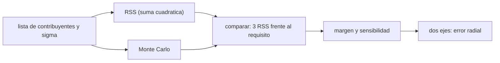

# B87-C22 — Presupuesto de error de apuntamiento

<!-- nav:top -->
[🏠 Programa](../../../../README.md) · [📚 Bloque B87](../../../tronco-comun/B87-sensores-y-control-de-actitud.md) · [← Anterior: B87-C21 — Control predictivo basado en modelo (MPC) para vehículos espaciales](../B87-C21-control-predictivo-basado-en-modelo-mpc-para-vehiculos-espaciales/CLASE.md) · [Siguiente: B88-C01 — Arquitectura de computador de vuelo →](../../../tronco-comun/B88-avionica-y-software-critico-espacial.md#b88-c01)
<!-- /nav -->

## 1. Ubicación, nivel y alcance

Clase 22 del bloque B87. Nivel N3. Para cerrar el control de actitud, el apuntamiento se presupuesta: se listan los contribuyentes al error, se combinan estadísticamente, se compara con el requisito y se verifica por Monte Carlo. Esta clase trata la parte que C15 deja abierta: **el presupuesto de error de apuntamiento**. Usa seis contribuyentes sintéticos (`σ` entre `1,5″` y `5″`), un requisito de ejemplo de `30″` (3σ por eje) y 100 000 sorteos. Ningún valor es de una misión.

## 2. Por qué esta clase existe

Un requisito de apuntamiento solo se cumple si el diseño lo respalda con números. La decisión central: **¿qué contribuyentes dominan, cómo se combinan (suma lineal o cuadrática), con qué margen se cumple el requisito y qué ocurre con dos ejes?** El descuido típico es sumar linealmente (demasiado pesimista) o ignorar que el error radial de dos ejes es mayor que el de uno.

## 3. Lo que podrás hacer al terminar

1. Clasificar contribuyentes en aleatorios, sesgos y acotados, con su `σ`.
2. Combinar por suma cuadrática (RSS) y comparar con la suma lineal.
3. Verificar la combinación por Monte Carlo, incluido un término uniforme acotado.
4. Calcular el margen frente a un requisito de `3σ` y la sensibilidad por contribuyente.
5. Pasar de un eje al error radial de dos ejes (Rayleigh).
6. Separar lo sintético de lo consultado y de lo no consultado.

La evidencia es la **presupuesto de apuntamiento con margen y verificación por Monte Carlo** del ejercicio 12 (sección 20).

## 4. Con qué llegas y cómo comprobarlo

1. ¿Qué es la desviación típica de una suma de variables independientes?
2. ¿Qué es una distribución uniforme `U(−a, a)`?
3. ¿Qué es un percentil 99,73?
4. ¿Qué es una distribución de Rayleigh?
5. ¿Qué es un margen?

<details>
<summary>Ver respuestas</summary>

1. La raíz de la suma de varianzas (RSS). 2. Una con `σ = a/√3`. 3. El valor que deja el 99,73 % de los datos por debajo; `≈ 3σ` en una gaussiana. 4. La del módulo de dos gaussianas independientes. 5. La diferencia entre el requisito y el valor presupuestado.
</details>

Con cuatro o cinco aciertos, sigue; si no, repasa los prerrequisitos.

## 5. Un caso de contexto y casos de referencia

Con seis contribuyentes (`3; 5; 4; 2,5; 1,5; 2″` 1σ), la suma cuadrática es `7,91″` y la lineal `18,0″`. El requisito de `30″` (3σ) deja un margen de `6,28″` (`3·7,91 = 23,7″`). El Monte Carlo da una desviación de `7,905″` y un percentil 99,73 de `23,47″`; con dos ejes, el error radial a 99,73 % sube a `27,1″`. Todo es **sintético**.

## 6. Vocabulario

Un **contribuyente** es una fuente de error con su `σ` (1σ). El **RSS** (raíz de la suma de cuadrados) combina contribuyentes independientes. La **suma lineal** es la cota del peor caso. Un **término acotado uniforme** `±a` tiene `σ = a/√3`. El **margen** es `requisito − 3·RSS`. El **error radial** de dos ejes sigue una Rayleigh. Un **requisito completo** nombra valor, eje, índice, estadística, confianza y periodo (S3).

## 7. Modelo mental: de una lista de errores a un número con margen



*Descripción textual:* cada contribuyente se describe por su desviación; la suma cuadrática da el error total, el Monte Carlo la confirma y la comparación con el requisito da el margen; con dos ejes aparece el error radial.

Analogía: un presupuesto de tolerancias mecánicas: se suman en cuadratura las tolerancias independientes en lugar de sumarlas todas en el peor caso, y se comprueba con muchas piezas simuladas. Límite: la suma cuadrática exige independencia; los errores correlacionados (por ejemplo, térmicos comunes) se suman linealmente.

## 8. La explicación, paso a paso

### 8.1 Contribuyentes (arcsec, 1σ, de ejemplo)

| Contribuyente | `σ` (″) | Aporte a la varianza (%) |
|---|---|---|
| ruido del rastreador estelar (aleatorio) | 3,00 | 14,4 |
| alineamiento rastreador–carga (sesgo) | 5,00 | 40,0 |
| distorsión térmica de la estructura (sesgo lento) | 4,00 | 25,6 |
| error de control residual (aleatorio) | 2,50 | 10,0 |
| vibración de ruedas, jitter (aleatorio) | 1,50 | 3,6 |
| retardo y sincronización (uniforme acotado `±a`) | 2,00 | 6,4 |

### 8.2 Combinación

`σ_tot = √(Σσ_i²) = 7,906″` (RSS) frente a `Σσ_i = 18,00″` (lineal). La suma lineal es `2,3` veces mayor: demasiado pesimista para errores independientes. El Monte Carlo (100000 sorteos) da `7,905″`, acorde con el RSS.

### 8.3 Requisito y margen

Requisito de ejemplo: `30″` (3σ, por eje). `3·RSS = 23,72″`, margen `6,28″`. El percentil 99,73 de `|error|` del Monte Carlo es `23,47″`, cercano a `3·RSS` (diferencia `-1,0 %`, por el término uniforme). Sin el mayor contribuyente (el alineamiento), el RSS bajaría a `6,12″`: el alineamiento aporta el 40 % de la varianza y es donde conviene invertir.

### 8.4 Dos ejes

El error radial `√(e_x² + e_y²)` sigue una Rayleigh: su percentil 99,73 es `σ_tot √(−2 ln 0,0027) = 27,19″` (teoría) frente a `27,13″` (Monte Carlo), un `14 %` más que `3σ` de un eje. Un requisito «30″ radial» y uno «30″ por eje» no son lo mismo. Quedan fuera los errores correlacionados, los no gaussianos de cola pesada y los que dependen del modo de operación.

## 9. Magnitudes, símbolos y unidades

| Símbolo | Qué es | Unidad | Valor / nota |
|---|---|---|---|
| `σ_i` | desviación del contribuyente `i` | ″ | 1,5 a 5 |
| `σ_tot` | RSS | ″ | 7,906 |
| `3σ_tot` | error a 3σ | ″ | 23,72 |
| `R` | requisito (3σ por eje) | ″ | 30 |
| margen | `R − 3σ_tot` | ″ | 6,28 |

## 10. Convenciones y referencias

Seis contribuyentes sintéticos independientes (cinco gaussianos y uno uniforme acotado), `100 000` sorteos con semilla 20260525; requisito de ejemplo `30″` (3σ por eje). Tolerancias: desviación del Monte Carlo dentro del 1 % del RSS, percentil 99,73 dentro del 3 % de `3σ`, error radial dentro del 4 % de la Rayleigh. Cuaternión `q = [qx, qy, qz, qw]` con la parte escalar al final, `v_B = A(q) v_I`, producto tal que `A(q⊗p) = A(q) A(p)`, cinemática `q̇ = ½ [ω; 0] ⊗ q` con `ω` del cuerpo respecto del sistema inercial expresada en el cuerpo (la biblioteca [adcs_comun.py](../adcs_comun.py) del bloque lo comprueba). Sistema inercial `I` de **ejemplo** (ejes sin relación con J2000), órbita circular de dos cuerpos con radio terrestre `6 378 137 m` y `μ = 3,986004418 × 10¹⁴ m³/s²` como valores adoptados de ejemplo. Satélite **sintético** `I = diag(0,35; 0,40; 0,30) kg·m²` salvo que la clase diga otra cosa. Todo dato es sintético con semilla fija.

## 11. De dónde sale lo que afirmamos

| ID | Fuente | Localizador | Respalda | Estado |
|---|---|---|---|---|
| S3 | ECSS, ECSS-E-ST-60-30C «Satellite attitude and orbit control system (AOCS) requirements» — https://ecss.nl/standard/ecss-e-st-60-30c-satellite-attitude-and-orbit-control-system-aocs-requirements/ (consultada 2026-11-10 mediante resultados de búsqueda; el PDF no se abrió) | descripción del estándar | es un conjunto base de requisitos de AOCS (funcionales y de FDIR, operacionales, de desempeño, de verificación y documentales) limitado al nivel AOCS; el método de presupuesto de errores viene de ECSS-E-ST-60-10C y su guía de ECSS-E-HB-60-10A y del manual ESSB-HB-E-003; un requisito de apuntamiento completo especifica valor, sistema y eje, índice de error (APE, MPE, RPE), interpretación estadística, nivel de confianza y periodo de evaluación | Consultada (solo descripciones y resultados de búsqueda) |
| — | Relaciones estándar de dinámica de actitud, estimación y control usadas en esta clase (ecuaciones de Euler, cinemática de cuaterniones, problema de Wahba, filtro de Kalman multiplicativo, estabilidad de Lyapunov, modelos de sensores y actuadores) | — | las verifica el laboratorio con una segunda vía (conservación, comparación entre métodos, propagación independiente o Monte Carlo) | No consultada en una fuente concreta |
| — | Libros de texto de actitud y control (p. ej. Wertz, Markley–Crassidis, Sidi) y hojas de datos de fabricantes | — | — | No consultada |
| — | ECSS-E-ST-60-10C, ECSS-E-HB-60-10A y ESSB-HB-E-003 (no abiertos) | — | — | No consultada |

Límites: S3 se consultó solo como descripción y resultados de búsqueda: respalda que el método de presupuesto de errores viene de ECSS-E-ST-60-10C (guía en ECSS-E-HB-60-10A y ESSB-HB-E-003) y que un requisito completo especifica valor, sistema y eje, índice, estadística, confianza y periodo. Los textos no se abrieron: el RSS y la clasificación de contribuyentes de esta clase son simplificaciones propias.

## 12. Cómo ver el presupuesto

| Magnitud | Valor |
|---|---|
| RSS / suma lineal | 7,91 / 18,0″ |
| `3·RSS` frente al requisito | 23,7 frente a 30″ |
| margen | 6,28″ |
| Monte Carlo: percentil 99,73 de `|e|` | 23,47″ |
| radial de dos ejes (99,73 %) | 27,1″ |

Descripción larga: el presupuesto cumple el requisito con margen de 6,3″, y el alineamiento aporta el 40 % de la varianza.

## 13. Ejemplo trabajado: presupuesto por eje

**Paso 1 · Lista.** `σ = (3; 5; 4; 2,5; 1,5; 2)″`.

**Paso 2 · RSS.** `√(9 + 25 + 16 + 6,25 + 2,25 + 4) = 7,906″`.

**Paso 3 · 3σ.** `3·7,906 = 23,72″`; margen `6,28″` frente a 30″.

**Paso 4 · Monte Carlo.** `7,905″` de desviación y `23,47″` al 99,73 %.

**Paso 5 · Dos ejes.** Radial 99,73 %: `27,1″`.

## 14. Distintas formas de describir la combinación de errores

**RSS** (esta clase): independientes. **Suma lineal:** peor caso o errores correlacionados. **Monte Carlo:** cualquier distribución y combinación. **Estadística de requisito:** por eje (3σ) o radial; hay que decir cuál.

## 15. Práctica guiada

**Ejercicio 1 · con los pasos indicados.** Calcula el RSS de `4″`, `3″` y `12″`. *Pasos:* suma de cuadrados.

<details><summary>Solución comentada</summary>

`16 + 9 + 144 = 169`; `√169 = 13″` (y la suma lineal sería 19″).
</details>

**Ejercicio 2 · con una pista.** Un término uniforme de `±3″`, ¿qué `σ` tiene? *Pista:* `a/√3`.

<details><summary>Solución comentada</summary>

`3/√3 = 1,73″`.
</details>

**Ejercicio 3 · casi autónomo.** Con `σ_tot = 7,9″`, ¿cuánto vale `3σ` y cuánto margen deja frente a `30″`?

<details><summary>Solución comentada</summary>

`23,7″`; margen `6,3″`.
</details>

## 16. Práctica autónoma, transferencia e integrador

**Ejercicio 4 · autónomo.** ¿Qué pasa con el RSS si el alineamiento baja de `5″` a `3″`?

<details><summary>Solución comentada</summary>

`√(46,5) = 6,82″`: baja `1,09″`.
</details>

**Ejercicio 5 · autónomo.** ¿Qué contribuyente atacarías primero y por qué?

<details><summary>Solución comentada</summary>

El alineamiento (`40 %` de la varianza) y luego la distorsión térmica (`26 %`); reducir el menor casi no cambia el total.
</details>

**Ejercicio 6 · autónomo.** ¿Cuál es el percentil 99,73 del error radial de dos ejes iguales con `σ = 7,9″`?

<details><summary>Solución comentada</summary>

`σ√(−2 ln 0,0027) = 27,2″`.
</details>

**Ejercicio 7 · autónomo.** ¿Por qué el percentil Monte Carlo no coincide exactamente con `3σ`?

<details><summary>Solución comentada</summary>

Porque un término es uniforme y la suma no es exactamente gaussiana; la diferencia es `-1,0 %`.
</details>

**Ejercicio 8 · autónomo.** Si dos contribuyentes están perfectamente correlacionados (`2″` y `3″`), ¿cuánto aportan?

<details><summary>Solución comentada</summary>

Se suman linealmente: `5″`, no `√13 = 3,6″`.
</details>

**Ejercicio 9 · transferencia.** **Transferencia.** **Transferencia.** Un colega usa este presupuesto para una misión real. ¿Es válido?

<details><summary>Solución comentada</summary>

No: los contribuyentes son sintéticos; un presupuesto real parte de datos de diseño, ensayos y el proceso de ECSS (no abierto aquí).
</details>

**Ejercicio 10 · transferencia.** **Transferencia.** **Transferencia.** ¿Cómo cambia el presupuesto si el requisito es «30″ radial»?

<details><summary>Solución comentada</summary>

Hay que comparar con el percentil radial (`27,1″`), que deja un margen de solo `2,9″`.
</details>

**Ejercicio 11 · transferencia.** **Transferencia.** **Transferencia.** ¿Qué hacer si el margen sale negativo?

<details><summary>Solución comentada</summary>

Atacar los mayores contribuyentes, mejorar el estimador (rastreador estelar), relajar el requisito con el usuario o reducir la confianza justificadamente.
</details>

**Ejercicio 12 · integrador.** **Integrador.** **Integrador.** Elabora tu *presupuesto de apuntamiento*: tabla de contribuyentes, RSS, margen, Monte Carlo, caso de dos ejes y lista de consultado y sintético.

<details><summary>Solución comentada</summary>

Secciones 8.1–8.4, 12 y la salida del laboratorio.
</details>

## 17. Laboratorio: presupuesto por suma cuadrática y Monte Carlo

El script [presupuesto.py](presupuesto.py) define seis contribuyentes sintéticos (cinco gaussianos y uno uniforme), calcula el RSS y la suma lineal, sortea 100 000 muestras por eje, compara la desviación y el percentil 99,73 con `3·RSS`, calcula el margen frente a 30″, la sensibilidad por contribuyente y el error radial de dos ejes frente a la Rayleigh (**comprueba** desviación dentro del 1 % del RSS, percentil dentro del 3 %, radial dentro del 4 % y suma lineal `>` RSS). Usa la biblioteca común [adcs_comun.py](../adcs_comun.py) del bloque.

**Datos:** contribuyentes y requisito **sintéticos** (de ejemplo, semilla 20260525). **Predice antes de ejecutar:** ¿Cuánto mayor será la suma lineal que la cuadrática? (unas 2,3 veces.) **Ejecución del 2026-11-10 (Python 3.12.9, numpy 2.4.4):**

```text
Python 3.12.9 | numpy 2.4.4
B87-C22 presupuesto de apuntamiento | contribuyentes SINTETICOS (arcsec 1 sigma), Monte Carlo de 100000 sorteos (semilla 20260525)
contribuyente                                          sigma [arcsec]   aporte a la varianza [%]
ruido del rastreador estelar (aleatorio)                   3.00             14.4
alineamiento rastreador-carga (sesgo)                      5.00             40.0
distorsion termica de la estructura (sesgo lento)          4.00             25.6
error de control residual (aleatorio)                      2.50             10.0
vibracion de ruedas, jitter (aleatorio)                    1.50              3.6
retardo y sincronizacion (acotado uniforme +-a)            2.00              6.4
suma cuadratica (RSS, 1 sigma) = 7.906 arcsec ; suma lineal (peor caso) = 18.00 arcsec
Monte Carlo: desviacion total = 7.905 arcsec ; percentil 99.73 de |error| = 23.47 arcsec (3 RSS = 23.72)
requisito 30 arcsec (3 sigma): margen = 6.28 arcsec ; sin el mayor contribuyente RSS = 6.124 arcsec
error radial de dos ejes, percentil 99.73 = 27.13 arcsec (teoria Rayleigh 27.19)
Pruebas superadas.
```

```bash
python programa/clases/B87/B87-C22-presupuesto-de-error-de-apuntamiento/presupuesto.py
```

**Límites:** contribuyentes independientes, sin correlaciones, sin colas pesadas, un solo modo de operación; no sigue el proceso formal de ECSS.

## 18. Errores frecuentes y cómo corregirlos

**Sumar todos los errores linealmente.** Usa RSS para independientes (8.2)

**Confundir 3σ por eje con 3σ radial.** Calcula la Rayleigh (8.4)

**Ignorar correlaciones.** Suma linealmente los correlacionados (ejercicio 8)

## 19. Cómo sabrás que vas bien

Tras la sección 8: ¿qué margen esperabas? Si dudas, repasa el ejemplo 13. Tras el laboratorio: ¿qué comprueba? (ver sección 17).

## 20. Qué entregas y cómo se evalúa

El producto es tu **presupuesto de apuntamiento con margen y verificación por Monte Carlo** (ejercicio 12).

| Criterio | Inicial | En desarrollo | Logrado | Destacado |
|---|---|---|---|---|
| Conceptos | Los confunde | Parciales | Explica el método y su dominio | Explica los límites y las alternativas |
| Cálculo | Sin unidades | Con errores | Resultados con unidades y comprobados | Resuelve casos nuevos |
| Numérico | Sin comprobar | Un caso | Verifica con una segunda vía en varios casos | Interpreta las diferencias y los fallos |
| Fuentes | Sin fuente | Sin fecha | Fuentes con fecha y estado | Declara lo sintético y lo no consultado |
| Límites | No los nombra | Uno | Tres | Discute qué falta del modelo |

**Condiciones críticas (no se compensan con promedio):** rotular los datos como sintéticos; verificar cada resultado con una segunda vía; citar solo lo consultado.

## 21. Ética, seguridad y límites

Clase educativa: los modelos son simplificados y los datos son sintéticos; ningún resultado describe una misión real ni sustituye el diseño y la verificación de un subsistema de actitud con herramientas validadas, ensayos y revisión de especialistas.  Accesibilidad: tablas equivalentes a las gráficas, fórmulas en texto, ejercicios sin conexión.

## 22. Para cerrar y seguir

El presupuesto de ejemplo da `7,9″` (1σ) y `23,7″` (3σ), con `6,3″` de margen frente a 30″ por eje; con dos ejes, el error radial al 99,73 % es `27,1″`. Con este presupuesto se cierra el bloque: de la dinámica y los sensores a la verificación del apuntamiento.

**Glosario español–inglés.** presupuesto de error · *error budget*; suma cuadrática · *root sum square (RSS)*; margen · *margin*; requisito · *requirement*; error radial · *radial error*; contribuyente · *contributor*.

**Continuidad.** cierra el bloque B87 y vuelve a la guía del bloque.

**Referencias:** ver sección 11.

<!-- nav:bottom -->
---

[← Anterior: B87-C21 — Control predictivo basado en modelo (MPC) para vehículos espaciales](../B87-C21-control-predictivo-basado-en-modelo-mpc-para-vehiculos-espaciales/CLASE.md) · [📚 Bloque B87](../../../tronco-comun/B87-sensores-y-control-de-actitud.md) · [Siguiente: B88-C01 — Arquitectura de computador de vuelo →](../../../tronco-comun/B88-avionica-y-software-critico-espacial.md#b88-c01)
<!-- /nav -->
