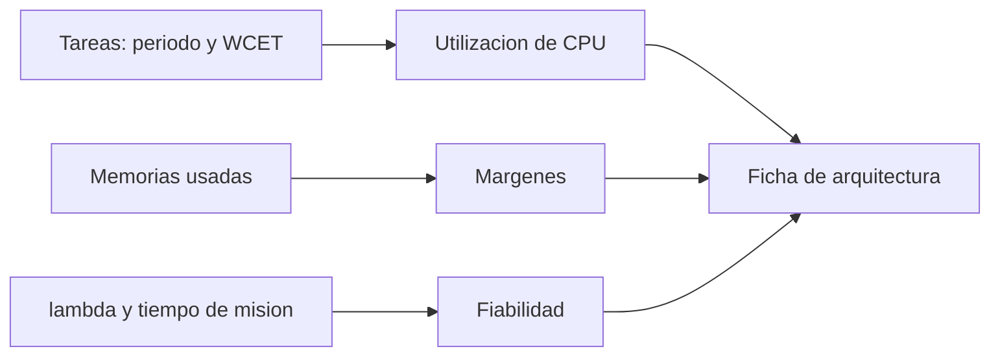

# B88-C01 — Arquitectura de computador de vuelo

<!-- nav:top -->
[🏠 Programa](../../../../README.md) · [📚 Bloque B88](../../../tronco-comun/B88-avionica-y-software-critico-espacial.md) · [← Anterior: B87-C22 — Presupuesto de error de apuntamiento](../../../tronco-comun/B87-sensores-y-control-de-actitud.md#b87-c22) · [Siguiente: B88-C02 — Microcontroladores embarcados →](../B88-C02-microcontroladores-embarcados/CLASE.md)
<!-- /nav -->

## 1. Ubicación, nivel y alcance

Clase 1 del bloque B88. Nivel N3. Un computador de vuelo es el conjunto de procesador, memorias, interfaces y software que ejecuta el control de la nave. Aquí aprendes a describirlo con un **presupuesto**: cuánta CPU y memoria se usan, qué margen queda y qué fiabilidad aporta su configuración redundante. Usas un computador **sintético** de cinco tareas periódicas; no representa a ningún equipo real. Todos los datos son **sintéticos** salvo los que se rotulan como consultados.

## 2. Por qué esta clase existe

Un computador de vuelo no se puede reparar en órbita, así que su arquitectura se decide con números antes de construirlo. La decisión central: **¿alcanzan la CPU y la memoria con margen, y qué redundancia compra qué fiabilidad?**

## 3. Lo que podrás hacer al terminar

1. Calcular la utilización de CPU de un conjunto de tareas periódicas.
2. Calcular el margen de ROM, RAM y memoria no volátil.
3. Calcular la fiabilidad de una unidad simple con tasa de fallo constante.
4. Comparar redundancia caliente y fría con conmutación perfecta e imperfecta.
5. Leer un presupuesto como una tabla de márgenes con criterio explícito.
6. Separar lo sintético de lo consultado.

La evidencia es la **ficha de arquitectura con márgenes y fiabilidad** del ejercicio 12 (sección 20).

## 4. Con qué llegas y cómo comprobarlo

1. ¿Qué es una tarea periódica con período `T` y tiempo de cómputo `C`?
2. ¿Qué es una tasa de fallo constante `λ`?
3. ¿Qué es un margen?
4. ¿Qué distingue ROM de RAM?
5. ¿Qué es redundancia?

<details>
<summary>Ver respuestas</summary>

1. Una actividad que se repite cada `T` y usa `C` de CPU en cada ejecución. 2. Una probabilidad de fallo por hora que no depende de la edad; `R(t)=e^(−λt)`. 3. La holgura entre lo usado y lo disponible, en porcentaje. 4. La ROM conserva el código sin energía; la RAM es de lectura y escritura rápida y se pierde sin energía. 5. Más de una unidad para una misma función.
</details>

Con cuatro o cinco aciertos, sigue; si no, repasa los prerrequisitos.

## 5. Un caso de contexto y casos de referencia

Un computador **sintético** ejecuta cinco tareas: AOCS (100 ms, 12 ms), TM (500 ms, 20 ms), TC (250 ms, 6 ms), FDIR (1000 ms, 40 ms) y Energía (1000 ms, 25 ms). Su utilización es `0,2490`. La memoria es de 2048 KiB de ROM, 1024 KiB de RAM y 256 KiB de memoria no volátil. La misión es de 5 años con `λ = 2×10⁻⁶ /h`. Es un ejemplo escolar: no se tomó de ninguna misión.

## 6. Vocabulario

La **utilización** `U = Σ Cᵢ/Tᵢ`. El **margen** `1 − usado/capacidad`. La **fiabilidad** `R(t)` es la probabilidad de funcionar hasta `t`. La **redundancia caliente** tiene las unidades encendidas a la vez; la **fría** deja la reserva apagada y sin desgaste hasta conmutar. La **cobertura** `c` es la probabilidad de que la conmutación funcione cuando se necesita.

## 7. Modelo mental



*Descripción textual:* tres entradas (tareas, memorias y tasa de fallo) producen tres resultados (utilización, márgenes y fiabilidad) que se reúnen en una ficha de arquitectura.

Analogía: el presupuesto de un computador es como el de una casa: ingresos (capacidad), gastos (uso) y un ahorro de seguridad (margen). Límite: a diferencia del dinero, la CPU no se acumula; lo que no usas en un instante se pierde.

## 8. La explicación, paso a paso

### 8.1 La CPU

`U = 12/100 + 20/500 + 6/250 + 40/1000 + 25/1000 = 0,2490`: el 24,9 % del tiempo. Con el criterio sintético de dejar al menos 30 % libre (`U ≤ 0,70`), **cumple**. Este criterio es del ejemplo, no una norma.

### 8.2 La memoria

El margen es `1 − usado/capacidad`: ROM 27,7 %, RAM 40,4 %, no volátil 62,5 %. La ROM es la más ajustada.

### 8.3 La fiabilidad

Con `λT = 2×10⁻⁶ × 43 800 = 0,0876`: `R = e^(−0,0876) = 0,916127`. Caliente con dos unidades y conmutación perfecta: `R = 1 − (1 − r)² = 0,992965`. Fría perfecta: `R = e^(−λT)(1 + λT) = 0,996380`. Con cobertura `c` : `R = r(1 + c·λT)`; para `c = 0,99` da `0,995577` y para `c = 0,9`, `0,988355`.

### 8.4 Qué enseña la comparación

La fría supera a la caliente porque la reserva no se desgasta mientras espera, pero depende más de que la conmutación funcione: con `c = 0,9` baja de `0,9964` a `0,9884`, por debajo de la caliente.

## 9. Magnitudes, símbolos y unidades

| Símbolo | Qué es | Unidad | Valor / nota |
|---|---|---|---|
| `U` | utilización de CPU | — | 0,2490 |
| `C, T` | tiempo de cómputo y período | ms | ver 5 |
| `λ` | tasa de fallo | 1/h | 2×10⁻⁶ (sintética) |
| `R` | fiabilidad | — | 0,916127 (simple) |
| `c` | cobertura de conmutación | — | 0,9 a 1 |

## 10. Convenciones y referencias

Tiempo en ms para tareas y en horas para fiabilidad. Memoria en KiB (1 KiB = 1024 bytes). Modelo de tasa de fallo constante, fallos independientes, sin latentes. Tolerancias: igualdad de `R` fría con `r(1+λT)` a `10⁻¹⁵`. Sistema de referencia: no aplica. Todo es **sintético**.

## 11. De dónde sale lo que afirmamos

| ID | Fuente | Localizador | Respalda | Estado |
|---|---|---|---|---|
| S1 | NASA, «Software Engineering and Assurance Handbook» NASA-HDBK-2203 — https://swehb.nasa.gov/ (consultada 2026-11-10) | página de inicio | guía informativa (no de requisitos) para cumplir NPR 7150.2D y NASA-STD-8739.8B para quien adquiere, desarrolla, asegura o mantiene software de la NASA | Consultada (solo la página de inicio) |
| S2 | ECSS, «ECSS-E-ST-40C — Software», 6 mar 2009 (reemplazada por la Rev.1 del 30 abr 2025) — https://ecss.nl/standard/ecss-e-st-40c-software-general-requirements/ (consultada 2026-11-10) | página de la norma (solo resumen y alcance; no el texto de requisitos) | alcance: software de producto de un sistema espacial en los segmentos espacial, de lanzamiento y de tierra, desde los requisitos hasta el mantenimiento | Consultada (solo la página) |
| — | Libros de texto de sistemas de tiempo real, tolerancia a fallos y comunicaciones digitales | — | — | No consultada |
| — | Relaciones y algoritmos estándar usados por el laboratorio (utilización, margen y fiabilidad exponencial con redundancia) | — | los verifica el laboratorio con una segunda vía o con pruebas | No consultada en una fuente concreta |

Límites: no se usaron hojas de datos de computadores reales ni tasas de fallo publicadas. El modelo no incluye fallos de causa común ni fallos latentes. Lo simulado no se presenta como dato de vuelo ni como medición.

## 12. Cómo ver los resultados

| Configuración | `R` a 5 años |
|---|---|
| Unidad simple | 0,916127 |
| Caliente (2) | 0,992965 |
| Fría perfecta (2) | 0,996380 |
| Fría, `c = 0,99` | 0,995577 |
| Fría, `c = 0,90` | 0,988355 |

Descripción larga: la fiabilidad sube de 0,916 a casi 0,996 con una reserva, y la cobertura de conmutación puede perder la ventaja de la fría.

## 13. Ejemplo trabajado

**Paso 1 · CPU.** Se suman las cinco utilizaciones: `0,12 + 0,04 + 0,024 + 0,04 + 0,025 = 0,249`.

**Paso 2 · Memoria.** ROM: `1 − 1480/2048 = 0,277`.

**Paso 3 · Fiabilidad.** `λT = 0,0876`; `r = 0,916127`; fría: `r(1 + 0,0876) = 0,99638`.

**Paso 4 · Lectura.** El presupuesto cumple y la reserva fría es mejor siempre que `c` sea alto.

## 14. Distintas formas de describir el problema

**Por tablas:** presupuesto de márgenes (esta clase). **Por diagrama de bloques de fiabilidad:** serie y paralelo (C32 y C33). **Por simulación:** Monte Carlo de fallos (C32). La fórmula fría del laboratorio coincide con `r + λT r` a `10⁻¹⁵`.

## 15. Práctica guiada

**Ejercicio 1 · con los pasos indicados.** Calcula `U` para las cinco tareas del caso.

<details><summary>Solución comentada</summary>

`0,12 + 0,04 + 0,024 + 0,04 + 0,025 = 0,249`.
</details>

**Ejercicio 2 · con una pista.** Calcula el margen de RAM.

<details><summary>Solución comentada</summary>

`1 − 610/1024 = 0,404` (40,4 %).
</details>

**Ejercicio 3 · casi autónomo.** Calcula `R` de la unidad simple.

<details><summary>Solución comentada</summary>

`λT = 0,0876`; `e^(−0,0876) = 0,9161`.
</details>

## 16. Práctica autónoma, transferencia e integrador

**Ejercicio 4 · autónomo.** Calcula la fiabilidad fría perfecta.

<details><summary>Solución comentada</summary>

`0,916127 × 1,0876 = 0,99638`.
</details>

**Ejercicio 5 · autónomo.** Calcula la fiabilidad caliente.

<details><summary>Solución comentada</summary>

`1 − (0,083873)² = 0,992965`.
</details>

**Ejercicio 6 · autónomo.** Calcula la fría con `c = 0,9`.

<details><summary>Solución comentada</summary>

`0,916127 × (1 + 0,9 × 0,0876) = 0,98835`.
</details>

**Ejercicio 7 · autónomo.** ¿Cuántas tareas de utilización 0,10 se pueden añadir sin pasar de 0,70?

<details><summary>Solución comentada</summary>

`(0,70 − 0,249)/0,10 = 4,51`: cuatro tareas.
</details>

**Ejercicio 8 · autónomo.** Aproxima la `1 − R` fría por serie de Taylor.

<details><summary>Solución comentada</summary>

`1 − R ≈ x²/2 − x³/3 = 0,003837 − 0,000224 = 0,003613`, es decir `R = 0,996387`, cercano a `0,99638`.
</details>

**Ejercicio 9 · transferencia.** **Transferencia.** Un colega dice que la fiabilidad de 0,996 vale para un satélite real. ¿Es válida?

<details><summary>Solución comentada</summary>

No: `λ`, tareas y memoria son sintéticos; sirve para aprender el método, no como dato.
</details>

**Ejercicio 10 · transferencia.** **Transferencia.** ¿Qué cambia si hay fallos de causa común en las dos unidades?

<details><summary>Solución comentada</summary>

La redundancia aporta menos: el modelo independiente sobrestima `R`; hace falta un término de causa común.
</details>

**Ejercicio 11 · transferencia.** **Transferencia.** ¿Por qué la ROM es la restricción más ajustada y qué harías?

<details><summary>Solución comentada</summary>

Margen 27,7 %: se recorta código o se pasa a una memoria mayor; se revisa en cada versión.
</details>

**Ejercicio 12 · integrador.** **Integrador.** Elabora tu *ficha de arquitectura con márgenes y fiabilidad*: `U`, márgenes, `R` de tres configuraciones, criterios y lista de qué es sintético.

<details><summary>Solución comentada</summary>

Secciones 8.1–8.4 y la salida del laboratorio.
</details>

## 17. Laboratorio: presupuesto de un computador de vuelo sintético

El script [arquitectura_vuelo.py](arquitectura_vuelo.py) calcula la utilización, los márgenes de memoria y la fiabilidad de configuraciones simple, caliente y fría, y **comprueba** que la fría es igual a `r(1+λT)` y supera a la simple.

**Datos:** todo **sintético** (tareas, memorias, `λ`). **Predice antes de ejecutar:** ¿qué configuración tendrá más fiabilidad con cobertura 0,9? (la caliente, 0,99297, supera a la fría con 0,98835). **Ejecución del 2026-11-10 (Python 3.12.9):**

```text
Python 3.12.9
Datos SINTETICOS: no describen un computador real
Utilizacion de CPU = 0.2490 (24.9 %) ; criterio de margen <= 70 %: cumple
ROM    usado= 1480 KiB cap= 2048 KiB margen= 27.7 %
RAM    usado=  610 KiB cap= 1024 KiB margen= 40.4 %
NVRAM  usado=   96 KiB cap=  256 KiB margen= 62.5 %
lambda=2.0e-06/h  T=43800 h  lambda*T=0.0876
R simple = 0.916127
R caliente (2 unidades, conmutacion perfecta) = 0.99296536
R fria (reserva sin fallo en espera)        = 0.99638000
R fria con cobertura c=1.00: 0.99638000
R fria con cobertura c=0.99: 0.99557747
R fria con cobertura c=0.90: 0.98835473
Pruebas superadas.
```

```bash
python programa/clases/B88/B88-C01-arquitectura-de-computador-de-vuelo/arquitectura_vuelo.py
```

**Límites:** tasa de fallo constante, fallos independientes, sin fallos latentes ni de causa común.

## 18. Errores frecuentes y cómo corregirlos

**Confundir utilización con margen.** Un margen de 30 % significa `U = 0,70`, no `U = 0,30`

**Suponer cobertura perfecta.** Calcula con `c < 1` (8.3)

**Presentar el ejemplo como un equipo real.** Revisa la sección 10

## 19. Cómo sabrás que vas bien

Tras 8.3: ¿qué configuración esperabas mejor con `c = 0,9`? Si dudas, repasa el ejemplo 13. Tras el laboratorio: ¿qué comprueba? (ver sección 17).

## 20. Qué entregas y cómo se evalúa

El producto es tu **ficha de arquitectura con márgenes y fiabilidad** (ejercicio 12).

| Criterio | Inicial | En desarrollo | Logrado | Destacado |
|---|---|---|---|---|
| Conceptos | Los confunde | Parciales | Explica el método y su dominio | Explica los límites y las alternativas |
| Cálculo | Sin unidades | Con errores | Resultados con unidades y comprobados | Resuelve casos nuevos |
| Numérico | Sin comprobar | Un caso | Verifica con una segunda vía en varios casos | Interpreta las diferencias y los fallos |
| Fuentes | Sin fuente | Sin fecha | Fuentes con fecha y estado | Declara lo sintético y lo no consultado |
| Límites | No los nombra | Uno | Tres | Discute qué falta del modelo |

**Condiciones críticas (no se compensan con promedio):** rotular los datos como sintéticos; comprobar cada resultado con una segunda vía; citar solo lo consultado.

## 21. Ética, seguridad y límites

Clase educativa: los modelos son simplificados y los datos son sintéticos; ningún resultado describe una misión real, certifica conformidad con una norma ni sustituye la revisión de especialistas.  Accesibilidad: tablas equivalentes a las gráficas, fórmulas en texto, ejercicios sin conexión.

## 22. Para cerrar y seguir

El computador sintético usa 24,9 % de CPU y su reserva fría eleva la fiabilidad de 0,916 a 0,996 si la conmutación es perfecta. Queda una pregunta: ¿qué componentes concretos soportan la radiación?

**Glosario español–inglés.** computador de vuelo · *flight computer*; utilización · *utilization*; margen · *margin*; reserva fría · *cold standby*; cobertura · *coverage*.

**Continuidad.** [B88-C02](../B88-C02-microcontroladores-embarcados/CLASE.md) trata los microcontroladores.

**Referencias:** ver sección 11.

<!-- nav:bottom -->
---

[← Anterior: B87-C22 — Presupuesto de error de apuntamiento](../../../tronco-comun/B87-sensores-y-control-de-actitud.md#b87-c22) · [📚 Bloque B88](../../../tronco-comun/B88-avionica-y-software-critico-espacial.md) · [Siguiente: B88-C02 — Microcontroladores embarcados →](../B88-C02-microcontroladores-embarcados/CLASE.md)
<!-- /nav -->
