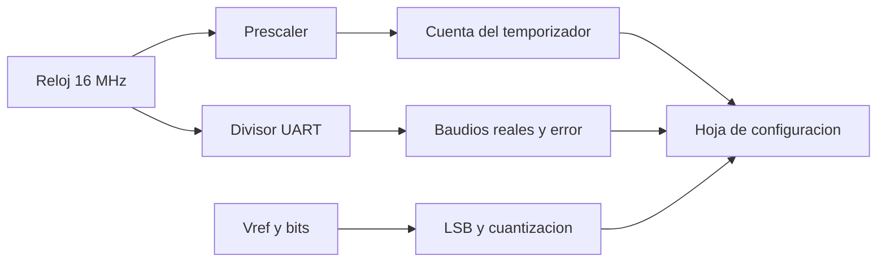

# B88-C02 — Microcontroladores embarcados

<!-- nav:top -->
[🏠 Programa](../../../../README.md) · [📚 Bloque B88](../../../tronco-comun/B88-avionica-y-software-critico-espacial.md) · [← Anterior: B88-C01 — Arquitectura de computador de vuelo](../B88-C01-arquitectura-de-computador-de-vuelo/CLASE.md) · [Siguiente: B88-C03 — Procesadores tolerantes a radiación →](../B88-C03-procesadores-tolerantes-a-radiacion/CLASE.md)
<!-- /nav -->

## 1. Ubicación, nivel y alcance

Clase 2 del bloque B88. Nivel N3. Un microcontrolador integra procesador, memoria, temporizadores, convertidores y puertos en un chip; en una nave maneja sensores, actuadores y subsistemas pequeños. Aquí aprendes a **configurar** sus recursos con cuentas: divisores de reloj, velocidades de transmisión, resolución del convertidor y consumo con ciclo de trabajo. El microcontrolador es **genérico y sintético** (reloj de 16 MHz); no hay hoja de datos de fabricante. Todos los datos son **sintéticos** salvo los que se rotulan como consultados.

## 2. Por qué esta clase existe

Un error de configuración (un divisor mal calculado, una resolución insuficiente) no se ve en el escritorio y aparece en órbita. La decisión central: **¿qué valores de registro dan la temporización, la velocidad y la resolución que exige el requisito, con qué error?**

## 3. Lo que podrás hacer al terminar

1. Calcular el valor de cuenta de un temporizador y su error de redondeo.
2. Calcular el divisor de una UART y el error de velocidad resultante.
3. Calcular el LSB y el error de cuantización de un ADC.
4. Calcular el consumo medio con ciclo de trabajo.
5. Decidir si un error es aceptable frente a una tolerancia explícita.
6. Separar lo sintético de lo consultado.

La evidencia es la **hoja de configuración de un microcontrolador** del ejercicio 12 (sección 20).

## 4. Con qué llegas y cómo comprobarlo

1. ¿Qué es un temporizador con prescaler?
2. ¿Qué es la velocidad de transmisión (baudios)?
3. ¿Qué es un ADC de `n` bits?
4. ¿Qué es el ciclo de trabajo?
5. ¿Qué es un error relativo?

<details>
<summary>Ver respuestas</summary>

1. Un contador que cuenta pulsos del reloj divididos por el prescaler hasta un valor de comparación. 2. Símbolos por segundo en una línea serie. 3. Un convertidor que da `2ⁿ` códigos entre 0 y la tensión de referencia. 4. La fracción del tiempo que el dispositivo está activo. 5. `(real − ideal)/ideal`.
</details>

Con cuatro o cinco aciertos, sigue; si no, repasa los prerrequisitos.

## 5. Un caso de contexto y casos de referencia

Un microcontrolador **sintético** de 16 MHz debe generar una interrupción cada 1 ms, hablar por UART a 115 200 baudios y medir una tensión de 0 a 3,3 V con 12 bits. Con prescaler 64 la cuenta es exactamente 250; con prescaler 256 es 62,5 y se redondea a 62 (error −0,8 %). A 115 200 baudios con divisor 9 el error es −3,55 %. Son datos de ejemplo.

## 6. Vocabulario

El **prescaler** divide el reloj. La **cuenta** `N = f/(presc)·Δt`. El **divisor** de UART `d = f/(16·baud)`. El **LSB** `= Vref/2ⁿ`. El **error de cuantización** máximo es `±LSB/2`. El **modo de bajo consumo** (*sleep*) reduce la corriente mientras no hay trabajo.

## 7. Modelo mental



*Descripción textual:* el reloj alimenta el temporizador y la UART; la referencia y los bits fijan el LSB; los tres resultados forman la hoja de configuración.

Analogía: configurar un microcontrolador es como ajustar un reloj de engranajes: cada divisor es un piñón y solo ciertos cocientes encajan exactamente. Límite: los engranajes reales no tienen error de redondeo en cuentas enteras.

## 8. La explicación, paso a paso

### 8.1 El temporizador

`N = f/presc · Δt`. Con `f = 16 MHz` y `Δt = 1 ms`: prescaler 8 da 2000, prescaler 64 da 250 y prescaler 256 da 62,5. Las cuentas enteras exactas dan error 0; la de 62,5 se redondea a 62 (−0,8 %). Todas caben en 16 bits (`< 65 536`).

### 8.2 La UART

`d = round(f/(16·baud))` y `baud_real = f/(16·d)`. A 9600: `d = 104`, real `9615,4` (+0,16 %). A 115 200: `d = 9`, real `111 111,1` (−3,55 %). A 230 400: `d = 4`, real `250 000` (+8,51 %). Un error de unos pocos por ciento ya puede romper la recepción; por eso se elige el reloj para que el cociente sea casi entero.

### 8.3 El ADC

Con 12 bits y 3,3 V: `LSB = 0,8057 mV` y error de cuantización máximo `±0,4028 mV`. 1,000 V da el código 1241 (0,9998 V).

### 8.4 El consumo

Con 12 mA activo, 0,005 mA dormido y 2 % de ciclo de trabajo: `I = 0,02·12 + 0,98·0,005 = 0,2449 mA`; a 3,3 V, `0,8082 mW` y `19,396 mWh/día`.

## 9. Magnitudes, símbolos y unidades

| Símbolo | Qué es | Unidad | Valor / nota |
|---|---|---|---|
| `f` | frecuencia de reloj | Hz | 16×10⁶ |
| `N` | cuenta del temporizador | — | 250 (presc. 64) |
| `d` | divisor de UART | — | 9 (115 200 baud) |
| `LSB` | paso del ADC | mV | 0,8057 |
| `I` | corriente media | mA | 0,2449 |

## 10. Convenciones y referencias

Frecuencias en Hz, tiempos en s, tensiones en V, corrientes en mA. Modelo ideal: reloj sin deriva, ADC sin error de ganancia ni de offset, UART con divisor de 16 muestras. Tolerancias: cuenta exacta cuando el cociente es entero; error de baudios evaluado frente a un criterio de ejemplo de ±2 %. Todo **sintético**.

## 11. De dónde sale lo que afirmamos

| ID | Fuente | Localizador | Respalda | Estado |
|---|---|---|---|---|
| S1 | NASA, «Software Engineering and Assurance Handbook» NASA-HDBK-2203 — https://swehb.nasa.gov/ (consultada 2026-11-10) | página de inicio | guía informativa (no de requisitos) para cumplir NPR 7150.2D y NASA-STD-8739.8B para quien adquiere, desarrolla, asegura o mantiene software de la NASA | Consultada (solo la página de inicio) |
| — | Libros de texto de sistemas de tiempo real, tolerancia a fallos y comunicaciones digitales | — | — | No consultada |
| — | Relaciones y algoritmos estándar usados por el laboratorio (cuentas de temporizador, divisores de UART, cuantización y consumo medio) | — | los verifica el laboratorio con una segunda vía o con pruebas | No consultada en una fuente concreta |

Límites: no se usó la hoja de datos de ningún microcontrolador; el reloj real tiene deriva y el ADC tiene errores de offset y ganancia que aquí se ignoran. Lo simulado no se presenta como dato de vuelo ni como medición.

## 12. Cómo ver los resultados

| Baudios | Divisor | Real | Error |
|---|---|---|---|
| 9600 | 104 | 9615,4 | +0,16 % |
| 115 200 | 9 | 111 111,1 | −3,55 % |
| 230 400 | 4 | 250 000 | +8,51 % |
| 460 800 | 2 | 500 000 | +8,51 % |

Descripción larga: el error crece con la velocidad porque el divisor entero se hace pequeño.

## 13. Ejemplo trabajado

**Paso 1 · Cuenta.** `16·10⁶/64 · 10⁻³ = 250`.

**Paso 2 · UART.** `16·10⁶/(16·115 200) = 8,68`; se redondea a 9.

**Paso 3 · Error.** `f/(16·9) = 111 111`; `(111 111 − 115 200)/115 200 = −3,55 %`.

**Paso 4 · Decisión.** Con tolerancia ±2 % no cumple: hay que cambiar el reloj o la velocidad.

## 14. Distintas formas de describir el problema

**Por tablas de cuentas:** esta clase. **Por simulación temporal:** un modelo de periferia (C24). **Por hoja de datos:** valores exactos del fabricante (no consultado). El laboratorio verifica que la cuenta 250 sea exacta.

## 15. Práctica guiada

**Ejercicio 1 · con los pasos indicados.** Calcula la cuenta para 100 µs con prescaler 8.

<details><summary>Solución comentada</summary>

`16·10⁶/8 · 10⁻⁴ = 200`.
</details>

**Ejercicio 2 · con una pista.** Calcula el divisor y el error para 57 600 baudios.

<details><summary>Solución comentada</summary>

`16·10⁶/(16·57 600) = 17,36 → 17`; real `58 823,5`; error `+2,12 %`.
</details>

**Ejercicio 3 · casi autónomo.** Calcula el LSB de un ADC de 10 bits con 3,3 V.

<details><summary>Solución comentada</summary>

`3,3/1024 = 3,222 mV`.
</details>

## 16. Práctica autónoma, transferencia e integrador

**Ejercicio 4 · autónomo.** ¿Cuántos bits hacen falta para resolver 1 mV en 0–3,3 V?

<details><summary>Solución comentada</summary>

`3,3/0,001 = 3300` niveles → 12 bits (4096).
</details>

**Ejercicio 5 · autónomo.** Calcula la corriente media con 1 % de ciclo de trabajo.

<details><summary>Solución comentada</summary>

`0,01·12 + 0,99·0,005 = 0,12495 mA`.
</details>

**Ejercicio 6 · autónomo.** Calcula la energía por día de la configuración del caso.

<details><summary>Solución comentada</summary>

`0,2449 mA × 3,3 V × 24 h = 19,40 mWh`.
</details>

**Ejercicio 7 · autónomo.** ¿Qué prescaler da 1 ms con la cuenta exacta más pequeña?

<details><summary>Solución comentada</summary>

El 256 da 62,5 (no exacto); el 64 da 250 y el 8, 2000. Entre los exactos, el 64.
</details>

**Ejercicio 8 · autónomo.** ¿Por qué no se usa 230 400 baudios con este reloj?

<details><summary>Solución comentada</summary>

El error es +8,51 %, mayor que la tolerancia de ejemplo de 2 %.
</details>

**Ejercicio 9 · transferencia.** **Transferencia.** Un colega dice que el resultado vale para un procesador real. ¿Es válido?

<details><summary>Solución comentada</summary>

No: es un reloj y un modelo genéricos; hay que usar la hoja de datos y medir.
</details>

**Ejercicio 10 · transferencia.** **Transferencia.** ¿Qué cambia si el reloj deriva un +1 %?

<details><summary>Solución comentada</summary>

Todas las cuentas y baudios cambian +1 %; se suman a los errores de redondeo y puede que dejen de cumplir.
</details>

**Ejercicio 11 · transferencia.** **Transferencia.** ¿Qué harías para que 115 200 baudios tenga error pequeño?

<details><summary>Solución comentada</summary>

Elegir un reloj con `f/(16·115 200)` casi entero, por ejemplo 18,432 MHz (divisor 10 exacto).
</details>

**Ejercicio 12 · integrador.** **Integrador.** Elabora tu *hoja de configuración de un microcontrolador*: cuentas, divisores con error, LSB, consumo y lista de qué es sintético.

<details><summary>Solución comentada</summary>

Secciones 8.1–8.4 y la salida del laboratorio.
</details>

## 17. Laboratorio: configuración de un microcontrolador sintético

El script [microcontrolador.py](microcontrolador.py) calcula cuentas del temporizador, divisores y errores de la UART, el LSB y los códigos del ADC y el consumo medio, y **comprueba** que la cuenta con prescaler 64 es exactamente 250.

**Datos:** todo **sintético** (reloj de 16 MHz y corrientes de ejemplo). **Predice antes de ejecutar:** ¿cuál de los cuatro baudios tendrá menor error? (9600, con +0,16 %). **Ejecución del 2026-11-10 (Python 3.12.9):**

```text
Python 3.12.9
Datos SINTETICOS: un microcontrolador generico, sin hoja de datos de fabricante
prescaler   8: cuentas=  2000.000 ->   2000  error=+0.0000 %  (cabe en 16 bit: True)
prescaler  64: cuentas=   250.000 ->    250  error=+0.0000 %  (cabe en 16 bit: True)
prescaler 256: cuentas=    62.500 ->     62  error=-0.8000 %  (cabe en 16 bit: True)
baud   9600: divisor= 104 real=    9615.4 error=+0.16 %
baud 115200: divisor=   9 real=  111111.1 error=-3.55 %
baud 230400: divisor=   4 real=  250000.0 error=+8.51 %
baud 460800: divisor=   2 real=  500000.0 error=+8.51 %
LSB = 0.8057 mV ; error de cuantizacion max = +-0.4028 mV
V=0.0000 -> codigo    0 -> 0.0000 V
V=1.0000 -> codigo 1241 -> 0.9998 V
V=1.6500 -> codigo 2048 -> 1.6500 V
V=3.2999 -> codigo 4095 -> 3.2992 V
I media = 0.2449 mA ; potencia = 0.8082 mW ; energia/dia = 19.396 mWh
Pruebas superadas.
```

```bash
python programa/clases/B88/B88-C02-microcontroladores-embarcados/microcontrolador.py
```

**Límites:** modelo ideal sin deriva de reloj ni errores de ADC.

## 18. Errores frecuentes y cómo corregirlos

**Redondear el divisor sin calcular el error.** Calcula el baudio real (8.2)

**Olvidar el límite de 16 bits del temporizador.** Comprueba `N < 65 536` (8.1)

**Presentar el ejemplo como un chip real.** Revisa la sección 10

## 19. Cómo sabrás que vas bien

Tras 8.2: ¿qué error esperabas a 115 200? Si dudas, repasa el ejemplo 13. Tras el laboratorio: ¿qué comprueba? (ver sección 17).

## 20. Qué entregas y cómo se evalúa

El producto es tu **hoja de configuración de un microcontrolador** (ejercicio 12).

| Criterio | Inicial | En desarrollo | Logrado | Destacado |
|---|---|---|---|---|
| Conceptos | Los confunde | Parciales | Explica el método y su dominio | Explica los límites y las alternativas |
| Cálculo | Sin unidades | Con errores | Resultados con unidades y comprobados | Resuelve casos nuevos |
| Numérico | Sin comprobar | Un caso | Verifica con una segunda vía en varios casos | Interpreta las diferencias y los fallos |
| Fuentes | Sin fuente | Sin fecha | Fuentes con fecha y estado | Declara lo sintético y lo no consultado |
| Límites | No los nombra | Uno | Tres | Discute qué falta del modelo |

**Condiciones críticas (no se compensan con promedio):** rotular los datos como sintéticos; comprobar cada resultado con una segunda vía; citar solo lo consultado.

## 21. Ética, seguridad y límites

Clase educativa: los modelos son simplificados y los datos son sintéticos; ningún resultado describe una misión real, certifica conformidad con una norma ni sustituye la revisión de especialistas.  Accesibilidad: tablas equivalentes a las gráficas, fórmulas en texto, ejercicios sin conexión.

## 22. Para cerrar y seguir

Con 16 MHz, la cuenta 250 da 1 ms exactos, 115 200 baudios tiene −3,55 % de error y el ADC de 12 bits resuelve 0,8057 mV. Queda una pregunta: ¿qué ocurre con esos registros cuando una partícula cargada los golpea?

**Glosario español–inglés.** microcontrolador · *microcontroller*; prescaler · *prescaler*; divisor · *divisor*; cuantización · *quantization*; ciclo de trabajo · *duty cycle*.

**Continuidad.** [B88-C03](../B88-C03-procesadores-tolerantes-a-radiacion/CLASE.md) trata los procesadores tolerantes a radiación.

**Referencias:** ver sección 11.

<!-- nav:bottom -->
---

[← Anterior: B88-C01 — Arquitectura de computador de vuelo](../B88-C01-arquitectura-de-computador-de-vuelo/CLASE.md) · [📚 Bloque B88](../../../tronco-comun/B88-avionica-y-software-critico-espacial.md) · [Siguiente: B88-C03 — Procesadores tolerantes a radiación →](../B88-C03-procesadores-tolerantes-a-radiacion/CLASE.md)
<!-- /nav -->
