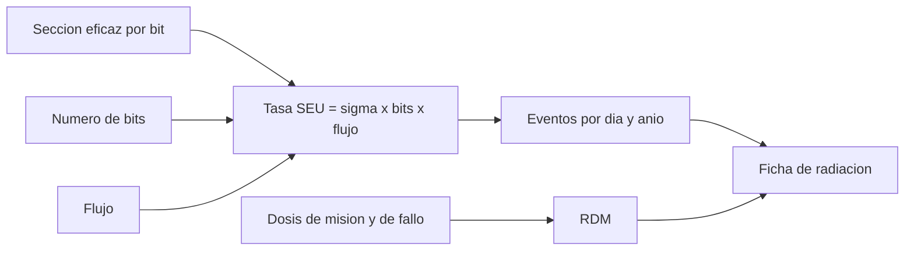

# B88-C03 — Procesadores tolerantes a radiación

<!-- nav:top -->
[🏠 Programa](../../../../README.md) · [📚 Bloque B88](../../../tronco-comun/B88-avionica-y-software-critico-espacial.md) · [← Anterior: B88-C02 — Microcontroladores embarcados](../B88-C02-microcontroladores-embarcados/CLASE.md) · [Siguiente: B88-C04 — Memorias y corrección de errores →](../B88-C04-memorias-y-correccion-de-errores/CLASE.md)
<!-- /nav -->

## 1. Ubicación, nivel y alcance

Clase 3 del bloque B88. Nivel N3. La radiación espacial puede invertir un bit de memoria (*efecto de evento único*, SEU) o degradar un componente con la dosis acumulada (*dosis ionizante total*, TID). Aquí aprendes a **estimar la tasa de SEU** con una sección eficaz y un flujo, a leer una curva sección eficaz–LET y a calcular el margen de dosis. Los datos son **sintéticos**; la página del programa NEPP de la NASA solo enlaza a bases de datos de radiación y no se usó para valores. Todos los datos son **sintéticos** salvo los que se rotulan como consultados.

## 2. Por qué esta clase existe

Un procesador comercial puede fallar en órbita por una sola partícula. La decisión central: **¿cuántos eventos esperar al año y qué margen de dosis hay respecto del fallo del componente?** De ello depende si se usa un procesador endurecido, corrección de errores o ambos.

## 3. Lo que podrás hacer al terminar

1. Calcular la tasa de SEU como `σ · bits · Φ`.
2. Convertirla a eventos por día y por año.
3. Evaluar una curva de Weibull de sección eficaz frente al LET.
4. Calcular el margen de diseño de dosis (RDM).
5. Verificar con Monte Carlo que los conteos siguen Poisson.
6. Separar lo sintético de lo consultado.

La evidencia es la **ficha de tasa de SEU y margen de dosis** del ejercicio 12 (sección 20).

## 4. Con qué llegas y cómo comprobarlo

1. ¿Qué es la sección eficaz?
2. ¿Qué es el flujo `Φ`?
3. ¿Qué es el LET?
4. ¿Qué es una distribución de Poisson?
5. ¿Qué es una dosis en krad(Si)?

<details>
<summary>Ver respuestas</summary>

1. Un área efectiva por bit; cuanto mayor, más sensible. 2. Partículas por cm² y por segundo. 3. La energía que una partícula deposita por unidad de longitud y densidad (MeV·cm²/mg). 4. La de conteos de eventos independientes con tasa constante; media = varianza. 5. Energía absorbida por masa de silicio, acumulada en el tiempo.
</details>

Con cuatro o cinco aciertos, sigue; si no, repasa los prerrequisitos.

## 5. Un caso de contexto y casos de referencia

Una memoria **sintética** de 64 KiB (524 288 bits) tiene `σ = 10⁻¹⁴ cm²/bit` y se expone a un flujo de `100 /cm²/s` con LET sobre el umbral. La tasa es `5,243×10⁻⁷ /s = 0,0453 /día = 16,53 /año`. La misión acumula 20 krad(Si) y el componente falla a 60 krad(Si): `RDM = 3`. Todo es de ejemplo: no son datos de un componente real ni de una órbita real.

## 6. Vocabulario

El **SEU** (*single event upset*) invierte un bit. La **sección eficaz** `σ`. El **LET umbral** `L₀` es el LET mínimo con que ocurre el evento. La curva de **Weibull** `σ(L) = σ_sat(1 − exp(−((L − L₀)/W)^s))`. El **RDM** (*radiation design margin*) `= dosis de fallo / dosis de misión`. La **TID** es la dosis ionizante total.

## 7. Modelo mental



*Descripción textual:* la sección eficaz, los bits y el flujo dan la tasa de SEU y sus conteos anuales; la dosis da el margen; ambos forman la ficha de radiación.

Analogía: los SEU son como gotas de lluvia sobre un tablero de casillas: cuanto más grande la casilla (σ) y más fuerte la lluvia (Φ), más casillas mojadas. Límite: una partícula no moja casillas al azar con igual probabilidad; la sección eficaz depende del LET.

## 8. La explicación, paso a paso

### 8.1 La tasa

`R = σ · N · Φ = 10⁻¹⁴ × 524 288 × 100 = 5,243×10⁻⁷ /s`. Por día `0,0453` y por año `16,53`. El tiempo medio entre eventos es `1/0,045298 = 22,1 d`.

### 8.2 La curva de LET

Con Weibull sintético (`σ_sat = 10⁻¹⁴`, `L₀ = 1`, `W = 20`, `s = 1,5`): bajo `L₀` la sección es 0; a LET 2 vale `1,11×10⁻¹⁶`; a 15, `4,43×10⁻¹⁵`; a 80, `9,996×10⁻¹⁵ ≈ σ_sat`. La sección crece y se **satura**.

### 8.3 La dosis

`RDM = 60/20 = 3`. Con el criterio de ejemplo `RDM ≥ 2` cumple; un componente con 60 krad de fallo admite hasta 30 krad de misión con `RDM = 2`.

### 8.4 Monte Carlo

Con semilla 88, 2000 corridas de un año: media `16,575` (teoría `16,534`), varianza `16,477`: Poisson tiene media igual a varianza.

## 9. Magnitudes, símbolos y unidades

| Símbolo | Qué es | Unidad | Valor / nota |
|---|---|---|---|
| `σ` | sección eficaz por bit | cm²/bit | 10⁻¹⁴ (sintética) |
| `Φ` | flujo | 1/(cm²·s) | 100 (sintético) |
| `R` | tasa de SEU | 1/s | 5,243×10⁻⁷ |
| `L` | LET | MeV·cm²/mg | 0,5 a 80 |
| `RDM` | margen de dosis | — | 3 |

## 10. Convenciones y referencias

Eventos independientes con tasa constante (Poisson). Flujo único (no hay espectro de LET integrado). Dosis en krad(Si). Tolerancia: media Monte Carlo a menos de 20 % de la teórica. Semilla `88`. Todo **sintético**.

## 11. De dónde sale lo que afirmamos

| ID | Fuente | Localizador | Respalda | Estado |
|---|---|---|---|---|
| S1 | NASA, Electronic Parts and Packaging Program (NEPP) — https://nepp.nasa.gov/ (consultada 2026-11-10) | página de inicio | el programa genera conocimiento técnico sobre partes EEE y enlaza a bases de datos de pruebas de radiación; la página no describe efectos de radiación | Consultada (solo la página; sin datos de radiación) |
| S2 | NASA, «Software Engineering and Assurance Handbook» NASA-HDBK-2203 — https://swehb.nasa.gov/ (consultada 2026-11-10) | página de inicio | guía informativa (no de requisitos) para cumplir NPR 7150.2D y NASA-STD-8739.8B para quien adquiere, desarrolla, asegura o mantiene software de la NASA | Consultada (solo la página de inicio) |
| — | Hojas de datos de fabricantes de componentes (microcontroladores, procesadores y memorias endurecidos) | — | — | No consultada |
| — | Libros de texto de sistemas de tiempo real, tolerancia a fallos y comunicaciones digitales | — | — | No consultada |
| — | Relaciones y algoritmos estándar usados por el laboratorio (tasa de SEU = σ·N·Φ, curva de Weibull, RDM y conteos Poisson) | — | los verifica el laboratorio con una segunda vía o con pruebas | No consultada en una fuente concreta |

Límites: no se consultaron datos de radiación de ningún componente ni de ninguna órbita; la página de NEPP no describe efectos de radiación. No se integra el espectro de LET ni se modelan latch-up o fallos múltiples. Lo simulado no se presenta como dato de vuelo ni como medición.

## 12. Cómo ver los resultados

| LET (MeV·cm²/mg) | σ por bit (cm²) |
|---|---|
| 0,5 | 0 |
| 2 | 1,11×10⁻¹⁶ |
| 15 | 4,43×10⁻¹⁵ |
| 80 | 9,996×10⁻¹⁵ |

Descripción larga: la sección eficaz parte de cero bajo el umbral y se satura cerca de `10⁻¹⁴ cm²`.

## 13. Ejemplo trabajado

**Paso 1 · Bits.** `64 × 1024 × 8 = 524 288`.

**Paso 2 · Tasa.** `10⁻¹⁴ × 524 288 × 100 = 5,243×10⁻⁷ /s`.

**Paso 3 · Año.** `5,243×10⁻⁷ × 86 400 × 365 = 16,53`.

**Paso 4 · Lectura.** Unos 17 eventos al año: sin protección, una palabra podría corromperse unas 17 veces; la corrección de errores (C04) los absorbe.

## 14. Distintas formas de describir el problema

**Por tasa media:** esta clase. **Por curva de LET integrada con el espectro:** método de las referencias de radiación (no consultado). **Por Monte Carlo:** conteos aleatorios. La media simulada difiere de la teórica un 0,2 %.

## 15. Práctica guiada

**Ejercicio 1 · con los pasos indicados.** Calcula los bits de una memoria de 1 MiB.

<details><summary>Solución comentada</summary>

`1 048 576 × 8 = 8 388 608`.
</details>

**Ejercicio 2 · con una pista.** Calcula la tasa por año con `σ = 2×10⁻¹⁴`.

<details><summary>Solución comentada</summary>

El doble: `33,06 /año`.
</details>

**Ejercicio 3 · casi autónomo.** Calcula el tiempo medio entre SEU del caso.

<details><summary>Solución comentada</summary>

`1/0,045298 = 22,1 d`.
</details>

## 16. Práctica autónoma, transferencia e integrador

**Ejercicio 4 · autónomo.** Calcula la probabilidad de cero eventos en un año (Poisson).

<details><summary>Solución comentada</summary>

`e^(−16,53) = 6,6×10⁻⁸`.
</details>

**Ejercicio 5 · autónomo.** Calcula el RDM si el componente falla a 45 krad y la misión da 20.

<details><summary>Solución comentada</summary>

`45/20 = 2,25`.
</details>

**Ejercicio 6 · autónomo.** ¿Qué dosis de misión admite un componente de 60 krad con `RDM = 2`?

<details><summary>Solución comentada</summary>

`60/2 = 30 krad(Si)`.
</details>

**Ejercicio 7 · autónomo.** ¿Qué sección eficaz da la curva a LET 5?

<details><summary>Solución comentada</summary>

`8,556×10⁻¹⁶ cm²` según la salida.
</details>

**Ejercicio 8 · autónomo.** ¿Por qué sube la tasa con el tamaño de la memoria?

<details><summary>Solución comentada</summary>

`R` es proporcional a `N`: el doble de bits, el doble de eventos.
</details>

**Ejercicio 9 · transferencia.** **Transferencia.** Un colega dice que 16 SEU/año vale para el procesador de su misión. ¿Es válido?

<details><summary>Solución comentada</summary>

No: `σ`, `Φ` y bits son sintéticos; hay que usar datos de prueba y del entorno de la órbita.
</details>

**Ejercicio 10 · transferencia.** **Transferencia.** ¿Qué cambia en un flujo 10 veces mayor (tormenta solar)?

<details><summary>Solución comentada</summary>

La tasa sube 10 veces (`165 /año` equivalente); la protección debe dimensionarse para el peor caso.
</details>

**Ejercicio 11 · transferencia.** **Transferencia.** ¿Qué diferencia hay entre SEU y TID?

<details><summary>Solución comentada</summary>

SEU es un evento aislado y recuperable; TID es acumulativa y degrada el componente.
</details>

**Ejercicio 12 · integrador.** **Integrador.** Elabora tu *ficha de tasa de SEU y margen de dosis*: `σ`, bits, flujo, tasa, RDM, Monte Carlo y lista de qué es sintético.

<details><summary>Solución comentada</summary>

Secciones 8.1–8.4 y la salida del laboratorio.
</details>

## 17. Laboratorio: tasa de SEU, margen de dosis y Monte Carlo sintéticos

El script [tasa_seu.py](tasa_seu.py) calcula la tasa de SEU, la curva de Weibull, el RDM y una simulación Poisson con semilla 88, y **comprueba** que la media simulada está a menos de 20 % de la teórica.

**Datos:** todo **sintético** (`σ`, flujo, dosis). **Predice antes de ejecutar:** ¿qué varianza tendrán los conteos anuales? (igual a la media, unos 16,5). **Ejecución del 2026-11-10 (Python 3.12.9):**

```text
Python 3.12.9
Datos SINTETICOS: secciones eficaces, flujos y dosis inventados; NO son de un componente real
bits=524288  tasa SEU = 5.243e-07 /s = 0.045298 /dia = 16.53 /anio
LET=  0.5 MeV cm2/mg  sigma/bit=0.000e+00 cm2
LET=  2.0 MeV cm2/mg  sigma/bit=1.112e-16 cm2
LET=  5.0 MeV cm2/mg  sigma/bit=8.556e-16 cm2
LET= 15.0 MeV cm2/mg  sigma/bit=4.433e-15 cm2
LET= 40.0 MeV cm2/mg  sigma/bit=9.343e-15 cm2
LET= 80.0 MeV cm2/mg  sigma/bit=9.996e-15 cm2
RDM = 3.00  (criterio sintetico RDM >= 2: cumple)
Monte Carlo (semilla 88, 2000 corridas): media=16.575 (teoria 16.534)  varianza=16.477 (Poisson: igual a la media)
Pruebas superadas.
```

```bash
python programa/clases/B88/B88-C03-procesadores-tolerantes-a-radiacion/tasa_seu.py
```

**Límites:** flujo único, sin espectro de LET, sin latch-up ni eventos múltiples.

## 18. Errores frecuentes y cómo corregirlos

**Usar σ de un componente como si fuera de otro.** σ es propia de cada parte y de su LET

**Confundir SEU con TID.** SEU es instantáneo y TID acumulativo (ejercicio 11)

**Presentar el ejemplo como una predicción de misión.** Revisa la sección 10

## 19. Cómo sabrás que vas bien

Tras 8.1: ¿cuántos eventos esperabas por año? Si dudas, repasa el ejemplo 13. Tras el laboratorio: ¿qué comprueba? (ver sección 17).

## 20. Qué entregas y cómo se evalúa

El producto es tu **ficha de tasa de SEU y margen de dosis** (ejercicio 12).

| Criterio | Inicial | En desarrollo | Logrado | Destacado |
|---|---|---|---|---|
| Conceptos | Los confunde | Parciales | Explica el método y su dominio | Explica los límites y las alternativas |
| Cálculo | Sin unidades | Con errores | Resultados con unidades y comprobados | Resuelve casos nuevos |
| Numérico | Sin comprobar | Un caso | Verifica con una segunda vía en varios casos | Interpreta las diferencias y los fallos |
| Fuentes | Sin fuente | Sin fecha | Fuentes con fecha y estado | Declara lo sintético y lo no consultado |
| Límites | No los nombra | Uno | Tres | Discute qué falta del modelo |

**Condiciones críticas (no se compensan con promedio):** rotular los datos como sintéticos; comprobar cada resultado con una segunda vía; citar solo lo consultado.

## 21. Ética, seguridad y límites

Clase educativa: los modelos son simplificados y los datos son sintéticos; ningún resultado describe una misión real, certifica conformidad con una norma ni sustituye la revisión de especialistas.  Accesibilidad: tablas equivalentes a las gráficas, fórmulas en texto, ejercicios sin conexión.

## 22. Para cerrar y seguir

Con los datos de ejemplo se esperan 16,5 SEU al año y un RDM de 3. Queda una pregunta: ¿cómo corrige la memoria esos bits invertidos?

**Glosario español–inglés.** evento de upset único · *single event upset*; sección eficaz · *cross section*; dosis ionizante total · *total ionizing dose*; margen de diseño · *design margin*.

**Continuidad.** [B88-C04](../B88-C04-memorias-y-correccion-de-errores/CLASE.md) trata las memorias y la corrección de errores.

**Referencias:** ver sección 11.

<!-- nav:bottom -->
---

[← Anterior: B88-C02 — Microcontroladores embarcados](../B88-C02-microcontroladores-embarcados/CLASE.md) · [📚 Bloque B88](../../../tronco-comun/B88-avionica-y-software-critico-espacial.md) · [Siguiente: B88-C04 — Memorias y corrección de errores →](../B88-C04-memorias-y-correccion-de-errores/CLASE.md)
<!-- /nav -->
