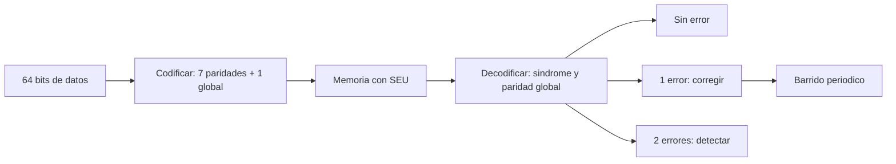

# B88-C04 — Memorias y corrección de errores

<!-- nav:top -->
[🏠 Programa](../../../../README.md) · [📚 Bloque B88](../../../tronco-comun/B88-avionica-y-software-critico-espacial.md) · [← Anterior: B88-C03 — Procesadores tolerantes a radiación](../B88-C03-procesadores-tolerantes-a-radiacion/CLASE.md) · [Siguiente: B88-C05 — Sistemas de tiempo real →](../../../tronco-comun/B88-avionica-y-software-critico-espacial.md#b88-c05)
<!-- /nav -->

## 1. Ubicación, nivel y alcance

Clase 4 del bloque B88. Nivel N3. Una memoria de vuelo corrige errores con códigos como Hamming SECDED, que corrige un bit y detecta dos (*single error correction, double error detection*). Aquí implementas un código (72,64), le inyectas errores y calculas cómo el **barrido** (*scrubbing*) evita que se acumulen dos errores en la misma palabra. Los datos son **sintéticos**. Todos los datos son **sintéticos** salvo los que se rotulan como consultados.

## 2. Por qué esta clase existe

Sin corrección, un SEU corrompe un dato; con SECDED lo corrige al leerlo, pero si dos errores se acumulan en la misma palabra el código ya no corrige. La decisión central: **¿cada cuánto hay que barrer la memoria para que la probabilidad de doble error sea aceptable?**

## 3. Lo que podrás hacer al terminar

1. Calcular los bits de paridad que necesita un Hamming y la sobrecarga.
2. Codificar y decodificar una palabra con SECDED.
3. Comprobar la corrección de un error y la detección de dos.
4. Calcular la probabilidad de doble error según el intervalo de barrido.
5. Interpretar la sobrecarga de 12,5 % del (72,64).
6. Separar lo sintético de lo consultado.

La evidencia es la **tabla de corrección/detección y de barrido** del ejercicio 12 (sección 20).

## 4. Con qué llegas y cómo comprobarlo

1. ¿Qué es un bit de paridad?
2. ¿Qué es la distancia de Hamming?
3. ¿Qué es el síndrome?
4. ¿Qué es una distribución de Poisson?
5. ¿Qué es una potencia de dos?

<details>
<summary>Ver respuestas</summary>

1. Un bit que hace par (o impar) el número de unos de un grupo. 2. El número de bits en que difieren dos palabras. 3. El resultado de recalcular las paridades; indica la posición del error. 4. Conteo de eventos independientes con tasa constante. 5. `1, 2, 4, 8, …`; en Hamming ocupan las posiciones de paridad.
</details>

Con cuatro o cinco aciertos, sigue; si no, repasa los prerrequisitos.

## 5. Un caso de contexto y casos de referencia

Una palabra de 64 bits se guarda con 8 bits de redundancia (72 en total): 7 de Hamming y 1 de paridad global. En el laboratorio se inyecta un error en 2000 palabras aleatorias y se corrigen las 2000; con dos errores se detectan las 2000. Con una tasa de inversión de `10⁻⁹ /bit/h` y barrido cada 24 h, la probabilidad de dos errores en una palabra es `1,49×10⁻¹²`. Todo **sintético**.

## 6. Vocabulario

El **código Hamming** pone bits de paridad en las posiciones potencia de dos. El **síndrome** `s` es la suma de las posiciones de paridad que fallan. La **paridad global** distingue uno de dos errores. **SECDED** corrige uno y detecta dos. El **barrido** relee y reescribe la memoria para limpiar errores aislados.

## 7. Modelo mental



*Descripción textual:* los datos se codifican; la memoria sufre inversiones; al decodificar el síndrome y la paridad global dicen si no hay error, si se corrige uno o si se detectan dos; el barrido repite la lectura para que los errores no se acumulen.

Analogía: el código es como un corrector que lee una columna de cifras con una suma de control: si una cifra cambia, la suma señala cuál. Límite: con dos cifras cambiadas la suma señala una equivocada, por eso se añade la paridad global.

## 8. La explicación, paso a paso

### 8.1 Cuántos bits de paridad

Hacen falta `p` bits con `2ᵖ ≥ k + p + 1`. Para `k = 64`, `p = 7` (`128 ≥ 72`); con la paridad global son 8: `(72,64)`. La sobrecarga es `72/64 = 1,125`, es decir 12,5 %.

### 8.2 Codificar y decodificar

Los 64 bits de datos ocupan las posiciones 1…71 que no son potencia de dos; cada bit de paridad `2ʲ` cubre las posiciones cuyo bit `j` es 1. Al decodificar, el síndrome `s` apunta a la posición errónea; si la paridad global falla se corrige esa posición (un error); si el síndrome es distinto de 0 y la paridad global no falla, hay **dos** errores: se detectan sin corregir.

### 8.3 Resultado de las pruebas

Con semilla 4, 2000 palabras con un error: 2000 corregidas, 0 mal. 2000 con dos errores: 2000 detectadas, 0 no detectadas.

### 8.4 El barrido

La probabilidad de al menos dos inversiones en una palabra durante un intervalo es `1 − e^(−λ)(1 + λ)` con `λ = 72·q·t`. Con `q = 10⁻⁹ /bit/h` y `2²⁰` palabras: barrido cada 1 h, `2,8×10⁻⁹` palabras con doble error; cada 24 h, `1,6×10⁻⁶`; cada 30 d, `1,4×10⁻³`; cada año, `0,21`.

## 9. Magnitudes, símbolos y unidades

| Símbolo | Qué es | Unidad | Valor / nota |
|---|---|---|---|
| `k` | bits de datos | bit | 64 |
| `p` | bits de paridad Hamming | bit | 7 (+1 global) |
| `q` | tasa de inversión | 1/(bit·h) | 10⁻⁹ (sintética) |
| `t` | intervalo de barrido | h | 1 a 8760 |
| `P₂` | probabilidad de ≥2 errores | — | 1,49×10⁻¹² (24 h) |

## 10. Convenciones y referencias

Posiciones numeradas desde 1; paridad par. Errores independientes e inyectados por el script con semilla `4`. Tolerancia: 0 fallos de corrección y 0 dobles no detectados. Todo **sintético**.

## 11. De dónde sale lo que afirmamos

| ID | Fuente | Localizador | Respalda | Estado |
|---|---|---|---|---|
| S1 | NASA, «Software Engineering and Assurance Handbook» NASA-HDBK-2203 — https://swehb.nasa.gov/ (consultada 2026-11-10) | página de inicio | guía informativa (no de requisitos) para cumplir NPR 7150.2D y NASA-STD-8739.8B para quien adquiere, desarrolla, asegura o mantiene software de la NASA | Consultada (solo la página de inicio) |
| — | Hojas de datos de fabricantes de componentes (microcontroladores, procesadores y memorias endurecidos) | — | — | No consultada |
| — | Libros de texto de sistemas de tiempo real, tolerancia a fallos y comunicaciones digitales | — | — | No consultada |
| — | Relaciones y algoritmos estándar usados por el laboratorio (Hamming SECDED y probabilidad de doble error con intervalo de barrido) | — | los verifica el laboratorio con una segunda vía o con pruebas | No consultada en una fuente concreta |

Límites: no se consultó ningún código de memoria real ni su arquitectura; los errores inyectados son de un bit independientes (no se modelan eventos de varios bits por una partícula). Lo simulado no se presenta como dato de vuelo ni como medición.

## 12. Cómo ver los resultados

| Barrido cada | `P(≥2)` por palabra | Palabras esperadas con doble |
|---|---|---|
| 1 h | 2,67×10⁻¹⁵ | 2,8×10⁻⁹ |
| 24 h | 1,49×10⁻¹² | 1,6×10⁻⁶ |
| 30 d | 1,34×10⁻⁹ | 1,4×10⁻³ |
| 1 año | 1,99×10⁻⁷ | 0,21 |

Descripción larga: la probabilidad de doble error crece con el cuadrado del intervalo de barrido.

## 13. Ejemplo trabajado

**Paso 1 · Paridad.** Para 64 datos: `2⁷ = 128 ≥ 64 + 7 + 1`, `p = 7`; más la global, 8.

**Paso 2 · Sobrecarga.** `72/64 = 1,125`.

**Paso 3 · Barrido de 24 h.** `λ = 72 × 10⁻⁹ × 24 = 1,728×10⁻⁶`; `P₂ ≈ λ²/2 = 1,49×10⁻¹²`.

**Paso 4 · Memoria.** `1,49×10⁻¹² × 2²⁰ = 1,6×10⁻⁶` palabras al día.

## 14. Distintas formas de describir el problema

**Por paridades:** Hamming (esta clase). **Por polinomios:** BCH y Reed–Solomon (no consultado). **Por duplicación:** copias con votación (C33). El laboratorio comprueba 4000 casos sin un fallo.

## 15. Práctica guiada

**Ejercicio 1 · con los pasos indicados.** Calcula `p` para 32 bits de datos.

<details><summary>Solución comentada</summary>

`2⁶ = 64 ≥ 32 + 6 + 1 = 39`, `p = 6`; con la global son 7: (39,32).
</details>

**Ejercicio 2 · con una pista.** Calcula la sobrecarga del (39,32).

<details><summary>Solución comentada</summary>

`39/32 = 1,219` (21,9 %).
</details>

**Ejercicio 3 · casi autónomo.** Calcula `λ` para barrido de 720 h.

<details><summary>Solución comentada</summary>

`72 × 10⁻⁹ × 720 = 5,18×10⁻⁵`.
</details>

## 16. Práctica autónoma, transferencia e integrador

**Ejercicio 4 · autónomo.** Calcula `P₂` aproximada con `λ²/2` para 24 h.

<details><summary>Solución comentada</summary>

`(1,728×10⁻⁶)²/2 = 1,49×10⁻¹²`.
</details>

**Ejercicio 5 · autónomo.** ¿Cuántas palabras con doble error al año con barrido diario?

<details><summary>Solución comentada</summary>

`1,6×10⁻⁶ × 365 = 5,7×10⁻⁴`.
</details>

**Ejercicio 6 · autónomo.** ¿Cómo cambia `P₂` si el barrido es el doble de largo?

<details><summary>Solución comentada</summary>

Se cuadruplica (crece con `t²`).
</details>

**Ejercicio 7 · autónomo.** ¿Qué pasa con un error en el bit de paridad global?

<details><summary>Solución comentada</summary>

El síndrome es 0 y la paridad global falla: se corrige ese bit sin tocar los datos.
</details>

**Ejercicio 8 · autónomo.** ¿Por qué hace falta la paridad global?

<details><summary>Solución comentada</summary>

Sin ella, dos errores producen un síndrome que parece un error simple y se «corrige» mal.
</details>

**Ejercicio 9 · transferencia.** **Transferencia.** Un colega dice que SECDED protege contra cualquier radiación. ¿Es válido?

<details><summary>Solución comentada</summary>

No: tres o más errores en una palabra pueden pasar o corregirse mal; y no cubre los registros ni la lógica.
</details>

**Ejercicio 10 · transferencia.** **Transferencia.** ¿Qué cambia si una partícula invierte dos bits de la misma palabra a la vez?

<details><summary>Solución comentada</summary>

Los errores ya no son independientes; SECDED solo detecta y el dato se pierde; se separan bits de una palabra en chips distintos.
</details>

**Ejercicio 11 · transferencia.** **Transferencia.** ¿Qué relación hay entre el intervalo de barrido y el consumo?

<details><summary>Solución comentada</summary>

Barrer más seguido reduce `P₂` pero usa más ancho de banda y energía; se busca el mínimo que cumpla la probabilidad objetivo.
</details>

**Ejercicio 12 · integrador.** **Integrador.** Elabora tu *tabla de corrección y de barrido*: `p`, sobrecarga, pruebas de corrección y detección, `P₂` por intervalo y lista de qué es sintético.

<details><summary>Solución comentada</summary>

Secciones 8.1–8.4 y la salida del laboratorio.
</details>

## 17. Laboratorio: Hamming SECDED (72,64) con inyección de errores

El script [hamming_secded.py](hamming_secded.py) implementa codificación y decodificación SECDED, inyecta 2000 errores simples y 2000 dobles y calcula la probabilidad de doble error según el barrido, y **comprueba** 0 fallos de corrección y 0 dobles no detectados.

**Datos:** palabras aleatorias de 64 bits con semilla 4; tasa de inversión de ejemplo, **sintéticas**. **Predice antes de ejecutar:** ¿cuántos errores simples quedarán mal corregidos? (ninguno). **Ejecución del 2026-11-10 (Python 3.12.9):**

```text
Python 3.12.9
Datos SINTETICOS: palabras aleatorias de 64 bit; errores inyectados por el propio script
Un error en 2000 palabras: corregidos=2000 mal=0
Dos errores en 2000 palabras: detectados=2000 no detectados=0
Sobrecarga: 72/64 = 1.1250 (12.5 %)
barrido cada     1 h: P(>=2 en una palabra) = 2.665e-15 ; palabras esperadas con doble = 2.794e-09
barrido cada    24 h: P(>=2 en una palabra) = 1.493e-12 ; palabras esperadas con doble = 1.566e-06
barrido cada   720 h: P(>=2 en una palabra) = 1.344e-09 ; palabras esperadas con doble = 1.409e-03
barrido cada  8760 h: P(>=2 en una palabra) = 1.988e-07 ; palabras esperadas con doble = 2.085e-01
Pruebas superadas.
```

```bash
python programa/clases/B88/B88-C04-memorias-y-correccion-de-errores/hamming_secded.py
```

**Límites:** errores independientes de un bit; sin eventos múltiples ni fallos en la lógica del codificador.

## 18. Errores frecuentes y cómo corregirlos

**Creer que SECDED corrige dos errores.** Corrige uno y detecta dos (8.2)

**Olvidar el barrido.** Sin él, los errores se acumulan (8.4)

**Presentar el ejemplo como una memoria real.** Revisa la sección 10

## 19. Cómo sabrás que vas bien

Tras 8.2: ¿qué hace el decodificador con dos errores? Si dudas, repasa el ejemplo 13. Tras el laboratorio: ¿qué comprueba? (ver sección 17).

## 20. Qué entregas y cómo se evalúa

El producto es tu **tabla de corrección/detección y de barrido** (ejercicio 12).

| Criterio | Inicial | En desarrollo | Logrado | Destacado |
|---|---|---|---|---|
| Conceptos | Los confunde | Parciales | Explica el método y su dominio | Explica los límites y las alternativas |
| Cálculo | Sin unidades | Con errores | Resultados con unidades y comprobados | Resuelve casos nuevos |
| Numérico | Sin comprobar | Un caso | Verifica con una segunda vía en varios casos | Interpreta las diferencias y los fallos |
| Fuentes | Sin fuente | Sin fecha | Fuentes con fecha y estado | Declara lo sintético y lo no consultado |
| Límites | No los nombra | Uno | Tres | Discute qué falta del modelo |

**Condiciones críticas (no se compensan con promedio):** rotular los datos como sintéticos; comprobar cada resultado con una segunda vía; citar solo lo consultado.

## 21. Ética, seguridad y límites

Clase educativa: los modelos son simplificados y los datos son sintéticos; ningún resultado describe una misión real, certifica conformidad con una norma ni sustituye la revisión de especialistas.  Accesibilidad: tablas equivalentes a las gráficas, fórmulas en texto, ejercicios sin conexión.

## 22. Para cerrar y seguir

El código (72,64) corrige un error y detecta dos con 12,5 % de sobrecarga, y el barrido diario deja la probabilidad de doble error en `10⁻¹²` por palabra. Queda una pregunta: ¿cómo garantiza el software que cada tarea cumple su plazo?

**Glosario español–inglés.** código Hamming · *Hamming code*; síndrome · *syndrome*; barrido · *scrubbing*; paridad · *parity*; corrección de errores · *error correction*.

**Continuidad.** [B88-C05](../B88-C05-sistemas-de-tiempo-real/CLASE.md) abre el tiempo real con los sistemas de tiempo real.

**Referencias:** ver sección 11.

<!-- nav:bottom -->
---

[← Anterior: B88-C03 — Procesadores tolerantes a radiación](../B88-C03-procesadores-tolerantes-a-radiacion/CLASE.md) · [📚 Bloque B88](../../../tronco-comun/B88-avionica-y-software-critico-espacial.md) · [Siguiente: B88-C05 — Sistemas de tiempo real →](../../../tronco-comun/B88-avionica-y-software-critico-espacial.md#b88-c05)
<!-- /nav -->
