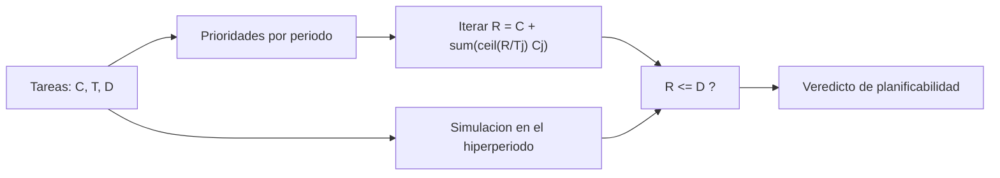

# B88-C05 — Sistemas de tiempo real

<!-- nav:top -->
[🏠 Programa](../../../../README.md) · [📚 Bloque B88](../../../tronco-comun/B88-avionica-y-software-critico-espacial.md) · [← Anterior: B88-C04 — Memorias y corrección de errores](../B88-C04-memorias-y-correccion-de-errores/CLASE.md) · [Siguiente: B88-C06 — Planificación de tareas RTOS →](../B88-C06-planificacion-de-tareas-rtos/CLASE.md)
<!-- /nav -->

## 1. Ubicación, nivel y alcance

Clase 5 del bloque B88. Nivel N3. Un sistema de tiempo real es correcto solo si produce su resultado **antes de un plazo**. Aquí distingues plazos duros y blandos, calculas la utilización y el **tiempo de respuesta** de cada tarea en prioridades fijas, y lo verificas con una simulación. El conjunto de tres tareas es **sintético** (milisegundos). Todos los datos son **sintéticos** salvo los que se rotulan como consultados.

## 2. Por qué esta clase existe

En una nave, una tarea de control que llega tarde puede ser tan mala como una que da un resultado incorrecto. La decisión central: **¿cada tarea termina siempre antes de su plazo, aun cuando las de mayor prioridad la interrumpen?**

## 3. Lo que podrás hacer al terminar

1. Distinguir plazo duro, firme y blando.
2. Calcular la utilización de un conjunto de tareas.
3. Calcular el tiempo de respuesta con la iteración de punto fijo.
4. Verificarlo con una simulación discreta sobre hiperperiodos.
5. Decidir si el conjunto es planificable.
6. Separar lo sintético de lo consultado.

La evidencia es la **análisis de tiempo de respuesta de un conjunto de tareas** del ejercicio 12 (sección 20).

## 4. Con qué llegas y cómo comprobarlo

1. ¿Qué es un plazo (*deadline*)?
2. ¿Qué es una tarea periódica?
3. ¿Qué es prioridad fija?
4. ¿Qué es la expulsión (*preemption*)?
5. ¿Qué es el mínimo común múltiplo?

<details>
<summary>Ver respuestas</summary>

1. El instante máximo en que debe terminar una tarea tras su liberación. 2. Una tarea que se libera cada `T` unidades de tiempo. 3. Cada tarea tiene una prioridad que no cambia. 4. Interrumpir una tarea para ejecutar otra de mayor prioridad. 5. El menor número divisible por todos los períodos: el hiperperiodo.
</details>

Con cuatro o cinco aciertos, sigue; si no, repasa los prerrequisitos.

## 5. Un caso de contexto y casos de referencia

Tres tareas **sintéticas** con prioridad por período corto: `t1 (C=1, T=4)`, `t2 (C=2, T=6)` y `t3 (C=3, T=13)`, en ms y con plazo igual al período. La utilización es `0,8141`. El tiempo de respuesta de `t3` converge a `10 ms`, menor que su plazo de `13 ms`; el hiperperiodo es 156 ms.

## 6. Vocabulario

El **tiempo de respuesta** `Rᵢ = Cᵢ + Σ_{j∈hp(i)} ⌈Rᵢ/Tⱼ⌉ Cⱼ`, resuelto por iteración. El **plazo duro** no admite incumplimiento; el **blando** lo tolera con degradación. El **hiperperiodo** `H = mcm(Tᵢ)`. Una tarea **planificable** cumple `Rᵢ ≤ Dᵢ`.

## 7. Modelo mental



*Descripción textual:* de las tareas y sus prioridades sale el tiempo de respuesta por iteración; la simulación lo comprueba; ambos alimentan el veredicto.

Analogía: el tiempo de respuesta es como cruzar una ciudad con semáforos: tu viaje (C) se alarga por cada vez que un vehículo prioritario te hace parar. Límite: las tareas no pierden tiempo en el cambio de contexto en este modelo.

## 8. La explicación, paso a paso

### 8.1 Utilización

`U = 1/4 + 2/6 + 3/13 = 0,25 + 0,3333 + 0,2308 = 0,8141`.

### 8.2 Tiempo de respuesta

Para `t1`: `R = 1`. Para `t2`: `R = 2 + ⌈R/4⌉·1`; `R = 3`. Para `t3`: `R = 3 + ⌈R/4⌉·1 + ⌈R/6⌉·2`; iteración `3 → 6 → 7 → 9 → 10 → 10`. Como `R₃ = 10 ≤ 13`, cumple.

### 8.3 Simulación

Con paso de 1 ms sobre 3 hiperperiodos (468 ms), el tiempo de respuesta máximo observado es 1, 3 y 10 ms: **igual** al analítico, con 0 plazos incumplidos.

### 8.4 Qué falla primero

Si `C₃` crece, `t3` sufre más interferencia: con `C₃ = 5` resulta `R₃ = 12 ≤ 13`, pero con `C₃ = 6` la iteración pasa de 13 y el plazo se pierde.

## 9. Magnitudes, símbolos y unidades

| Símbolo | Qué es | Unidad | Valor / nota |
|---|---|---|---|
| `C` | tiempo de cómputo | ms | 1, 2, 3 |
| `T` | período | ms | 4, 6, 13 |
| `D` | plazo | ms | = T |
| `R` | tiempo de respuesta | ms | 1, 3, 10 |
| `U` | utilización | — | 0,8141 |

## 10. Convenciones y referencias

Tiempo en ms con paso entero de 1 ms. Prioridad por período (menor período, mayor prioridad), expulsión inmediata, sin bloqueos ni coste de cambio de contexto, liberación simultánea en `t = 0`. Tolerancia: igualdad entre `R` analítico y simulado. Todo **sintético**.

## 11. De dónde sale lo que afirmamos

| ID | Fuente | Localizador | Respalda | Estado |
|---|---|---|---|---|
| S1 | NASA, «Software Engineering and Assurance Handbook» NASA-HDBK-2203 — https://swehb.nasa.gov/ (consultada 2026-11-10) | página de inicio | guía informativa (no de requisitos) para cumplir NPR 7150.2D y NASA-STD-8739.8B para quien adquiere, desarrolla, asegura o mantiene software de la NASA | Consultada (solo la página de inicio) |
| S2 | ECSS, «ECSS-E-ST-40C — Software», 6 mar 2009 (reemplazada por la Rev.1 del 30 abr 2025) — https://ecss.nl/standard/ecss-e-st-40c-software-general-requirements/ (consultada 2026-11-10) | página de la norma (solo resumen y alcance; no el texto de requisitos) | alcance: software de producto de un sistema espacial en los segmentos espacial, de lanzamiento y de tierra, desde los requisitos hasta el mantenimiento | Consultada (solo la página) |
| — | C. L. Liu y J. W. Layland, J. ACM 20(1), 1973 (planificación RM/EDF) | — | — | No consultada (la página de la ACM respondió 403) |
| — | Libros de texto de sistemas de tiempo real, tolerancia a fallos y comunicaciones digitales | — | — | No consultada |
| — | Relaciones y algoritmos estándar usados por el laboratorio (análisis de tiempo de respuesta en prioridades fijas) | — | los verifica el laboratorio con una segunda vía o con pruebas | No consultada en una fuente concreta |

Límites: la iteración de tiempo de respuesta es un resultado estándar de planificación que no se consultó en una fuente concreta. El modelo ignora bloqueos, interrupciones y cambio de contexto (C22, C27 y C28). Lo simulado no se presenta como dato de vuelo ni como medición.

## 12. Cómo ver los resultados

| Tarea | C | T | R analítico | R simulado | Plazo |
|---|---|---|---|---|---|
| t1 | 1 | 4 | 1 | 1 | cumple |
| t2 | 2 | 6 | 3 | 3 | cumple |
| t3 | 3 | 13 | 10 | 10 | cumple |

Descripción larga: el tiempo de respuesta crece con la interferencia de las tareas de mayor prioridad; la simulación lo confirma.

## 13. Ejemplo trabajado

**Paso 1 · Orden.** `t1 > t2 > t3` por período.

**Paso 2 · Iteración de t3.** `R₀ = 3`; `R₁ = 3 + 1 + 2 = 6`; `R₂ = 3 + 2 + 2 = 7`; `R₃ = 3 + 2 + 4 = 9`; `R₄ = 3 + 3 + 4 = 10`; `R₅ = 10`.

**Paso 3 · Plazo.** `10 ≤ 13`: cumple.

**Paso 4 · Simulación.** Máximo observado: 10 ms.

## 14. Distintas formas de describir el problema

**Por análisis:** iteración de punto fijo (esta clase). **Por simulación:** cronograma (esta clase y C06). **Por cota de utilización:** Liu y Layland (C06). El laboratorio exige que ambas vías coincidan.

## 15. Práctica guiada

**Ejercicio 1 · con los pasos indicados.** Calcula `U` del caso.

<details><summary>Solución comentada</summary>

`0,25 + 0,3333 + 0,2308 = 0,8141`.
</details>

**Ejercicio 2 · con una pista.** Calcula `R₂`.

<details><summary>Solución comentada</summary>

`R = 2 + ⌈R/4⌉`; `R=2 → 3 → 3`: `R₂ = 3`.
</details>

**Ejercicio 3 · casi autónomo.** Haz las iteraciones de `R₃`.

<details><summary>Solución comentada</summary>

`3, 6, 7, 9, 10, 10`.
</details>

## 16. Práctica autónoma, transferencia e integrador

**Ejercicio 4 · autónomo.** ¿Cuál es el máximo `C₃` que mantiene el plazo de 13?

<details><summary>Solución comentada</summary>

`C₃ = 5` da `R = 12`; `C₃ = 6` falla.
</details>

**Ejercicio 5 · autónomo.** Calcula el hiperperiodo.

<details><summary>Solución comentada</summary>

`mcm(4, 6, 13) = 156 ms`.
</details>

**Ejercicio 6 · autónomo.** Calcula `R₃` si `t1` tuviera `C = 2`.

<details><summary>Solución comentada</summary>

`R = 3 + 2⌈R/4⌉ + 2⌈R/6⌉`: `3→9→11→13→15…` excede 13: falla.
</details>

**Ejercicio 7 · autónomo.** ¿Cuántas liberaciones de `t3` hay en 3 hiperperiodos?

<details><summary>Solución comentada</summary>

`3 × 156/13 = 36`.
</details>

**Ejercicio 8 · autónomo.** Explica por qué `U < 1` no basta para cumplir plazos.

<details><summary>Solución comentada</summary>

La interferencia puede retrasar a una tarea más allá de su plazo aunque la CPU no esté saturada.
</details>

**Ejercicio 9 · transferencia.** **Transferencia.** Un colega dice que el análisis vale para su software de vuelo. ¿Es válido?

<details><summary>Solución comentada</summary>

No: las tareas son sintéticas y no hay bloqueos ni interrupciones; se necesita el WCET real (C30).
</details>

**Ejercicio 10 · transferencia.** **Transferencia.** ¿Qué cambia si `t2` se bloquea 2 ms por un recurso compartido?

<details><summary>Solución comentada</summary>

Se suma un término de bloqueo `B` a `R₂`: `R₂ = 5`; hay que repetir el análisis (C28).
</details>

**Ejercicio 11 · transferencia.** **Transferencia.** ¿Qué haces con un plazo blando incumplido a veces?

<details><summary>Solución comentada</summary>

Se mide la fracción de incumplimientos y se compara con el requisito de degradación aceptable.
</details>

**Ejercicio 12 · integrador.** **Integrador.** Elabora tu *análisis de tiempo de respuesta*: `U`, `R` por tarea, simulación, veredicto y lista de qué es sintético.

<details><summary>Solución comentada</summary>

Secciones 8.1–8.4 y la salida del laboratorio.
</details>

## 17. Laboratorio: tiempo de respuesta analítico y simulado

El script [tiempo_respuesta.py](tiempo_respuesta.py) calcula el tiempo de respuesta por iteración, simula 3 hiperperiodos con prioridades fijas y **comprueba** que ambos coinciden y que no hay plazos incumplidos.

**Datos:** tres tareas **sintéticas**. **Predice antes de ejecutar:** ¿cuál será el tiempo de respuesta de `t3`? (10 ms). **Ejecución del 2026-11-10 (Python 3.12.9):**

```text
Python 3.12.9
Datos SINTETICOS: conjunto de tres tareas de ejemplo (unidades: ms)
U = 0.8141
t1: C=1 T=4 D=4  R(analitico)=1  cumple
t2: C=2 T=6 D=6  R(analitico)=3  cumple
t3: C=3 T=13 D=13  R(analitico)=10  cumple
Hiperperiodo = 156 ms ; simulado 3 hiperperiodos (468 ms)
t1: R max simulado = 1
t2: R max simulado = 3
t3: R max simulado = 10
Plazos incumplidos = 0
Pruebas superadas.
```

```bash
python programa/clases/B88/B88-C05-sistemas-de-tiempo-real/tiempo_respuesta.py
```

**Límites:** sin bloqueos, interrupciones ni cambio de contexto; liberación simultánea.

## 18. Errores frecuentes y cómo corregirlos

**Usar solo la utilización.** Calcula `R` (8.2)

**Olvidar el redondeo hacia arriba.** `⌈R/T⌉` cuenta las liberaciones en `R`

**Presentar el ejemplo como un sistema real.** Revisa la sección 10

## 19. Cómo sabrás que vas bien

Tras 8.2: ¿qué `R` esperabas para `t3`? Si dudas, repasa el ejemplo 13. Tras el laboratorio: ¿qué comprueba? (ver sección 17).

## 20. Qué entregas y cómo se evalúa

El producto es tu **análisis de tiempo de respuesta de un conjunto de tareas** (ejercicio 12).

| Criterio | Inicial | En desarrollo | Logrado | Destacado |
|---|---|---|---|---|
| Conceptos | Los confunde | Parciales | Explica el método y su dominio | Explica los límites y las alternativas |
| Cálculo | Sin unidades | Con errores | Resultados con unidades y comprobados | Resuelve casos nuevos |
| Numérico | Sin comprobar | Un caso | Verifica con una segunda vía en varios casos | Interpreta las diferencias y los fallos |
| Fuentes | Sin fuente | Sin fecha | Fuentes con fecha y estado | Declara lo sintético y lo no consultado |
| Límites | No los nombra | Uno | Tres | Discute qué falta del modelo |

**Condiciones críticas (no se compensan con promedio):** rotular los datos como sintéticos; comprobar cada resultado con una segunda vía; citar solo lo consultado.

## 21. Ética, seguridad y límites

Clase educativa: los modelos son simplificados y los datos son sintéticos; ningún resultado describe una misión real, certifica conformidad con una norma ni sustituye la revisión de especialistas.  Accesibilidad: tablas equivalentes a las gráficas, fórmulas en texto, ejercicios sin conexión.

## 22. Para cerrar y seguir

Con `U = 0,8141`, `t3` responde en 10 ms de un plazo de 13 y la simulación coincide. Queda una pregunta: ¿qué política de planificación aprovecha mejor la CPU?

**Glosario español–inglés.** tiempo real · *real time*; plazo · *deadline*; tiempo de respuesta · *response time*; expulsión · *preemption*; hiperperiodo · *hyperperiod*.

**Continuidad.** [B88-C06](../B88-C06-planificacion-de-tareas-rtos/CLASE.md) compara las políticas RM y EDF.

**Referencias:** ver sección 11.

<!-- nav:bottom -->
---

[← Anterior: B88-C04 — Memorias y corrección de errores](../B88-C04-memorias-y-correccion-de-errores/CLASE.md) · [📚 Bloque B88](../../../tronco-comun/B88-avionica-y-software-critico-espacial.md) · [Siguiente: B88-C06 — Planificación de tareas RTOS →](../B88-C06-planificacion-de-tareas-rtos/CLASE.md)
<!-- /nav -->
