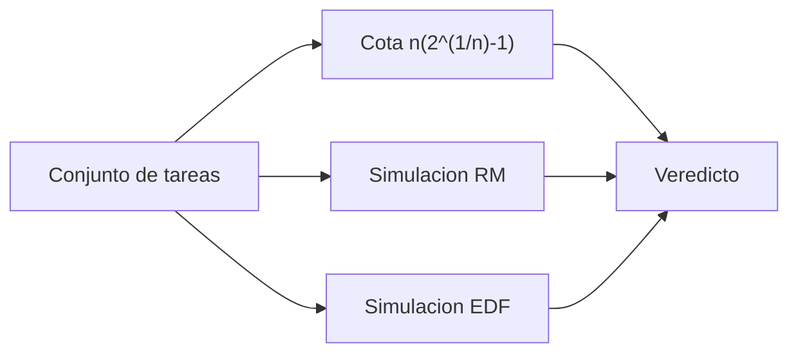

# B88-C06 — Planificación de tareas RTOS

<!-- nav:top -->
[🏠 Programa](../../../../README.md) · [📚 Bloque B88](../../../tronco-comun/B88-avionica-y-software-critico-espacial.md) · [← Anterior: B88-C05 — Sistemas de tiempo real](../B88-C05-sistemas-de-tiempo-real/CLASE.md) · [Siguiente: B88-C07 — Buses I2C SPI CAN y SpaceWire →](../B88-C07-buses-i2c-spi-can-y-spacewire/CLASE.md)
<!-- /nav -->

## 1. Ubicación, nivel y alcance

Clase 6 del bloque B88. Nivel N3. Un planificador de un sistema operativo de tiempo real (RTOS) decide qué tarea corre. Aquí comparas **RM** (*rate monotonic*, prioridad fija por período) y **EDF** (*earliest deadline first*, prioridad dinámica por plazo) con una simulación y la cota de utilización de Liu y Layland. Los conjuntos de tareas son **sintéticos** (ticks). Todos los datos son **sintéticos** salvo los que se rotulan como consultados.

## 2. Por qué esta clase existe

Elegir la política determina cuánta CPU se puede usar con garantías. La decisión central: **¿RM basta, o se necesita EDF para el conjunto de tareas?** Y una pregunta previa: ¿qué dice la cota de utilización y qué no dice?

## 3. Lo que podrás hacer al terminar

1. Calcular la cota `n(2^(1/n) − 1)` para `n` tareas.
2. Simular RM y EDF en el hiperperiodo.
3. Contar plazos perdidos y cambios de contexto.
4. Reconocer que la cota es suficiente y no necesaria.
5. Identificar un conjunto armónico que alcanza `U = 1` con RM.
6. Separar lo sintético de lo consultado.

La evidencia es la **cronograma y veredicto de planificabilidad** del ejercicio 12 (sección 20).

## 4. Con qué llegas y cómo comprobarlo

1. ¿Qué es RM?
2. ¿Qué es EDF?
3. ¿Qué es un conjunto armónico?
4. ¿Qué es una condición suficiente?
5. ¿Qué es el cambio de contexto?

<details>
<summary>Ver respuestas</summary>

1. Prioridad fija: menor período, mayor prioridad. 2. Se ejecuta la tarea con el plazo absoluto más cercano. 3. Uno cuyos períodos son múltiplos entre sí. 4. Si se cumple, el resultado es seguro; si no, no se puede concluir. 5. Guardar una tarea y cargar otra.
</details>

Con cuatro o cinco aciertos, sigue; si no, repasa los prerrequisitos.

## 5. Un caso de contexto y casos de referencia

Tres conjuntos **sintéticos**: A `(C,T) = (2,5),(4,7)` con `U = 0,9714`; B armónico `(1,2),(1,4),(2,8)` con `U = 1`; C `(1,4),(2,6),(3,13)` con `U = 0,8141`. En A, RM pierde 1 plazo y EDF ninguno; en B y C ambas cumplen.

## 6. Vocabulario

La **cota de Liu y Layland** `U ≤ n(2^(1/n) − 1)` es suficiente para RM con plazos iguales a los períodos y tiende a `ln 2 = 0,6931`. **EDF** es óptimo para una CPU con tareas expulsables y plazo igual al período: cumple si `U ≤ 1`. Un **cambio de contexto** cuesta tiempo real; aquí solo se cuentan.

## 7. Modelo mental



*Descripción textual:* cada conjunto se evalúa con la cota (solo suficiente) y con dos simulaciones; el veredicto cruza las tres.

Analogía: RM es una fila con orden fijo por tamaño de tarea; EDF es una fila donde pasa primero quien tiene la cita más próxima. Límite: EDF exige reordenar a cada instante y bajo sobrecarga puede fallar en cadena.

## 8. La explicación, paso a paso

### 8.1 La cota

`n=1: 1,0000`; `n=2: 0,8284`; `n=3: 0,7798`; `n=4: 0,7568`; `n=5: 0,7435`; límite `0,6931`. Cualquier conjunto de `n` tareas con `U` bajo la cota es planificable con RM; **por encima no se puede concluir**.

### 8.2 Conjunto A

`U = 2/5 + 4/7 = 0,9714 > 0,8284`. En el hiperperiodo de 35 ticks, RM pierde 1 plazo (15 cambios de contexto) y EDF 0 (12 cambios).

### 8.3 Conjunto B

Es armónico con `U = 1,0000`: RM y EDF cumplen, con 7 cambios cada una. La cota no lo permitiría (0,7798 para `n = 3`), lo que muestra que es solo suficiente.

### 8.4 Conjunto C

`U = 0,8141 > 0,7798`, y sin embargo RM cumple (ya lo mostró C05: `R₃ = 10 ≤ 13`). Ambas políticas dan 89 cambios de contexto.

## 9. Magnitudes, símbolos y unidades

| Símbolo | Qué es | Unidad | Valor / nota |
|---|---|---|---|
| `n` | número de tareas | — | 2, 3 |
| `U` | utilización | — | 0,8141 a 1 |
| `H` | hiperperiodo | ticks | 35, 8, 156 |
| `cota` | `n(2^(1/n) − 1)` | — | 0,8284 (n=2) |
| `cc` | cambios de contexto | — | ver 8 |

## 10. Convenciones y referencias

Tiempo en ticks enteros; plazo igual al período; liberación simultánea en 0; expulsión inmediata; sin coste de cambio de contexto ni bloqueos. Tolerancia: conteos exactos de plazos perdidos. Todo **sintético**.

## 11. De dónde sale lo que afirmamos

| ID | Fuente | Localizador | Respalda | Estado |
|---|---|---|---|---|
| S1 | NASA, «Software Engineering and Assurance Handbook» NASA-HDBK-2203 — https://swehb.nasa.gov/ (consultada 2026-11-10) | página de inicio | guía informativa (no de requisitos) para cumplir NPR 7150.2D y NASA-STD-8739.8B para quien adquiere, desarrolla, asegura o mantiene software de la NASA | Consultada (solo la página de inicio) |
| — | C. L. Liu y J. W. Layland, J. ACM 20(1), 1973 (planificación RM/EDF) | — | — | No consultada (la página de la ACM respondió 403) |
| — | Libros de texto de sistemas de tiempo real, tolerancia a fallos y comunicaciones digitales | — | — | No consultada |
| — | Relaciones y algoritmos estándar usados por el laboratorio (cota de utilización de RM, optimalidad de EDF para `U ≤ 1` y simulación en el hiperperiodo) | — | los verifica el laboratorio con una segunda vía o con pruebas | No consultada en una fuente concreta |

Límites: no se consultó el artículo original de Liu y Layland (la página de la ACM respondió 403); sus resultados se verifican solo con las simulaciones de estos conjuntos. No se simulan sobrecargas ni recursos compartidos. Lo simulado no se presenta como dato de vuelo ni como medición.

## 12. Cómo ver los resultados

| Conjunto | `U` | RM: perdidos | EDF: perdidos |
|---|---|---|---|
| A | 0,9714 | 1 | 0 |
| B (armónico) | 1,0000 | 0 | 0 |
| C | 0,8141 | 0 | 0 |

Descripción larga: solo A separa a las políticas; en B y C ambas cumplen aunque `U` supere la cota de RM.

## 13. Ejemplo trabajado

**Paso 1 · Cota.** `n = 2`: `2(√2 − 1) = 0,8284`.

**Paso 2 · A.** `U = 0,4 + 0,5714 = 0,9714 > 0,8284`: no se puede concluir con la cota.

**Paso 3 · Simulación.** RM pierde 1 plazo; EDF 0.

**Paso 4 · Conclusión.** A necesita EDF o menos carga; el cumplimiento en B y C no contradice la cota.

## 14. Distintas formas de describir el problema

**Por cota:** suficiente, rápida (esta clase). **Por tiempo de respuesta:** exacta para prioridades fijas (C05). **Por simulación:** exacta en el caso simulado. El laboratorio exige que A falle en RM y cumpla en EDF.

## 15. Práctica guiada

**Ejercicio 1 · con los pasos indicados.** Calcula la cota para `n = 3`.

<details><summary>Solución comentada</summary>

`3(2^(1/3) − 1) = 0,7798`.
</details>

**Ejercicio 2 · con una pista.** Calcula `U` del conjunto A.

<details><summary>Solución comentada</summary>

`2/5 + 4/7 = 0,9714`.
</details>

**Ejercicio 3 · casi autónomo.** ¿Qué dice la cota sobre B?

<details><summary>Solución comentada</summary>

Nada concluyente: `U = 1 > 0,7798`; solo es suficiente.
</details>

## 16. Práctica autónoma, transferencia e integrador

**Ejercicio 4 · autónomo.** Calcula el hiperperiodo de A.

<details><summary>Solución comentada</summary>

`mcm(5, 7) = 35`.
</details>

**Ejercicio 5 · autónomo.** ¿Cuántas liberaciones de la tarea de período 7 hay en el hiperperiodo de A?

<details><summary>Solución comentada</summary>

`35/7 = 5`.
</details>

**Ejercicio 6 · autónomo.** ¿Por qué EDF cumple A?

<details><summary>Solución comentada</summary>

`U = 0,9714 ≤ 1` y EDF cumple si `U ≤ 1` para plazos iguales a períodos.
</details>

**Ejercicio 7 · autónomo.** ¿Por qué RM pierde un plazo en A?

<details><summary>Solución comentada</summary>

La tarea de período 7 (`C = 4`) recibe interferencia de 2 liberaciones de la de período 5: `R = 8 > 7`.
</details>

**Ejercicio 8 · autónomo.** ¿Qué conjuntos `n=2` están seguros con RM?

<details><summary>Solución comentada</summary>

Los de `U ≤ 0,8284`.
</details>

**Ejercicio 9 · transferencia.** **Transferencia.** Un colega dice que EDF siempre es mejor. ¿Es válido?

<details><summary>Solución comentada</summary>

No: bajo sobrecarga EDF puede perder muchos plazos y es menos predecible; RM degrada de forma ordenada.
</details>

**Ejercicio 10 · transferencia.** **Transferencia.** ¿Qué cambia si se añade 0,05 de coste de cambio de contexto por conmutación?

<details><summary>Solución comentada</summary>

Hay que sumar ese coste a `C`; A con 12–15 conmutaciones pierde margen y empeora.
</details>

**Ejercicio 11 · transferencia.** **Transferencia.** ¿Cuándo preferirías RM aun con `U` mayor que la cota?

<details><summary>Solución comentada</summary>

Si el conjunto es armónico o el tiempo de respuesta analítico demuestra los plazos.
</details>

**Ejercicio 12 · integrador.** **Integrador.** Elabora tu *cronograma y veredicto de planificabilidad*: cota, `U`, plazos perdidos por política, cambios de contexto y lista de qué es sintético.

<details><summary>Solución comentada</summary>

Secciones 8.1–8.4 y la salida del laboratorio.
</details>

## 17. Laboratorio: RM frente a EDF por simulación

El script [rm_edf.py](rm_edf.py) simula RM y EDF en el hiperperiodo de tres conjuntos, cuenta plazos perdidos y cambios de contexto y **comprueba** que A falla en RM y cumple en EDF y que B y C cumplen en ambas.

**Datos:** tres conjuntos de tareas **sintéticos**. **Predice antes de ejecutar:** ¿qué política pierde plazos en el conjunto A? (RM, 1 plazo). **Ejecución del 2026-11-10 (Python 3.12.9):**

```text
Python 3.12.9
Datos SINTETICOS: conjuntos de tareas de ejemplo (unidades: ticks)
Cota de Liu-Layland n(2^(1/n)-1):
  n=1: 1.0000
  n=2: 0.8284
  n=3: 0.7798
  n=4: 0.7568
  n=5: 0.7435
  limite n->inf: 0.6931
A: (2,5),(4,7)                   U=0.9714 RM  hiperperiodo= 35 plazos perdidos=1 cambios de contexto=15
A: (2,5),(4,7)                   U=0.9714 EDF hiperperiodo= 35 plazos perdidos=0 cambios de contexto=12
B: armonico (1,2),(1,4),(2,8)    U=1.0000 RM  hiperperiodo=  8 plazos perdidos=0 cambios de contexto=7
B: armonico (1,2),(1,4),(2,8)    U=1.0000 EDF hiperperiodo=  8 plazos perdidos=0 cambios de contexto=7
C: (1,4),(2,6),(3,13)            U=0.8141 RM  hiperperiodo=156 plazos perdidos=0 cambios de contexto=89
C: (1,4),(2,6),(3,13)            U=0.8141 EDF hiperperiodo=156 plazos perdidos=0 cambios de contexto=89
Pruebas superadas.
```

```bash
python programa/clases/B88/B88-C06-planificacion-de-tareas-rtos/rm_edf.py
```

**Límites:** sin coste de cambio de contexto, bloqueos ni sobrecarga continua.

## 18. Errores frecuentes y cómo corregirlos

**Usar la cota como condición necesaria.** Es solo suficiente (8.3)

**Creer que EDF no puede fallar.** Falla si `U > 1` (ejercicio 9)

**Presentar el ejemplo como un sistema real.** Revisa la sección 10

## 19. Cómo sabrás que vas bien

Tras 8.2: ¿qué política esperabas que perdiera plazos en A? Si dudas, repasa el ejemplo 13. Tras el laboratorio: ¿qué comprueba? (ver sección 17).

## 20. Qué entregas y cómo se evalúa

El producto es tu **cronograma y veredicto de planificabilidad** (ejercicio 12).

| Criterio | Inicial | En desarrollo | Logrado | Destacado |
|---|---|---|---|---|
| Conceptos | Los confunde | Parciales | Explica el método y su dominio | Explica los límites y las alternativas |
| Cálculo | Sin unidades | Con errores | Resultados con unidades y comprobados | Resuelve casos nuevos |
| Numérico | Sin comprobar | Un caso | Verifica con una segunda vía en varios casos | Interpreta las diferencias y los fallos |
| Fuentes | Sin fuente | Sin fecha | Fuentes con fecha y estado | Declara lo sintético y lo no consultado |
| Límites | No los nombra | Uno | Tres | Discute qué falta del modelo |

**Condiciones críticas (no se compensan con promedio):** rotular los datos como sintéticos; comprobar cada resultado con una segunda vía; citar solo lo consultado.

## 21. Ética, seguridad y límites

Clase educativa: los modelos son simplificados y los datos son sintéticos; ningún resultado describe una misión real, certifica conformidad con una norma ni sustituye la revisión de especialistas.  Accesibilidad: tablas equivalentes a las gráficas, fórmulas en texto, ejercicios sin conexión.

## 22. Para cerrar y seguir

Con `U = 0,9714`, RM pierde 1 plazo en 35 ticks y EDF ninguno; la cota de 0,8284 es solo suficiente. Queda una pregunta: ¿por cuáles medios llegan los datos a las tareas?

**Glosario español–inglés.** planificador · *scheduler*; prioridad fija · *fixed priority*; plazo más cercano primero · *earliest deadline first*; cambio de contexto · *context switch*.

**Continuidad.** [B88-C07](../B88-C07-buses-i2c-spi-can-y-spacewire/CLASE.md) trata los buses I2C, SPI, CAN y SpaceWire.

**Referencias:** ver sección 11.

<!-- nav:bottom -->
---

[← Anterior: B88-C05 — Sistemas de tiempo real](../B88-C05-sistemas-de-tiempo-real/CLASE.md) · [📚 Bloque B88](../../../tronco-comun/B88-avionica-y-software-critico-espacial.md) · [Siguiente: B88-C07 — Buses I2C SPI CAN y SpaceWire →](../B88-C07-buses-i2c-spi-can-y-spacewire/CLASE.md)
<!-- /nav -->
