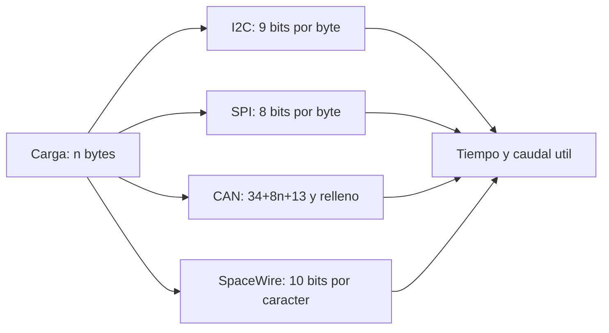

# B88-C07 — Buses I2C SPI CAN y SpaceWire

<!-- nav:top -->
[🏠 Programa](../../../../README.md) · [📚 Bloque B88](../../../tronco-comun/B88-avionica-y-software-critico-espacial.md) · [← Anterior: B88-C06 — Planificación de tareas RTOS](../B88-C06-planificacion-de-tareas-rtos/CLASE.md) · [Siguiente: B88-C08 — Telemetría interna →](../B88-C08-telemetria-interna/CLASE.md)
<!-- /nav -->

## 1. Ubicación, nivel y alcance

Clase 7 del bloque B88. Nivel N3. Los buses conectan los equipos de la nave. Aquí comparas cuatro familias por su **caudal útil**: I2C y SPI (cortas distancias, dentro de una tarjeta), CAN (red robusta de dispositivos) y SpaceWire (enlace rápido punto a punto). Calculas bits por trama, tiempo y caudal, y el **relleno de bits** del CAN con su CRC-15. Todo es **sintético**; la página de ECSS-E-ST-50-12C solo se usó para el propósito de SpaceWire. Todos los datos son **sintéticos** salvo los que se rotulan como consultados.

## 2. Por qué esta clase existe

El bus fija cuánta telemetría y cuántos comandos caben y con qué retardo. La decisión central: **¿cuál es el caudal útil y el peor tiempo de trama de cada bus para mi carga?**

## 3. Lo que podrás hacer al terminar

1. Calcular bits y tiempo de una transferencia I2C y SPI.
2. Calcular la longitud de una trama CAN con y sin relleno de bits.
3. Implementar el CRC-15 del CAN y el relleno.
4. Calcular el caudal útil de un paquete SpaceWire con supuestos explícitos.
5. Comparar buses por caudal y por peor caso.
6. Separar lo sintético de lo consultado.

La evidencia es la **comparativa de caudal útil de cuatro buses** del ejercicio 12 (sección 20).

## 4. Con qué llegas y cómo comprobarlo

1. ¿Qué es la velocidad en bit/s?
2. ¿Qué es sobrecarga de protocolo?
3. ¿Qué es un CRC?
4. ¿Qué es un bus maestro-esclavo?
5. ¿Qué es el peor caso?

<details>
<summary>Ver respuestas</summary>

1. Bits transmitidos por segundo. 2. Los bits que no son datos útiles. 3. Un código de redundancia cíclica que detecta errores. 4. Uno donde un maestro inicia las transferencias. 5. El mayor tiempo posible de una operación.
</details>

Con cuatro o cinco aciertos, sigue; si no, repasa los prerrequisitos.

## 5. Un caso de contexto y casos de referencia

Carga **sintética**: un bloque de 4 bytes por I2C a 400 kHz tarda `117,5 µs` (caudal útil `272,3 kb/s`); por SPI a 10 MHz tarda `3,4 µs` (`9,41 Mb/s`). Una trama CAN con 8 bytes tiene `111` bits sin relleno y, en el peor caso, `135`. Un paquete SpaceWire de 64 bytes con 2 bytes de ruta ocupa `664` bits y da `77,11 Mb/s` útiles a 100 Mb/s.

## 6. Vocabulario

La **trama CAN 2.0A** tiene `34 + 8n` bits de cabecera y datos (SOF…CRC), más 13 bits de cola (delimitador, ACK, EOF e IFS). El **relleno de bits** inserta un bit complementario tras cinco iguales; hay como máximo `⌊(34 + 8n − 1)/4⌋` rellenos. El **CRC-15** usa el polinomio `0x4599`. En SpaceWire, el **carácter de datos** usa 10 bits en este laboratorio (supuesto).

## 7. Modelo mental



*Descripción textual:* la misma carga se traduce a bits en cada bus; de ahí salen el tiempo y el caudal útil que se comparan.

Analogía: cada bus es una forma de enviar cartas: I2C pone el sobre y acuse en cada byte, SPI manda las cartas sueltas a gran velocidad, CAN añade sobre y sellos de seguridad, y SpaceWire es una autopista punto a punto. Límite: el caudal útil no incluye la espera del arbitraje ni de los routers.

## 8. La explicación, paso a paso

### 8.1 I2C y SPI

I2C: `9(1 + n) + 2` bits; para `n = 4` son 47 bits, `117,5 µs` a 400 kHz y `272,3 kb/s` útiles. SPI: `8n + 2` bits; `n = 4` da 34 bits, `3,4 µs` a 10 MHz y `9,41 Mb/s`.

### 8.2 CAN: trama y relleno

Una trama de `n = 8` tiene `34 + 64 = 98` bits entre SOF y CRC, más 13 de cola: `111`. El relleno puede añadir hasta `⌊97/4⌋ = 24`: `135` bits, `135 µs` a 1 Mb/s y `0,474 Mb/s` útiles. En 5000 tramas aleatorias el máximo de rellenos fue 10 (media `3,30`); una trama de ceros añadió 16.

### 8.3 SpaceWire

Con 10 bits por carácter de datos (supuesto) y 4 bits para el fin de paquete: `(2 + n)·10 + 4` bits. Para `n = 64`: 664 bits, `6,64 µs` y `77,11 Mb/s`; para `n = 1024`: `79,81 Mb/s`.

### 8.4 Qué compara cada bus

El caudal útil crece con el tamaño del bloque porque la sobrecarga se reparte: I2C pasa de 160 a 330 kb/s al ir de 1 a 16 bytes.

## 9. Magnitudes, símbolos y unidades

| Símbolo | Qué es | Unidad | Valor / nota |
|---|---|---|---|
| `n` | bytes de datos | B | 1 a 1024 |
| `f` | frecuencia del bus | Hz | 400 k, 10 M, 1 M, 100 M |
| `bits` | bits por transferencia | bit | 47, 34, 111…135, 664 |
| `t` | tiempo de trama | µs | 117,5; 3,4; 135; 6,64 |
| `η` | caudal útil | Mb/s | 0,272; 9,41; 0,474; 77,11 |

## 10. Convenciones y referencias

Velocidades nominales; sin arbitraje ni esperas; I2C con una dirección de 7 bits; CAN 2.0A estándar a 1 Mb/s; SpaceWire con carácter de datos de 10 bits y fin de paquete de 4 bits (supuestos del laboratorio, no consultados en la norma). Tolerancia: relleno máximo ≤ cota. Semilla `7`. Todo **sintético**.

## 11. De dónde sale lo que afirmamos

| ID | Fuente | Localizador | Respalda | Estado |
|---|---|---|---|---|
| S1 | ECSS, «ECSS-E-ST-50-12C Rev.1 — SpaceWire: links, nodes, routers and networks», 15 may 2019 — https://ecss.nl/standard/ecss-e-st-50-12c-rev-1-spacewire-links-nodes-routers-and-networks-15-may-2019/ (consultada 2026-11-10) | página de la norma (sin velocidades ni detalles de enlace) | SpaceWire nace de las necesidades de manejo de datos a bordo y busca compatibilidad y reutilización de equipos y su integración y prueba | Consultada (solo la página) |
| — | CCSDS 133.0-B (Space Packet Protocol) y CCSDS 232.0-B (TC) | — | — | No consultada (la URL probada respondió 404) |
| — | Libros de texto de sistemas de tiempo real, tolerancia a fallos y comunicaciones digitales | — | — | No consultada |
| — | Relaciones y algoritmos estándar usados por el laboratorio (tiempos de trama, CRC-15 y relleno de bits) | — | los verifica el laboratorio con una segunda vía o con pruebas | No consultada en una fuente concreta |

Límites: la página de ECSS-E-ST-50-12C no da velocidades ni formatos de carácter; el formato de 10 bits es un supuesto. No se consultó ISO 11898 (CAN) ni NXP (I2C); los cálculos son del propio laboratorio. Lo simulado no se presenta como dato de vuelo ni como medición.

## 12. Cómo ver los resultados

| Bus | Carga | Bits | Tiempo | Caudal útil |
|---|---|---|---|---|
| I2C 400 kHz | 4 B | 47 | 117,5 µs | 272,3 kb/s |
| SPI 10 MHz | 4 B | 34 | 3,4 µs | 9,41 Mb/s |
| CAN 1 Mb/s (peor) | 8 B | 135 | 135 µs | 0,474 Mb/s |
| SpaceWire 100 Mb/s | 64 B | 664 | 6,64 µs | 77,11 Mb/s |

Descripción larga: SPI y SpaceWire son rápidos; CAN y I2C pagan sobrecarga a cambio de direccionamiento y robustez.

## 13. Ejemplo trabajado

**Paso 1 · Bits CAN.** `34 + 8·8 = 98`, más 13 de cola: `111`.

**Paso 2 · Relleno máximo.** `⌊(34 + 64 − 1)/4⌋ = 24`: `135` bits.

**Paso 3 · Tiempo.** A 1 Mb/s, `135 µs`.

**Paso 4 · Caudal útil.** `64 bits/135 µs = 0,474 Mb/s`.

## 14. Distintas formas de describir el problema

**Por fórmula de bits:** esta clase. **Por simulación de arbitraje:** red CAN completa (C31). **Por especificación:** hoja del estándar (no consultado). El laboratorio comprueba que ningún caso aleatorio supera la cota de 24 rellenos.

## 15. Práctica guiada

**Ejercicio 1 · con los pasos indicados.** Calcula bits y tiempo de I2C con 1 byte a 400 kHz.

<details><summary>Solución comentada</summary>

`9·2 + 2 = 20` bits; `50 µs`.
</details>

**Ejercicio 2 · con una pista.** Calcula bits y tiempo de SPI con 16 bytes a 10 MHz.

<details><summary>Solución comentada</summary>

`130` bits; `13 µs`.
</details>

**Ejercicio 3 · casi autónomo.** Calcula la cota de relleno CAN para `n = 1`.

<details><summary>Solución comentada</summary>

`⌊(34 + 8 − 1)/4⌋ = 10`.
</details>

## 16. Práctica autónoma, transferencia e integrador

**Ejercicio 4 · autónomo.** Calcula el peor caso de una trama CAN de 4 bytes.

<details><summary>Solución comentada</summary>

`34 + 32 + 13 = 79`; relleno `⌊65/4⌋ = 16`; total `95` bits.
</details>

**Ejercicio 5 · autónomo.** ¿Cuánto dura la trama de 8 bytes a 500 kb/s en el peor caso?

<details><summary>Solución comentada</summary>

`135 bits × 2 µs = 270 µs`.
</details>

**Ejercicio 6 · autónomo.** Calcula el caudal útil de SpaceWire con 8 bytes.

<details><summary>Solución comentada</summary>

`104` bits; `1,04 µs`; `61,54 Mb/s`.
</details>

**Ejercicio 7 · autónomo.** ¿Por qué el caudal útil de SpaceWire crece con el paquete?

<details><summary>Solución comentada</summary>

Porque los 2 bytes de ruta y el fin de paquete son una sobrecarga fija.
</details>

**Ejercicio 8 · autónomo.** ¿Por qué el CAN necesita relleno?

<details><summary>Solución comentada</summary>

Para forzar transiciones y mantener la sincronización de los receptores.
</details>

**Ejercicio 9 · transferencia.** **Transferencia.** Un colega dice que 0,474 Mb/s es el caudal del CAN de su nave. ¿Es válido?

<details><summary>Solución comentada</summary>

No: es el peor caso sintético sin arbitraje ni errores; el caudal real depende de la red.
</details>

**Ejercicio 10 · transferencia.** **Transferencia.** ¿Qué cambia si el CRC-15 se calcula con un polinomio distinto?

<details><summary>Solución comentada</summary>

Los receptores rechazarían todas las tramas; el polinomio es parte de la norma del bus.
</details>

**Ejercicio 11 · transferencia.** **Transferencia.** ¿Qué bus elegirías para 100 Mb/s entre un instrumento y la memoria masiva?

<details><summary>Solución comentada</summary>

SpaceWire por su caudal punto a punto, comprobando la norma y el equipo.
</details>

**Ejercicio 12 · integrador.** **Integrador.** Elabora tu *comparativa de caudal útil de cuatro buses*: bits, tiempo y caudal por bus y lista de qué es sintético y qué supuesto.

<details><summary>Solución comentada</summary>

Secciones 8.1–8.4 y la salida del laboratorio.
</details>

## 17. Laboratorio: tiempos de trama de cuatro buses

El script [buses.py](buses.py) calcula bits y tiempos de I2C, SPI, CAN (con CRC-15 y relleno sobre 5000 tramas aleatorias) y SpaceWire, y **comprueba** que el relleno nunca supera la cota de 24 y que el CRC de ceros es 0.

**Datos:** cargas y velocidades de ejemplo, **sintéticas**; semilla 7. **Predice antes de ejecutar:** ¿cuántos bits tiene en el peor caso una trama CAN de 8 bytes? (135). **Ejecución del 2026-11-10 (Python 3.12.9):**

```text
Python 3.12.9
Datos SINTETICOS: cargas y velocidades de ejemplo
n= 1 B  I2C@400k:  20 bit    50.0 us util   160.0 kb/s | SPI@10M:  10 bit   1.00 us util  8.00 Mb/s
n= 4 B  I2C@400k:  47 bit   117.5 us util   272.3 kb/s | SPI@10M:  34 bit   3.40 us util  9.41 Mb/s
n=16 B  I2C@400k: 155 bit   387.5 us util   330.3 kb/s | SPI@10M: 130 bit  13.00 us util  9.85 Mb/s
CAN n=8: bits sin relleno (con IFS) = 111; cota de relleno = 24; maximo aleatorio = 10; medio = 3.30; ceros = 16
CAN n=1: 55 bit sin relleno (55 us a 1 Mb/s) ; peor caso 65 bit (65 us) ; util min 0.123 Mb/s
CAN n=4: 79 bit sin relleno (79 us a 1 Mb/s) ; peor caso 95 bit (95 us) ; util min 0.337 Mb/s
CAN n=8: 111 bit sin relleno (111 us a 1 Mb/s) ; peor caso 135 bit (135 us) ; util min 0.474 Mb/s
SpaceWire@100M n=   8 B (+2 B de ruta):   104 bit    1.04 us util  61.54 Mb/s
SpaceWire@100M n=  64 B (+2 B de ruta):   664 bit    6.64 us util  77.11 Mb/s
SpaceWire@100M n=1024 B (+2 B de ruta): 10264 bit  102.64 us util  79.81 Mb/s
Pruebas superadas.
```

```bash
python programa/clases/B88/B88-C07-buses-i2c-spi-can-y-spacewire/buses.py
```

**Límites:** sin arbitraje, errores ni esperas; el carácter de 10 bits de SpaceWire es un supuesto.

## 18. Errores frecuentes y cómo corregirlos

**Olvidar el relleno de bits en CAN.** Usa el peor caso (8.2)

**Confundir velocidad nominal con caudal útil.** Resta la sobrecarga (8.1)

**Presentar el ejemplo como un bus real.** Revisa la sección 10

## 19. Cómo sabrás que vas bien

Tras 8.2: ¿cuántos bits esperabas en el peor caso CAN? Si dudas, repasa el ejemplo 13. Tras el laboratorio: ¿qué comprueba? (ver sección 17).

## 20. Qué entregas y cómo se evalúa

El producto es tu **comparativa de caudal útil de cuatro buses** (ejercicio 12).

| Criterio | Inicial | En desarrollo | Logrado | Destacado |
|---|---|---|---|---|
| Conceptos | Los confunde | Parciales | Explica el método y su dominio | Explica los límites y las alternativas |
| Cálculo | Sin unidades | Con errores | Resultados con unidades y comprobados | Resuelve casos nuevos |
| Numérico | Sin comprobar | Un caso | Verifica con una segunda vía en varios casos | Interpreta las diferencias y los fallos |
| Fuentes | Sin fuente | Sin fecha | Fuentes con fecha y estado | Declara lo sintético y lo no consultado |
| Límites | No los nombra | Uno | Tres | Discute qué falta del modelo |

**Condiciones críticas (no se compensan con promedio):** rotular los datos como sintéticos; comprobar cada resultado con una segunda vía; citar solo lo consultado.

## 21. Ética, seguridad y límites

Clase educativa: los modelos son simplificados y los datos son sintéticos; ningún resultado describe una misión real, certifica conformidad con una norma ni sustituye la revisión de especialistas.  Accesibilidad: tablas equivalentes a las gráficas, fórmulas en texto, ejercicios sin conexión.

## 22. Para cerrar y seguir

El mismo bloque de datos tarda 117,5 µs por I2C, 3,4 µs por SPI y hasta 135 µs por CAN; SpaceWire llega a 77 Mb/s útiles. Queda una pregunta: ¿qué datos viajan por esos buses hacia el suelo?

**Glosario español–inglés.** relleno de bits · *bit stuffing*; trama · *frame*; caudal útil · *goodput*; sobrecarga · *overhead*; enlace punto a punto · *point-to-point link*.

**Continuidad.** [B88-C08](../B88-C08-telemetria-interna/CLASE.md) trata la telemetría interna.

**Referencias:** ver sección 11.

<!-- nav:bottom -->
---

[← Anterior: B88-C06 — Planificación de tareas RTOS](../B88-C06-planificacion-de-tareas-rtos/CLASE.md) · [📚 Bloque B88](../../../tronco-comun/B88-avionica-y-software-critico-espacial.md) · [Siguiente: B88-C08 — Telemetría interna →](../B88-C08-telemetria-interna/CLASE.md)
<!-- /nav -->
