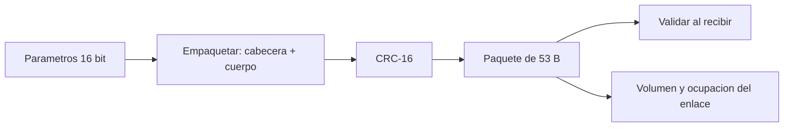

# B88-C08 — Telemetría interna

<!-- nav:top -->
[🏠 Programa](../../../../README.md) · [📚 Bloque B88](../../../tronco-comun/B88-avionica-y-software-critico-espacial.md) · [← Anterior: B88-C07 — Buses I2C SPI CAN y SpaceWire](../B88-C07-buses-i2c-spi-can-y-spacewire/CLASE.md) · [Siguiente: B88-C09 — Telecomandos y estados de misión →](../B88-C09-telecomandos-y-estados-de-mision/CLASE.md)
<!-- /nav -->

## 1. Ubicación, nivel y alcance

Clase 8 del bloque B88. Nivel N3. La telemetría interna reúne medidas de los subsistemas (temperaturas, tensiones, estados) en paquetes que el computador de vuelo guarda y envía a tierra. Aquí defines un **paquete propio de la clase**, calculas su CRC-16, compruebas qué errores detecta y haces el **presupuesto de volumen** frente a un enlace. No es CCSDS ni PUS; la página de ECSS-E-ST-70-41C solo se consultó para el alcance de la norma. Datos **sintéticos**. Todos los datos son **sintéticos** salvo los que se rotulan como consultados.

## 2. Por qué esta clase existe

Sin telemetría no se ve la salud de la nave; con demasiada, se satura el enlace. La decisión central: **¿qué parámetros, a qué frecuencia y con qué protección caben en el enlace sin perder los críticos?**

## 3. Lo que podrás hacer al terminar

1. Armar y validar un paquete con cabecera, cuerpo y CRC-16.
2. Verificar el CRC con un valor de comprobación.
3. Medir la detección de errores de 1 byte y de 2 bits.
4. Calcular el volumen y la ocupación del enlace.
5. Dimensionar periodos de muestreo por perfil.
6. Separar lo sintético de lo consultado.

La evidencia es la **definición de paquete y presupuesto de telemetría** del ejercicio 12 (sección 20).

## 4. Con qué llegas y cómo comprobarlo

1. ¿Qué es un paquete?
2. ¿Qué es un CRC?
3. ¿Qué es el muestreo?
4. ¿Qué es un enlace con ocupación de 80 %?
5. ¿Qué es big-endian?

<details>
<summary>Ver respuestas</summary>

1. Una unidad de datos con cabecera, cuerpo y comprobación. 2. Un código que detecta errores calculado con división polinómica. 3. Medir una magnitud a intervalos regulares. 4. Uno cuyo caudal usado es el 80 % del disponible. 5. Orden de bytes con el más significativo primero.
</details>

Con cuatro o cinco aciertos, sigue; si no, repasa los prerrequisitos.

## 5. Un caso de contexto y casos de referencia

Paquete **sintético**: sincronía `0xEB90`, tipo (1 byte), secuencia (2), longitud (2), tiempo (4), `n` parámetros de 16 bits y CRC-16 (2). Con 20 parámetros mide `53 bytes = 424 bits`. Tres perfiles (HK básico a 1 s, Energía a 0,5 s y Actitud a 0,25 s) suman `3352 bit/s` sobre un enlace de ejemplo de 4000 bit/s: ocupación `83,8 %`.

## 6. Vocabulario

La **sincronía** marca el inicio. El **CRC-16** con polinomio `0x1021` e inicio `0xFFFF` da `0x29B1` para la cadena `123456789`. El **volumen** es bits por segundo. La **ocupación** es volumen entre capacidad. Un **perfil** de telemetría es un conjunto de parámetros con un período.

## 7. Modelo mental



*Descripción textual:* los parámetros se empaquetan con cabecera, se les añade CRC, y el receptor valida; el mismo tamaño alimenta el presupuesto de volumen.

Analogía: un paquete de telemetría es como un parte médico: datos con fecha y una firma de control. Límite: el CRC detecta errores accidentales; no impide que alguien falsifique el parte (C17).

## 8. La explicación, paso a paso

### 8.1 Estructura y CRC

Cabecera de 11 bytes (2 + 1 + 2 + 2 + 4), cuerpo de `2n` bytes y CRC de 2. Con `n = 20`: `11 + 40 + 2 = 53` bytes. El CRC-16 de `123456789` es `0x29B1` (valor de comprobación del propio laboratorio).

### 8.2 Detección de errores

En 20 000 corrupciones aleatorias de 1 byte, se detectaron 20 000; en 20 000 corrupciones de 2 bits, 20 000. Con CRC-16, un error de un byte (ráfaga ≤ 16 bits) siempre se detecta; esto lo comprueba el laboratorio, no una norma.

### 8.3 Presupuesto

`bit/s = 8·L/T`: HK `424`; Energía `37 B / 0,5 s = 592`; Actitud `73 B / 0,25 s = 2336`. Total `3352 bit/s`.

### 8.4 Ocupación

`3352/4000 = 83,8 %`. Con un límite de ejemplo de 80 % **no cumple**: hay que reducir el muestreo de Actitud o agrupar parámetros.

## 9. Magnitudes, símbolos y unidades

| Símbolo | Qué es | Unidad | Valor / nota |
|---|---|---|---|
| `L` | longitud de paquete | B | 53, 37, 73 |
| `T` | período | s | 1; 0,5; 0,25 |
| `V` | volumen | bit/s | 3352 |
| `C` | capacidad del enlace | bit/s | 4000 (ejemplo) |
| `CRC` | código de 16 bit | — | 0x29B1 (prueba) |

## 10. Convenciones y referencias

Orden de bytes big-endian; tiempo en unidades de 1 µs del reloj de a bordo (ejemplo). Polinomio CRC `0x1021`, inicio `0xFFFF`. Semilla `11`. Tolerancias: 100 % de detección en las pruebas. Formato **propio de la clase y sintético**.

## 11. De dónde sale lo que afirmamos

| ID | Fuente | Localizador | Respalda | Estado |
|---|---|---|---|---|
| S1 | ECSS, «ECSS-E-ST-70-41C — Telemetry and telecommand packet utilization», 15 abr 2016 — https://ecss.nl/standard/ecss-e-st-70-41c-space-engineering-telemetry-and-telecommand-packet-utilization-15-april-2016/ (consultada 2026-11-10) | página de la norma | define servicios para vigilar y controlar naves y cargas útiles, y la estructura de los paquetes TC y TM; los servicios son opcionales y se adaptan por misión | Consultada (solo la página) |
| — | CCSDS 133.0-B (Space Packet Protocol) y CCSDS 232.0-B (TC) | — | — | No consultada (la URL probada respondió 404) |
| — | Libros de texto de sistemas de tiempo real, tolerancia a fallos y comunicaciones digitales | — | — | No consultada |
| — | Relaciones y algoritmos estándar usados por el laboratorio (CRC-16 por división polinómica y conteo de bytes) | — | los verifica el laboratorio con una segunda vía o con pruebas | No consultada en una fuente concreta |

Límites: el formato del paquete es didáctico y no se contrastó con CCSDS ni con los servicios PUS (la página de ECSS-E-ST-70-41C solo describe su alcance). La detección se comprueba por muestreo, no por demostración. Lo simulado no se presenta como dato de vuelo ni como medición.

## 12. Cómo ver los resultados

| Perfil | Paquete | Período | bit/s |
|---|---|---|---|
| HK básico | 53 B | 1,00 s | 424 |
| Energía | 37 B | 0,50 s | 592 |
| Actitud | 73 B | 0,25 s | 2336 |
| **Total** | | | **3352** |

Descripción larga: Actitud domina el volumen por su período corto.

## 13. Ejemplo trabajado

**Paso 1 · Longitud.** `11 + 2·30 + 2 = 73` bytes para Actitud.

**Paso 2 · Caudal.** `8 · 73/0,25 = 2336 bit/s`.

**Paso 3 · Suma.** `424 + 592 + 2336 = 3352`.

**Paso 4 · Ocupación.** `3352/4000 = 83,8 %`.

## 14. Distintas formas de describir el problema

**Por paquetes propios:** esta clase. **Por estándar de paquetes de espacio:** CCSDS y PUS (no consultado). **Por tabla de parámetros:** lista por perfil. El laboratorio valida el CRC con el valor de comprobación `0x29B1`.

## 15. Práctica guiada

**Ejercicio 1 · con los pasos indicados.** Calcula la longitud del paquete de Energía (12 parámetros).

<details><summary>Solución comentada</summary>

`11 + 24 + 2 = 37` bytes.
</details>

**Ejercicio 2 · con una pista.** Calcula el caudal del perfil Energía.

<details><summary>Solución comentada</summary>

`8 · 37/0,5 = 592 bit/s`.
</details>

**Ejercicio 3 · casi autónomo.** Calcula la ocupación si Actitud pasa a 0,5 s.

<details><summary>Solución comentada</summary>

Actitud `1168`; total `424 + 592 + 1168 = 2184`; `54,6 %`.
</details>

## 16. Práctica autónoma, transferencia e integrador

**Ejercicio 4 · autónomo.** ¿Cuántos HK de 20 parámetros a 1 s caben aún en el límite de 80 %?

<details><summary>Solución comentada</summary>

`(3200 − 3352)` es negativo: ninguno; hay que reducir primero.
</details>

**Ejercicio 5 · autónomo.** Calcula el volumen diario del total en MB.

<details><summary>Solución comentada</summary>

`3352 × 86 400/8 = 36,2 MB` (`36 201 600 B`).
</details>

**Ejercicio 6 · autónomo.** ¿Cuántos bits tiene la cabecera?

<details><summary>Solución comentada</summary>

`11 × 8 = 88`.
</details>

**Ejercicio 7 · autónomo.** ¿Qué detecta el CRC-16 y qué no?

<details><summary>Solución comentada</summary>

Errores accidentales (1 byte, 2 bits); no detecta una falsificación intencional con CRC recalculado.
</details>

**Ejercicio 8 · autónomo.** ¿Por qué el valor `0x29B1` sirve como prueba?

<details><summary>Solución comentada</summary>

Es un valor de comprobación de CRC-16 con ese polinomio e inicio; si el código lo reproduce, está bien implementado.
</details>

**Ejercicio 9 · transferencia.** **Transferencia.** Un colega dice que 83,8 % es el uso del enlace de su nave. ¿Es válido?

<details><summary>Solución comentada</summary>

No: perfiles y enlace son sintéticos; sirve para practicar el cálculo.
</details>

**Ejercicio 10 · transferencia.** **Transferencia.** ¿Qué cambia si se agrega compresión de 2:1 al cuerpo?

<details><summary>Solución comentada</summary>

El volumen baja, pero hay que fijar el peor caso (datos incompresibles) y la pérdida del CRC sobre datos comprimidos.
</details>

**Ejercicio 11 · transferencia.** **Transferencia.** ¿Qué parámetros priorizarías ante un enlace saturado?

<details><summary>Solución comentada</summary>

Los de seguridad y salud (temperatura, energía, estado de modo) primero; los de ciencia, si hay espacio.
</details>

**Ejercicio 12 · integrador.** **Integrador.** Elabora tu *definición de paquete y presupuesto de telemetría*: estructura, CRC, detección, perfiles, volumen y lista de qué es sintético.

<details><summary>Solución comentada</summary>

Secciones 8.1–8.4 y la salida del laboratorio.
</details>

## 17. Laboratorio: paquete de telemetría y presupuesto de volumen

El script [telemetria.py](telemetria.py) empaqueta 20 parámetros con CRC-16, comprueba el valor `0x29B1`, mide la detección de 20 000 errores de 1 byte y de 2 bits y calcula la ocupación del enlace, y **comprueba** 100 % de detección.

**Datos:** parámetros aleatorios con semilla 11, perfiles y enlace de ejemplo, **sintéticos**. **Predice antes de ejecutar:** ¿qué ocupación tendrá el enlace? (83,8 %). **Ejecución del 2026-11-10 (Python 3.12.9):**

```text
Python 3.12.9
Datos SINTETICOS: formato de paquete propio de la clase (NO es CCSDS ni PUS)
CRC-16 (poly 0x1021, init 0xFFFF) de '123456789' = 0x29B1
Paquete HK de 20 parametros: 53 bytes = 424 bits ; valido=True
Deteccion en 20000 casos: 1 byte = 20000, 2 bits = 20000
HK basico : paquete  53 B cada 1.00 s ->   424.0 bit/s
Energia   : paquete  37 B cada 0.50 s ->   592.0 bit/s
Actitud   : paquete  73 B cada 0.25 s ->  2336.0 bit/s
Total = 3352.0 bit/s ; enlace interno de ejemplo = 4000 bit/s ; ocupacion = 83.8 %
Pruebas superadas.
```

```bash
python programa/clases/B88/B88-C08-telemetria-interna/telemetria.py
```

**Límites:** formato propio; detección medida por muestreo; sin retransmisión.

## 18. Errores frecuentes y cómo corregirlos

**Olvidar la cabecera en el presupuesto.** Suma la cabecera y el CRC (8.1)

**Creer que el CRC autentica.** Solo detecta errores accidentales (C17)

**Presentar el formato como CCSDS.** Es propio de la clase (sección 10)

## 19. Cómo sabrás que vas bien

Tras 8.3: ¿qué ocupación esperabas? Si dudas, repasa el ejemplo 13. Tras el laboratorio: ¿qué comprueba? (ver sección 17).

## 20. Qué entregas y cómo se evalúa

El producto es tu **definición de paquete y presupuesto de telemetría** (ejercicio 12).

| Criterio | Inicial | En desarrollo | Logrado | Destacado |
|---|---|---|---|---|
| Conceptos | Los confunde | Parciales | Explica el método y su dominio | Explica los límites y las alternativas |
| Cálculo | Sin unidades | Con errores | Resultados con unidades y comprobados | Resuelve casos nuevos |
| Numérico | Sin comprobar | Un caso | Verifica con una segunda vía en varios casos | Interpreta las diferencias y los fallos |
| Fuentes | Sin fuente | Sin fecha | Fuentes con fecha y estado | Declara lo sintético y lo no consultado |
| Límites | No los nombra | Uno | Tres | Discute qué falta del modelo |

**Condiciones críticas (no se compensan con promedio):** rotular los datos como sintéticos; comprobar cada resultado con una segunda vía; citar solo lo consultado.

## 21. Ética, seguridad y límites

Clase educativa: los modelos son simplificados y los datos son sintéticos; ningún resultado describe una misión real, certifica conformidad con una norma ni sustituye la revisión de especialistas.  Accesibilidad: tablas equivalentes a las gráficas, fórmulas en texto, ejercicios sin conexión.

## 22. Para cerrar y seguir

El paquete de 53 bytes lleva 20 parámetros con CRC y los tres perfiles suman 3352 bit/s, el 83,8 % del enlace de ejemplo. Queda una pregunta: ¿qué órdenes puede recibir la nave y en qué estado?

**Glosario español–inglés.** telemetría · *telemetry*; paquete · *packet*; sincronía · *sync marker*; ocupación · *utilization*; perfil · *profile*.

**Continuidad.** [B88-C09](../B88-C09-telecomandos-y-estados-de-mision/CLASE.md) trata los telecomandos y los estados de misión.

**Referencias:** ver sección 11.

<!-- nav:bottom -->
---

[← Anterior: B88-C07 — Buses I2C SPI CAN y SpaceWire](../B88-C07-buses-i2c-spi-can-y-spacewire/CLASE.md) · [📚 Bloque B88](../../../tronco-comun/B88-avionica-y-software-critico-espacial.md) · [Siguiente: B88-C09 — Telecomandos y estados de misión →](../B88-C09-telecomandos-y-estados-de-mision/CLASE.md)
<!-- /nav -->
