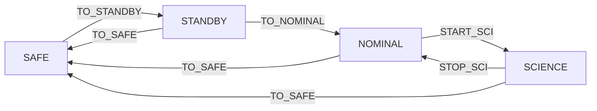

# B88-C09 — Telecomandos y estados de misión

<!-- nav:top -->
[🏠 Programa](../../../../README.md) · [📚 Bloque B88](../../../tronco-comun/B88-avionica-y-software-critico-espacial.md) · [← Anterior: B88-C08 — Telemetría interna](../B88-C08-telemetria-interna/CLASE.md) · [Siguiente: B88-C10 — Gestión de eventos →](../B88-C10-gestion-de-eventos/CLASE.md)
<!-- /nav -->

## 1. Ubicación, nivel y alcance

Clase 9 del bloque B88. Nivel N3. Los telecomandos son las órdenes que llegan de tierra; el software decide si los acepta según el **modo de misión** de la nave, su **contador de secuencia** y su **CRC**. Aquí construyes una máquina de estados sintética de cuatro modos y seis comandos, la matriz estado–comando y un guion de pruebas. La página de ECSS-E-ST-70-41C solo se consultó para el alcance de la norma. Datos **sintéticos**. Todos los datos son **sintéticos** salvo los que se rotulan como consultados.

## 2. Por qué esta clase existe

Un telecomando aceptado en el estado equivocado puede dañar la nave; uno rechazado en el estado correcto puede perderla. La decisión central: **¿qué comando es válido en cada modo y qué comprobaciones lo protegen?**

## 3. Lo que podrás hacer al terminar

1. Definir modos de misión y transiciones.
2. Construir la matriz de aceptación estado–comando.
3. Aplicar comprobaciones de CRC y secuencia antes de ejecutar.
4. Probar un guion con comandos válidos, repetidos y corruptos.
5. Entender por qué `TO_SAFE` tiene un tratamiento especial.
6. Separar lo sintético de lo consultado.

La evidencia es la **matriz de aceptación de telecomandos** del ejercicio 12 (sección 20).

## 4. Con qué llegas y cómo comprobarlo

1. ¿Qué es una máquina de estados?
2. ¿Qué es un modo seguro (*safe*)?
3. ¿Qué es un contador de secuencia?
4. ¿Qué es un CRC?
5. ¿Qué es una matriz estado–comando?

<details>
<summary>Ver respuestas</summary>

1. Un modelo con estados y transiciones según eventos. 2. Un modo mínimo y estable al que la nave vuelve ante un problema. 3. Un número que crece con cada comando para detectar repeticiones y pérdidas. 4. Un código de comprobación contra errores accidentales. 5. Una tabla que dice qué comandos acepta cada estado.
</details>

Con cuatro o cinco aciertos, sigue; si no, repasa los prerrequisitos.

## 5. Un caso de contexto y casos de referencia

Máquina **sintética**: modos `SAFE`, `STANDBY`, `NOMINAL` y `SCIENCE`; comandos `PING`, `TO_STANDBY`, `TO_NOMINAL`, `START_SCI`, `STOP_SCI` y `TO_SAFE`. De las 24 celdas, 11 son de aceptación. En el guion, `START_SCI` en `SAFE` se rechaza por estado, la repetición de `seq = 2` por secuencia y `seq = 3` con CRC malo por CRC.

## 6. Vocabulario

El **modo** es el estado de operación. La **transición** cambia de modo. La **matriz estado–comando** es la tabla de aceptación. El **contador de secuencia** debe valer el anterior más uno. El **CRC-8** con polinomio `0x07` da `0xF4` para `123456789`. Un comando **de seguridad** (`TO_SAFE`) se acepta aun con secuencia fuera de orden, para no impedir la salvaguarda.

## 7. Modelo mental



*Descripción textual:* la nave sube de SAFE a STANDBY, NOMINAL y SCIENCE con comandos y puede volver a SAFE desde cualquier modo superior; STOP_SCI regresa de SCIENCE a NOMINAL.

Analogía: los modos son como las marchas de un auto: no se pasa de primera a quinta de golpe y siempre se puede volver a punto muerto. Límite: en una nave el «punto muerto» (SAFE) debe aceptarse incluso con comunicación parcial.

## 8. La explicación, paso a paso

### 8.1 La matriz

`PING` se acepta en los 4 modos (4 celdas); `TO_STANDBY` solo en `SAFE` (1); `TO_NOMINAL` solo en `STANDBY` (1); `START_SCI` solo en `NOMINAL` (1); `STOP_SCI` solo en `SCIENCE` (1); `TO_SAFE` en los tres modos superiores (3). Total: `4 + 1 + 1 + 1 + 1 + 3 = 11` de 24.

### 8.2 Orden de las comprobaciones

Primero el **CRC** (¿llegó íntegro?), luego la **secuencia** (¿es el siguiente?) y por último el **estado** (¿lo acepta este modo?). `TO_SAFE` omite la secuencia.

### 8.3 El guion

`START_SCI (seq 1)` en `SAFE`: rechazo por estado. `TO_STANDBY (1)`: acepta → `STANDBY`. `TO_NOMINAL (2)`: acepta → `NOMINAL`. Repetir `TO_NOMINAL (2)`: rechazo por secuencia. `TO_NOMINAL (3)` con CRC malo: rechazo por CRC. Con CRC bueno: rechazo por estado (ya en `NOMINAL`). `START_SCI (4)`: rechazo por secuencia (esperaba 3). `TO_SAFE (200)`: acepta → `SAFE`. `PING (1)`: rechazo por secuencia (esperaba 201).

### 8.4 Lección

El último caso muestra que, tras un `TO_SAFE` con secuencia fuera de orden, el contador queda en 200 y hay que **resincronizarlo** con un procedimiento definido.

## 9. Magnitudes, símbolos y unidades

| Símbolo | Qué es | Unidad | Valor / nota |
|---|---|---|---|
| `modo` | estado de operación | — | 4 modos |
| `seq` | contador de secuencia | — | 0–255 |
| `CRC-8` | comprobación | — | 0xF4 (prueba) |
| `celdas` | aceptadas en la matriz | — | 11 de 24 |

## 10. Convenciones y referencias

Contador de 8 bits con aritmética módulo 256. Orden de comprobaciones: CRC, secuencia, estado. `TO_SAFE` se acepta sin comprobar secuencia (decisión de diseño de la clase). Todo **sintético**; no es el servicio de verificación de PUS.

## 11. De dónde sale lo que afirmamos

| ID | Fuente | Localizador | Respalda | Estado |
|---|---|---|---|---|
| S1 | ECSS, «ECSS-E-ST-70-41C — Telemetry and telecommand packet utilization», 15 abr 2016 — https://ecss.nl/standard/ecss-e-st-70-41c-space-engineering-telemetry-and-telecommand-packet-utilization-15-april-2016/ (consultada 2026-11-10) | página de la norma | define servicios para vigilar y controlar naves y cargas útiles, y la estructura de los paquetes TC y TM; los servicios son opcionales y se adaptan por misión | Consultada (solo la página) |
| — | CCSDS 133.0-B (Space Packet Protocol) y CCSDS 232.0-B (TC) | — | — | No consultada (la URL probada respondió 404) |
| — | Libros de texto de sistemas de tiempo real, tolerancia a fallos y comunicaciones digitales | — | — | No consultada |
| — | Relaciones y algoritmos estándar usados por el laboratorio (máquina de estados y CRC-8 por división polinómica) | — | los verifica el laboratorio con una segunda vía o con pruebas | No consultada en una fuente concreta |

Límites: la política de la clase es didáctica y no sigue ningún estándar de telecomandos (la página de ECSS-E-ST-70-41C solo da su alcance). No hay autenticación (C17) ni ventana de secuencia. Lo simulado no se presenta como dato de vuelo ni como medición.

## 12. Cómo ver los resultados

| Comando | SAFE | STANDBY | NOMINAL | SCIENCE |
|---|---|---|---|---|
| PING | A | A | A | A |
| TO_STANDBY | A | – | – | – |
| TO_NOMINAL | – | A | – | – |
| START_SCI | – | – | A | – |
| STOP_SCI | – | – | – | A |
| TO_SAFE | – | A | A | A |

Descripción larga: A es aceptado y – rechazado; 11 de 24 celdas aceptan.

## 13. Ejemplo trabajado

**Paso 1 · Estado inicial.** `SAFE`, `seq = 0`.

**Paso 2 · Comando.** `TO_STANDBY (1)` con CRC correcto.

**Paso 3 · Comprobaciones.** CRC ok; secuencia `1 = 0 + 1`; estado `SAFE` lo acepta.

**Paso 4 · Resultado.** Modo `STANDBY`, `seq = 1`.

## 14. Distintas formas de describir el problema

**Por matriz:** esta clase. **Por diagrama de transición:** sección 7. **Por servicio de verificación:** informes de aceptación de PUS (no consultado en detalle). El laboratorio exige 11 celdas y el modo final `SAFE`.

## 15. Práctica guiada

**Ejercicio 1 · con los pasos indicados.** Cuenta las celdas aceptadas por `PING`.

<details><summary>Solución comentada</summary>

4.
</details>

**Ejercicio 2 · con una pista.** ¿Qué comandos se aceptan en `NOMINAL`?

<details><summary>Solución comentada</summary>

`PING`, `START_SCI` y `TO_SAFE`.
</details>

**Ejercicio 3 · casi autónomo.** ¿Por qué se rechaza `START_SCI` en `SAFE`?

<details><summary>Solución comentada</summary>

Porque exige `NOMINAL`; la matriz lo rechaza por estado.
</details>

## 16. Práctica autónoma, transferencia e integrador

**Ejercicio 4 · autónomo.** ¿Qué secuencia espera la nave tras `seq = 7`?

<details><summary>Solución comentada</summary>

`8`; tras `255`, `0` (módulo 256).
</details>

**Ejercicio 5 · autónomo.** ¿Qué pasa si llega dos veces el mismo comando válido?

<details><summary>Solución comentada</summary>

La segunda se rechaza por secuencia.
</details>

**Ejercicio 6 · autónomo.** Calcula el CRC-8 de un solo byte `0x00` con polinomio `0x07`.

<details><summary>Solución comentada</summary>

`0x00`: el registro permanece 0.
</details>

**Ejercicio 7 · autónomo.** ¿Por qué `TO_SAFE` omite la secuencia?

<details><summary>Solución comentada</summary>

Para que un desajuste del contador no impida llevar la nave a un modo seguro.
</details>

**Ejercicio 8 · autónomo.** ¿Qué riesgo trae omitir la secuencia en `TO_SAFE`?

<details><summary>Solución comentada</summary>

Una repetición maliciosa o accidental podría forzar `SAFE`; se mitiga con autenticación (C17).
</details>

**Ejercicio 9 · transferencia.** **Transferencia.** Un colega dice que esta matriz sirve para su nave. ¿Es válido?

<details><summary>Solución comentada</summary>

No: es una máquina sintética sin los modos ni los comandos reales de ninguna misión.
</details>

**Ejercicio 10 · transferencia.** **Transferencia.** ¿Qué cambia si se agrega el modo `DETUMBLE`?

<details><summary>Solución comentada</summary>

Se añade una fila y una columna (30 celdas), con sus transiciones y pruebas de cada celda.
</details>

**Ejercicio 11 · transferencia.** **Transferencia.** ¿Cómo resincronizarías el contador tras `TO_SAFE (200)`?

<details><summary>Solución comentada</summary>

Con un comando de resincronización definido o aceptando una ventana de números cercanos.
</details>

**Ejercicio 12 · integrador.** **Integrador.** Elabora tu *matriz de aceptación de telecomandos*: modos, comandos, matriz, guion con resultados y lista de qué es sintético.

<details><summary>Solución comentada</summary>

Secciones 8.1–8.4 y la salida del laboratorio.
</details>

## 17. Laboratorio: modos de misión y aceptación de telecomandos

El script [telecomandos_modos.py](telecomandos_modos.py) imprime la matriz estado–comando, ejecuta un guion de nueve telecomandos con CRC y secuencia y **comprueba** 11 celdas aceptadas, el modo final `SAFE` y el CRC-8 de prueba `0xF4`.

**Datos:** modos, comandos y guion **sintéticos**. **Predice antes de ejecutar:** ¿cuántos de los nueve comandos del guion se aceptan? (tres: dos transiciones y `TO_SAFE`). **Ejecución del 2026-11-10 (Python 3.12.9):**

```text
Python 3.12.9
Datos SINTETICOS: modos, comandos y secuencia inventados
Matriz estado x comando (A = aceptado, - = rechazado):
            SAFE     STANDBY  NOMINAL  SCIENCE 
PING        A        A        A        A       
TO_STANDBY  A        -        -        -       
TO_NOMINAL  -        A        -        -       
START_SCI   -        -        A        -       
STOP_SCI    -        -        -        A       
TO_SAFE     -        A        A        A       
Celdas aceptadas = 11 de 24
Guion de telecomandos:
  START_SCI  seq=  1 crc=ok  -> RECHAZO estado SAFE
  TO_STANDBY seq=  1 crc=ok  -> ACEPTADO -> STANDBY
  TO_NOMINAL seq=  2 crc=ok  -> ACEPTADO -> NOMINAL
  TO_NOMINAL seq=  2 crc=ok  -> RECHAZO secuencia (esperada 3)
  TO_NOMINAL seq=  3 crc=MAL -> RECHAZO crc
  TO_NOMINAL seq=  3 crc=ok  -> RECHAZO estado NOMINAL
  START_SCI  seq=  4 crc=ok  -> RECHAZO secuencia (esperada 3)
  TO_SAFE    seq=200 crc=ok  -> ACEPTADO -> SAFE
  PING       seq=  1 crc=ok  -> RECHAZO secuencia (esperada 201)
CRC-8 (poly 0x07) de '123456789' = 0xF4
Pruebas superadas.
```

```bash
python programa/clases/B88/B88-C09-telecomandos-y-estados-de-mision/telecomandos_modos.py
```

**Límites:** sin autenticación ni ventana de secuencia; el CRC no se calcula sobre los comandos del guion (se simula con una bandera).

## 18. Errores frecuentes y cómo corregirlos

**Comprobar el estado antes que el CRC.** Primero la integridad (8.2)

**Olvidar el contador módulo 256.** Tras 255 viene 0

**Presentar el ejemplo como una misión.** Revisa la sección 10

## 19. Cómo sabrás que vas bien

Tras 8.3: ¿qué respuesta esperabas para el último `PING`? Si dudas, repasa el ejemplo 13. Tras el laboratorio: ¿qué comprueba? (ver sección 17).

## 20. Qué entregas y cómo se evalúa

El producto es tu **matriz de aceptación de telecomandos** (ejercicio 12).

| Criterio | Inicial | En desarrollo | Logrado | Destacado |
|---|---|---|---|---|
| Conceptos | Los confunde | Parciales | Explica el método y su dominio | Explica los límites y las alternativas |
| Cálculo | Sin unidades | Con errores | Resultados con unidades y comprobados | Resuelve casos nuevos |
| Numérico | Sin comprobar | Un caso | Verifica con una segunda vía en varios casos | Interpreta las diferencias y los fallos |
| Fuentes | Sin fuente | Sin fecha | Fuentes con fecha y estado | Declara lo sintético y lo no consultado |
| Límites | No los nombra | Uno | Tres | Discute qué falta del modelo |

**Condiciones críticas (no se compensan con promedio):** rotular los datos como sintéticos; comprobar cada resultado con una segunda vía; citar solo lo consultado.

## 21. Ética, seguridad y límites

Clase educativa: los modelos son simplificados y los datos son sintéticos; ningún resultado describe una misión real, certifica conformidad con una norma ni sustituye la revisión de especialistas.  Accesibilidad: tablas equivalentes a las gráficas, fórmulas en texto, ejercicios sin conexión.

## 22. Para cerrar y seguir

Con 11 de 24 celdas aceptadas, la nave rechaza por CRC, secuencia o estado y siempre puede volver a `SAFE`. Queda una pregunta: ¿cómo se avisa de lo que ocurre dentro del software?

**Glosario español–inglés.** telecomando · *telecommand*; modo de misión · *mission mode*; modo seguro · *safe mode*; contador de secuencia · *sequence counter*; matriz de aceptación · *acceptance matrix*.

**Continuidad.** [B88-C10](../B88-C10-gestion-de-eventos/CLASE.md) trata la gestión de eventos.

**Referencias:** ver sección 11.

<!-- nav:bottom -->
---

[← Anterior: B88-C08 — Telemetría interna](../B88-C08-telemetria-interna/CLASE.md) · [📚 Bloque B88](../../../tronco-comun/B88-avionica-y-software-critico-espacial.md) · [Siguiente: B88-C10 — Gestión de eventos →](../B88-C10-gestion-de-eventos/CLASE.md)
<!-- /nav -->
