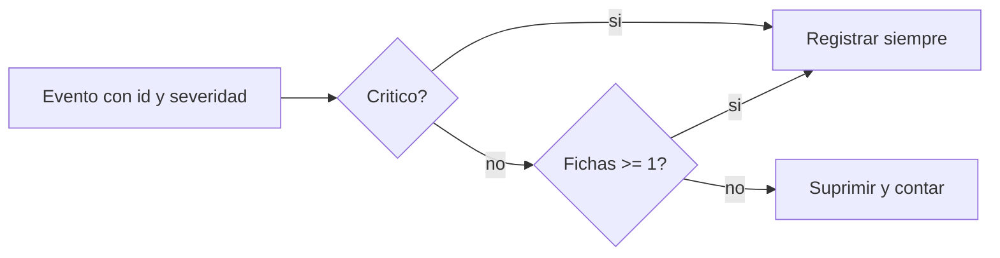

# B88-C10 — Gestión de eventos

<!-- nav:top -->
[🏠 Programa](../../../../README.md) · [📚 Bloque B88](../../../tronco-comun/B88-avionica-y-software-critico-espacial.md) · [← Anterior: B88-C09 — Telecomandos y estados de misión](../B88-C09-telecomandos-y-estados-de-mision/CLASE.md) · [Siguiente: B88-C11 — Watchdogs y recuperación →](../../../tronco-comun/B88-avionica-y-software-critico-espacial.md#b88-c11)
<!-- /nav -->

## 1. Ubicación, nivel y alcance

Clase 10 del bloque B88. Nivel N3. Los eventos son avisos que el software emite al detectar algo (una temperatura alta, un reinicio). Aquí defines **severidades**, un **limitador de tasa** por identificador (cubo de fichas) y compruebas que una tormenta de eventos repetidos no tapa los críticos. Todo es **sintético** (semilla 10). Todos los datos son **sintéticos** salvo los que se rotulan como consultados.

## 2. Por qué esta clase existe

Un sensor que parpadea puede generar miles de eventos y saturar el registro y el enlace, ocultando el único evento importante. La decisión central: **¿cómo se limita el ruido sin perder lo crítico?**

## 3. Lo que podrás hacer al terminar

1. Clasificar eventos por severidad.
2. Implementar un limitador de tasa con ráfaga permitida.
3. Medir cuántos eventos se suprimen en una tormenta.
4. Garantizar que los críticos no se suprimen.
5. Calcular la tasa sostenida y la ráfaga del limitador.
6. Separar lo sintético de lo consultado.

La evidencia es la **política de eventos con prueba de tormenta** del ejercicio 12 (sección 20).

## 4. Con qué llegas y cómo comprobarlo

1. ¿Qué es un evento?
2. ¿Qué es la severidad?
3. ¿Qué es un cubo de fichas?
4. ¿Qué es una tormenta de eventos?
5. ¿Qué es la tasa sostenida?

<details>
<summary>Ver respuestas</summary>

1. Una notificación de que ocurrió algo en el software. 2. Una escala de importancia: informativo, aviso, error, crítico. 3. Un contador que se rellena a tasa fija y se gasta con cada evento. 4. Una ráfaga de eventos repetidos del mismo origen. 5. El número medio de eventos por segundo que se admite.
</details>

Con cuatro o cinco aciertos, sigue; si no, repasa los prerrequisitos.

## 5. Un caso de contexto y casos de referencia

Eventos **sintéticos** en 60 s: `TEMP_ALTA`, `BUS_ERR` y `TM_LISTO` esporádicos, `RESET_WDG` (crítico) en t = 25 y 50 s y `SENSOR_PARPADEO` a 50/s durante 20 s. Se generan `1026` eventos. Sin limitador se registran todos; con limitador (1/s, ráfaga 3) se registran `48` y se suprimen `978`, todos del parpadeo; los 2 críticos quedan.

## 6. Vocabulario

La **severidad** va de 1 (informativo) a 4 (crítico). El **cubo de fichas** tiene capacidad `B` y se rellena a `r` fichas por segundo; cada evento gasta una. La **supresión** descarta el evento y cuenta cuántos. Los eventos **críticos** nunca pasan por el limitador.

## 7. Modelo mental



*Descripción textual:* un evento crítico se registra siempre; uno no crítico solo si el cubo de su identificador tiene una ficha; si no, se suprime y se cuenta.

Analogía: el limitador es como un portero que deja pasar a tres personas de golpe y luego a una por segundo, salvo a quien trae una emergencia. Límite: un portero real puede equivocarse al juzgar la emergencia; aquí la severidad la fija el diseño.

## 8. La explicación, paso a paso

### 8.1 El problema

Sin limitador, el parpadeo (50/s × 20 s = 1000 eventos) domina: `1026` eventos totales.

### 8.2 El cubo de fichas

Capacidad `B = 3`, tasa `r = 1/s`. El evento se acepta si hay al menos una ficha; las fichas se recuperan con `r·Δt` hasta `B`. Para el parpadeo, la ráfaga inicial permite 3 y luego 1 por segundo: `1000 − 978 = 22` registrados.

### 8.3 Resultado

Con limitador: registrados `48`, suprimidos `978` (todos del identificador 5) y críticos registrados `2` de `2`.

### 8.4 Contar lo suprimido

Es importante **contar** lo suprimido: aunque no se registra cada uno, un contador por identificador indica que hubo una tormenta.

## 9. Magnitudes, símbolos y unidades

| Símbolo | Qué es | Unidad | Valor / nota |
|---|---|---|---|
| `r` | tasa sostenida | 1/s | 1 |
| `B` | ráfaga máxima | eventos | 3 |
| `N` | eventos generados | — | 1026 |
| `sup` | eventos suprimidos | — | 978 |
| `sev` | severidad | — | 1 a 4 |

## 10. Convenciones y referencias

Tiempo en s. Cubo por identificador, solo para severidad menor que 4. Semilla `10`. Tolerancia: 0 críticos suprimidos. Todo **sintético**; no es el servicio de eventos de PUS.

## 11. De dónde sale lo que afirmamos

| ID | Fuente | Localizador | Respalda | Estado |
|---|---|---|---|---|
| S1 | ECSS, «ECSS-E-ST-70-41C — Telemetry and telecommand packet utilization», 15 abr 2016 — https://ecss.nl/standard/ecss-e-st-70-41c-space-engineering-telemetry-and-telecommand-packet-utilization-15-april-2016/ (consultada 2026-11-10) | página de la norma | define servicios para vigilar y controlar naves y cargas útiles, y la estructura de los paquetes TC y TM; los servicios son opcionales y se adaptan por misión | Consultada (solo la página) |
| — | CCSDS 133.0-B (Space Packet Protocol) y CCSDS 232.0-B (TC) | — | — | No consultada (la URL probada respondió 404) |
| — | Libros de texto de sistemas de tiempo real, tolerancia a fallos y comunicaciones digitales | — | — | No consultada |
| — | Relaciones y algoritmos estándar usados por el laboratorio (cubo de fichas para limitar tasas y severidades de eventos) | — | los verifica el laboratorio con una segunda vía o con pruebas | No consultada en una fuente concreta |

Límites: la política es didáctica; no se consultó el servicio de informes de eventos de la norma (la página de ECSS-E-ST-70-41C solo da el alcance). El limitador no modela memoria de registro ni prioridades entre identificadores. Lo simulado no se presenta como dato de vuelo ni como medición.

## 12. Cómo ver los resultados

| Limitador | Registrados | Suprimidos | Críticos registrados |
|---|---|---|---|
| No | 1026 | 0 | 2 |
| Sí (1/s, B = 3) | 48 | 978 | 2 |

Descripción larga: el limitador reduce 1026 eventos a 48 sin perder los 2 críticos.

## 13. Ejemplo trabajado

**Paso 1 · Tormenta.** `50 × 20 = 1000` eventos del id 5.

**Paso 2 · Admitidos.** Ráfaga de 3 más `≈ 1/s` durante 20 s: `22` registrados.

**Paso 3 · Suprimidos.** `1000 − 22 = 978`.

**Paso 4 · Críticos.** Ambos `RESET_WDG` se registran.

## 14. Distintas formas de describir el problema

**Por cubo de fichas:** esta clase. **Por ventana deslizante:** contar eventos en los últimos `Δt`. **Por agregación:** un solo evento «repetido N veces». El laboratorio exige 0 críticos suprimidos.

## 15. Práctica guiada

**Ejercicio 1 · con los pasos indicados.** Calcula los eventos de la tormenta.

<details><summary>Solución comentada</summary>

`50 × 20 = 1000`.
</details>

**Ejercicio 2 · con una pista.** ¿Cuántos del parpadeo se registran?

<details><summary>Solución comentada</summary>

`1000 − 978 = 22`.
</details>

**Ejercicio 3 · casi autónomo.** Calcula la reducción porcentual del registro.

<details><summary>Solución comentada</summary>

`(1026 − 48)/1026 = 95,3 %`.
</details>

## 16. Práctica autónoma, transferencia e integrador

**Ejercicio 4 · autónomo.** ¿Qué fichas quedan tras 3 eventos seguidos con `B = 3` y `r = 1/s`?

<details><summary>Solución comentada</summary>

0; tras 1 s, 1 ficha.
</details>

**Ejercicio 5 · autónomo.** ¿Qué pasa con un evento de severidad 4 durante la tormenta?

<details><summary>Solución comentada</summary>

Se registra: no pasa por el limitador.
</details>

**Ejercicio 6 · autónomo.** ¿Cuántos eventos por minuto admite la tasa sostenida?

<details><summary>Solución comentada</summary>

60, más la ráfaga inicial de 3.
</details>

**Ejercicio 7 · autónomo.** ¿Por qué se cuenta lo suprimido?

<details><summary>Solución comentada</summary>

Para saber que hubo una tormenta y su tamaño.
</details>

**Ejercicio 8 · autónomo.** ¿Qué riesgo tiene una ráfaga `B` muy grande?

<details><summary>Solución comentada</summary>

Deja pasar demasiados eventos antes de limitar.
</details>

**Ejercicio 9 · transferencia.** **Transferencia.** Un colega dice que 95 % de reducción vale para su software. ¿Es válido?

<details><summary>Solución comentada</summary>

No: es un conjunto sintético; depende de las tasas y de la política.
</details>

**Ejercicio 10 · transferencia.** **Transferencia.** ¿Qué cambia si el parpadeo es de severidad 4?

<details><summary>Solución comentada</summary>

No se limitaría: se registrarían los 1000; la clasificación de severidad es una decisión crítica.
</details>

**Ejercicio 11 · transferencia.** **Transferencia.** ¿Cómo detectarías un parpadeo que dura meses a baja tasa?

<details><summary>Solución comentada</summary>

Con un contador acumulado por identificador y umbral de alerta, no solo con el limitador.
</details>

**Ejercicio 12 · integrador.** **Integrador.** Elabora tu *política de eventos con prueba de tormenta*: severidades, limitador, resultados con y sin limitador y lista de qué es sintético.

<details><summary>Solución comentada</summary>

Secciones 8.1–8.4 y la salida del laboratorio.
</details>

## 17. Laboratorio: gestión de eventos con limitador de tasa

El script [eventos.py](eventos.py) genera 1026 eventos con semilla 10, aplica un cubo de fichas por identificador y **comprueba** que se suprimen 978 del parpadeo y no se suprime ningún crítico.

**Datos:** eventos **sintéticos** con semilla 10. **Predice antes de ejecutar:** ¿cuántos eventos críticos se suprimirán? (ninguno). **Ejecución del 2026-11-10 (Python 3.12.9):**

```text
Python 3.12.9
Datos SINTETICOS: eventos generados con semilla 10
Eventos generados = 1026
Limitador no: registrados = 1026 ; suprimidos =    0 ; criticos registrados = 2
Limitador si: registrados =   48 ; suprimidos =  978 ; criticos registrados = 2
  suprimidos por ID: {5: 978}
Eventos criticos generados = 2 ; ninguno suprimido
Pruebas superadas.
```

```bash
python programa/clases/B88/B88-C10-gestion-de-eventos/eventos.py
```

**Límites:** sin memoria de registro finita ni prioridades entre identificadores.

## 18. Errores frecuentes y cómo corregirlos

**Limitar también los críticos.** Exímelos del limitador (8.2)

**No contar lo suprimido.** Lleva un contador (8.4)

**Presentar el ejemplo como un registro real.** Revisa la sección 10

## 19. Cómo sabrás que vas bien

Tras 8.3: ¿cuántos registros esperabas? Si dudas, repasa el ejemplo 13. Tras el laboratorio: ¿qué comprueba? (ver sección 17).

## 20. Qué entregas y cómo se evalúa

El producto es tu **política de eventos con prueba de tormenta** (ejercicio 12).

| Criterio | Inicial | En desarrollo | Logrado | Destacado |
|---|---|---|---|---|
| Conceptos | Los confunde | Parciales | Explica el método y su dominio | Explica los límites y las alternativas |
| Cálculo | Sin unidades | Con errores | Resultados con unidades y comprobados | Resuelve casos nuevos |
| Numérico | Sin comprobar | Un caso | Verifica con una segunda vía en varios casos | Interpreta las diferencias y los fallos |
| Fuentes | Sin fuente | Sin fecha | Fuentes con fecha y estado | Declara lo sintético y lo no consultado |
| Límites | No los nombra | Uno | Tres | Discute qué falta del modelo |

**Condiciones críticas (no se compensan con promedio):** rotular los datos como sintéticos; comprobar cada resultado con una segunda vía; citar solo lo consultado.

## 21. Ética, seguridad y límites

Clase educativa: los modelos son simplificados y los datos son sintéticos; ningún resultado describe una misión real, certifica conformidad con una norma ni sustituye la revisión de especialistas.  Accesibilidad: tablas equivalentes a las gráficas, fórmulas en texto, ejercicios sin conexión.

## 22. Para cerrar y seguir

El limitador reduce 1026 eventos a 48 conservando los 2 críticos. Queda una pregunta: ¿qué ocurre cuando el software mismo se cuelga?

**Glosario español–inglés.** evento · *event*; severidad · *severity*; cubo de fichas · *token bucket*; tormenta de eventos · *event storm*; supresión · *suppression*.

**Continuidad.** [B88-C11](../B88-C11-watchdogs-y-recuperacion/CLASE.md) trata los watchdogs y la recuperación.

**Referencias:** ver sección 11.

<!-- nav:bottom -->
---

[← Anterior: B88-C09 — Telecomandos y estados de misión](../B88-C09-telecomandos-y-estados-de-mision/CLASE.md) · [📚 Bloque B88](../../../tronco-comun/B88-avionica-y-software-critico-espacial.md) · [Siguiente: B88-C11 — Watchdogs y recuperación →](../../../tronco-comun/B88-avionica-y-software-critico-espacial.md#b88-c11)
<!-- /nav -->
