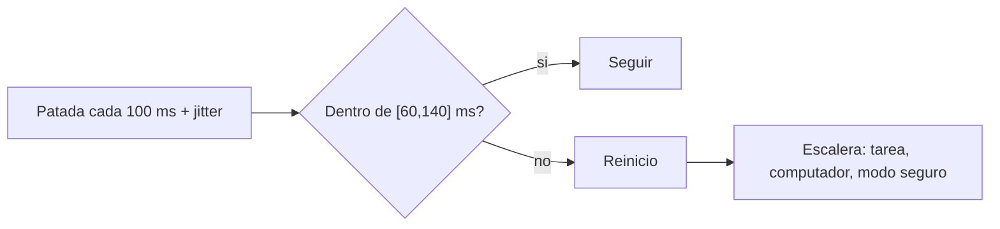

# B88-C11 — Watchdogs y recuperación

<!-- nav:top -->
[🏠 Programa](../../../../README.md) · [📚 Bloque B88](../../../tronco-comun/B88-avionica-y-software-critico-espacial.md) · [← Anterior: B88-C10 — Gestión de eventos](../B88-C10-gestion-de-eventos/CLASE.md) · [Siguiente: B88-C12 — Detección aislamiento y recuperación de fallos →](../B88-C12-deteccion-aislamiento-y-recuperacion-de-fallos/CLASE.md)
<!-- /nav -->

## 1. Ubicación, nivel y alcance

Clase 11 del bloque B88. Nivel N3. Un **watchdog** es un temporizador que reinicia el computador si el software no lo «patea» a tiempo. Aquí modelas uno **de ventana** (la patada debe llegar ni muy pronto ni muy tarde), mides cuántos reinicios falsos produce la fluctuación del lazo y diseñas una **escalera de recuperación**. Todo es **sintético**; el único caso real citado es el relato de Mars Pathfinder (1997) de M. Jones. Todos los datos son **sintéticos** salvo los que se rotulan como consultados.

## 2. Por qué esta clase existe

Un watchdog mal ajustado reinicia sin necesidad o no reinicia cuando hace falta. La decisión central: **¿qué ventana y qué escalera de acciones recuperan un software colgado sin reinicios falsos?**

## 3. Lo que podrás hacer al terminar

1. Definir el período y la ventana de un watchdog.
2. Calcular la probabilidad de reinicio falso con jitter gaussiano.
3. Verificar el cálculo con simulación.
4. Diseñar una escalera de recuperación por reinicios repetidos.
5. Reconocer el papel del watchdog en el caso Pathfinder.
6. Separar lo sintético de lo consultado.

La evidencia es la **diseño de watchdog con casos de prueba** del ejercicio 12 (sección 20).

## 4. Con qué llegas y cómo comprobarlo

1. ¿Qué es patear (*kick*) un watchdog?
2. ¿Qué es el jitter?
3. ¿Qué es una distribución normal?
4. ¿Qué es `erfc`?
5. ¿Qué es un reinicio?

<details>
<summary>Ver respuestas</summary>

1. Reiniciar su cuenta desde el software. 2. La variación aleatoria del instante de un evento periódico. 3. Una campana con media y desviación típica `σ`. 4. La función de error complementaria; `P(|N(0,σ)|>a) = erfc(a/(σ√2))`. 5. Volver al estado de arranque.
</details>

Con cuatro o cinco aciertos, sigue; si no, repasa los prerrequisitos.

## 5. Un caso de contexto y casos de referencia

Un lazo **sintético** patea cada `100 ms`; la ventana válida es `[60, 140] ms` desde la patada anterior. Con jitter `σ = 5 ms` no hay reinicios falsos en 200 000 ciclos; con `σ = 10 ms` hay 9; con `20 ms`, 9132 (4,57 %); con `30 ms`, 36 481 (18,2 %). Caso real, según el relato de Jones: en Mars Pathfinder un reinicio por watchdog fue el síntoma de una inversión de prioridad (C28).

## 6. Vocabulario

El **watchdog simple** reinicia si pasa demasiado tiempo sin patada. El **de ventana** también reinicia si la patada llega **antes** de `t_min`. El **reinicio falso** ocurre con el software sano. La **escalera de recuperación** escala la respuesta con los reinicios repetidos: tarea, computador, modo seguro.

## 7. Modelo mental



*Descripción textual:* cada patada se compara con la ventana; si queda fuera, se reinicia y la escalera decide la respuesta según cuántos reinicios hubo recientemente.

Analogía: un watchdog de ventana es como un guardia que exige que lo saludes cada hora, ni antes de los 40 minutos ni después de los 80. Límite: un software colgado puede seguir pateando si el lazo de patada es independiente de la tarea crítica.

## 8. La explicación, paso a paso

### 8.1 La ventana

Margen de `±40 ms` alrededor de 100 ms. La probabilidad de que una patada caiga fuera con jitter gaussiano es `P = erfc(40/(σ√2))`.

### 8.2 Teoría y simulación

`σ = 10`: `6,33×10⁻⁵` (9 observados en 200 000, esperados 12,7); `σ = 20`: `4,55×10⁻²` (observado `4,57×10⁻²`); `σ = 30`: `1,82×10⁻¹` (observado `1,82×10⁻¹`). Bajo `σ = 5` la probabilidad es `≈ 10⁻⁸`: no hubo reinicios.

### 8.3 Software colgado

Si el software deja de patear, el watchdog expira `140 ms` después de la última patada y reinicia: es el caso para el que se instala.

### 8.4 Escalera

Reinicios a `100, 300, 450` y `2000 s`, con una ventana de 10 minutos: nivel 1 (reiniciar la tarea), nivel 2 (reiniciar el computador), nivel 3 (modo seguro y esperar a tierra) y, pasado el tiempo, vuelve al nivel 1.

## 9. Magnitudes, símbolos y unidades

| Símbolo | Qué es | Unidad | Valor / nota |
|---|---|---|---|
| `T` | período de patada | ms | 100 |
| `[t_min, t_max]` | ventana | ms | [60, 140] |
| `σ` | jitter | ms | 5 a 30 |
| `P` | prob. fuera de ventana | — | 6,33×10⁻⁵ (σ=10) |
| `nivel` | escalón de recuperación | — | 1, 2, 3 |

## 10. Convenciones y referencias

Tiempo en ms; jitter gaussiano independiente por ciclo; semilla `3`. Ventana de reinicios de 10 min (600 s). Tolerancia: coincidencia de proporciones con la teoría en un orden de magnitud para eventos raros. Todo **sintético**.

## 11. De dónde sale lo que afirmamos

| ID | Fuente | Localizador | Respalda | Estado |
|---|---|---|---|---|
| S1 | M. Jones, «What really happened on Mars?» (mensaje del 7 dic 1997, copia en cs.cornell.edu) — https://www.cs.cornell.edu/courses/cs614/1999sp/papers/pathfinder.html (consultada 2026-11-10) | texto completo del mensaje | reinicios de Mars Pathfinder por inversión de prioridad: una tarea de baja prioridad con un mutex, otra de prioridad media que la desplaza y un watchdog que reinicia; se corrigió activando la herencia de prioridad | Consultada (relato del autor, no documento de la misión) |
| S2 | NASA, «Software Engineering and Assurance Handbook» NASA-HDBK-2203 — https://swehb.nasa.gov/ (consultada 2026-11-10) | página de inicio | guía informativa (no de requisitos) para cumplir NPR 7150.2D y NASA-STD-8739.8B para quien adquiere, desarrolla, asegura o mantiene software de la NASA | Consultada (solo la página de inicio) |
| — | Libros de texto de sistemas de tiempo real, tolerancia a fallos y comunicaciones digitales | — | — | No consultada |
| — | Relaciones y algoritmos estándar usados por el laboratorio (probabilidad gaussiana de salir de una ventana y escalera de recuperación) | — | los verifica el laboratorio con una segunda vía o con pruebas | No consultada en una fuente concreta |

Límites: el relato de Jones es un mensaje del autor, no un informe oficial de la misión. No se modela el jitter no gaussiano ni el desfase entre el reloj del watchdog y el del software. Lo simulado no se presenta como dato de vuelo ni como medición.

## 12. Cómo ver los resultados

| `σ` (ms) | Reinicios falsos / 200 000 | Observada | Teórica |
|---|---|---|---|
| 5 | 0 | 0 | ≈10⁻⁸ |
| 10 | 9 | 4,5×10⁻⁵ | 6,33×10⁻⁵ |
| 20 | 9132 | 4,57×10⁻² | 4,55×10⁻² |
| 30 | 36 481 | 1,82×10⁻¹ | 1,82×10⁻¹ |

Descripción larga: la tasa de reinicios falsos crece de forma abrupta cuando el jitter se acerca al margen de la ventana.

## 13. Ejemplo trabajado

**Paso 1 · Margen.** `100 − 60 = 40 ms` y `140 − 100 = 40 ms`.

**Paso 2 · Probabilidad.** Con `σ = 20`, el margen es `2σ`: `erfc(40/(20√2)) = 0,0455`.

**Paso 3 · Ciclos.** `200 000 × 0,0455 = 9100` (observado 9132).

**Paso 4 · Decisión.** Un 4,6 % de reinicios es inaceptable: hay que reducir el jitter o ensanchar la ventana.

## 14. Distintas formas de describir el problema

**Por probabilidad:** `erfc` (esta clase). **Por simulación:** ciclos aleatorios (esta clase). **Por medición en banco:** histograma del instante de patada (C26). El laboratorio compara las dos primeras vías.

## 15. Práctica guiada

**Ejercicio 1 · con los pasos indicados.** Calcula el margen superior de la ventana.

<details><summary>Solución comentada</summary>

`140 − 100 = 40 ms`.
</details>

**Ejercicio 2 · con una pista.** Calcula cuántos `σ` son 40 ms con `σ = 10`.

<details><summary>Solución comentada</summary>

`4σ`.
</details>

**Ejercicio 3 · casi autónomo.** Calcula `P` para `σ = 20` con `erfc(40/(20√2))`.

<details><summary>Solución comentada</summary>

`erfc(1,414) = 0,0455`.
</details>

## 16. Práctica autónoma, transferencia e integrador

**Ejercicio 4 · autónomo.** ¿Cuántos reinicios falsos al día con `σ = 10` a 10 Hz?

<details><summary>Solución comentada</summary>

`864 000 × 6,33×10⁻⁵ = 54,7`.
</details>

**Ejercicio 5 · autónomo.** Si la ventana pasa a `[40, 160]`, ¿qué `P` tiene `σ = 20`?

<details><summary>Solución comentada</summary>

El margen es `3σ`: `erfc(2,121) = 0,0027`.
</details>

**Ejercicio 6 · autónomo.** ¿Qué reinicio se produce si el software se cuelga?

<details><summary>Solución comentada</summary>

Uno al expirar `t_max` (140 ms) tras la última patada.
</details>

**Ejercicio 7 · autónomo.** ¿Por qué una ventana ancha tiene un costo?

<details><summary>Solución comentada</summary>

Un software colgado tarda más en detectarse: el tiempo máximo hasta el reinicio crece.
</details>

**Ejercicio 8 · autónomo.** ¿Qué patada haría reiniciar a un watchdog de ventana aunque el software esté sano?

<details><summary>Solución comentada</summary>

Una patada adelantada por un lazo desbocado (antes de `t_min`).
</details>

**Ejercicio 9 · transferencia.** **Transferencia.** Un colega dice que `σ = 5 ms` vale para su computador. ¿Es válido?

<details><summary>Solución comentada</summary>

No: el jitter es de ejemplo; debe medirse en el sistema real (C26).
</details>

**Ejercicio 10 · transferencia.** **Transferencia.** ¿Qué cambia si hay una patada de otro lazo que no depende de la tarea crítica?

<details><summary>Solución comentada</summary>

El watchdog no detectaría la tarea colgada: la patada debe depender de que todas las tareas críticas progresaron.
</details>

**Ejercicio 11 · transferencia.** **Transferencia.** ¿Qué le pasó a Pathfinder según Jones?

<details><summary>Solución comentada</summary>

Una tarea de baja prioridad con un mutex bloqueó a la de alta; el watchdog detectó la falta de progreso y reinició; se arregló activando la herencia de prioridad.
</details>

**Ejercicio 12 · integrador.** **Integrador.** Elabora tu *diseño de watchdog con casos de prueba*: ventana, probabilidades, simulación, escalera y lista de qué es sintético.

<details><summary>Solución comentada</summary>

Secciones 8.1–8.4 y la salida del laboratorio.
</details>

## 17. Laboratorio: watchdog de ventana y escalera de recuperación

El script [watchdog.py](watchdog.py) simula 200 000 ciclos con cuatro niveles de jitter, los compara con `erfc` y aplica una escalera de recuperación, y **comprueba** 0 reinicios falsos con `σ = 5` y más de 1000 con `σ = 30`.

**Datos:** jitter y tiempos **sintéticos**; semilla 3. **Predice antes de ejecutar:** ¿qué fracción de ciclos reinicia con `σ = 20 ms`? (alrededor de 4,6 %). **Ejecución del 2026-11-10 (Python 3.12.9):**

```text
Python 3.12.9
Datos SINTETICOS: lazo de 100 ms con fluctuacion inventada
Ventana = [60, 140] ms ; periodo = 100 ms ; margen = +-40/40 ms
jitter sigma= 5 ms: resets falsos en 200000 ciclos =     0 (tempranos 0, tardios 0) -> 0.00e+00 por ciclo
jitter sigma=10 ms: resets falsos en 200000 ciclos =     9 (tempranos 5, tardios 4) -> 4.50e-05 por ciclo
jitter sigma=20 ms: resets falsos en 200000 ciclos =  9132 (tempranos 4581, tardios 4551) -> 4.57e-02 por ciclo
jitter sigma=30 ms: resets falsos en 200000 ciclos = 36481 (tempranos 18398, tardios 18083) -> 1.82e-01 por ciclo
  teorico sigma=10: P(fuera de ventana) = 6.334e-05
  teorico sigma=20: P(fuera de ventana) = 4.550e-02
  teorico sigma=30: P(fuera de ventana) = 1.824e-01
Software colgado en el ciclo 500: el watchdog expira tras 140.0 ms sin patada -> reset (1 vez)
reset a t= 100 s -> nivel 1: reinicio de la tarea
reset a t= 300 s -> nivel 2: reinicio del computador
reset a t= 450 s -> nivel 3: modo seguro y espera a tierra
reset a t=2000 s -> nivel 1: reinicio de la tarea
Pruebas superadas.
```

```bash
python programa/clases/B88/B88-C11-watchdogs-y-recuperacion/watchdog.py
```

**Límites:** jitter gaussiano independiente; sin relojes distintos para el watchdog y el software.

## 18. Errores frecuentes y cómo corregirlos

**Pensar que un watchdog arregla la causa.** Solo recupera; hay que hallar la causa (C28)

**Patear desde un lazo independiente.** Ata la patada al progreso de las tareas críticas

**Ajustar la ventana sin medir el jitter.** Mídelo (C26)

## 19. Cómo sabrás que vas bien

Tras 8.2: ¿qué tasa esperabas con `σ = 20`? Si dudas, repasa el ejemplo 13. Tras el laboratorio: ¿qué comprueba? (ver sección 17).

## 20. Qué entregas y cómo se evalúa

El producto es tu **diseño de watchdog con casos de prueba** (ejercicio 12).

| Criterio | Inicial | En desarrollo | Logrado | Destacado |
|---|---|---|---|---|
| Conceptos | Los confunde | Parciales | Explica el método y su dominio | Explica los límites y las alternativas |
| Cálculo | Sin unidades | Con errores | Resultados con unidades y comprobados | Resuelve casos nuevos |
| Numérico | Sin comprobar | Un caso | Verifica con una segunda vía en varios casos | Interpreta las diferencias y los fallos |
| Fuentes | Sin fuente | Sin fecha | Fuentes con fecha y estado | Declara lo sintético y lo no consultado |
| Límites | No los nombra | Uno | Tres | Discute qué falta del modelo |

**Condiciones críticas (no se compensan con promedio):** rotular los datos como sintéticos; comprobar cada resultado con una segunda vía; citar solo lo consultado.

## 21. Ética, seguridad y límites

Clase educativa: los modelos son simplificados y los datos son sintéticos; ningún resultado describe una misión real, certifica conformidad con una norma ni sustituye la revisión de especialistas.  Accesibilidad: tablas equivalentes a las gráficas, fórmulas en texto, ejercicios sin conexión.

## 22. Para cerrar y seguir

Con una ventana de ±40 ms, el jitter debe ser unas 5 veces menor que el margen para evitar reinicios falsos. Queda una pregunta: ¿cómo decide el software qué fallo ocurrió y qué hacer?

**Glosario español–inglés.** vigilante · *watchdog*; patada · *kick*; ventana · *window*; reinicio · *reset*; escalera de recuperación · *recovery ladder*.

**Continuidad.** [B88-C12](../B88-C12-deteccion-aislamiento-y-recuperacion-de-fallos/CLASE.md) trata la detección, aislamiento y recuperación de fallos.

**Referencias:** ver sección 11.

<!-- nav:bottom -->
---

[← Anterior: B88-C10 — Gestión de eventos](../B88-C10-gestion-de-eventos/CLASE.md) · [📚 Bloque B88](../../../tronco-comun/B88-avionica-y-software-critico-espacial.md) · [Siguiente: B88-C12 — Detección aislamiento y recuperación de fallos →](../B88-C12-deteccion-aislamiento-y-recuperacion-de-fallos/CLASE.md)
<!-- /nav -->
