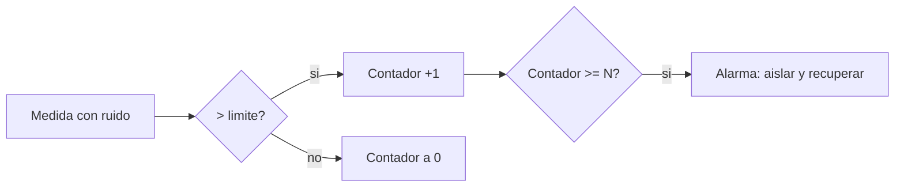

# B88-C12 — Detección aislamiento y recuperación de fallos

<!-- nav:top -->
[🏠 Programa](../../../../README.md) · [📚 Bloque B88](../../../tronco-comun/B88-avionica-y-software-critico-espacial.md) · [← Anterior: B88-C11 — Watchdogs y recuperación](../B88-C11-watchdogs-y-recuperacion/CLASE.md) · [Siguiente: B88-C13 — Actualización segura de software →](../B88-C13-actualizacion-segura-de-software/CLASE.md)
<!-- /nav -->

## 1. Ubicación, nivel y alcance

Clase 12 del bloque B88. Nivel N3. **FDIR** (detección, aislamiento y recuperación de fallos) es la lógica con que el software vigila la nave y responde. Aquí construyes un monitor con **persistencia** (N violaciones consecutivas), mides sus falsas alarmas y su latencia de detección, y defines una tabla monitor→acción. Los datos son **sintéticos** (ruido gaussiano de 1 °C). Todos los datos son **sintéticos** salvo los que se rotulan como consultados.

## 2. Por qué esta clase existe

Un monitor demasiado sensible dispara respuestas innecesarias; uno demasiado lento deja crecer el fallo. La decisión central: **¿qué persistencia equilibra las falsas alarmas y el tiempo de detección?**

## 3. Lo que podrás hacer al terminar

1. Calcular la probabilidad de superar un límite por ruido.
2. Calcular y simular las falsas alarmas con persistencia `N`.
3. Medir la latencia de detección de una falla persistente.
4. Construir una tabla monitor→acción con su persistencia.
5. Interpretar el compromiso entre falsas alarmas y latencia.
6. Separar lo sintético de lo consultado.

La evidencia es la **tabla FDIR con latencias medidas** del ejercicio 12 (sección 20).

## 4. Con qué llegas y cómo comprobarlo

1. ¿Qué es detección, aislamiento y recuperación?
2. ¿Qué es una falsa alarma?
3. ¿Qué es persistencia?
4. ¿Qué es `Q(z)`?
5. ¿Qué es la latencia de detección?

<details>
<summary>Ver respuestas</summary>

1. Notar la falla, ubicar su origen y ejecutar una acción correctiva. 2. Una detección sin falla real. 3. Exigir `N` muestras consecutivas fuera del límite. 4. La cola superior de la normal estándar. 5. El tiempo entre la falla y su detección.
</details>

Con cuatro o cinco aciertos, sigue; si no, repasa los prerrequisitos.

## 5. Un caso de contexto y casos de referencia

Sensor **sintético** de media `20 °C`, ruido `σ = 1 °C` y límite `22 °C`: `q = P(x > 22) = 0,02275`. Con `N = 1` hay 8891 falsas alarmas en 400 000 muestras; con `N = 2`, 206; con `N = 3`, 4; con `N = 4`, 0. Ante una falla real (salto a 25 °C), la latencia media es `N` muestras: 1, 2, 3 y 4 s.

## 6. Vocabulario

El **monitor** compara una medida con un límite. La **persistencia** `N` exige `N` muestras seguidas fuera. La **falsa alarma** por ruido tiene probabilidad aproximada `q^N(1 − q)` por muestra. La **latencia** es `N·Δt` para una falla persistente. La **tabla de respuestas** asocia cada monitor con una acción.

## 7. Modelo mental



*Descripción textual:* cada muestra fuera del límite suma al contador y una dentro lo reinicia; al llegar a N se dispara la alarma y su acción.

Analogía: la persistencia es como esperar a oír tres veces el mismo ruido antes de llamar al técnico. Límite: si el fallo es intermitente y nunca dura tres muestras seguidas, no se detecta (ejercicio 10).

## 8. La explicación, paso a paso

### 8.1 Falsas alarmas

`q = ½ erfc((22 − 20)/(1·√2)) = 0,02275`. Con persistencia `N`, la tasa por muestra es `≈ q^N(1 − q)`: para `N = 3`, `1,15×10⁻⁵`; en 400 000 muestras, `4,6` esperadas (4 simuladas).

### 8.2 Latencia

Si la falla es persistente (media 25 °C, casi siempre sobre el límite), la detección ocurre tras `N` muestras: latencias medias `1,001; 2,004; 3,009; 4,013 s` y máximas `2, 4, 6, 8 s` para `Δt = 1 s`.

### 8.3 El compromiso

Subir `N` de 1 a 3 reduce las falsas alarmas de `8891` a `4` y cuesta 2 s más de detección. La elección depende de lo que cause una falsa alarma y de cuánto daño haga la falla en esos segundos.

### 8.4 La tabla de respuestas

`TEMP_ALTA` (N = 3) → aislar el calentador; `BUS_SIN_RESP` (N = 2) → conmutar al bus B; `TENSION_BAJA` (N = 1) → desconectar cargas no esenciales. El que más daño hace más rápido tiene la menor persistencia.

## 9. Magnitudes, símbolos y unidades

| Símbolo | Qué es | Unidad | Valor / nota |
|---|---|---|---|
| `μ, σ` | media y ruido | °C | 20 y 1 |
| `lim` | límite | °C | 22 |
| `q` | P(x > lim) por ruido | — | 0,02275 |
| `N` | persistencia | muestras | 1 a 4 |
| `L` | latencia media | s | N |

## 10. Convenciones y referencias

Ruido gaussiano independiente; muestreo a 1 Hz; semilla `12`; 400 000 muestras para falsas alarmas y 5000 corridas para latencia. Tolerancia: simulado igual a teórico en un orden de magnitud para eventos raros. Todo **sintético**.

## 11. De dónde sale lo que afirmamos

| ID | Fuente | Localizador | Respalda | Estado |
|---|---|---|---|---|
| S1 | NASA, «Software Assurance and Software Safety Standard» NASA-STD-8739.8B, 8 sep 2022 — https://standards.nasa.gov/standard/nasa/nasa-std-87398 (consultada 2026-11-10) | página de la norma | define requisitos para un enfoque sistemático de aseguramiento y seguridad del software y la verificación y validación independientes, desde la concepción hasta el retiro | Consultada (solo la página) |
| S2 | NASA, «Software Engineering and Assurance Handbook» NASA-HDBK-2203 — https://swehb.nasa.gov/ (consultada 2026-11-10) | página de inicio | guía informativa (no de requisitos) para cumplir NPR 7150.2D y NASA-STD-8739.8B para quien adquiere, desarrolla, asegura o mantiene software de la NASA | Consultada (solo la página de inicio) |
| — | Libros de texto de sistemas de tiempo real, tolerancia a fallos y comunicaciones digitales | — | — | No consultada |
| — | Relaciones y algoritmos estándar usados por el laboratorio (probabilidad de cola gaussiana y persistencia de monitores) | — | los verifica el laboratorio con una segunda vía o con pruebas | No consultada en una fuente concreta |

Límites: las páginas de NASA-STD-8739.8B y del manual de software solo se consultaron como contexto de aseguramiento; no se tomaron de ellas valores de persistencia. No se modelan fallas intermitentes ni deriva del sensor. Lo simulado no se presenta como dato de vuelo ni como medición.

## 12. Cómo ver los resultados

| `N` | Falsas alarmas simuladas | Teóricas | Latencia media |
|---|---|---|---|
| 1 | 8891 | 8893 | 1,001 s |
| 2 | 206 | 202,3 | 2,004 s |
| 3 | 4 | 4,6 | 3,009 s |
| 4 | 0 | 0,1 | 4,013 s |

Descripción larga: cada aumento de `N` divide las falsas alarmas por unas 40 y suma una muestra de latencia.

## 13. Ejemplo trabajado

**Paso 1 · Cola.** `q = 0,02275`.

**Paso 2 · Con N = 2.** `q²(1 − q) = 5,06×10⁻⁴` por muestra.

**Paso 3 · Muestras.** `400 000 × 5,06×10⁻⁴ = 202` (simulado 206).

**Paso 4 · Latencia.** `2 muestras = 2 s`.

## 14. Distintas formas de describir el problema

**Por probabilidad:** `q^N(1 − q)` (esta clase). **Por simulación:** muestras aleatorias (esta clase). **Por inyección de fallos:** campañas en banco (C34). El laboratorio compara las dos primeras vías.

## 15. Práctica guiada

**Ejercicio 1 · con los pasos indicados.** Calcula `q` con `σ = 1` y límite 22 sobre media 20.

<details><summary>Solución comentada</summary>

`½ erfc(√2) = 0,02275`.
</details>

**Ejercicio 2 · con una pista.** Calcula la tasa de falsas alarmas con `N = 2`.

<details><summary>Solución comentada</summary>

`q²(1 − q) = 5,06×10⁻⁴`.
</details>

**Ejercicio 3 · casi autónomo.** Calcula las esperadas en 400 000 muestras con `N = 3`.

<details><summary>Solución comentada</summary>

`400 000 × 1,15×10⁻⁵ = 4,6`.
</details>

## 16. Práctica autónoma, transferencia e integrador

**Ejercicio 4 · autónomo.** ¿Qué `N` da menos de una falsa alarma por millón de muestras?

<details><summary>Solución comentada</summary>

`q³ = 1,2×10⁻⁵` no; `q⁴ = 2,7×10⁻⁷` sí: `N = 4`.
</details>

**Ejercicio 5 · autónomo.** ¿Cuál es la latencia máxima de `N = 3` a 1 Hz?

<details><summary>Solución comentada</summary>

`3 s` para una falla persistente.
</details>

**Ejercicio 6 · autónomo.** Si el muestreo pasa a 10 Hz, ¿qué latencia tiene `N = 3`?

<details><summary>Solución comentada</summary>

`0,3 s`.
</details>

**Ejercicio 7 · autónomo.** ¿Qué acción asignarías al monitor de tensión baja y por qué `N = 1`?

<details><summary>Solución comentada</summary>

Desconectar cargas no esenciales; una tensión baja daña rápido y la respuesta es reversible.
</details>

**Ejercicio 8 · autónomo.** ¿Por qué el aislamiento es una parte distinta de la detección?

<details><summary>Solución comentada</summary>

Detectar dice que algo falló; aislar dice cuál es la unidad responsable para actuar sobre ella.
</details>

**Ejercicio 9 · transferencia.** **Transferencia.** Un colega dice que `N = 3` vale para su sensor. ¿Es válido?

<details><summary>Solución comentada</summary>

No: el ruido es sintético; debe medirse el de cada sensor.
</details>

**Ejercicio 10 · transferencia.** **Transferencia.** ¿Qué falla escapa a un monitor con persistencia?

<details><summary>Solución comentada</summary>

Una intermitente que no dura `N` muestras seguidas; se usa una cuenta acumulada con fuga.
</details>

**Ejercicio 11 · transferencia.** **Transferencia.** ¿Qué pasa si la acción de recuperación también falla?

<details><summary>Solución comentada</summary>

Se necesita un nivel siguiente de la escalera (C11), por ejemplo modo seguro.
</details>

**Ejercicio 12 · integrador.** **Integrador.** Elabora tu *tabla FDIR con latencias medidas*: monitores, persistencias, falsas alarmas, latencias, acciones y lista de qué es sintético.

<details><summary>Solución comentada</summary>

Secciones 8.1–8.4 y la salida del laboratorio.
</details>

## 17. Laboratorio: monitores FDIR con persistencia

El script [fdir.py](fdir.py) simula falsas alarmas con `N = 1…4`, las compara con `q^N(1 − q)`, mide la latencia ante una falla y lista una tabla monitor→acción, y **comprueba** que `N = 3` da menos falsas alarmas que `N = 1`.

**Datos:** ruido y falla **sintéticos**; semilla 12. **Predice antes de ejecutar:** ¿cuántas falsas alarmas esperas con `N = 3`? (unas 4,6). **Ejecución del 2026-11-10 (Python 3.12.9):**

```text
Python 3.12.9
Datos SINTETICOS: sensor de temperatura con ruido gaussiano inventado
P(muestra > limite) por ruido = 0.02275
Persistencia N -> falsas alarmas (simulado vs aprox. teorica q^N*(1-q))*muestras
  N=1: simuladas=  8891  teoricas~   8893.0
  N=2: simuladas=   206  teoricas~    202.3
  N=3: simuladas=     4  teoricas~      4.6
  N=4: simuladas=     0  teoricas~      0.1
  N=1: latencia media = 1.001 s ; maxima = 2 s (muestreo 1 s)
  N=2: latencia media = 2.004 s ; maxima = 4 s (muestreo 1 s)
  N=3: latencia media = 3.009 s ; maxima = 6 s (muestreo 1 s)
  N=4: latencia media = 4.013 s ; maxima = 8 s (muestreo 1 s)
  TEMP_ALTA     -> aislar el calentador               (N=3)
  BUS_SIN_RESP  -> conmutar al bus B                  (N=2)
  TENSION_BAJA  -> desconectar cargas no esenciales   (N=1)
Pruebas superadas.
```

```bash
python programa/clases/B88/B88-C12-deteccion-aislamiento-y-recuperacion-de-fallos/fdir.py
```

**Límites:** ruido gaussiano independiente; falla persistente; sin deriva.

## 18. Errores frecuentes y cómo corregirlos

**Usar `N = 1` por defecto.** Calcula las falsas alarmas (8.1)

**Detectar sin aislar.** Aislar es otro paso (ejercicio 8)

**Presentar el ejemplo como un sensor real.** Revisa la sección 10

## 19. Cómo sabrás que vas bien

Tras 8.3: ¿qué `N` elegirías para TEMP_ALTA? Si dudas, repasa el ejemplo 13. Tras el laboratorio: ¿qué comprueba? (ver sección 17).

## 20. Qué entregas y cómo se evalúa

El producto es tu **tabla FDIR con latencias medidas** (ejercicio 12).

| Criterio | Inicial | En desarrollo | Logrado | Destacado |
|---|---|---|---|---|
| Conceptos | Los confunde | Parciales | Explica el método y su dominio | Explica los límites y las alternativas |
| Cálculo | Sin unidades | Con errores | Resultados con unidades y comprobados | Resuelve casos nuevos |
| Numérico | Sin comprobar | Un caso | Verifica con una segunda vía en varios casos | Interpreta las diferencias y los fallos |
| Fuentes | Sin fuente | Sin fecha | Fuentes con fecha y estado | Declara lo sintético y lo no consultado |
| Límites | No los nombra | Uno | Tres | Discute qué falta del modelo |

**Condiciones críticas (no se compensan con promedio):** rotular los datos como sintéticos; comprobar cada resultado con una segunda vía; citar solo lo consultado.

## 21. Ética, seguridad y límites

Clase educativa: los modelos son simplificados y los datos son sintéticos; ningún resultado describe una misión real, certifica conformidad con una norma ni sustituye la revisión de especialistas.  Accesibilidad: tablas equivalentes a las gráficas, fórmulas en texto, ejercicios sin conexión.

## 22. Para cerrar y seguir

Pasar de `N = 1` a `N = 3` reduce las falsas alarmas de 8891 a 4 por 400 000 muestras y suma 2 s de detección. Queda una pregunta: ¿cómo se cambia el software de una nave sin perderla?

**Glosario español–inglés.** detección de fallos · *fault detection*; aislamiento · *isolation*; recuperación · *recovery*; persistencia · *persistence*; falsa alarma · *false alarm*.

**Continuidad.** [B88-C13](../B88-C13-actualizacion-segura-de-software/CLASE.md) trata la actualización segura de software.

**Referencias:** ver sección 11.

<!-- nav:bottom -->
---

[← Anterior: B88-C11 — Watchdogs y recuperación](../B88-C11-watchdogs-y-recuperacion/CLASE.md) · [📚 Bloque B88](../../../tronco-comun/B88-avionica-y-software-critico-espacial.md) · [Siguiente: B88-C13 — Actualización segura de software →](../B88-C13-actualizacion-segura-de-software/CLASE.md)
<!-- /nav -->
