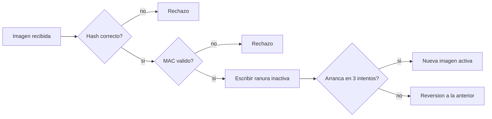

# B88-C13 — Actualización segura de software

<!-- nav:top -->
[🏠 Programa](../../../../README.md) · [📚 Bloque B88](../../../tronco-comun/B88-avionica-y-software-critico-espacial.md) · [← Anterior: B88-C12 — Detección aislamiento y recuperación de fallos](../B88-C12-deteccion-aislamiento-y-recuperacion-de-fallos/CLASE.md) · [Siguiente: B88-C14 — Pruebas de software embarcado →](../B88-C14-pruebas-de-software-embarcado/CLASE.md)
<!-- /nav -->

## 1. Ubicación, nivel y alcance

Clase 13 del bloque B88. Nivel N3. Actualizar el software de una nave a distancia es riesgoso: una imagen corrupta o falsa puede inutilizarla. Aquí modelas una actualización con **dos ranuras (A/B)**, verificación de **hash SHA-256**, **firma HMAC** y **reversión** tras arranques fallidos. La clave es de juguete y las imágenes son **sintéticas**. De NIST SP 800-193 solo se consultó el resumen. Todos los datos son **sintéticos** salvo los que se rotulan como consultados.

## 2. Por qué esta clase existe

Una actualización fallida en órbita no se arregla con un cable. La decisión central: **¿qué comprobaciones aceptan solo la imagen correcta y qué mecanismo vuelve a una versión conocida si la nueva no arranca?**

## 3. Lo que podrás hacer al terminar

1. Describir el esquema de ranuras A/B.
2. Verificar integridad con SHA-256 y autenticidad con HMAC.
3. Rechazar una descarga corrupta y una imagen modificada.
4. Revertir a la imagen anterior tras arranques fallidos.
5. Relacionar el diseño con protección, detección y recuperación.
6. Separar lo sintético de lo consultado.

La evidencia es la **procedimiento de actualización con casos de fallo** del ejercicio 12 (sección 20).

## 4. Con qué llegas y cómo comprobarlo

1. ¿Qué es un hash?
2. ¿Qué es un MAC?
3. ¿Qué es una ranura de arranque?
4. ¿Qué es una reversión?
5. ¿Qué distingue integridad de autenticidad?

<details>
<summary>Ver respuestas</summary>

1. Un resumen de longitud fija que cambia si el dato cambia. 2. Un código de autenticación calculado con una clave compartida. 3. Una zona de memoria con una imagen arrancable. 4. Volver a la versión anterior. 5. Integridad: no cambió; autenticidad: la envió quien tenía la clave.
</details>

Con cuatro o cinco aciertos, sigue; si no, repasa los prerrequisitos.

## 5. Un caso de contexto y casos de referencia

Un equipo **sintético** ejecuta `v1.0` en la ranura A. Llega `v2.0` (560 bytes) con su hash y su MAC. Cuatro casos: (1) actualización buena → pasa a B; (2) descarga con 3 bits corruptos → rechazo por hash; (3) imagen modificada con hash recalculado → rechazo por firma; (4) imagen buena que no arranca → 3 arranques fallidos y reversión a A.

## 6. Vocabulario

El **hash** SHA-256 detecta cambios accidentales o no. El **HMAC-SHA256** con clave secreta autentica. Las **ranuras A/B** guardan la imagen actual y la nueva. Una **reversión** (*rollback*) restaura la anterior. La **cuenta de arranques** limita los intentos. Las tres capacidades de resiliencia de NIST SP 800-193 son **protección, detección y recuperación**.

## 7. Modelo mental



*Descripción textual:* la imagen pasa por el hash y el MAC, se escribe en la ranura inactiva y solo se confirma si arranca; si no, se vuelve a la anterior.

Analogía: es como estrenar un traje con el anterior colgado a mano: lo pruebas, y si no te queda lo cambias. Límite: la clave del MAC debe protegerse; quien la tenga puede firmar cualquier imagen (C38).

## 8. La explicación, paso a paso

### 8.1 Dos comprobaciones

El **hash** dice si los bytes llegaron como se enviaron; el **MAC** dice si los envió quien posee la clave. Un atacante que modifica la imagen puede recalcular el hash, pero no el MAC sin la clave: el caso 3 se rechaza por firma.

### 8.2 Ranura inactiva

La imagen se escribe en la ranura que **no** está activa. La activa sigue intacta mientras tanto.

### 8.3 Reversión

Tras el cambio, el cargador cuenta los arranques. Si no hay arranque correcto en 3 intentos, vuelve a la ranura anterior: caso 4 con `activo = A`.

### 8.4 Resultados

`actualización buena → OK: activo = B`; `descarga corrupta → RECHAZO: hash distinto`; `imagen modificada → RECHAZO: firma inválida`; `no arranca → REVERSIÓN a A`. Las tres capacidades de SP 800-193 se ven así: la firma protege, el hash detecta y las ranuras recuperan.

## 9. Magnitudes, símbolos y unidades

| Símbolo | Qué es | Unidad | Valor / nota |
|---|---|---|---|
| `SHA-256` | hash | bit | 256 |
| `HMAC` | código de autenticación | bit | 256 |
| `L` | tamaño de la imagen | B | 560 |
| `n` | arranques máximos | — | 3 |
| `slot` | ranura activa | — | A o B |

## 10. Convenciones y referencias

Clave de juguete embebida en el script (nunca usar claves reales en código). Hash SHA-256 y HMAC-SHA256 de la biblioteca estándar; comparación en tiempo constante. Todo **sintético**.

## 11. De dónde sale lo que afirmamos

| ID | Fuente | Localizador | Respalda | Estado |
|---|---|---|---|---|
| S1 | NIST, «Platform Firmware Resiliency Guidelines», SP 800-193, mayo 2018 — https://csrc.nist.gov/pubs/sp/800/193/final (consultada 2026-11-10) | resumen | tres capacidades de resiliencia del firmware: protección, detección y recuperación | Consultada (solo el resumen) |
| S2 | E. Barker, NIST SP 800-57 Parte 1 Rev. 5, «Recommendation for Key Management: General», mayo 2020 — https://csrc.nist.gov/pubs/sp/800/57/pt1/r5/final (consultada 2026-11-10) | resumen | la publicación trata tipos de claves, su protección y las funciones de la gestión de claves | Consultada (solo el resumen) |
| — | Libros de texto de sistemas de tiempo real, tolerancia a fallos y comunicaciones digitales | — | — | No consultada |
| — | Relaciones y algoritmos estándar usados por el laboratorio (SHA-256, HMAC-SHA256 y lógica de ranuras A/B con reversión) | — | los verifica el laboratorio con una segunda vía o con pruebas | No consultada en una fuente concreta |

Límites: de NIST SP 800-193 y 800-57 solo se consultó el resumen; el laboratorio no implementa el modelo completo de raíz de confianza, arranque medido ni almacenamiento seguro de claves. No se verifica contra ataques de degradación de versión. Lo simulado no se presenta como dato de vuelo ni como medición.

## 12. Cómo ver los resultados

| Caso | Resultado | Ranura activa |
|---|---|---|
| Actualización buena | OK | B |
| Descarga corrupta | Rechazo: hash | A |
| Imagen modificada | Rechazo: firma | A |
| No arranca | Reversión | A |

Descripción larga: solo la imagen íntegra, firmada y que arranca llega a ser la activa.

## 13. Ejemplo trabajado

**Paso 1 · Recepción.** `v2.0` de 560 bytes con su hash y MAC.

**Paso 2 · Verificación.** Hash y MAC coinciden.

**Paso 3 · Escritura.** Va a la ranura B; la A queda intacta.

**Paso 4 · Arranque.** Arranca en el primer intento: `activo = B`.

## 14. Distintas formas de describir el problema

**Por ranuras A/B:** esta clase. **Por ranura única con recuperación desde ROM:** menos memoria, más riesgo. **Por parcheo parcial:** menos datos, más complejidad. El laboratorio ejecuta los cuatro casos.

## 15. Práctica guiada

**Ejercicio 1 · con los pasos indicados.** ¿Cuántos bits tiene el SHA-256?

<details><summary>Solución comentada</summary>

256.
</details>

**Ejercicio 2 · con una pista.** ¿Qué comprobación detecta una descarga corrupta?

<details><summary>Solución comentada</summary>

El hash.
</details>

**Ejercicio 3 · casi autónomo.** ¿Qué comprobación detecta una imagen modificada con hash recalculado?

<details><summary>Solución comentada</summary>

El MAC (firma).
</details>

## 16. Práctica autónoma, transferencia e integrador

**Ejercicio 4 · autónomo.** ¿Por qué se escribe en la ranura inactiva?

<details><summary>Solución comentada</summary>

Para que la imagen activa siga funcionando si la escritura falla.
</details>

**Ejercicio 5 · autónomo.** ¿Cuántos arranques fallidos provocan la reversión del caso 4?

<details><summary>Solución comentada</summary>

3.
</details>

**Ejercicio 6 · autónomo.** ¿Qué pasa si se pierde energía durante la escritura en la ranura B?

<details><summary>Solución comentada</summary>

La A sigue activa y válida; B se invalida y se reintenta.
</details>

**Ejercicio 7 · autónomo.** ¿Qué mecanismo falta para impedir cargar una versión antigua vulnerable?

<details><summary>Solución comentada</summary>

Un contador de versión mínimo (protección contra degradación).
</details>

**Ejercicio 8 · autónomo.** ¿Por qué comparar el MAC en tiempo constante?

<details><summary>Solución comentada</summary>

Para que el tiempo de comparación no revele cuántos bytes coinciden.
</details>

**Ejercicio 9 · transferencia.** **Transferencia.** Un colega dice que con esto el software de vuelo queda seguro. ¿Es válido?

<details><summary>Solución comentada</summary>

No: es un modelo con clave de juguete; falta raíz de confianza, gestión de claves y pruebas de campo.
</details>

**Ejercicio 10 · transferencia.** **Transferencia.** ¿Qué cambia si la clave del MAC se filtra?

<details><summary>Solución comentada</summary>

Cualquiera puede firmar imágenes: hay que rotar la clave con un mecanismo previsto (C38).
</details>

**Ejercicio 11 · transferencia.** **Transferencia.** ¿Qué capacidad de SP 800-193 cubre la reversión?

<details><summary>Solución comentada</summary>

Recuperación.
</details>

**Ejercicio 12 · integrador.** **Integrador.** Elabora tu *procedimiento de actualización con casos de fallo*: pasos, comprobaciones, cuatro casos y lista de qué es sintético.

<details><summary>Solución comentada</summary>

Secciones 8.1–8.4 y la salida del laboratorio.
</details>

## 17. Laboratorio: actualización segura con A/B, hash, MAC y reversión

El script [actualizacion_segura.py](actualizacion_segura.py) ejecuta cuatro casos de actualización con SHA-256 y HMAC-SHA256 y **comprueba** que solo el caso bueno cambia de ranura y que el no-arranque revierte a A.

**Datos:** imágenes y clave de juguete **sintéticas**. **Predice antes de ejecutar:** ¿qué ranura queda activa tras la imagen modificada con hash recalculado? (la A). **Ejecución del 2026-11-10 (Python 3.12.9):**

```text
Python 3.12.9
Datos SINTETICOS: imagenes de bytes inventados y una clave de juguete (NO usar en un sistema real)
actualizacion buena                        -> OK: activo = B (arranque correcto)
descarga corrupta (3 bits)                 -> RECHAZO: hash distinto (descarga corrupta)
imagen modificada con hash recalculado     -> RECHAZO: firma invalida
imagen buena pero no arranca               -> REVERSION: tras 3 arranques fallidos vuelve a A
SHA-256 de la imagen v2.0 = 638278b467096b3e...  longitud = 560 B
Pruebas superadas.
```

```bash
python programa/clases/B88/B88-C13-actualizacion-segura-de-software/actualizacion_segura.py
```

**Límites:** clave de juguete, sin raíz de confianza ni contador de versión; el arranque se simula con una bandera.

## 18. Errores frecuentes y cómo corregirlos

**Verificar solo el hash.** Un atacante recalcula el hash; añade MAC (8.1)

**Sobrescribir la imagen activa.** Escribe en la inactiva (8.2)

**Guardar la clave en el código real.** Solo aquí es un juguete (sección 10)

## 19. Cómo sabrás que vas bien

Tras 8.3: ¿qué ranura esperabas tras un arranque fallido? Si dudas, repasa el ejemplo 13. Tras el laboratorio: ¿qué comprueba? (ver sección 17).

## 20. Qué entregas y cómo se evalúa

El producto es tu **procedimiento de actualización con casos de fallo** (ejercicio 12).

| Criterio | Inicial | En desarrollo | Logrado | Destacado |
|---|---|---|---|---|
| Conceptos | Los confunde | Parciales | Explica el método y su dominio | Explica los límites y las alternativas |
| Cálculo | Sin unidades | Con errores | Resultados con unidades y comprobados | Resuelve casos nuevos |
| Numérico | Sin comprobar | Un caso | Verifica con una segunda vía en varios casos | Interpreta las diferencias y los fallos |
| Fuentes | Sin fuente | Sin fecha | Fuentes con fecha y estado | Declara lo sintético y lo no consultado |
| Límites | No los nombra | Uno | Tres | Discute qué falta del modelo |

**Condiciones críticas (no se compensan con promedio):** rotular los datos como sintéticos; comprobar cada resultado con una segunda vía; citar solo lo consultado.

## 21. Ética, seguridad y límites

Clase educativa: los modelos son simplificados y los datos son sintéticos; ningún resultado describe una misión real, certifica conformidad con una norma ni sustituye la revisión de especialistas. El laboratorio usa una clave de juguete y no contiene técnicas contra sistemas reales. Accesibilidad: tablas equivalentes a las gráficas, fórmulas en texto, ejercicios sin conexión.

## 22. Para cerrar y seguir

Solo la imagen íntegra, firmada y que arranca llega a ser la activa; las demás se rechazan o se revierten. Queda una pregunta: ¿cómo se prueba que el software hace lo que debe?

**Glosario español–inglés.** actualización · *update*; ranura · *slot*; reversión · *rollback*; firma · *signature*; resiliencia del firmware · *firmware resiliency*.

**Continuidad.** [B88-C14](../B88-C14-pruebas-de-software-embarcado/CLASE.md) trata las pruebas de software embarcado.

**Referencias:** ver sección 11.

<!-- nav:bottom -->
---

[← Anterior: B88-C12 — Detección aislamiento y recuperación de fallos](../B88-C12-deteccion-aislamiento-y-recuperacion-de-fallos/CLASE.md) · [📚 Bloque B88](../../../tronco-comun/B88-avionica-y-software-critico-espacial.md) · [Siguiente: B88-C14 — Pruebas de software embarcado →](../B88-C14-pruebas-de-software-embarcado/CLASE.md)
<!-- /nav -->
