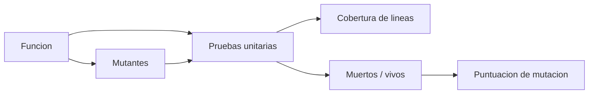

# B88-C14 — Pruebas de software embarcado

<!-- nav:top -->
[🏠 Programa](../../../../README.md) · [📚 Bloque B88](../../../tronco-comun/B88-avionica-y-software-critico-espacial.md) · [← Anterior: B88-C13 — Actualización segura de software](../B88-C13-actualizacion-segura-de-software/CLASE.md) · [Siguiente: B88-C15 — Análisis estático de código →](../B88-C15-analisis-estatico-de-codigo/CLASE.md)
<!-- /nav -->

## 1. Ubicación, nivel y alcance

Clase 14 del bloque B88. Nivel N3. Probar software embarcado es comprobar que cumple sus requisitos con casos de prueba. Aquí escribes pruebas unitarias de una función de vigilancia de límites, mides la **cobertura de líneas** con un trazador y evalúas la calidad de las pruebas con **mutación** (cambiar un operador y ver si alguna prueba falla). La función es **sintética**. Todos los datos son **sintéticos** salvo los que se rotulan como consultados.

## 2. Por qué esta clase existe

Una prueba que pasa no prueba nada si pasaría también con el código roto. La decisión central: **¿las pruebas detectan los cambios de comportamiento o solo recorren el código?**

## 3. Lo que podrás hacer al terminar

1. Escribir pruebas con valores de frontera.
2. Medir la cobertura de líneas.
3. Generar mutantes de operadores.
4. Calcular la puntuación de mutación.
5. Interpretar un mutante vivo como una prueba que falta.
6. Separar lo sintético de lo consultado.

La evidencia es la **informe de pruebas con puntuación de mutación** del ejercicio 12 (sección 20).

## 4. Con qué llegas y cómo comprobarlo

1. ¿Qué es una prueba unitaria?
2. ¿Qué es un valor de frontera?
3. ¿Qué es la cobertura de líneas?
4. ¿Qué es un mutante?
5. ¿Qué es un oráculo de prueba?

<details>
<summary>Ver respuestas</summary>

1. Una comprobación automática de una función aislada. 2. Un valor justo en el borde de una condición. 3. El porcentaje de líneas ejecutadas por las pruebas. 4. Una copia del código con un cambio pequeño. 5. El resultado esperado con que se compara.
</details>

Con cuatro o cinco aciertos, sigue; si no, repasa los prerrequisitos.

## 5. Un caso de contexto y casos de referencia

La función `vigilar(x, lo, hi, n_max)` devuelve el estado (`OK`, `BAJO`, `ALTO` o `ALARMA`) y un contador que baja con cada violación. Seis pruebas pasan sobre el original. Con 1 prueba la cobertura es `45 %`; con 3, `82 %`; con 6, `91 %`. De los 9 mutantes de operadores, las 6 pruebas matan los 9 (`100 %`); sin las dos de frontera, la puntuación baja a `77,8 %`.

## 6. Vocabulario

La **cobertura de líneas** `líneas ejecutadas / ejecutables`. Un **mutante** es el código con un cambio (`<` por `<=`). Un mutante **muerto** hace fallar alguna prueba; uno **vivo**, no. La **puntuación de mutación** `= muertos/total`. Una **prueba de frontera** usa el valor límite.

## 7. Modelo mental



*Descripción textual:* las pruebas se ejecutan sobre la función para medir cobertura y sobre sus mutantes para medir cuántos detectan.

Analogía: la mutación es como probar un detector de humo con humo de verdad: si no suena, el detector no sirve aunque esté instalado. Límite: un mutante equivalente (que no cambia el comportamiento) nunca se detecta.

## 8. La explicación, paso a paso

### 8.1 Las pruebas

Seis casos: `OK` en el centro, `BAJO`, `ALTO`, `ALARMA` con `n_max = 1`, y los dos de frontera `x = lo` y `x = hi` (ambos `OK`).

### 8.2 Cobertura

Con 1 prueba se cubren `5/11` líneas (45 %); con 3, `9/11` (82 %); con 6, `10/11` (91 %). La línea que falta es `else:`, que Python no registra como línea ejecutable con el trazador: no es un hueco real.

### 8.3 Mutación

Se aplican cambios de operadores (`<`→`<=`, `>`→`>=`, `!=`→`==`, `-1`→`+1`, etc.). De 9 mutantes, las 6 pruebas matan 9. Sin las dos de frontera, matan 7 de 9 (`77,8 %`): los mutantes `<`→`<=` y `>`→`>=` quedan vivos.

### 8.4 Lectura

La cobertura de líneas sube con cada prueba, pero solo la mutación mide si las pruebas **detectan cambios**. Las pruebas de frontera valen su peso en esos dos mutantes.

## 9. Magnitudes, símbolos y unidades

| Símbolo | Qué es | Unidad | Valor / nota |
|---|---|---|---|
| `cob` | cobertura de líneas | % | 45, 82, 91 |
| `M` | mutantes totales | — | 9 |
| `muertos` | mutantes detectados | — | 9 |
| `puntuación` | muertos / total | % | 100 (6 pruebas) / 77,8 (4) |

## 10. Convenciones y referencias

Mutación de primer orden sobre texto, un operador a la vez; los mutantes con error de sintaxis se descartan. Cobertura con `sys.settrace` de líneas. Tolerancia: la puntuación con todas las pruebas debe superar la de 4. Todo **sintético**.

## 11. De dónde sale lo que afirmamos

| ID | Fuente | Localizador | Respalda | Estado |
|---|---|---|---|---|
| S1 | NASA, «Software Engineering and Assurance Handbook» NASA-HDBK-2203 — https://swehb.nasa.gov/ (consultada 2026-11-10) | página de inicio | guía informativa (no de requisitos) para cumplir NPR 7150.2D y NASA-STD-8739.8B para quien adquiere, desarrolla, asegura o mantiene software de la NASA | Consultada (solo la página de inicio) |
| S2 | NASA, «Software Assurance and Software Safety Standard» NASA-STD-8739.8B, 8 sep 2022 — https://standards.nasa.gov/standard/nasa/nasa-std-87398 (consultada 2026-11-10) | página de la norma | define requisitos para un enfoque sistemático de aseguramiento y seguridad del software y la verificación y validación independientes, desde la concepción hasta el retiro | Consultada (solo la página) |
| — | Libros de texto de sistemas de tiempo real, tolerancia a fallos y comunicaciones digitales | — | — | No consultada |
| — | Relaciones y algoritmos estándar usados por el laboratorio (cobertura de líneas, mutación de operadores y puntuación de mutación) | — | los verifica el laboratorio con una segunda vía o con pruebas | No consultada en una fuente concreta |

Límites: no se consultaron los requisitos de pruebas de las normas citadas (solo sus páginas de inicio). La mutación usa pocos operadores y no detecta mutantes equivalentes. La cobertura es de líneas, no de decisión ni de MC/DC (C39). Lo simulado no se presenta como dato de vuelo ni como medición.

## 12. Cómo ver los resultados

| Pruebas | Cobertura de líneas | Puntuación de mutación |
|---|---|---|
| 1 | 5/11 = 45 % | no medida |
| 3 | 9/11 = 82 % | no medida |
| 4 (sin frontera) | — | 77,8 % |
| 6 | 10/11 = 91 % | 100 % |

Descripción larga: la mutación distingue 4 de 6 pruebas aunque ambas alcancen alta cobertura.

## 13. Ejemplo trabajado

**Paso 1 · Mutante.** Se cambia `x < lo` por `x <= lo`.

**Paso 2 · Pruebas de 4.** Ninguna usa `x = lo`: el mutante sobrevive.

**Paso 3 · Prueba 5.** `f(0, 0, 10, 3) == ("OK", 3)`: con el mutante da `BAJO` y falla.

**Paso 4 · Resultado.** El mutante queda muerto.

## 14. Distintas formas de describir el problema

**Por cobertura:** qué se ejecuta. **Por mutación:** qué se detecta (esta clase). **Por propiedades y fuzzing:** entradas aleatorias (C37). El laboratorio compara cobertura y mutación.

## 15. Práctica guiada

**Ejercicio 1 · con los pasos indicados.** Calcula la cobertura con 3 pruebas.

<details><summary>Solución comentada</summary>

`9/11 = 82 %`.
</details>

**Ejercicio 2 · con una pista.** ¿Qué valor de `x` mata el mutante `<`→`<=`?

<details><summary>Solución comentada</summary>

`x = lo`.
</details>

**Ejercicio 3 · casi autónomo.** ¿Qué valor de `x` mata el mutante `>`→`>=`?

<details><summary>Solución comentada</summary>

`x = hi`.
</details>

## 16. Práctica autónoma, transferencia e integrador

**Ejercicio 4 · autónomo.** Calcula la puntuación con 7 de 9 mutantes muertos.

<details><summary>Solución comentada</summary>

`7/9 = 77,8 %`.
</details>

**Ejercicio 5 · autónomo.** ¿Qué significa un mutante vivo?

<details><summary>Solución comentada</summary>

Hay un cambio de comportamiento que ninguna prueba detecta: falta una prueba.
</details>

**Ejercicio 6 · autónomo.** ¿Por qué la línea `else:` no cuenta en la cobertura?

<details><summary>Solución comentada</summary>

No genera evento de línea en el trazador; es una limitación de la herramienta.
</details>

**Ejercicio 7 · autónomo.** ¿Cuántos mutantes equivalentes esperas en `n_max <= 0`→`n_max < 0`?

<details><summary>Solución comentada</summary>

Ninguno: cambia el comportamiento con `n_max = 0`.
</details>

**Ejercicio 8 · autónomo.** Añade una prueba para `n_max = 2` y `x` fuera de límite.

<details><summary>Solución comentada</summary>

`f(11,0,10,2) == ("ALTO",1)`; cubre el contador sin alarma.
</details>

**Ejercicio 9 · transferencia.** **Transferencia.** Un colega dice que 91 % de cobertura demuestra que el código es correcto. ¿Es válido?

<details><summary>Solución comentada</summary>

No: cobertura no es corrección; con 4 pruebas la mutación ya mostró huecos.
</details>

**Ejercicio 10 · transferencia.** **Transferencia.** ¿Qué cambia si la función usa números reales con tolerancia?

<details><summary>Solución comentada</summary>

Las pruebas de frontera necesitan valores a `±ε` y la comparación con tolerancia.
</details>

**Ejercicio 11 · transferencia.** **Transferencia.** ¿Cómo usarías la mutación en un proyecto crítico?

<details><summary>Solución comentada</summary>

Sobre los módulos de seguridad, con un umbral exigido y revisión de los mutantes vivos.
</details>

**Ejercicio 12 · integrador.** **Integrador.** Elabora tu *informe de pruebas con puntuación de mutación*: pruebas, cobertura, mutantes, vivos y lista de qué es sintético.

<details><summary>Solución comentada</summary>

Secciones 8.1–8.4 y la salida del laboratorio.
</details>

## 17. Laboratorio: pruebas unitarias, cobertura y mutación

El script [pruebas_mutacion.py](pruebas_mutacion.py) ejecuta seis pruebas sobre `vigilar`, mide la cobertura de líneas con `sys.settrace`, genera mutantes de operadores y calcula la puntuación, y **comprueba** que todas pasan sobre el original y que quitar las de frontera baja la puntuación.

**Datos:** función y casos **sintéticos**. **Predice antes de ejecutar:** ¿qué puntuación tendrá el conjunto sin pruebas de frontera? (77,8 %). **Ejecución del 2026-11-10 (Python 3.12.9):**

```text
Python 3.12.9
Datos SINTETICOS: una funcion de vigilancia de limites inventada
Pruebas que pasan en el original: 6/6
Con 1 pruebas: lineas cubiertas 5/11 = 45 %
Con 3 pruebas: lineas cubiertas 9/11 = 82 %
Con 6 pruebas: lineas cubiertas 10/11 = 91 %
Mutantes = 9 ; muertos = 9 ; vivos = 0 ; puntuacion de mutacion = 100.0 %
Puntuacion sin pruebas de frontera = 77.8 % ; con todas = 100.0 %
Pruebas superadas.
```

```bash
python programa/clases/B88/B88-C14-pruebas-de-software-embarcado/pruebas_mutacion.py
```

**Límites:** mutación de primer orden con ocho operadores; cobertura de líneas solamente.

## 18. Errores frecuentes y cómo corregirlos

**Confiar en la cobertura.** Mide también la mutación (8.4)

**Omitir fronteras.** Los mutantes `<=` sobreviven (8.3)

**Presentar la función como código de vuelo.** Revisa la sección 10

## 19. Cómo sabrás que vas bien

Tras 8.3: ¿qué mutantes sobreviven sin fronteras? Si dudas, repasa el ejemplo 13. Tras el laboratorio: ¿qué comprueba? (ver sección 17).

## 20. Qué entregas y cómo se evalúa

El producto es tu **informe de pruebas con puntuación de mutación** (ejercicio 12).

| Criterio | Inicial | En desarrollo | Logrado | Destacado |
|---|---|---|---|---|
| Conceptos | Los confunde | Parciales | Explica el método y su dominio | Explica los límites y las alternativas |
| Cálculo | Sin unidades | Con errores | Resultados con unidades y comprobados | Resuelve casos nuevos |
| Numérico | Sin comprobar | Un caso | Verifica con una segunda vía en varios casos | Interpreta las diferencias y los fallos |
| Fuentes | Sin fuente | Sin fecha | Fuentes con fecha y estado | Declara lo sintético y lo no consultado |
| Límites | No los nombra | Uno | Tres | Discute qué falta del modelo |

**Condiciones críticas (no se compensan con promedio):** rotular los datos como sintéticos; comprobar cada resultado con una segunda vía; citar solo lo consultado.

## 21. Ética, seguridad y límites

Clase educativa: los modelos son simplificados y los datos son sintéticos; ningún resultado describe una misión real, certifica conformidad con una norma ni sustituye la revisión de especialistas.  Accesibilidad: tablas equivalentes a las gráficas, fórmulas en texto, ejercicios sin conexión.

## 22. Para cerrar y seguir

Seis pruebas dan 91 % de cobertura y 100 % de mutación; sin las de frontera, la mutación baja a 77,8 %. Queda una pregunta: ¿qué se puede revisar sin ejecutar el código?

**Glosario español–inglés.** prueba unitaria · *unit test*; cobertura · *coverage*; mutante · *mutant*; valor de frontera · *boundary value*; puntuación de mutación · *mutation score*.

**Continuidad.** [B88-C15](../B88-C15-analisis-estatico-de-codigo/CLASE.md) trata el análisis estático de código.

**Referencias:** ver sección 11.

<!-- nav:bottom -->
---

[← Anterior: B88-C13 — Actualización segura de software](../B88-C13-actualizacion-segura-de-software/CLASE.md) · [📚 Bloque B88](../../../tronco-comun/B88-avionica-y-software-critico-espacial.md) · [Siguiente: B88-C15 — Análisis estático de código →](../B88-C15-analisis-estatico-de-codigo/CLASE.md)
<!-- /nav -->
