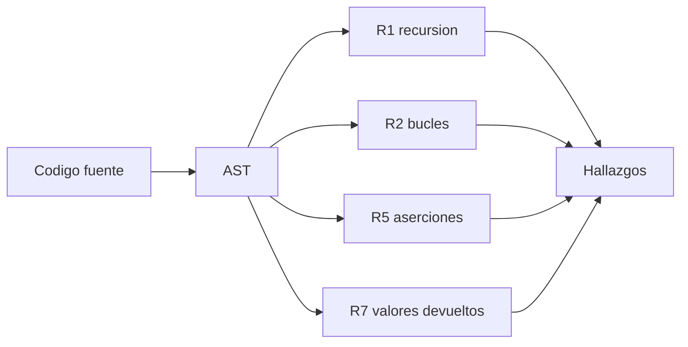

# B88-C15 — Análisis estático de código

<!-- nav:top -->
[🏠 Programa](../../../../README.md) · [📚 Bloque B88](../../../tronco-comun/B88-avionica-y-software-critico-espacial.md) · [← Anterior: B88-C14 — Pruebas de software embarcado](../B88-C14-pruebas-de-software-embarcado/CLASE.md) · [Siguiente: B88-C16 — Ingeniería de seguridad funcional →](../B88-C16-ingenieria-de-seguridad-funcional/CLASE.md)
<!-- /nav -->

## 1. Ubicación, nivel y alcance

Clase 15 del bloque B88. Nivel N3. El análisis estático examina el código **sin ejecutarlo**. Aquí aplicas cinco reglas inspiradas en «The Power of Ten» de G. Holzmann (JPL) sobre dos fragmentos en Python: uno con defectos sembrados y uno corregido. Las reglas originales son para C; esto es un **análogo didáctico** con el módulo `ast`. Todo el código es **sintético**. Todos los datos son **sintéticos** salvo los que se rotulan como consultados.

## 2. Por qué esta clase existe

Un defecto que el compilador acepta puede costar una misión: recursión sin cota, bucles que no terminan, valores de retorno ignorados. La decisión central: **¿qué reglas simples y verificables mecánicamente reducen esas clases de error?**

## 3. Lo que podrás hacer al terminar

1. Enunciar las reglas de Holzmann que se aplican.
2. Implementar comprobaciones con el árbol sintáctico.
3. Distinguir un hallazgo verdadero de un falso negativo.
4. Corregir los defectos sembrados.
5. Reconocer los límites de un análisis estático simple.
6. Separar lo sintético de lo consultado.

La evidencia es la **informe de análisis estático con reglas y hallazgos** del ejercicio 12 (sección 20).

## 4. Con qué llegas y cómo comprobarlo

1. ¿Qué es el árbol sintáctico abstracto (AST)?
2. ¿Qué es recursión?
3. ¿Qué es una aserción?
4. ¿Qué es un falso negativo?
5. ¿Qué es un bucle con cota?

<details>
<summary>Ver respuestas</summary>

1. La representación en árbol de la estructura del código. 2. Una función que se llama a sí misma. 3. Una comprobación de una condición que debe ser siempre cierta. 4. Un defecto que el análisis no detecta. 5. Uno cuyo número máximo de iteraciones es conocido.
</details>

Con cuatro o cinco aciertos, sigue; si no, repasa los prerrequisitos.

## 5. Un caso de contexto y casos de referencia

Fragmento **sintético** `MALO` con cuatro funciones: `leer` sin aserciones, `factorial` recursiva, `esperar` con `while True` sin salida y `procesar` que ignora el valor de `leer()`. El analizador da **7 hallazgos**. El fragmento `BUENO` corrige todo y da **0**. Un caso (`while s` sin cambio) escapa a la regla de bucles: un falso negativo.

## 6. Vocabulario

Holzmann propone, entre otras, **R1** flujo simple sin recursión, **R2** bucles con cota fija, **R3** sin memoria dinámica tras la inicialización, **R4** funciones de unas 60 líneas, **R5** al menos 2 aserciones por función, **R6** alcance mínimo y **R7** comprobar los valores devueltos. Un **hallazgo** es una violación detectada.

## 7. Modelo mental



*Descripción textual:* el código se convierte en árbol y cada regla recorre el árbol buscando su patrón; los resultados forman la lista de hallazgos.

Analogía: el análisis estático es como un corrector ortográfico: encuentra errores de forma, no de sentido. Límite: un texto sin faltas puede ser un disparate; código sin hallazgos puede ser incorrecto.

## 8. La explicación, paso a paso

### 8.1 Las reglas aplicadas

Se toman del texto de Holzmann: flujo simple sin recursión (R1), bucles con cota (R2), unas 60 líneas por función (R4), mínimo de dos aserciones por función (R5) y comprobar valores devueltos (R7). Las demás (memoria dinámica, preprocesador, punteros, advertencias del compilador) no tienen análogo directo en este lenguaje.

### 8.2 Resultados sobre `MALO`

`leer`: R5 (0 < 2). `factorial`: R1 y R5. `esperar`: R2 y R5. `procesar`: R5 y R7 (ignora el valor de `leer()`). Total: `7`.

### 8.3 Resultado sobre `BUENO`

Se reescribe `factorial` con `for` acotado, `esperar` con `max_iter`, y se agregan dos aserciones por función y el uso del valor devuelto: `0` hallazgos.

### 8.4 Falsos negativos

`while s:` donde `s` nunca cambia no se marca, porque R2 solo reconoce `while True` sin salida. Una regla simple deja pasar lo que no sabe ver.

## 9. Magnitudes, símbolos y unidades

| Símbolo | Qué es | Unidad | Valor / nota |
|---|---|---|---|
| `hall` | hallazgos | — | 7 (MALO), 0 (BUENO) |
| `R` | regla | — | R1, R2, R4, R5, R7 |
| `aserc` | aserciones por función | — | ≥ 2 |
| `líneas` | longitud máxima de función | líneas | 60 |

## 10. Convenciones y referencias

Reglas mecánicas sobre el AST de Python 3.12; un hallazgo por regla y función; la regla R4 usa 60 líneas. Tolerancia: 7 y 0 hallazgos exactos. Todo **sintético**; las reglas de Holzmann son para C y aquí son un análogo.

## 11. De dónde sale lo que afirmamos

| ID | Fuente | Localizador | Respalda | Estado |
|---|---|---|---|---|
| S1 | G. J. Holzmann (NASA/JPL), «The Power of Ten — Rules for Developing Safety Critical Code» — https://spinroot.com/gerard/pdf/P10.pdf (consultada 2026-11-10 con PyMuPDF) | texto de las diez reglas | reglas: control de flujo simple sin recursión, bucles con cota fija, sin memoria dinámica tras la inicialización, funciones de unas 60 líneas, al menos dos aserciones por función, alcance mínimo de datos, comprobación de valores devueltos | Consultada (texto completo del PDF) |
| — | Libros de texto de sistemas de tiempo real, tolerancia a fallos y comunicaciones digitales | — | — | No consultada |
| — | Relaciones y algoritmos estándar usados por el laboratorio (recorrido del AST y detección de patrones sintácticos) | — | los verifica el laboratorio con una segunda vía o con pruebas | No consultada en una fuente concreta |

Límites: se consultó el texto de las diez reglas de Holzmann, pero no se verificó su adopción en normas del JPL ni de la NASA. El analizador es un juguete: no hace análisis de flujo de datos ni de punteros. Lo simulado no se presenta como dato de vuelo ni como medición.

## 12. Cómo ver los resultados

| Función | Hallazgos en MALO |
|---|---|
| leer | R5 |
| factorial | R1, R5 |
| esperar | R2, R5 |
| procesar | R5, R7 |

Descripción larga: R5 se repite en las cuatro funciones; R1, R2 y R7 aparecen una vez.

## 13. Ejemplo trabajado

**Paso 1 · Recursión.** `factorial` llama a `factorial`: R1.

**Paso 2 · Bucle.** `while True` sin `break` ni `return`: R2.

**Paso 3 · Aserciones.** Ninguna función tiene 2: R5 ×4.

**Paso 4 · Retorno.** `leer(x)` se llama como sentencia y devuelve valor: R7. Total 7.

## 14. Distintas formas de describir el problema

**Por reglas simples:** esta clase. **Por análisis de flujo:** herramientas de verificación formal (no consultado). **Por revisión humana:** inspección. El laboratorio exige 7 y 0 hallazgos.

## 15. Práctica guiada

**Ejercicio 1 · con los pasos indicados.** ¿Cuántas aserciones mínimas pide R5 por función?

<details><summary>Solución comentada</summary>

Dos.
</details>

**Ejercicio 2 · con una pista.** ¿Qué regla marca `factorial` y por qué?

<details><summary>Solución comentada</summary>

R1: llamada recursiva directa.
</details>

**Ejercicio 3 · casi autónomo.** ¿Qué cota da `for i in range(2, n + 1)`?

<details><summary>Solución comentada</summary>

`n − 1` iteraciones: acotado por `n`.
</details>

## 16. Práctica autónoma, transferencia e integrador

**Ejercicio 4 · autónomo.** ¿Cuántos hallazgos produce `MALO` en `procesar`?

<details><summary>Solución comentada</summary>

Dos: R5 y R7.
</details>

**Ejercicio 5 · autónomo.** ¿Qué regla de Holzmann prohíbe la memoria dinámica tras la inicialización?

<details><summary>Solución comentada</summary>

R3.
</details>

**Ejercicio 6 · autónomo.** ¿Por qué se piden aserciones sin efectos secundarios?

<details><summary>Solución comentada</summary>

Para poder desactivarlas sin cambiar el comportamiento.
</details>

**Ejercicio 7 · autónomo.** Reescribe `esperar` con una cota.

<details><summary>Solución comentada</summary>

`for _ in range(max_iter): ...` con retorno si el sensor responde.
</details>

**Ejercicio 8 · autónomo.** ¿Por qué `while s` no se detecta?

<details><summary>Solución comentada</summary>

R2 solo reconoce `while True`; no sigue los cambios de `s`.
</details>

**Ejercicio 9 · transferencia.** **Transferencia.** Un colega dice que cero hallazgos prueba que el código es seguro. ¿Es válido?

<details><summary>Solución comentada</summary>

No: el análisis solo busca patrones; puede haber errores de lógica y falsos negativos.
</details>

**Ejercicio 10 · transferencia.** **Transferencia.** ¿Qué cambia si se aplica R4 con 10 líneas?

<details><summary>Solución comentada</summary>

Más funciones se marcan; el umbral es una decisión de proyecto.
</details>

**Ejercicio 11 · transferencia.** **Transferencia.** ¿Cómo combinarías análisis estático y pruebas?

<details><summary>Solución comentada</summary>

El análisis encuentra clases de error sin ejecutar; las pruebas verifican el comportamiento (C14).
</details>

**Ejercicio 12 · integrador.** **Integrador.** Elabora tu *informe de análisis estático con reglas y hallazgos*: reglas, hallazgos antes y después, falsos negativos y lista de qué es sintético.

<details><summary>Solución comentada</summary>

Secciones 8.1–8.4 y la salida del laboratorio.
</details>

## 17. Laboratorio: reglas de código con el AST

El script [analisis_estatico.py](analisis_estatico.py) analiza dos fragmentos con cinco reglas inspiradas en Holzmann, reporta 7 y 0 hallazgos y muestra un falso negativo, y **comprueba** esos conteos.

**Datos:** fragmentos de código **sintéticos**. **Predice antes de ejecutar:** ¿cuántos hallazgos tendrá `MALO`? (7). **Ejecución del 2026-11-10 (Python 3.12.9):**

```text
Python 3.12.9
Datos SINTETICOS: dos fragmentos de codigo inventados (uno con defectos sembrados, uno corregido)
MALO: 7 hallazgos
   leer: R5 aserciones 0 < 2
   factorial: R1 recursion directa
   factorial: R5 aserciones 0 < 2
   esperar: R2 bucle sin cota
   esperar: R5 aserciones 0 < 2
   procesar: R5 aserciones 0 < 2
   procesar: R7 valor devuelto de leer() ignorado
BUENO: 0 hallazgos
Falso negativo: while s sin cambio -> 0 hallazgos (la regla R2 solo ve 'while True')
Pruebas superadas.
```

```bash
python programa/clases/B88/B88-C15-analisis-estatico-de-codigo/analisis_estatico.py
```

**Límites:** análogo en Python de reglas pensadas para C; sin análisis de flujo.

## 18. Errores frecuentes y cómo corregirlos

**Creer que cero hallazgos significa correcto.** Hay falsos negativos (8.4)

**Poner aserciones vacías.** Deben comprobar algo real (R5)

**Presentar el analizador como una herramienta certificada.** Revisa la sección 10

## 19. Cómo sabrás que vas bien

Tras 8.2: ¿qué reglas esperabas en `esperar`? Si dudas, repasa el ejemplo 13. Tras el laboratorio: ¿qué comprueba? (ver sección 17).

## 20. Qué entregas y cómo se evalúa

El producto es tu **informe de análisis estático con reglas y hallazgos** (ejercicio 12).

| Criterio | Inicial | En desarrollo | Logrado | Destacado |
|---|---|---|---|---|
| Conceptos | Los confunde | Parciales | Explica el método y su dominio | Explica los límites y las alternativas |
| Cálculo | Sin unidades | Con errores | Resultados con unidades y comprobados | Resuelve casos nuevos |
| Numérico | Sin comprobar | Un caso | Verifica con una segunda vía en varios casos | Interpreta las diferencias y los fallos |
| Fuentes | Sin fuente | Sin fecha | Fuentes con fecha y estado | Declara lo sintético y lo no consultado |
| Límites | No los nombra | Uno | Tres | Discute qué falta del modelo |

**Condiciones críticas (no se compensan con promedio):** rotular los datos como sintéticos; comprobar cada resultado con una segunda vía; citar solo lo consultado.

## 21. Ética, seguridad y límites

Clase educativa: los modelos son simplificados y los datos son sintéticos; ningún resultado describe una misión real, certifica conformidad con una norma ni sustituye la revisión de especialistas.  Accesibilidad: tablas equivalentes a las gráficas, fórmulas en texto, ejercicios sin conexión.

## 22. Para cerrar y seguir

Siete hallazgos en el código con defectos y cero en el corregido, con un falso negativo que muestra el límite. Queda una pregunta: ¿qué probabilidad de falla debe tener el sistema para ser seguro?

**Glosario español–inglés.** análisis estático · *static analysis*; árbol sintáctico · *syntax tree*; aserción · *assertion*; falso negativo · *false negative*; hallazgo · *finding*.

**Continuidad.** [B88-C16](../B88-C16-ingenieria-de-seguridad-funcional/CLASE.md) trata la ingeniería de seguridad funcional.

**Referencias:** ver sección 11.

<!-- nav:bottom -->
---

[← Anterior: B88-C14 — Pruebas de software embarcado](../B88-C14-pruebas-de-software-embarcado/CLASE.md) · [📚 Bloque B88](../../../tronco-comun/B88-avionica-y-software-critico-espacial.md) · [Siguiente: B88-C16 — Ingeniería de seguridad funcional →](../B88-C16-ingenieria-de-seguridad-funcional/CLASE.md)
<!-- /nav -->
