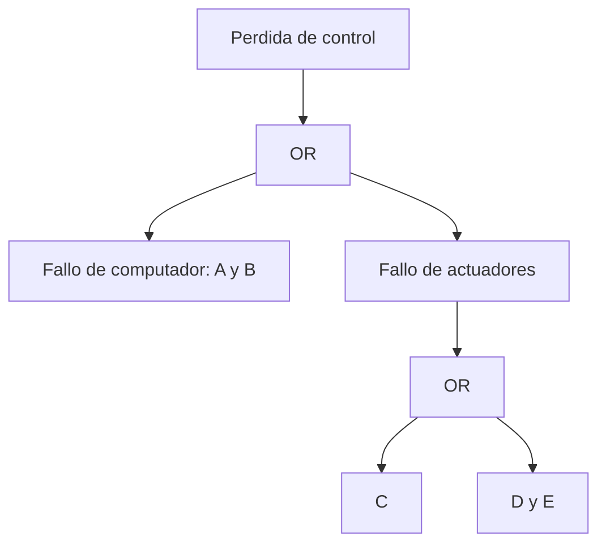

# B88-C16 — Ingeniería de seguridad funcional

<!-- nav:top -->
[🏠 Programa](../../../../README.md) · [📚 Bloque B88](../../../tronco-comun/B88-avionica-y-software-critico-espacial.md) · [← Anterior: B88-C15 — Análisis estático de código](../B88-C15-analisis-estatico-de-codigo/CLASE.md) · [Siguiente: B88-C17 — Ciberseguridad de aviónica →](../../../tronco-comun/B88-avionica-y-software-critico-espacial.md#b88-c17)
<!-- /nav -->

## 1. Ubicación, nivel y alcance

Clase 16 del bloque B88. Nivel N3. La seguridad funcional busca que un fallo no cause un daño inaceptable. Aquí construyes un **árbol de fallos** (puertas AND y OR), calculas la probabilidad del evento tope, hallas los **conjuntos mínimos de corte**, la **importancia de Birnbaum** y una clasificación severidad–probabilidad. Las probabilidades son **sintéticas** y los eventos independientes. Todos los datos son **sintéticos** salvo los que se rotulan como consultados.

## 2. Por qué esta clase existe

Una nave tolera fallos si ninguno solo provoca la pérdida y las combinaciones peligrosas son improbables. La decisión central: **¿qué combinaciones mínimas de fallos causan la pérdida y cuál elemento merece más protección?**

## 3. Lo que podrás hacer al terminar

1. Construir un árbol de fallos con AND y OR.
2. Calcular la probabilidad exacta del evento tope por enumeración.
3. Hallar los conjuntos mínimos de corte.
4. Calcular la importancia de Birnbaum.
5. Clasificar el riesgo con una matriz severidad–probabilidad.
6. Separar lo sintético de lo consultado.

La evidencia es la **análisis de fallos con conjuntos de corte** del ejercicio 12 (sección 20).

## 4. Con qué llegas y cómo comprobarlo

1. ¿Qué es una puerta AND?
2. ¿Qué es una puerta OR?
3. ¿Qué es la independencia?
4. ¿Qué es un conjunto de corte?
5. ¿Qué es la severidad?

<details>
<summary>Ver respuestas</summary>

1. El evento ocurre si todas las entradas ocurren. 2. Ocurre si alguna entrada ocurre. 3. La probabilidad conjunta es el producto. 4. Un conjunto de fallos básicos que causan el evento tope. 5. La gravedad de la consecuencia.
</details>

Con cuatro o cinco aciertos, sigue; si no, repasa los prerrequisitos.

## 5. Un caso de contexto y casos de referencia

Evento tope **sintético** «pérdida de control» = (fallo de computador `A ∧ B`) ∨ (fallo de actuadores `C ∨ (D ∧ E)`) con `P(A) = P(B) = 10⁻²`, `P(C) = 10⁻⁴`, `P(D) = P(E) = 5×10⁻²`. La probabilidad exacta es `2,6995×10⁻³`. Los conjuntos mínimos de corte son `{C}`, `{A, B}` y `{D, E}`.

## 6. Vocabulario

El **evento tope** es la falla del sistema. Los **eventos básicos** son los fallos elementales. Un **conjunto mínimo de corte** no tiene subconjunto que también cause el tope. La **importancia de Birnbaum** `I_k = P(tope | k falla) − P(tope | k no falla)`. La **matriz severidad–probabilidad** clasifica el riesgo.

## 7. Modelo mental



*Descripción textual:* la pérdida de control ocurre si fallan ambos computadores, o el actuador C, o a la vez los actuadores D y E.

Analogía: el árbol es como un mapa de rutas hacia un desastre: cada camino es un conjunto de corte y cortar el más corto protege más. Límite: el mapa supone que los fallos son independientes, y la causa común los junta.

## 8. La explicación, paso a paso

### 8.1 La probabilidad del tope

Se enumeran los `2⁵ = 32` estados de los 5 eventos básicos, con producto de probabilidades: `P(tope) = 2,6995×10⁻³`.

### 8.2 Conjuntos de corte

`{C}`: `10⁻⁴`; `{A, B}`: `10⁻⁴`; `{D, E}`: `2,5×10⁻³`. La suma `2,7×10⁻³` es una cota superior de la exacta (`2,6995×10⁻³`).

### 8.3 Importancia

Birnbaum: `C = 0,9974`, `D = E = 0,0500`, `A = B = 0,0100`. `C` es un fallo único con importancia casi 1: **protegerlo** es lo más rentable.

### 8.4 Matriz de riesgo

Con una clasificación sintética (severidad 1–4, probabilidad por décadas): «pérdida de control» (4, `2,7×10⁻³`) → ALTO; «pérdida de un instrumento» (2, `3×10⁻³`) → MEDIO; «dato degradado» (1, `5×10⁻²`) → BAJO.

## 9. Magnitudes, símbolos y unidades

| Símbolo | Qué es | Unidad | Valor / nota |
|---|---|---|---|
| `P` | probabilidad de evento básico | — | 10⁻⁴ a 5×10⁻² |
| `P(tope)` | evento tope | — | 2,6995×10⁻³ |
| `I` | importancia de Birnbaum | — | 0,0100 a 0,9974 |
| `sev` | severidad | — | 1 a 4 |

## 10. Convenciones y referencias

Eventos básicos independientes por misión; enumeración exacta de 32 estados; criterio de riesgo de la clase (sintético, no normativo). Tolerancia: suma de cortes ≥ probabilidad exacta. Todo **sintético**.

## 11. De dónde sale lo que afirmamos

| ID | Fuente | Localizador | Respalda | Estado |
|---|---|---|---|---|
| S1 | NASA, «Software Assurance and Software Safety Standard» NASA-STD-8739.8B, 8 sep 2022 — https://standards.nasa.gov/standard/nasa/nasa-std-87398 (consultada 2026-11-10) | página de la norma | define requisitos para un enfoque sistemático de aseguramiento y seguridad del software y la verificación y validación independientes, desde la concepción hasta el retiro | Consultada (solo la página) |
| S2 | ECSS, «ECSS-E-ST-40C — Software», 6 mar 2009 (reemplazada por la Rev.1 del 30 abr 2025) — https://ecss.nl/standard/ecss-e-st-40c-software-general-requirements/ (consultada 2026-11-10) | página de la norma (solo resumen y alcance; no el texto de requisitos) | alcance: software de producto de un sistema espacial en los segmentos espacial, de lanzamiento y de tierra, desde los requisitos hasta el mantenimiento | Consultada (solo la página) |
| — | ECSS-Q-ST-80C (aseguramiento de producto de software) y normas de seguridad ECSS | — | — | No consultada |
| — | Libros de texto de sistemas de tiempo real, tolerancia a fallos y comunicaciones digitales | — | — | No consultada |
| — | Relaciones y algoritmos estándar usados por el laboratorio (álgebra booleana de árboles de fallos, enumeración exacta e importancia de Birnbaum) | — | los verifica el laboratorio con una segunda vía o con pruebas | No consultada en una fuente concreta |

Límites: no se consultaron las normas de seguridad (ECSS-Q-ST-40, IEC 61508): la matriz de riesgo es didáctica. No se modelan fallos de causa común ni dependientes del tiempo. Lo simulado no se presenta como dato de vuelo ni como medición.

## 12. Cómo ver los resultados

| Corte | Probabilidad |
|---|---|
| {C} | 1,0×10⁻⁴ |
| {A, B} | 1,0×10⁻⁴ |
| {D, E} | 2,5×10⁻³ |
| Suma | 2,7×10⁻³ |
| Exacta | 2,6995×10⁻³ |

Descripción larga: el corte `{D, E}` domina el riesgo; `C` pesa poco en probabilidad pero mucho en importancia porque es un fallo único.

## 13. Ejemplo trabajado

**Paso 1 · Cortes.** `{C}`, `{A, B}`, `{D, E}`.

**Paso 2 · Probabilidades.** `10⁻⁴`, `10⁻⁴`, `2,5×10⁻³`.

**Paso 3 · Suma.** `2,7×10⁻³`.

**Paso 4 · Exacta.** `1 − (1−10⁻⁴)²(1−2,5×10⁻³) = 2,6995×10⁻³`.

## 14. Distintas formas de describir el problema

**Por enumeración:** exacta (esta clase). **Por cortes:** aproximación rápida (esta clase). **Por simulación:** Monte Carlo (C32). El laboratorio comprueba que la suma de cortes sea una cota superior.

## 15. Práctica guiada

**Ejercicio 1 · con los pasos indicados.** Calcula `P(A ∧ B)`.

<details><summary>Solución comentada</summary>

`10⁻² × 10⁻² = 10⁻⁴`.
</details>

**Ejercicio 2 · con una pista.** Calcula `P(D ∧ E)`.

<details><summary>Solución comentada</summary>

`2,5×10⁻³`.
</details>

**Ejercicio 3 · casi autónomo.** Calcula `P(tope)` con la fórmula `1 − ∏(1 − Pᵢ)` de los cortes.

<details><summary>Solución comentada</summary>

`1 − 0,9999 × 0,9999 × 0,9975 = 2,6995×10⁻³`.
</details>

## 16. Práctica autónoma, transferencia e integrador

**Ejercicio 4 · autónomo.** ¿Por qué la suma de cortes es una cota superior?

<details><summary>Solución comentada</summary>

Cuenta dos veces los estados en que varios cortes ocurren a la vez.
</details>

**Ejercicio 5 · autónomo.** ¿Cuántos estados se enumeran con 5 eventos?

<details><summary>Solución comentada</summary>

`2⁵ = 32`.
</details>

**Ejercicio 6 · autónomo.** ¿Qué elemento tiene mayor importancia y por qué?

<details><summary>Solución comentada</summary>

`C` (0,9974): es un fallo único que causa el tope.
</details>

**Ejercicio 7 · autónomo.** ¿Qué conjunto de corte reduce más el riesgo al duplicar su protección?

<details><summary>Solución comentada</summary>

`{D, E}`: pasa de `2,5×10⁻³` a `6,25×10⁻⁴` si se reduce a la mitad cada probabilidad.
</details>

**Ejercicio 8 · autónomo.** ¿Qué efecto tiene un fallo de causa común de `A` y `B`?

<details><summary>Solución comentada</summary>

Sube `P({A, B})` por encima de `10⁻⁴`; el modelo independiente lo subestima.
</details>

**Ejercicio 9 · transferencia.** **Transferencia.** Un colega dice que 2,7×10⁻³ es la probabilidad de pérdida de su nave. ¿Es válido?

<details><summary>Solución comentada</summary>

No: es un árbol sintético con probabilidades inventadas.
</details>

**Ejercicio 10 · transferencia.** **Transferencia.** ¿Qué cambia si `D` y `E` comparten alimentación?

<details><summary>Solución comentada</summary>

Se vuelven dependientes; hay que modelar un evento de causa común.
</details>

**Ejercicio 11 · transferencia.** **Transferencia.** ¿Para qué sirve la importancia de Birnbaum?

<details><summary>Solución comentada</summary>

Para priorizar qué componente mejorar o duplicar.
</details>

**Ejercicio 12 · integrador.** **Integrador.** Elabora tu *análisis de fallos con conjuntos de corte*: árbol, probabilidad del tope, cortes, importancia, riesgo y lista de qué es sintético.

<details><summary>Solución comentada</summary>

Secciones 8.1–8.4 y la salida del laboratorio.
</details>

## 17. Laboratorio: árbol de fallos, cortes e importancia

El script [arbol_fallos.py](arbol_fallos.py) enumera los 32 estados, calcula la probabilidad del tope, los cortes mínimos, la importancia de Birnbaum y la matriz de riesgo, y **comprueba** que hay 3 cortes y que su suma es una cota superior.

**Datos:** probabilidades **sintéticas** independientes. **Predice antes de ejecutar:** ¿qué corte domina la probabilidad? (`{D, E}`). **Ejecución del 2026-11-10 (Python 3.12.9):**

```text
Python 3.12.9
Datos SINTETICOS: probabilidades por mision inventadas; eventos independientes
P(evento tope) exacta = 2.699490e-03
Conjuntos minimos de corte: [['C'], ['A', 'B'], ['D', 'E']]
  C   : P = 1.000e-04
  A+B : P = 1.000e-04
  D+E : P = 2.500e-03
Aproximacion por suma de cortes = 2.700000e-03 (cota superior; exacta 2.699490e-03)
Importancia de Birnbaum:
  A: 0.0100
  B: 0.0100
  C: 0.9974
  D: 0.0500
  E: 0.0500
  perdida de control         severidad 4, P=2.7e-03 -> riesgo ALTO
  perdida de un instrumento  severidad 2, P=3.0e-03 -> riesgo MEDIO
  dato degradado             severidad 1, P=5.0e-02 -> riesgo BAJO
Pruebas superadas.
```

```bash
python programa/clases/B88/B88-C16-ingenieria-de-seguridad-funcional/arbol_fallos.py
```

**Límites:** eventos independientes; sin causa común ni tiempo; matriz de riesgo de ejemplo.

## 18. Errores frecuentes y cómo corregirlos

**Suponer independencia sin discutirla.** La causa común rompe el modelo (ejercicio 8)

**Sumar todos los cortes como exacto.** Es una cota (8.2)

**Presentar el árbol como el de una nave real.** Revisa la sección 10

## 19. Cómo sabrás que vas bien

Tras 8.2: ¿qué corte esperabas que dominara? Si dudas, repasa el ejemplo 13. Tras el laboratorio: ¿qué comprueba? (ver sección 17).

## 20. Qué entregas y cómo se evalúa

El producto es tu **análisis de fallos con conjuntos de corte** (ejercicio 12).

| Criterio | Inicial | En desarrollo | Logrado | Destacado |
|---|---|---|---|---|
| Conceptos | Los confunde | Parciales | Explica el método y su dominio | Explica los límites y las alternativas |
| Cálculo | Sin unidades | Con errores | Resultados con unidades y comprobados | Resuelve casos nuevos |
| Numérico | Sin comprobar | Un caso | Verifica con una segunda vía en varios casos | Interpreta las diferencias y los fallos |
| Fuentes | Sin fuente | Sin fecha | Fuentes con fecha y estado | Declara lo sintético y lo no consultado |
| Límites | No los nombra | Uno | Tres | Discute qué falta del modelo |

**Condiciones críticas (no se compensan con promedio):** rotular los datos como sintéticos; comprobar cada resultado con una segunda vía; citar solo lo consultado.

## 21. Ética, seguridad y límites

Clase educativa: los modelos son simplificados y los datos son sintéticos; ningún resultado describe una misión real, certifica conformidad con una norma ni sustituye la revisión de especialistas.  Accesibilidad: tablas equivalentes a las gráficas, fórmulas en texto, ejercicios sin conexión.

## 22. Para cerrar y seguir

Tres cortes mínimos explican el 100 % del riesgo del ejemplo, y el fallo único `C` es el de mayor importancia. Queda una pregunta: ¿quién puede enviar órdenes falsas a la nave?

**Glosario español–inglés.** seguridad funcional · *functional safety*; árbol de fallos · *fault tree*; conjunto de corte · *cut set*; evento tope · *top event*; causa común · *common cause*.

**Continuidad.** [B88-C17](../B88-C17-ciberseguridad-de-avionica/CLASE.md) trata la ciberseguridad de aviónica.

**Referencias:** ver sección 11.

<!-- nav:bottom -->
---

[← Anterior: B88-C15 — Análisis estático de código](../B88-C15-analisis-estatico-de-codigo/CLASE.md) · [📚 Bloque B88](../../../tronco-comun/B88-avionica-y-software-critico-espacial.md) · [Siguiente: B88-C17 — Ciberseguridad de aviónica →](../../../tronco-comun/B88-avionica-y-software-critico-espacial.md#b88-c17)
<!-- /nav -->
