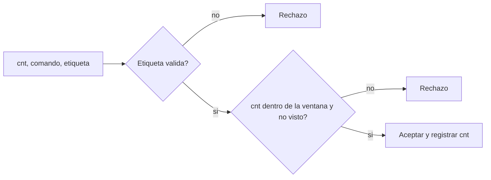

# B88-C17 — Ciberseguridad de aviónica

<!-- nav:top -->
[🏠 Programa](../../../../README.md) · [📚 Bloque B88](../../../tronco-comun/B88-avionica-y-software-critico-espacial.md) · [← Anterior: B88-C16 — Ingeniería de seguridad funcional](../B88-C16-ingenieria-de-seguridad-funcional/CLASE.md) · [Siguiente: B88-C18 — Control de configuración de firmware →](../B88-C18-control-de-configuracion-de-firmware/CLASE.md)
<!-- /nav -->

## 1. Ubicación, nivel y alcance

Clase 17 del bloque B88. Nivel N3. La ciberseguridad de aviónica protege los enlaces de mando y el software de acciones no autorizadas. Aquí practicas **defensa** sobre un banco propio: autenticas telecomandos con **HMAC**, rechazas repeticiones con una **ventana de contadores** y escribes un modelo de amenazas **STRIDE**. La clave es de juguete y los mensajes son **sintéticos**. No hay técnicas contra sistemas reales. Todos los datos son **sintéticos** salvo los que se rotulan como consultados.

## 2. Por qué esta clase existe

Una orden falsa o repetida puede apagar un subsistema o poner la nave en riesgo. La decisión central: **¿qué comprobaciones aseguran que cada comando viene de quien tiene la clave y no es una repetición?**

## 3. Lo que podrás hacer al terminar

1. Calcular un código de autenticación HMAC sobre contador y comando.
2. Rechazar un comando alterado, repetido o con contador antiguo.
3. Calcular la probabilidad de acierto al azar según la longitud de la etiqueta.
4. Estimar el tiempo medio de fuerza bruta de una etiqueta corta.
5. Escribir un modelo de amenazas STRIDE con mitigaciones.
6. Separar lo sintético de lo consultado.

La evidencia es la **modelo de amenazas y prueba de rechazo** del ejercicio 12 (sección 20).

## 4. Con qué llegas y cómo comprobarlo

1. ¿Qué es un HMAC?
2. ¿Qué es un ataque de repetición?
3. ¿Qué es una ventana de contadores?
4. ¿Qué es la longitud de la etiqueta?
5. ¿Qué es STRIDE?

<details>
<summary>Ver respuestas</summary>

1. Un código de autenticación calculado con una función hash y una clave secreta. 2. Reenviar un mensaje válido capturado antes. 3. El conjunto de contadores recientes aceptados una sola vez. 4. Los bits del código que se transmiten. 5. Una lista de amenazas: suplantación, alteración, repudio, divulgación, denegación y elevación de privilegios.
</details>

Con cuatro o cinco aciertos, sigue; si no, repasa los prerrequisitos.

## 5. Un caso de contexto y casos de referencia

Banco **sintético** con clave de juguete y etiqueta de 32 bits. Casos: la repetición de `cnt = 1` se rechaza por repetición; `cnt = 3` con el comando cambiado, por etiqueta; `cnt = 4` legítimo y fuera de orden dentro de la ventana de 8, se acepta; `cnt = 5` tras `cnt = 20` se rechaza por contador viejo. Con etiquetas de 4, 8 y 12 bits las aceptaciones al azar fueron 6,24 %, 0,37 % y 0,026 %.

## 6. Vocabulario

La **etiqueta** `T = trunc(HMAC-SHA256(K, cnt ‖ cmd), b)`. La **ventana** acepta contadores `> máximo − w` no vistos. La **probabilidad de acierto al azar** es `2^−b`. **STRIDE** son seis categorías de amenaza. Un **comando de resincronización** restablece el contador.

## 7. Modelo mental



*Descripción textual:* se comprueba primero la etiqueta y luego el contador contra la ventana y el registro de vistos; solo entonces se acepta.

Analogía: la etiqueta es como un sello de cera con el anillo del remitente y el contador, un número de serie del sobre: el sello prueba quién lo envió y el número impide reusarlo. Límite: si el anillo (la clave) se copia, el sello deja de valer.

## 8. La explicación, paso a paso

### 8.1 La etiqueta

`HMAC-SHA256` sobre el contador (4 bytes) y el comando; se transmiten los primeros `b` bits. Alterar el comando cambia la etiqueta; sin la clave no se puede recalcular.

### 8.2 La ventana

Se acepta un contador si es mayor que `máximo − w` y no se vio antes. Con `w = 8`: tras `1, 2`, el `4` y el `5` (fuera de orden) se aceptan; tras `20`, el `5` y el `11` se rechazan por viejos (`≤ 12`).

### 8.3 Acierto al azar

Con `b = 4`: `6,24 %` observado (teoría `6,25 %`); `b = 8`: `0,369 %` (`0,391 %`); `b = 12`: `0,026 %` (`0,024 %`). Con `b = 32`: `2,3×10⁻¹⁰`; `b = 64`: `5,4×10⁻²⁰`; `b = 128`: `2,9×10⁻³⁹`. A 10 intentos por segundo, la fuerza bruta de 32 bits tarda en media `2³¹/10 s = 6,8 años`.

### 8.4 STRIDE

Suplantación y alteración: HMAC. Repudio: registro firmado. Denegación: límite de rechazos y ventana. Elevación de privilegios: matriz de comandos por modo (C09). La divulgación requiere cifrado, que esta clase no trata.

## 9. Magnitudes, símbolos y unidades

| Símbolo | Qué es | Unidad | Valor / nota |
|---|---|---|---|
| `b` | longitud de la etiqueta | bit | 4 a 128 |
| `w` | ventana de contadores | — | 8 |
| `cnt` | contador | — | 32 bit |
| `p` | prob. de acierto al azar | — | 2^−b |

## 10. Convenciones y referencias

Clave de juguete embebida (nunca en código real). HMAC-SHA256 de la biblioteca estándar; contador de 4 bytes big-endian. Semilla `17`. Tolerancia: tasas de aceptación al azar dentro de un factor 1,5 de `2^−b`. Todo **sintético** y defensivo sobre el propio banco.

## 11. De dónde sale lo que afirmamos

| ID | Fuente | Localizador | Respalda | Estado |
|---|---|---|---|---|
| S1 | E. Barker, NIST SP 800-57 Parte 1 Rev. 5, «Recommendation for Key Management: General», mayo 2020 — https://csrc.nist.gov/pubs/sp/800/57/pt1/r5/final (consultada 2026-11-10) | resumen | la publicación trata tipos de claves, su protección y las funciones de la gestión de claves | Consultada (solo el resumen) |
| S2 | NIST, «Platform Firmware Resiliency Guidelines», SP 800-193, mayo 2018 — https://csrc.nist.gov/pubs/sp/800/193/final (consultada 2026-11-10) | resumen | tres capacidades de resiliencia del firmware: protección, detección y recuperación | Consultada (solo el resumen) |
| S3 | NASA, «Software Engineering and Assurance Handbook» NASA-HDBK-2203 — https://swehb.nasa.gov/ (consultada 2026-11-10) | página de inicio | guía informativa (no de requisitos) para cumplir NPR 7150.2D y NASA-STD-8739.8B para quien adquiere, desarrolla, asegura o mantiene software de la NASA | Consultada (solo la página de inicio) |
| — | Libros de texto de sistemas de tiempo real, tolerancia a fallos y comunicaciones digitales | — | — | No consultada |
| — | Relaciones y algoritmos estándar usados por el laboratorio (HMAC-SHA256, ventana anti-repetición y probabilidad de acierto `2^−b`) | — | los verifica el laboratorio con una segunda vía o con pruebas | No consultada en una fuente concreta |

Límites: de NIST SP 800-57 y 800-193 solo se consultó el resumen; no se evaluó ningún protocolo de enlace real ni CCSDS-SDLS (no consultado). La ventana en memoria se pierde en un reinicio (C35). El laboratorio no contiene técnicas contra sistemas reales. Lo simulado no se presenta como dato de vuelo ni como medición.

## 12. Cómo ver los resultados

| Etiqueta | Aciertos al azar (200 000) | Teórico |
|---|---|---|
| 4 bit | 6,24 % | 6,25 % |
| 8 bit | 0,369 % | 0,391 % |
| 12 bit | 0,026 % | 0,024 % |
| 32 bit | — | 2,3×10⁻¹⁰ |

Descripción larga: cada 4 bits más dividen la probabilidad de acierto por 16.

## 13. Ejemplo trabajado

**Paso 1 · Estado.** Tras `cnt = 20`, `máximo = 20`, `w = 8`.

**Paso 2 · Comando.** Llega `cnt = 11` con etiqueta correcta.

**Paso 3 · Ventana.** `11 ≤ 20 − 8 = 12`: fuera de la ventana.

**Paso 4 · Resultado.** `RECHAZO contador viejo`.

## 14. Distintas formas de describir el problema

**Por contador y ventana:** esta clase. **Por marca de tiempo:** exige relojes sincronizados. **Por desafío–respuesta:** exige enlace bidireccional. El laboratorio ejecuta los casos y las tasas de acierto.

## 15. Práctica guiada

**Ejercicio 1 · con los pasos indicados.** Calcula `2^−8`.

<details><summary>Solución comentada</summary>

`0,00391`.
</details>

**Ejercicio 2 · con una pista.** ¿Qué pasa con `cnt = 12` tras `máximo = 20` y `w = 8`?

<details><summary>Solución comentada</summary>

`12 ≤ 12`: rechazo por contador viejo.
</details>

**Ejercicio 3 · casi autónomo.** ¿Qué pasa con `cnt = 13`?

<details><summary>Solución comentada</summary>

Se acepta si es válido y no visto.
</details>

## 16. Práctica autónoma, transferencia e integrador

**Ejercicio 4 · autónomo.** Calcula el tiempo medio de fuerza bruta de 32 bits a 1000 intentos/s.

<details><summary>Solución comentada</summary>

`2³¹/1000 = 2,1×10⁶ s ≈ 24,9 d`.
</details>

**Ejercicio 5 · autónomo.** ¿Por qué se limita la tasa de rechazos?

<details><summary>Solución comentada</summary>

Para que un atacante no pueda probar etiquetas indefinidamente.
</details>

**Ejercicio 6 · autónomo.** ¿Qué detecta la etiqueta que no detecta el CRC?

<details><summary>Solución comentada</summary>

La alteración intencional por quien no tiene la clave.
</details>

**Ejercicio 7 · autónomo.** ¿Qué pasa con la ventana si la nave se reinicia?

<details><summary>Solución comentada</summary>

Se pierde el registro de vistos; hay que persistirlo (C35) o resincronizar.
</details>

**Ejercicio 8 · autónomo.** ¿Por qué comparar etiquetas en tiempo constante?

<details><summary>Solución comentada</summary>

Para no filtrar cuántos bytes coinciden por el tiempo de respuesta.
</details>

**Ejercicio 9 · transferencia.** **Transferencia.** Un colega dice que 4 bits bastan porque hay pocos comandos. ¿Es válido?

<details><summary>Solución comentada</summary>

No: con 4 bits el 6 % de etiquetas al azar se acepta.
</details>

**Ejercicio 10 · transferencia.** **Transferencia.** ¿Qué cambia si la clave se comparte entre todas las naves de una flota?

<details><summary>Solución comentada</summary>

Una clave filtrada compromete toda la flota; se usan claves por nave (C38).
</details>

**Ejercicio 11 · transferencia.** **Transferencia.** ¿Qué amenaza de STRIDE no cubre el HMAC?

<details><summary>Solución comentada</summary>

Divulgación: el HMAC no cifra.
</details>

**Ejercicio 12 · integrador.** **Integrador.** Elabora tu *modelo de amenazas y prueba de rechazo*: STRIDE con mitigaciones, casos aceptados y rechazados, longitud de etiqueta elegida y lista de qué es sintético.

<details><summary>Solución comentada</summary>

Secciones 8.1–8.4 y la salida del laboratorio.
</details>

## 17. Laboratorio: autenticación de telecomandos y ventana anti-repetición

El script [autenticacion_tc.py](autenticacion_tc.py) autentica comandos con HMAC-SHA256, prueba repetición, alteración y contador viejo y mide la aceptación al azar de etiquetas cortas, y **comprueba** los casos con la salida mostrada.

**Datos:** clave de juguete y mensajes **sintéticos**; semilla 17. **Predice antes de ejecutar:** ¿qué pasa con el comando de `cnt = 11` tras `cnt = 20`? (se rechaza por contador viejo). **Ejecución del 2026-11-10 (Python 3.12.9):**

```text
Python 3.12.9
Datos SINTETICOS: clave de juguete, mensajes inventados; solo defensa sobre el propio banco
Casos de prueba:
  legitimo cnt=1 -> ACEPTADO ; legitimo cnt=2 -> ACEPTADO (previos)
  repeticion de cnt=1            -> RECHAZO repeticion
  cnt=3 con comando alterado     -> RECHAZO etiqueta
  cnt=5 legitimo (adelantado)    -> ACEPTADO
  cnt=4 legitimo (fuera de orden)-> ACEPTADO
  cnt=5 repetido tras cnt=20     -> RECHAZO contador viejo
  cnt=11 legitimo tras cnt=20    -> RECHAZO contador viejo
Etiqueta de  4 bit: aceptadas al azar =  12483/200000 = 0.06241 (teorico 0.06250)
Etiqueta de  8 bit: aceptadas al azar =    738/200000 = 0.00369 (teorico 0.00391)
Etiqueta de 12 bit: aceptadas al azar =     53/200000 = 0.00026 (teorico 0.00024)
Etiqueta de  32 bit: prob. de acierto por intento = 2^-32 = 2.328e-10
Etiqueta de  64 bit: prob. de acierto por intento = 2^-64 = 5.421e-20
Etiqueta de 128 bit: prob. de acierto por intento = 2^-128 = 2.939e-39
Tag de 32 bit a 10 intentos/s: media ~ 6.8 anios
  Suplantacion (S)   -> HMAC con clave por enlace
  Alteracion (T)     -> HMAC sobre contador y comando
  Repudio (R)        -> registro firmado de comandos
  Divulgacion (I)    -> no aplica a esta clase (cifrado aparte)
  Denegacion (D)     -> limitar tasa de rechazos y ventana
  Elevacion (E)      -> matriz de comandos por modo (C09)
Pruebas superadas.
```

```bash
python programa/clases/B88/B88-C17-ciberseguridad-de-avionica/autenticacion_tc.py
```

**Límites:** banco propio, sin enlace real; la ventana vive en memoria; sin cifrado.

## 18. Errores frecuentes y cómo corregirlos

**Usar solo CRC como protección.** El CRC no autentica (C08)

**Etiquetas muy cortas.** Calcula `2^−b` (8.3)

**Reutilizar la misma clave en toda la flota.** Una por nave (C38)

## 19. Cómo sabrás que vas bien

Tras 8.2: ¿qué ocurre con un contador viejo? Si dudas, repasa el ejemplo 13. Tras el laboratorio: ¿qué comprueba? (ver sección 17).

## 20. Qué entregas y cómo se evalúa

El producto es tu **modelo de amenazas y prueba de rechazo** (ejercicio 12).

| Criterio | Inicial | En desarrollo | Logrado | Destacado |
|---|---|---|---|---|
| Conceptos | Los confunde | Parciales | Explica el método y su dominio | Explica los límites y las alternativas |
| Cálculo | Sin unidades | Con errores | Resultados con unidades y comprobados | Resuelve casos nuevos |
| Numérico | Sin comprobar | Un caso | Verifica con una segunda vía en varios casos | Interpreta las diferencias y los fallos |
| Fuentes | Sin fuente | Sin fecha | Fuentes con fecha y estado | Declara lo sintético y lo no consultado |
| Límites | No los nombra | Uno | Tres | Discute qué falta del modelo |

**Condiciones críticas (no se compensan con promedio):** rotular los datos como sintéticos; comprobar cada resultado con una segunda vía; citar solo lo consultado.

## 21. Ética, seguridad y límites

Clase educativa: los modelos son simplificados y los datos son sintéticos; ningún resultado describe una misión real, certifica conformidad con una norma ni sustituye la revisión de especialistas. El banco es propio y sintético; no se incluyen técnicas de ataque contra sistemas reales y los resultados no certifican seguridad. Accesibilidad: tablas equivalentes a las gráficas, fórmulas en texto, ejercicios sin conexión.

## 22. Para cerrar y seguir

Con HMAC y ventana, el banco rechaza alteración, repetición y contadores viejos; la etiqueta de 32 bits da `2,3×10⁻¹⁰` por intento. Queda una pregunta: ¿cómo se sabe qué firmware está instalado?

**Glosario español–inglés.** ciberseguridad · *cybersecurity*; código de autenticación · *message authentication code*; ataque de repetición · *replay attack*; ventana · *window*; modelo de amenazas · *threat model*.

**Continuidad.** [B88-C18](../B88-C18-control-de-configuracion-de-firmware/CLASE.md) trata el control de configuración del firmware.

**Referencias:** ver sección 11.

<!-- nav:bottom -->
---

[← Anterior: B88-C16 — Ingeniería de seguridad funcional](../B88-C16-ingenieria-de-seguridad-funcional/CLASE.md) · [📚 Bloque B88](../../../tronco-comun/B88-avionica-y-software-critico-espacial.md) · [Siguiente: B88-C18 — Control de configuración de firmware →](../B88-C18-control-de-configuracion-de-firmware/CLASE.md)
<!-- /nav -->
