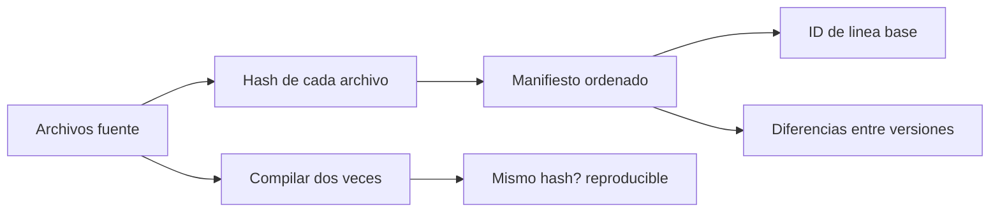

# B88-C18 — Control de configuración de firmware

<!-- nav:top -->
[🏠 Programa](../../../../README.md) · [📚 Bloque B88](../../../tronco-comun/B88-avionica-y-software-critico-espacial.md) · [← Anterior: B88-C17 — Ciberseguridad de aviónica](../B88-C17-ciberseguridad-de-avionica/CLASE.md) · [Siguiente: B88-C19 — Simulación hardware-in-the-loop →](../B88-C19-simulacion-hardware-in-the-loop/CLASE.md)
<!-- /nav -->

## 1. Ubicación, nivel y alcance

Clase 18 del bloque B88. Nivel N3. El control de configuración de firmware registra qué contiene exactamente cada versión: archivos, hashes, herramientas y compilación. Aquí construyes un **manifiesto con SHA-256**, calculas un **identificador de línea base**, comparas dos versiones y compruebas la **reproducibilidad** de una compilación. Los archivos son **sintéticos**. Todos los datos son **sintéticos** salvo los que se rotulan como consultados.

## 2. Por qué esta clase existe

Si no se sabe exactamente qué firmware vuela, no se puede reproducir un fallo ni comprobar que se probó lo que se lanzó. La decisión central: **¿qué registro identifica de manera única una versión y permite verificarla?**

## 3. Lo que podrás hacer al terminar

1. Construir un manifiesto de hashes ordenado.
2. Derivar un identificador de línea base.
3. Listar archivos añadidos, eliminados y modificados entre versiones.
4. Comprobar la reproducibilidad de una compilación.
5. Explicar el efecto avalancha del hash.
6. Separar lo sintético de lo consultado.

La evidencia es la **registro de línea base y diferencias** del ejercicio 12 (sección 20).

## 4. Con qué llegas y cómo comprobarlo

1. ¿Qué es una línea base?
2. ¿Qué es un hash?
3. ¿Qué es una compilación reproducible?
4. ¿Qué es un manifiesto?
5. ¿Qué es un cambio controlado?

<details>
<summary>Ver respuestas</summary>

1. Una versión aprobada y congelada de la configuración. 2. Un resumen de longitud fija de un dato. 3. Una que da el mismo binario con las mismas fuentes. 4. Una lista de archivos con sus hashes. 5. Uno aprobado y registrado.
</details>

Con cuatro o cinco aciertos, sigue; si no, repasa los prerrequisitos.

## 5. Un caso de contexto y casos de referencia

Cuatro archivos **sintéticos** (`main.c`, `aocs.c`, `tm.c`, `cfg.h`) forman la `v1`; la `v2` modifica `aocs.c` y `cfg.h` y añade `nuevo.c`. Las líneas base difieren (`2444cbb3…` frente a `fa73809c…`). Una compilación determinista da el mismo hash en dos corridas; si incrusta la fecha, no.

## 6. Vocabulario

El **manifiesto** `{archivo: SHA-256}` ordenado. El **ID de línea base** es el hash del manifiesto. La **diferencia** lista añadidos, eliminados y modificados. La **compilación reproducible** da bytes idénticos. El **efecto avalancha**: un bit cambiado altera cerca de la mitad de los bits del hash. El **resumen de integridad de NIST SP 800-193** habla de protección, detección y recuperación del firmware.

## 7. Modelo mental



*Descripción textual:* de los archivos salen el manifiesto, el identificador de línea base y las diferencias; la compilación repetida comprueba la reproducibilidad.

Analogía: el manifiesto es como el albarán de una caja: enumera cada pieza con su número de serie, y la suma de control del albarán identifica la caja entera. Límite: no dice si las piezas son buenas, solo cuáles son.

## 8. La explicación, paso a paso

### 8.1 Manifiesto e ID

Para cada archivo se calcula SHA-256 y se ordena por nombre; el ID es el hash del texto `archivo:hash` de todas las líneas. `v1 → 2444cbb3…`, `v2 → fa73809c…`.

### 8.2 Diferencias

`v1 → v2`: añadidos `nuevo.c`; eliminados ninguno; modificados `aocs.c` y `cfg.h`. Es el registro para la revisión del cambio.

### 8.3 Reproducibilidad

La compilación simulada que concatena las fuentes ordenadas da el mismo hash dos veces. Si incrusta la fecha, las dos corridas difieren: no es reproducible y no se puede verificar que el binario provenga de esas fuentes.

### 8.4 Avalancha

Cambiar **un** bit de `tm.c` cambia la línea base y 126 de los 256 bits de su SHA-256 (cercano a la mitad).

## 9. Magnitudes, símbolos y unidades

| Símbolo | Qué es | Unidad | Valor / nota |
|---|---|---|---|
| `h` | hash SHA-256 | bit | 256 |
| `ID` | identificador de línea base | — | hash del manifiesto |
| `Δ` | archivos cambiados | — | 2 mod + 1 añadido |
| `avalancha` | bits distintos tras un bit de cambio | bit | 126 de 256 |

## 10. Convenciones y referencias

Archivos en memoria, nombres ordenados lexicográficamente, hash SHA-256 de la biblioteca estándar. Compilación simulada por concatenación. Tolerancia: igualdad exacta de hashes. Todo **sintético**.

## 11. De dónde sale lo que afirmamos

| ID | Fuente | Localizador | Respalda | Estado |
|---|---|---|---|---|
| S1 | NIST, «Platform Firmware Resiliency Guidelines», SP 800-193, mayo 2018 — https://csrc.nist.gov/pubs/sp/800/193/final (consultada 2026-11-10) | resumen | tres capacidades de resiliencia del firmware: protección, detección y recuperación | Consultada (solo el resumen) |
| S2 | ECSS, «ECSS-E-ST-40C — Software», 6 mar 2009 (reemplazada por la Rev.1 del 30 abr 2025) — https://ecss.nl/standard/ecss-e-st-40c-software-general-requirements/ (consultada 2026-11-10) | página de la norma (solo resumen y alcance; no el texto de requisitos) | alcance: software de producto de un sistema espacial en los segmentos espacial, de lanzamiento y de tierra, desde los requisitos hasta el mantenimiento | Consultada (solo la página) |
| S3 | NASA, «Software Engineering and Assurance Handbook» NASA-HDBK-2203 — https://swehb.nasa.gov/ (consultada 2026-11-10) | página de inicio | guía informativa (no de requisitos) para cumplir NPR 7150.2D y NASA-STD-8739.8B para quien adquiere, desarrolla, asegura o mantiene software de la NASA | Consultada (solo la página de inicio) |
| — | Libros de texto de sistemas de tiempo real, tolerancia a fallos y comunicaciones digitales | — | — | No consultada |
| — | Relaciones y algoritmos estándar usados por el laboratorio (manifiesto de hashes, ID de línea base y efecto avalancha) | — | los verifica el laboratorio con una segunda vía o con pruebas | No consultada en una fuente concreta |

Límites: de NIST SP 800-193 solo se consultó el resumen; de ECSS-E-ST-40C solo la página (no se consultó ECSS-M-ST-40 de gestión de configuración). No se modelan firmas del manifiesto ni herramientas de compilación reales. Lo simulado no se presenta como dato de vuelo ni como medición.

## 12. Cómo ver los resultados

| Concepto | v1 | v2 |
|---|---|---|
| Archivos | 4 | 5 |
| Modificados | — | aocs.c, cfg.h |
| Añadidos | — | nuevo.c |
| ID de línea base | 2444cbb3… | fa73809c… |

Descripción larga: v2 cambia tres archivos respecto de v1 y por eso su identificador es distinto.

## 13. Ejemplo trabajado

**Paso 1 · Hashes.** SHA-256 de cada archivo de `v1`.

**Paso 2 · Texto.** `aocs.c:d4bc…\ncfg.h:1645…\n…`.

**Paso 3 · ID.** Hash de ese texto: `2444cbb3…`.

**Paso 4 · v2.** Cambian dos hashes y aparece uno: ID `fa73809c…`.

## 14. Distintas formas de describir el problema

**Por manifiesto:** esta clase. **Por control de versiones:** commit con hash de contenido. **Por lista de materiales de software:** SBOM (no consultado). El laboratorio verifica diferencias y reproducibilidad.

## 15. Práctica guiada

**Ejercicio 1 · con los pasos indicados.** ¿Cuántos archivos tiene la línea base v2?

<details><summary>Solución comentada</summary>

5.
</details>

**Ejercicio 2 · con una pista.** ¿Qué archivos se modificaron?

<details><summary>Solución comentada</summary>

`aocs.c` y `cfg.h`.
</details>

**Ejercicio 3 · casi autónomo.** ¿Por qué se ordenan los archivos por nombre?

<details><summary>Solución comentada</summary>

Para que el mismo conjunto dé siempre el mismo ID.
</details>

## 16. Práctica autónoma, transferencia e integrador

**Ejercicio 4 · autónomo.** ¿Cuántos bits cambian en promedio por avalancha?

<details><summary>Solución comentada</summary>

Cerca de la mitad: 128 de 256 (observado 126).
</details>

**Ejercicio 5 · autónomo.** ¿Por qué falla la reproducibilidad si se incrusta la fecha?

<details><summary>Solución comentada</summary>

Cada compilación genera bytes distintos.
</details>

**Ejercicio 6 · autónomo.** ¿Qué otros datos hay que registrar además de los fuentes?

<details><summary>Solución comentada</summary>

Versión del compilador, opciones, bibliotecas y herramientas de enlace.
</details>

**Ejercicio 7 · autónomo.** ¿Qué pasa con el ID si se cambia un espacio en un comentario?

<details><summary>Solución comentada</summary>

Cambia el hash del archivo y el ID.
</details>

**Ejercicio 8 · autónomo.** ¿Qué relación tiene la línea base con la verificación?

<details><summary>Solución comentada</summary>

Permite afirmar que lo probado es lo que vuela.
</details>

**Ejercicio 9 · transferencia.** **Transferencia.** Un colega dice que el hash del manifiesto garantiza que el firmware es correcto. ¿Es válido?

<details><summary>Solución comentada</summary>

No: garantiza identidad, no corrección.
</details>

**Ejercicio 10 · transferencia.** **Transferencia.** ¿Qué cambia si el manifiesto no está firmado?

<details><summary>Solución comentada</summary>

Un atacante puede cambiar archivo y manifiesto a la vez; se firma el manifiesto (C13).
</details>

**Ejercicio 11 · transferencia.** **Transferencia.** ¿Cómo detectarías un archivo agregado fuera de control?

<details><summary>Solución comentada</summary>

Comparando el contenido real del árbol con el manifiesto: aparecería como añadido.
</details>

**Ejercicio 12 · integrador.** **Integrador.** Elabora tu *registro de línea base y diferencias*: manifiesto, ID, diferencias, reproducibilidad y lista de qué es sintético.

<details><summary>Solución comentada</summary>

Secciones 8.1–8.4 y la salida del laboratorio.
</details>

## 17. Laboratorio: línea base, diferencias y reproducibilidad

El script [linea_base.py](linea_base.py) construye manifiestos y IDs de dos versiones, lista las diferencias, compara dos compilaciones con y sin fecha y mide la avalancha, y **comprueba** las diferencias esperadas y que sin fecha sea reproducible.

**Datos:** archivos **sintéticos** en memoria. **Predice antes de ejecutar:** ¿será reproducible la compilación con fecha incrustada? (no). **Ejecución del 2026-11-10 (Python 3.12.9):**

```text
Python 3.12.9
Datos SINTETICOS: archivos fuente inventados en memoria
Manifiesto v1:
  aocs.c   d4bc005e11f3
  cfg.h    1645e7fb96d2
  main.c   0a142b106d92
  tm.c     fa85d4b10f57
ID de linea base v1 = 2444cbb31918dcc7 ; v2 = fa73809c7c8da095
Diferencias v1->v2: anadidos=['nuevo.c'] eliminados=[] modificados=['aocs.c', 'cfg.h']
Compilacion determinista: dos corridas iguales = True
Compilacion con fecha incrustada: dos corridas iguales = False
Un bit cambiado en tm.c: linea base distinta = True
Bits distintos entre los SHA-256 antes/despues: 126 de 256
Pruebas superadas.
```

```bash
python programa/clases/B88/B88-C18-control-de-configuracion-de-firmware/linea_base.py
```

**Límites:** compilación simulada; sin firma del manifiesto ni herramientas reales.

## 18. Errores frecuentes y cómo corregirlos

**No registrar la versión del compilador.** Añádela al manifiesto (ejercicio 6)

**Compilar con fecha incrustada.** Pierdes reproducibilidad (8.3)

**Confundir identidad con corrección.** El hash no prueba que sea correcto

## 19. Cómo sabrás que vas bien

Tras 8.2: ¿qué archivos esperabas en la diferencia? Si dudas, repasa el ejemplo 13. Tras el laboratorio: ¿qué comprueba? (ver sección 17).

## 20. Qué entregas y cómo se evalúa

El producto es tu **registro de línea base y diferencias** (ejercicio 12).

| Criterio | Inicial | En desarrollo | Logrado | Destacado |
|---|---|---|---|---|
| Conceptos | Los confunde | Parciales | Explica el método y su dominio | Explica los límites y las alternativas |
| Cálculo | Sin unidades | Con errores | Resultados con unidades y comprobados | Resuelve casos nuevos |
| Numérico | Sin comprobar | Un caso | Verifica con una segunda vía en varios casos | Interpreta las diferencias y los fallos |
| Fuentes | Sin fuente | Sin fecha | Fuentes con fecha y estado | Declara lo sintético y lo no consultado |
| Límites | No los nombra | Uno | Tres | Discute qué falta del modelo |

**Condiciones críticas (no se compensan con promedio):** rotular los datos como sintéticos; comprobar cada resultado con una segunda vía; citar solo lo consultado.

## 21. Ética, seguridad y límites

Clase educativa: los modelos son simplificados y los datos son sintéticos; ningún resultado describe una misión real, certifica conformidad con una norma ni sustituye la revisión de especialistas.  Accesibilidad: tablas equivalentes a las gráficas, fórmulas en texto, ejercicios sin conexión.

## 22. Para cerrar y seguir

Dos versiones con IDs distintos, tres archivos de diferencia y una compilación reproducible dejan trazable el firmware. Queda una pregunta: ¿cómo se prueba el software con el hardware conectado?

**Glosario español–inglés.** línea base · *baseline*; manifiesto · *manifest*; compilación reproducible · *reproducible build*; control de configuración · *configuration control*; efecto avalancha · *avalanche effect*.

**Continuidad.** [B88-C19](../B88-C19-simulacion-hardware-in-the-loop/CLASE.md) trata la simulación hardware-in-the-loop.

**Referencias:** ver sección 11.

<!-- nav:bottom -->
---

[← Anterior: B88-C17 — Ciberseguridad de aviónica](../B88-C17-ciberseguridad-de-avionica/CLASE.md) · [📚 Bloque B88](../../../tronco-comun/B88-avionica-y-software-critico-espacial.md) · [Siguiente: B88-C19 — Simulación hardware-in-the-loop →](../B88-C19-simulacion-hardware-in-the-loop/CLASE.md)
<!-- /nav -->
