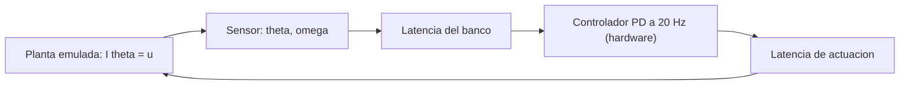

# B88-C19 — Simulación hardware-in-the-loop

<!-- nav:top -->
[🏠 Programa](../../../../README.md) · [📚 Bloque B88](../../../tronco-comun/B88-avionica-y-software-critico-espacial.md) · [← Anterior: B88-C18 — Control de configuración de firmware](../B88-C18-control-de-configuracion-de-firmware/CLASE.md) · [Siguiente: B88-C20 — Plan de verificación de computador de vuelo →](../B88-C20-plan-de-verificacion-de-computador-de-vuelo/CLASE.md)
<!-- /nav -->

## 1. Ubicación, nivel y alcance

Clase 19 del bloque B88. Nivel N3. En una simulación **hardware-in-the-loop** (HIL), el computador de vuelo real corre conectado a una planta emulada que le responde en tiempo real. Aquí modelas el lazo con una planta de un eje (inercia `1 kg·m²`) y un controlador PD a 20 Hz, y estudias qué hace la **latencia** del banco. Todo es **sintético**: no hay hardware ni planta real. Todos los datos son **sintéticos** salvo los que se rotulan como consultados.

## 2. Por qué esta clase existe

Si el banco añade retardo, las pruebas pueden mostrar inestabilidad que la nave no tendría, o esconder la que sí tendría. La decisión central: **¿cuánta latencia y jitter tolera el lazo sin perder su comportamiento, y por tanto qué exigirle al banco?**

## 3. Lo que podrás hacer al terminar

1. Describir los elementos de un banco HIL.
2. Simular un lazo planta–controlador con latencia.
3. Medir sobreimpulso y tiempo de asentamiento.
4. Identificar la latencia que desestabiliza el lazo.
5. Evaluar el efecto del jitter de latencia.
6. Separar lo sintético de lo consultado.

La evidencia es la **informe de efecto de la latencia en lazo cerrado** del ejercicio 12 (sección 20).

## 4. Con qué llegas y cómo comprobarlo

1. ¿Qué es una planta?
2. ¿Qué es un controlador PD?
3. ¿Qué es el sobreimpulso?
4. ¿Qué es el tiempo de asentamiento?
5. ¿Qué es la latencia?

<details>
<summary>Ver respuestas</summary>

1. El sistema controlado, aquí una inercia. 2. Uno que aplica un par proporcional al error y a la velocidad. 3. Cuánto supera la respuesta al valor final. 4. El tiempo para quedar dentro de ±2 % del valor final. 5. El retardo entre medir y actuar.
</details>

Con cuatro o cinco aciertos, sigue; si no, repasa los prerrequisitos.

## 5. Un caso de contexto y casos de referencia

Planta sintética `I θ̈ = u` con `I = 1`, controlador `u = Kp(1 − θ) − Kd θ̇` con `Kp = 4` y `Kd = 4` a 20 Hz, referencia `1 rad`, paso de planta `1 ms`. Con latencia 0 a 0,2 s no hay sobreimpulso y el asentamiento sube de 2,92 a 3,21 s. Con `0,25 s` hay 5,14 %; con `0,30 s`, 45,6 % y no se asienta; con `0,40 s` diverge.

## 6. Vocabulario

El **banco HIL** conecta el hardware real con una planta simulada. La **latencia** es el retardo del lazo. El **jitter** es su variación. El **sobreimpulso** `= (θmax − 1)·100 %`. El **tiempo de asentamiento** es el último instante fuera de ±2 %. Un lazo **inestable** crece sin cota.

## 7. Modelo mental



*Descripción textual:* la planta emulada entrega la medida al controlador con latencia, y su orden vuelve a la planta también con retardo; el retardo total decide la estabilidad.

Analogía: la latencia es como conducir con el reflejo del espejo retrasado: con poco retardo corriges bien; con mucho, sobrecorriges y oscilas. Límite: una nave real tiene sus propios retardos que el banco no debe sumar.

## 8. La explicación, paso a paso

### 8.1 El lazo

La planta se integra a 1 kHz. El controlador calcula cada `50 ms`; su orden llega a la planta tras `latencia + jitter`.

### 8.2 Efecto de la latencia

0 s: sin sobreimpulso, `t = 2,92 s`. 0,05 s: `2,97 s`. 0,10 s: `3,02 s`. 0,20 s: `3,21 s`. 0,25 s: `5,14 %` y `5,44 s`. 0,30 s: `45,6 %` y no se asienta en 30 s (`θ = 1,1398`). 0,40 s: diverge.

### 8.3 Jitter

Con latencia 0,10 s y jitter gaussiano de 30 ms el lazo conserva `0 %` y `3,00 s`: este jitter no desestabiliza porque la latencia máxima sigue lejos de 0,25 s.

### 8.4 Qué exigir al banco

El banco debe añadir muy poco respecto del retardo que ya tiene la nave real: aquí, mucho menos de los `0,25 s` en que aparece el sobreimpulso.

## 9. Magnitudes, símbolos y unidades

| Símbolo | Qué es | Unidad | Valor / nota |
|---|---|---|---|
| `I` | inercia | kg·m² | 1 |
| `Kp, Kd` | ganancias PD | N·m/rad, N·m·s/rad | 4 y 4 |
| `Tc` | período del controlador | s | 0,05 |
| `τ` | latencia | s | 0 a 0,4 |
| `t_s` | tiempo de asentamiento | s | 2,92 a 5,44 |

## 10. Convenciones y referencias

Planta integrada con Euler semiimplícito a 1 ms; muestreo del controlador a 20 Hz; latencia aplicada a la orden. Semilla `19`. Referencia 1 rad. Tolerancia: sobreimpulso nulo sin latencia. Todo **sintético**; no hay hardware real.

## 11. De dónde sale lo que afirmamos

| ID | Fuente | Localizador | Respalda | Estado |
|---|---|---|---|---|
| S1 | NASA, «Software Engineering and Assurance Handbook» NASA-HDBK-2203 — https://swehb.nasa.gov/ (consultada 2026-11-10) | página de inicio | guía informativa (no de requisitos) para cumplir NPR 7150.2D y NASA-STD-8739.8B para quien adquiere, desarrolla, asegura o mantiene software de la NASA | Consultada (solo la página de inicio) |
| — | Libros de texto de sistemas de tiempo real, tolerancia a fallos y comunicaciones digitales | — | — | No consultada |
| — | Relaciones y algoritmos estándar usados por el laboratorio (integración numérica de una planta de segundo orden con retardo) | — | los verifica el laboratorio con una segunda vía o con pruebas | No consultada en una fuente concreta |

Límites: el banco es un modelo de un eje sin hardware real, sin ruido de sensor ni saturación del actuador. El umbral de latencia vale solo para estas ganancias y esta inercia. Lo simulado no se presenta como dato de vuelo ni como medición.

## 12. Cómo ver los resultados

| Latencia (s) | Sobreimpulso | Asentamiento (s) |
|---|---|---|
| 0 | 0 % | 2,92 |
| 0,10 | 0 % | 3,02 |
| 0,20 | 0 % | 3,21 |
| 0,25 | 5,14 % | 5,44 |
| 0,30 | 45,6 % | no se asienta |
| 0,40 | diverge | — |

Descripción larga: el lazo tolera bien hasta 0,2 s; desde 0,25 s oscila y a 0,4 s es inestable.

## 13. Ejemplo trabajado

**Paso 1 · Lazo base.** Sin latencia: `ωn = 2 rad/s`, amortiguamiento 1; asienta en 2,92 s.

**Paso 2 · Latencia 0,2 s.** El asentamiento sube a 3,21 s sin sobreimpulso.

**Paso 3 · Latencia 0,25 s.** Aparece un sobreimpulso de 5,14 %.

**Paso 4 · Decisión.** El banco no debe sumar más de una fracción de 0,25 s.

## 14. Distintas formas de describir el problema

**Por simulación:** esta clase. **Por análisis de margen de fase:** teoría de control (no consultado). **Por prueba en banco real:** medir con el hardware. El laboratorio solo usa la primera vía.

## 15. Práctica guiada

**Ejercicio 1 · con los pasos indicados.** Calcula `ωn` con `Kp = 4` e `I = 1`.

<details><summary>Solución comentada</summary>

`ωn = √(Kp/I) = 2 rad/s`.
</details>

**Ejercicio 2 · con una pista.** Calcula el amortiguamiento con `Kd = 4`.

<details><summary>Solución comentada</summary>

`ζ = Kd/(2√(Kp·I)) = 1`.
</details>

**Ejercicio 3 · casi autónomo.** ¿Qué sobreimpulso hay con 0,20 s de latencia?

<details><summary>Solución comentada</summary>

0 %.
</details>

## 16. Práctica autónoma, transferencia e integrador

**Ejercicio 4 · autónomo.** ¿Cuánto sube el asentamiento de 0 a 0,2 s?

<details><summary>Solución comentada</summary>

`3,21 − 2,92 = 0,29 s`.
</details>

**Ejercicio 5 · autónomo.** ¿Qué pasa con 0,30 s?

<details><summary>Solución comentada</summary>

Sobreimpulso de 45,6 % y sin asentamiento en 30 s.
</details>

**Ejercicio 6 · autónomo.** ¿Por qué no se asienta a 0,30 s?

<details><summary>Solución comentada</summary>

La latencia reduce el margen de fase hasta una oscilación sostenida.
</details>

**Ejercicio 7 · autónomo.** ¿Qué tolera el jitter de 30 ms con latencia 0,10 s?

<details><summary>Solución comentada</summary>

No cambia el resultado: 0 % y 3,00 s.
</details>

**Ejercicio 8 · autónomo.** ¿Qué exigirías a un banco HIL con una latencia propia?

<details><summary>Solución comentada</summary>

Que su retardo sea una fracción pequeña de la latencia que desestabiliza el lazo.
</details>

**Ejercicio 9 · transferencia.** **Transferencia.** Un colega dice que la nave real es estable con 0,2 s. ¿Es válido?

<details><summary>Solución comentada</summary>

No: planta y ganancias son sintéticas.
</details>

**Ejercicio 10 · transferencia.** **Transferencia.** ¿Qué cambia si `Kd` baja a 1?

<details><summary>Solución comentada</summary>

El amortiguamiento cae a 0,5: ya hay sobreimpulso sin latencia.
</details>

**Ejercicio 11 · transferencia.** **Transferencia.** ¿Qué mide un banco HIL que una simulación pura no mide?

<details><summary>Solución comentada</summary>

El tiempo real del hardware: latencias, interrupciones y carga de CPU.
</details>

**Ejercicio 12 · integrador.** **Integrador.** Elabora tu *informe de efecto de la latencia en lazo cerrado*: lazo, tabla de latencia, jitter, umbral y lista de qué es sintético.

<details><summary>Solución comentada</summary>

Secciones 8.1–8.4 y la salida del laboratorio.
</details>

## 17. Laboratorio: lazo cerrado con latencia y jitter

El script [lazo_hil.py](lazo_hil.py) simula el lazo PD sobre una inercia con latencias de 0 a 0,4 s y un caso con jitter, mide sobreimpulso y asentamiento y **comprueba** 0 % sin latencia y más de 10 % con 0,3 s.

**Datos:** planta y ganancias **sintéticas**; semilla 19. **Predice antes de ejecutar:** ¿qué latencia desestabiliza el lazo? (0,4 s diverge; 0,25 s ya oscila). **Ejecución del 2026-11-10 (Python 3.12.9):**

```text
Python 3.12.9
Datos SINTETICOS: inercia I = 1 kg m^2, controlador PD, referencia 1 rad; sin planta real
latencia  jitter | sobreimpulso  t_asentamiento(2%)  theta final
  0.00 s  0.00 s |     0.00 %           2.92 s      1.0000
  0.05 s  0.00 s |     0.00 %           2.97 s      1.0000
  0.10 s  0.00 s |     0.00 %           3.02 s      1.0000
  0.20 s  0.00 s |     0.00 %           3.21 s      1.0000
  0.25 s  0.00 s |     5.14 %           5.44 s      1.0000
  0.30 s  0.00 s |    45.60 %          30.00 s      1.1398
  0.40 s  0.00 s | INESTABLE
  0.10 s  0.03 s |     0.00 %           3.00 s      1.0000
Pruebas superadas.
```

```bash
python programa/clases/B88/B88-C19-simulacion-hardware-in-the-loop/lazo_hil.py
```

**Límites:** un eje, sin ruido ni saturación; resultados válidos para estas ganancias.

## 18. Errores frecuentes y cómo corregirlos

**Ignorar el retardo del propio banco.** Mídelo y réstalo (8.4)

**Generalizar el umbral de latencia.** Depende de planta y ganancias

**Presentar el banco como hardware real.** Revisa la sección 10

## 19. Cómo sabrás que vas bien

Tras 8.2: ¿a qué latencia esperabas el primer sobreimpulso? Si dudas, repasa el ejemplo 13. Tras el laboratorio: ¿qué comprueba? (ver sección 17).

## 20. Qué entregas y cómo se evalúa

El producto es tu **informe de efecto de la latencia en lazo cerrado** (ejercicio 12).

| Criterio | Inicial | En desarrollo | Logrado | Destacado |
|---|---|---|---|---|
| Conceptos | Los confunde | Parciales | Explica el método y su dominio | Explica los límites y las alternativas |
| Cálculo | Sin unidades | Con errores | Resultados con unidades y comprobados | Resuelve casos nuevos |
| Numérico | Sin comprobar | Un caso | Verifica con una segunda vía en varios casos | Interpreta las diferencias y los fallos |
| Fuentes | Sin fuente | Sin fecha | Fuentes con fecha y estado | Declara lo sintético y lo no consultado |
| Límites | No los nombra | Uno | Tres | Discute qué falta del modelo |

**Condiciones críticas (no se compensan con promedio):** rotular los datos como sintéticos; comprobar cada resultado con una segunda vía; citar solo lo consultado.

## 21. Ética, seguridad y límites

Clase educativa: los modelos son simplificados y los datos son sintéticos; ningún resultado describe una misión real, certifica conformidad con una norma ni sustituye la revisión de especialistas.  Accesibilidad: tablas equivalentes a las gráficas, fórmulas en texto, ejercicios sin conexión.

## 22. Para cerrar y seguir

El lazo sintético tolera hasta 0,2 s sin sobreimpulso y diverge a 0,4 s: el banco debe ser rápido. Queda una pregunta: ¿cómo se organiza todo esto en un plan de verificación?

**Glosario español–inglés.** hardware en el lazo · *hardware-in-the-loop*; latencia · *latency*; sobreimpulso · *overshoot*; tiempo de asentamiento · *settling time*; planta · *plant*.

**Continuidad.** [B88-C20](../B88-C20-plan-de-verificacion-de-computador-de-vuelo/CLASE.md) cierra la línea base con el plan de verificación del computador de vuelo.

**Referencias:** ver sección 11.

<!-- nav:bottom -->
---

[← Anterior: B88-C18 — Control de configuración de firmware](../B88-C18-control-de-configuracion-de-firmware/CLASE.md) · [📚 Bloque B88](../../../tronco-comun/B88-avionica-y-software-critico-espacial.md) · [Siguiente: B88-C20 — Plan de verificación de computador de vuelo →](../B88-C20-plan-de-verificacion-de-computador-de-vuelo/CLASE.md)
<!-- /nav -->
