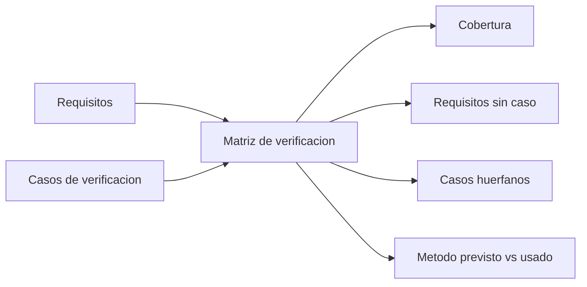

# B88-C20 — Plan de verificación de computador de vuelo

<!-- nav:top -->
[🏠 Programa](../../../../README.md) · [📚 Bloque B88](../../../tronco-comun/B88-avionica-y-software-critico-espacial.md) · [← Anterior: B88-C19 — Simulación hardware-in-the-loop](../B88-C19-simulacion-hardware-in-the-loop/CLASE.md) · [Siguiente: B88-C21 — Interfaces y documentos de control de software de vuelo →](../B88-C21-interfaces-y-documentos-de-control-de-software-de-vuelo/CLASE.md)
<!-- /nav -->

## 1. Ubicación, nivel y alcance

Clase 20 del bloque B88. Nivel N3. Un plan de verificación dice **cómo se demuestra** cada requisito del computador de vuelo: por prueba (T), análisis (A), inspección (I) o demostración (D). Aquí construyes una matriz requisito→caso, calculas la **cobertura**, detectas **requisitos sin verificación** y **casos huérfanos**. Los 16 requisitos y 12 casos son **sintéticos**. Todos los datos son **sintéticos** salvo los que se rotulan como consultados.

## 2. Por qué esta clase existe

Un requisito sin caso es una promesa sin evidencia; un caso sin requisito es esfuerzo sin objeto. La decisión central: **¿cada requisito tiene al menos un caso adecuado, y cada caso responde a un requisito?**

## 3. Lo que podrás hacer al terminar

1. Describir los cuatro métodos de verificación.
2. Construir la matriz de trazabilidad requisito→caso.
3. Calcular la cobertura de requisitos.
4. Detectar requisitos sin verificación y casos huérfanos.
5. Comprobar que el método usado coincide con el previsto.
6. Separar lo sintético de lo consultado.

La evidencia es la **matriz de verificación con cobertura** del ejercicio 12 (sección 20).

## 4. Con qué llegas y cómo comprobarlo

1. ¿Qué es un requisito verificable?
2. ¿Qué es la trazabilidad?
3. ¿Qué es un caso de prueba?
4. ¿Qué es un huérfano?
5. ¿Qué es el porcentaje de cobertura?

<details>
<summary>Ver respuestas</summary>

1. Uno que se puede demostrar con un criterio objetivo. 2. El vínculo entre un requisito y la evidencia que lo respalda. 3. Una actividad con entrada, procedimiento y criterio de éxito. 4. Un elemento sin vínculo con su origen. 5. Parte cubierta entre el total.
</details>

Con cuatro o cinco aciertos, sigue; si no, repasa los prerrequisitos.

## 5. Un caso de contexto y casos de referencia

16 requisitos **sintéticos** (frecuencia de lazo, utilización de CPU, corrección de memoria, watchdog, telecomandos, reversión, reglas de código, etc.) y 12 casos `V01…V12`. La matriz da cobertura de `14/16 = 87,5 %`. Sin verificación quedan `R12` (sin memoria dinámica) y `R16` (documento de interfaz); los casos `V11` (apunta a un requisito inexistente `R99`) y `V12` (sin requisito) son huérfanos.

## 6. Vocabulario

Los **métodos** `T` (prueba: ejecutar y medir), `A` (análisis: cálculo o modelo), `I` (inspección: revisar el producto o documento) y `D` (demostración: mostrar una función). La **matriz de verificación** vincula requisitos y casos. La **cobertura** `= requisitos con caso / total`. Un **huérfano** es un caso sin requisito válido.

## 7. Modelo mental



*Descripción textual:* requisitos y casos se cruzan en la matriz, de la que salen la cobertura, los requisitos sin caso, los huérfanos y la coherencia de métodos.

Analogía: la matriz es como una lista de invitados con sus entradas: ves quién no tiene entrada y quién tiene entrada sin estar invitado. Límite: tener entrada no prueba que la fiesta salió bien (el caso debe pasar).

## 8. La explicación, paso a paso

### 8.1 Los métodos

De los 16 requisitos: 9 por prueba (T), 2 por análisis (A), 3 por inspección (I) y 2 por demostración (D).

### 8.2 Cobertura

14 de 16 requisitos tienen caso: `87,5 %`. Los que faltan: `R12` y `R16`, ambos de inspección: nadie planificó la revisión.

### 8.3 Huérfanos

`V11` apunta a `R99`, que no existe; `V12` no apunta a nada. Hay que eliminarlos o vincularlos a requisitos reales.

### 8.4 Coherencia de métodos

En el ejemplo, el método usado en cada caso coincide con el previsto para su requisito: lista vacía de incoherencias.

## 9. Magnitudes, símbolos y unidades

| Símbolo | Qué es | Unidad | Valor / nota |
|---|---|---|---|
| `n` | requisitos | — | 16 |
| `cob` | cobertura | % | 87,5 |
| `T/A/I/D` | métodos | — | 9/2/3/2 |
| `huérf.` | casos sin requisito válido | — | 2 |

## 10. Convenciones y referencias

Identificadores `Rnn` y `Vnn`; método de un requisito `T`, `A`, `I` o `D`; un caso tiene un método. La cobertura cuenta requisitos con al menos un caso, **sin** exigir que el caso haya pasado. Todo **sintético**.

## 11. De dónde sale lo que afirmamos

| ID | Fuente | Localizador | Respalda | Estado |
|---|---|---|---|---|
| S1 | ECSS, «ECSS-E-ST-40C — Software», 6 mar 2009 (reemplazada por la Rev.1 del 30 abr 2025) — https://ecss.nl/standard/ecss-e-st-40c-software-general-requirements/ (consultada 2026-11-10) | página de la norma (solo resumen y alcance; no el texto de requisitos) | alcance: software de producto de un sistema espacial en los segmentos espacial, de lanzamiento y de tierra, desde los requisitos hasta el mantenimiento | Consultada (solo la página) |
| S2 | NASA, «Software Assurance and Software Safety Standard» NASA-STD-8739.8B, 8 sep 2022 — https://standards.nasa.gov/standard/nasa/nasa-std-87398 (consultada 2026-11-10) | página de la norma | define requisitos para un enfoque sistemático de aseguramiento y seguridad del software y la verificación y validación independientes, desde la concepción hasta el retiro | Consultada (solo la página) |
| S3 | NASA, «Software Engineering and Assurance Handbook» NASA-HDBK-2203 — https://swehb.nasa.gov/ (consultada 2026-11-10) | página de inicio | guía informativa (no de requisitos) para cumplir NPR 7150.2D y NASA-STD-8739.8B para quien adquiere, desarrolla, asegura o mantiene software de la NASA | Consultada (solo la página de inicio) |
| — | Libros de texto de sistemas de tiempo real, tolerancia a fallos y comunicaciones digitales | — | — | No consultada |
| — | Relaciones y algoritmos estándar usados por el laboratorio (trazabilidad requisito–caso y conteos de cobertura) | — | los verifica el laboratorio con una segunda vía o con pruebas | No consultada en una fuente concreta |

Límites: de ECSS-E-ST-40C y NASA-STD-8739.8B solo se consultaron las páginas; no se tomó de ellas el contenido de un plan de verificación. La matriz no registra resultados de ejecución. Lo simulado no se presenta como dato de vuelo ni como medición.

## 12. Cómo ver los resultados

| Métrica | Valor |
|---|---|
| Requisitos | 16 |
| Con caso | 14 |
| Cobertura | 87,5 % |
| Sin caso | R12, R16 |
| Huérfanos | V11, V12 |

Descripción larga: dos requisitos sin caso y dos casos sin requisito válido.

## 13. Ejemplo trabajado

**Paso 1 · Cruce.** Para cada `Rnn`, buscar los `Vnn` que lo citan.

**Paso 2 · Sin caso.** `R12` y `R16` no tienen.

**Paso 3 · Cobertura.** `14/16 = 87,5 %`.

**Paso 4 · Acción.** Planificar inspecciones para `R12` y `R16` y corregir `V11` y `V12`.

## 14. Distintas formas de describir el problema

**Por matriz:** esta clase. **Por herramienta de gestión de requisitos:** bases enlazadas (no consultado). **Por revisión humana:** auditoría (C40). El laboratorio compara dos listas.

## 15. Práctica guiada

**Ejercicio 1 · con los pasos indicados.** Calcula la cobertura con 14 de 16.

<details><summary>Solución comentada</summary>

`87,5 %`.
</details>

**Ejercicio 2 · con una pista.** ¿Qué requisitos no tienen caso?

<details><summary>Solución comentada</summary>

`R12` y `R16`.
</details>

**Ejercicio 3 · casi autónomo.** ¿Cuántos requisitos son de prueba?

<details><summary>Solución comentada</summary>

9.
</details>

## 16. Práctica autónoma, transferencia e integrador

**Ejercicio 4 · autónomo.** ¿Qué método usarías para `R03` (utilización ≤ 70 %)?

<details><summary>Solución comentada</summary>

Análisis (A), con datos de WCET.
</details>

**Ejercicio 5 · autónomo.** ¿Por qué `V12` es huérfano?

<details><summary>Solución comentada</summary>

No tiene requisito vinculado.
</details>

**Ejercicio 6 · autónomo.** ¿Por qué `V11` es huérfano aunque apunte a algo?

<details><summary>Solución comentada</summary>

Apunta a `R99`, que no existe.
</details>

**Ejercicio 7 · autónomo.** ¿Qué pasa si un requisito se cubre con un caso de método distinto al previsto?

<details><summary>Solución comentada</summary>

Se marca incoherencia y se justifica o se cambia el método.
</details>

**Ejercicio 8 · autónomo.** Un colega dice que 87,5 % de cobertura significa 87,5 % de requisitos cumplidos. ¿Es válido?

<details><summary>Solución comentada</summary>

No: cobertura no es éxito de ejecución.
</details>

**Ejercicio 9 · transferencia.** **Transferencia.** ¿Qué cambia si un caso cubre cinco requisitos?

<details><summary>Solución comentada</summary>

Una falla de ese caso deja cinco requisitos sin evidencia; conviene separar.
</details>

**Ejercicio 10 · transferencia.** **Transferencia.** ¿Cómo se trata un requisito imposible de verificar?

<details><summary>Solución comentada</summary>

Se reformula en términos medibles o se acuerda otro método.
</details>

**Ejercicio 11 · transferencia.** **Transferencia.** ¿Qué evidencia falta en esta matriz?

<details><summary>Solución comentada</summary>

Los resultados de cada caso, la fecha, la versión del software y quién lo ejecutó.
</details>

**Ejercicio 12 · integrador.** **Integrador.** Elabora tu *matriz de verificación con cobertura*: requisitos, casos, cobertura, faltantes, huérfanos y lista de qué es sintético.

<details><summary>Solución comentada</summary>

Secciones 8.1–8.4 y la salida del laboratorio.
</details>

## 17. Laboratorio: matriz de verificación y cobertura

El script [matriz_verificacion.py](matriz_verificacion.py) cruza 16 requisitos con 12 casos, calcula la cobertura y lista requisitos sin caso, huérfanos e incoherencias de método, y **comprueba** `R12`, `R16`, `V11` y `V12` como faltantes.

**Datos:** requisitos y casos **sintéticos**. **Predice antes de ejecutar:** ¿qué requisitos quedan sin verificación? (`R12` y `R16`). **Ejecución del 2026-11-10 (Python 3.12.9):**

```text
Python 3.12.9
Datos SINTETICOS: 16 requisitos y 12 casos de verificacion inventados
Requisitos = 16 ; con al menos un caso = 14 ; cobertura = 87.5 %
Requisitos sin verificacion: ['R12', 'R16']
Casos huerfanos (sin requisito valido): ['V11', 'V12']
Metodo previsto distinto del usado: []
Matriz (requisito -> casos):
  R01 [T] Frecuencia del lazo de control 20 Hz     -> ['V01']
  R02 [T] Tiempo de respuesta de tarea AOCS <= 12  -> ['V02']
  R03 [A] Utilizacion de CPU <= 70 %               -> ['V03']
  R04 [A] Margen de RAM >= 30 %                    -> ['V03']
  R05 [T] Correccion de un bit en memoria          -> ['V04']
  R06 [T] Deteccion de doble error en memoria      -> ['V04']
  R07 [T] Watchdog reinicia en <= 140 ms           -> ['V05']
  R08 [T] Rechazo de telecomando con CRC malo      -> ['V06']
  R09 [T] Rechazo de repeticion de telecomando     -> ['V06']
  R10 [D] Reversion tras 3 arranques fallidos      -> ['V07']
  R11 [I] Sin recursion en el codigo               -> ['V08']
  R12 [I] Sin memoria dinamica tras inicializar    -> SIN CASO
  R13 [T] Registro de eventos con limite de tasa   -> ['V09']
  R14 [T] Telemetria HK a 1 Hz                     -> ['V01']
  R15 [D] Modo seguro alcanzable desde cualquier m -> ['V10']
  R16 [I] Documento de interfaz aprobado           -> SIN CASO
Requisitos por metodo previsto: {'A': 2, 'D': 2, 'I': 3, 'T': 9}
Pruebas superadas.
```

```bash
python programa/clases/B88/B88-C20-plan-de-verificacion-de-computador-de-vuelo/matriz_verificacion.py
```

**Límites:** no registra resultados de ejecución; la cobertura es de trazabilidad.

## 18. Errores frecuentes y cómo corregirlos

**Confundir cobertura con éxito.** Registra resultados aparte (ejercicio 8)

**Dejar huérfanos.** Elimínalos o vincúlalos (8.3)

**Presentar los requisitos como los de una misión.** Revisa la sección 10

## 19. Cómo sabrás que vas bien

Tras 8.2: ¿qué requisitos esperabas sin caso? Si dudas, repasa el ejemplo 13. Tras el laboratorio: ¿qué comprueba? (ver sección 17).

## 20. Qué entregas y cómo se evalúa

El producto es tu **matriz de verificación con cobertura** (ejercicio 12).

| Criterio | Inicial | En desarrollo | Logrado | Destacado |
|---|---|---|---|---|
| Conceptos | Los confunde | Parciales | Explica el método y su dominio | Explica los límites y las alternativas |
| Cálculo | Sin unidades | Con errores | Resultados con unidades y comprobados | Resuelve casos nuevos |
| Numérico | Sin comprobar | Un caso | Verifica con una segunda vía en varios casos | Interpreta las diferencias y los fallos |
| Fuentes | Sin fuente | Sin fecha | Fuentes con fecha y estado | Declara lo sintético y lo no consultado |
| Límites | No los nombra | Uno | Tres | Discute qué falta del modelo |

**Condiciones críticas (no se compensan con promedio):** rotular los datos como sintéticos; comprobar cada resultado con una segunda vía; citar solo lo consultado.

## 21. Ética, seguridad y límites

Clase educativa: los modelos son simplificados y los datos son sintéticos; ningún resultado describe una misión real, certifica conformidad con una norma ni sustituye la revisión de especialistas.  Accesibilidad: tablas equivalentes a las gráficas, fórmulas en texto, ejercicios sin conexión.

## 22. Para cerrar y seguir

La matriz sintética cubre 14 de 16 requisitos y expone dos casos huérfanos. Con esto cierra la línea base de aviónica; las siguientes clases amplían la arquitectura de software y la tolerancia a fallos.

**Glosario español–inglés.** plan de verificación · *verification plan*; matriz de trazabilidad · *traceability matrix*; cobertura · *coverage*; inspección · *inspection*; demostración · *demonstration*.

**Continuidad.** [B88-C21](../B88-C21-interfaces-y-documentos-de-control-de-software-de-vuelo/CLASE.md) abre el tramo de arquitectura de software con las interfaces y los documentos de control.

**Referencias:** ver sección 11.

<!-- nav:bottom -->
---

[← Anterior: B88-C19 — Simulación hardware-in-the-loop](../B88-C19-simulacion-hardware-in-the-loop/CLASE.md) · [📚 Bloque B88](../../../tronco-comun/B88-avionica-y-software-critico-espacial.md) · [Siguiente: B88-C21 — Interfaces y documentos de control de software de vuelo →](../B88-C21-interfaces-y-documentos-de-control-de-software-de-vuelo/CLASE.md)
<!-- /nav -->
