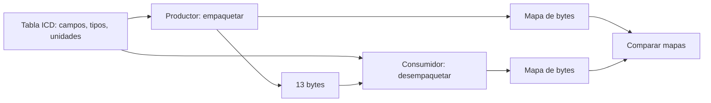

# B88-C21 — Interfaces y documentos de control de software de vuelo

<!-- nav:top -->
[🏠 Programa](../../../../README.md) · [📚 Bloque B88](../../../tronco-comun/B88-avionica-y-software-critico-espacial.md) · [← Anterior: B88-C20 — Plan de verificación de computador de vuelo](../B88-C20-plan-de-verificacion-de-computador-de-vuelo/CLASE.md) · [Siguiente: B88-C22 — Interrupciones y manejo de excepciones en el computador de vuelo →](../B88-C22-interrupciones-y-manejo-de-excepciones-en-el-computador-de-vuelo/CLASE.md)
<!-- /nav -->

## 1. Ubicación, nivel y alcance

Clase 21 del bloque B88. Nivel N3. El software de vuelo se acopla a los demás subsistemas mediante **documentos de control de interfaz** (ICD): tablas que fijan, campo por campo, tipo, unidad, escala y orden de bytes. Aquí defines un mensaje **sintético** (cuaternión de actitud de un sensor estelar), lo empaquetas, lo desempaqueta y **comprueba** la consistencia entre productor y consumidor. De ECSS-E-ST-70-41C solo se consultó el alcance. Todos los datos son **sintéticos** salvo los que se rotulan como consultados.

## 2. Por qué esta clase existe

La mayoría de los errores de integración nacen en la interfaz: un campo de otro ancho, un orden de bytes invertido o una unidad distinta. La decisión central: **¿la tabla de interfaz deja un solo significado posible para cada bit?**

## 3. Lo que podrás hacer al terminar

1. Describir un mensaje con campos, tipos, unidades y escalas.
2. Empaquetar y desempaquetar con orden de bytes explícito.
3. Calcular el error de cuantización de un campo escalado.
4. Detectar un consumidor con orden de bytes o ancho distinto.
5. Comparar mapas de bytes productor–consumidor.
6. Separar lo sintético de lo consultado.

La evidencia es la **ICD de mensajes con verificación de consistencia** del ejercicio 12 (sección 20).

## 4. Con qué llegas y cómo comprobarlo

1. ¿Qué es el orden de bytes (*endianness*)?
2. ¿Qué es un entero con signo de 16 bits?
3. ¿Qué es un factor de escala?
4. ¿Qué es un cuaternión de actitud?
5. ¿Qué es un ICD?

<details>
<summary>Ver respuestas</summary>

1. Si el byte más significativo va primero (big-endian) o último. 2. Un entero de −32768 a 32767. 3. Lo que convierte el entero en la magnitud física. 4. Cuatro números de norma 1 que describen una orientación. 5. Un documento que define una interfaz entre dos elementos.
</details>

Con cuatro o cinco aciertos, sigue; si no, repasa los prerrequisitos.

## 5. Un caso de contexto y casos de referencia

El mensaje **sintético** `ATT_QUAT` tiene cuatro enteros de 16 bits con escala `1/32767`, un estado de 1 byte y un tiempo de 4 bytes: `13 bytes = 104 bits`. El cuaternión `(0,5; −0,5; 0,5; 0,5)` se recupera como `(0,50002; …)` con norma `1,00003`. Un consumidor little-endian lee valores absurdos; uno con tiempo de 16 bits pierde `123 456`.

## 6. Vocabulario

El **campo** tiene nombre, tipo, unidad y escala. El **orden de bytes** `>` es big-endian. La **cuantización** de un campo escalado tiene LSB `= escala`. El **mapa de bytes** es la lista de intervalos `(inicio, fin)` de cada campo. El **ICD** es el contrato entre productor y consumidor.

## 7. Modelo mental



*Descripción textual:* la misma tabla alimenta al productor y al consumidor; los bytes viajan entre ellos y los mapas de bytes se comparan para detectar desfases.

Analogía: el ICD es como el formato de un formulario: cada casilla tiene su tamaño y su significado; si dos oficinas usan formatos distintos, los datos se corren. Límite: un formato igual no garantiza que los valores sean correctos.

## 8. La explicación, paso a paso

### 8.1 El mensaje

Seis campos: `q0…q3` (`int16`, escala `1/32767`), `estado` (`uint8`) y `t_ms` (`uint32`). Orden big-endian: `13` bytes.

### 8.2 Cuantización

`LSB = 1/32767 = 3,05×10⁻⁵`; error máximo `1,53×10⁻⁵` por componente. El cuaternión se recupera con norma `1,00003`: ya no es exactamente unitario y el consumidor debe renormalizar.

### 8.3 Errores de interfaz

Little-endian: `(64, 192, 64, 64)` y `t_ms = 1 088 553 216`. Tiempo de 16 bits: `t_ms = 1` en lugar de `123 456`.

### 8.4 Mapas

Productor: campos en `(0,1)…(9,12)`; consumidor con `t_ms` de 16 bits: `(9,10)`. Longitudes `13` y `11`: la discrepancia se detecta **antes** de volar al comparar los mapas.

## 9. Magnitudes, símbolos y unidades

| Símbolo | Qué es | Unidad | Valor / nota |
|---|---|---|---|
| `q` | componente de cuaternión | — | −1 a 1 |
| `escala` | factor de conversión | — | 1/32767 |
| `L` | longitud del mensaje | B | 13 |
| `LSB` | paso del campo | — | 3,05×10⁻⁵ |

## 10. Convenciones y referencias

Orden de bytes big-endian; escala entera con signo de 16 bits; estados como enumeración de 1 byte; tiempo en ms desde un origen de ejemplo. Tolerancia: recuperación exacta del entero y error de cuantización ≤ LSB/2. Todo **sintético**; no es un ICD de un sensor real.

## 11. De dónde sale lo que afirmamos

| ID | Fuente | Localizador | Respalda | Estado |
|---|---|---|---|---|
| S1 | ECSS, «ECSS-E-ST-70-41C — Telemetry and telecommand packet utilization», 15 abr 2016 — https://ecss.nl/standard/ecss-e-st-70-41c-space-engineering-telemetry-and-telecommand-packet-utilization-15-april-2016/ (consultada 2026-11-10) | página de la norma | define servicios para vigilar y controlar naves y cargas útiles, y la estructura de los paquetes TC y TM; los servicios son opcionales y se adaptan por misión | Consultada (solo la página) |
| S2 | ECSS, «ECSS-E-ST-40C — Software», 6 mar 2009 (reemplazada por la Rev.1 del 30 abr 2025) — https://ecss.nl/standard/ecss-e-st-40c-software-general-requirements/ (consultada 2026-11-10) | página de la norma (solo resumen y alcance; no el texto de requisitos) | alcance: software de producto de un sistema espacial en los segmentos espacial, de lanzamiento y de tierra, desde los requisitos hasta el mantenimiento | Consultada (solo la página) |
| — | Libros de texto de sistemas de tiempo real, tolerancia a fallos y comunicaciones digitales | — | — | No consultada |
| — | Relaciones y algoritmos estándar usados por el laboratorio (empaquetado binario con `struct` y cuantización por escala entera) | — | los verifica el laboratorio con una segunda vía o con pruebas | No consultada en una fuente concreta |

Límites: la página de ECSS-E-ST-70-41C solo da el alcance; no se consultó ningún ICD real ni la plantilla de ECSS para documentos de interfaz. El laboratorio no cubre sincronización de relojes ni versiones del mensaje. Lo simulado no se presenta como dato de vuelo ni como medición.

## 12. Cómo ver los resultados

| Consumidor | Resultado |
|---|---|
| Correcto (big-endian, 4 B de tiempo) | cuaternión y tiempo exactos |
| Little-endian | `(64, 192, 64, 64)`, `t_ms = 1 088 553 216` |
| Tiempo de 16 bits | `t_ms = 1`; longitud 11 B |

Descripción larga: dos errores sutiles de interfaz producen valores válidos pero falsos.

## 13. Ejemplo trabajado

**Paso 1 · Cuantizar.** `round(0,5 × 32767) = 16384 = 0x4000`.

**Paso 2 · Empaquetar.** `0x4000, 0xC000, 0x4000, 0x4000` más estado y tiempo.

**Paso 3 · Recuperar.** `16384/32767 = 0,50002`.

**Paso 4 · Norma.** `√(4 × 0,50002²) = 1,00003`.

## 14. Distintas formas de describir el problema

**Por tabla ICD:** esta clase. **Por esquema formal:** lenguajes de descripción de datos (no consultado). **Por prueba de integración:** intercambiar mensajes con el equipo real. El laboratorio compara mapas de bytes.

## 15. Práctica guiada

**Ejercicio 1 · con los pasos indicados.** Calcula los bytes del mensaje.

<details><summary>Solución comentada</summary>

`4×2 + 1 + 4 = 13`.
</details>

**Ejercicio 2 · con una pista.** Calcula el LSB del cuaternión.

<details><summary>Solución comentada</summary>

`1/32767 = 3,05×10⁻⁵`.
</details>

**Ejercicio 3 · casi autónomo.** ¿Qué entero representa 0,5?

<details><summary>Solución comentada</summary>

`16384` (`0x4000`).
</details>

## 16. Práctica autónoma, transferencia e integrador

**Ejercicio 4 · autónomo.** ¿Qué valor decodifica un consumidor que lee `0xC000` como `int16` big-endian?

<details><summary>Solución comentada</summary>

`−16384 → −0,5`.
</details>

**Ejercicio 5 · autónomo.** ¿Qué pasa si el consumidor lee el tiempo como `uint16`?

<details><summary>Solución comentada</summary>

Solo ve 2 bytes y el resto del mensaje se corre.
</details>

**Ejercicio 6 · autónomo.** ¿Por qué la norma del cuaternión recuperado no es exactamente 1?

<details><summary>Solución comentada</summary>

Por la cuantización: cada componente tiene error hasta LSB/2.
</details>

**Ejercicio 7 · autónomo.** ¿Qué hace el consumidor con eso?

<details><summary>Solución comentada</summary>

Renormaliza el cuaternión antes de usarlo.
</details>

**Ejercicio 8 · autónomo.** ¿Qué dato añadirías a la cabecera para detectar versiones distintas?

<details><summary>Solución comentada</summary>

Un número de versión del ICD.
</details>

**Ejercicio 9 · transferencia.** **Transferencia.** Un colega dice que el mapa de bytes igual garantiza que los valores sean correctos. ¿Es válido?

<details><summary>Solución comentada</summary>

No: garantiza el formato, no la unidad ni la escala; se verifica también con valores.
</details>

**Ejercicio 10 · transferencia.** **Transferencia.** ¿Qué cambia si se pasa de big-endian a little-endian en un solo lado?

<details><summary>Solución comentada</summary>

Los enteros se leen invertidos; es el caso del laboratorio.
</details>

**Ejercicio 11 · transferencia.** **Transferencia.** ¿Qué otras columnas añadirías a la tabla ICD?

<details><summary>Solución comentada</summary>

Rango válido, valor de error, frecuencia de envío y responsable del campo.
</details>

**Ejercicio 12 · integrador.** **Integrador.** Elabora tu *ICD de mensajes con verificación de consistencia*: tabla de campos, mapa de bytes, pruebas de ida y vuelta y lista de qué es sintético.

<details><summary>Solución comentada</summary>

Secciones 8.1–8.4 y la salida del laboratorio.
</details>

## 17. Laboratorio: tabla de interfaz y consistencia productor–consumidor

El script [icd_mensajes.py](icd_mensajes.py) empaqueta y desempaqueta un mensaje de 13 bytes, calcula la cuantización, simula consumidores con orden de bytes y ancho erróneos y compara mapas de bytes, y **comprueba** la ida y vuelta exacta y la detección del desfase.

**Datos:** mensaje **sintético**. **Predice antes de ejecutar:** ¿en qué campo difieren los mapas? (el sexto, `t_ms`). **Ejecución del 2026-11-10 (Python 3.12.9):**

```text
Python 3.12.9
Datos SINTETICOS: dos mensajes inventados entre el computador y un sensor estelar
Mensaje ATT_QUAT: 13 bytes = 104 bit
Bytes (hex): 4000c00040004000020001e240
Cuaternion recuperado: [0.50002, -0.50002, 0.50002, 0.50002] ; norma = 1.00003
Cuantizacion: LSB = 3.052e-05 ; error maximo = 1.526e-05
Consumidor little-endian lee: (64, 192, 64, 64) estado 2 t_ms 1088553216
Consumidor con t_ms de 16 bit: t_ms = 1 (se pierde el valor 123456)
Mapa productor: [(0, 1), (2, 3), (4, 5), (6, 7), (8, 8), (9, 12)]
Mapa consumidor: [(0, 1), (2, 3), (4, 5), (6, 7), (8, 8), (9, 10)]
Campos con desfase de bytes: [5] ; longitudes: 13 vs 11
Pruebas superadas.
```

```bash
python programa/clases/B88/B88-C21-interfaces-y-documentos-de-control-de-software-de-vuelo/icd_mensajes.py
```

**Límites:** sin sincronización de relojes, versiones del ICD ni validación de rangos.

## 18. Errores frecuentes y cómo corregirlos

**Dejar el orden de bytes implícito.** Escríbelo en el ICD (8.3)

**Confundir escala con unidad.** Anota ambas

**Presentar el mensaje como el de un sensor real.** Revisa la sección 10

## 19. Cómo sabrás que vas bien

Tras 8.3: ¿qué valores esperabas con un consumidor little-endian? Si dudas, repasa el ejemplo 13. Tras el laboratorio: ¿qué comprueba? (ver sección 17).

## 20. Qué entregas y cómo se evalúa

El producto es tu **ICD de mensajes con verificación de consistencia** (ejercicio 12).

| Criterio | Inicial | En desarrollo | Logrado | Destacado |
|---|---|---|---|---|
| Conceptos | Los confunde | Parciales | Explica el método y su dominio | Explica los límites y las alternativas |
| Cálculo | Sin unidades | Con errores | Resultados con unidades y comprobados | Resuelve casos nuevos |
| Numérico | Sin comprobar | Un caso | Verifica con una segunda vía en varios casos | Interpreta las diferencias y los fallos |
| Fuentes | Sin fuente | Sin fecha | Fuentes con fecha y estado | Declara lo sintético y lo no consultado |
| Límites | No los nombra | Uno | Tres | Discute qué falta del modelo |

**Condiciones críticas (no se compensan con promedio):** rotular los datos como sintéticos; comprobar cada resultado con una segunda vía; citar solo lo consultado.

## 21. Ética, seguridad y límites

Clase educativa: los modelos son simplificados y los datos son sintéticos; ningún resultado describe una misión real, certifica conformidad con una norma ni sustituye la revisión de especialistas.  Accesibilidad: tablas equivalentes a las gráficas, fórmulas en texto, ejercicios sin conexión.

## 22. Para cerrar y seguir

Un mensaje de 13 bytes tiene un solo significado si el ICD fija tipo, escala y orden de bytes; los mapas de bytes revelan el desfase. Queda una pregunta: ¿qué ocurre dentro del procesador cuando llega una interrupción?

**Glosario español–inglés.** documento de control de interfaz · *interface control document*; orden de bytes · *endianness*; cuantización · *quantization*; mapa de bytes · *byte map*; campo · *field*.

**Continuidad.** [B88-C22](../B88-C22-interrupciones-y-manejo-de-excepciones-en-el-computador-de-vuelo/CLASE.md) trata las interrupciones y el manejo de excepciones.

**Referencias:** ver sección 11.

<!-- nav:bottom -->
---

[← Anterior: B88-C20 — Plan de verificación de computador de vuelo](../B88-C20-plan-de-verificacion-de-computador-de-vuelo/CLASE.md) · [📚 Bloque B88](../../../tronco-comun/B88-avionica-y-software-critico-espacial.md) · [Siguiente: B88-C22 — Interrupciones y manejo de excepciones en el computador de vuelo →](../B88-C22-interrupciones-y-manejo-de-excepciones-en-el-computador-de-vuelo/CLASE.md)
<!-- /nav -->
