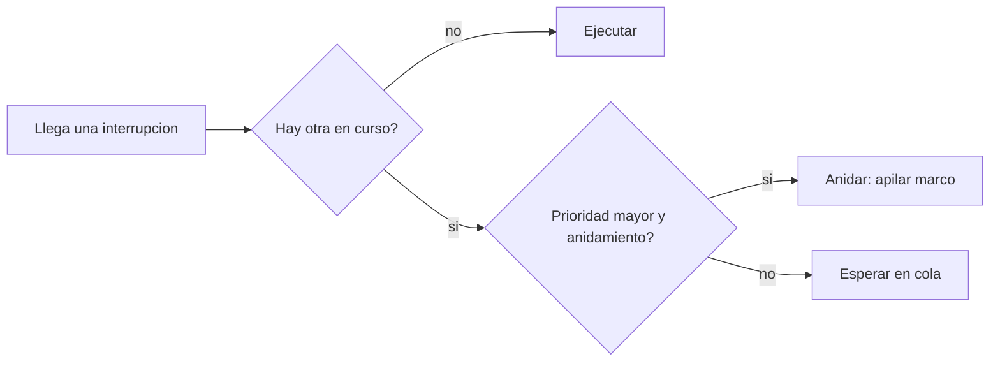

# B88-C22 — Interrupciones y manejo de excepciones en el computador de vuelo

<!-- nav:top -->
[🏠 Programa](../../../../README.md) · [📚 Bloque B88](../../../tronco-comun/B88-avionica-y-software-critico-espacial.md) · [← Anterior: B88-C21 — Interfaces y documentos de control de software de vuelo](../B88-C21-interfaces-y-documentos-de-control-de-software-de-vuelo/CLASE.md) · [Siguiente: B88-C23 — Arquitectura de software de vuelo: capas y ejecutivo →](../B88-C23-arquitectura-de-software-de-vuelo-capas-y-ejecutivo/CLASE.md)
<!-- /nav -->

## 1. Ubicación, nivel y alcance

Clase 22 del bloque B88. Nivel N3. Una **interrupción** detiene la tarea en curso para atender un evento de hardware. Aquí simulas tres fuentes de interrupción con prioridades (TIMER, UART, ADC), con y sin **anidamiento**, y mides **latencia**, **tiempo de respuesta** y **profundidad de pila**. Todo es **sintético** (microsegundos). Todos los datos son **sintéticos** salvo los que se rotulan como consultados.

## 2. Por qué esta clase existe

Las interrupciones fijan cuánto tarda el sistema en reaccionar y cuánta pila usa. La decisión central: **¿se permite que una interrupción de mayor prioridad interrumpa a otra, y qué cuesta eso en latencia y pila?**

## 3. Lo que podrás hacer al terminar

1. Describir latencia, tiempo de respuesta y anidamiento.
2. Simular interrupciones con prioridades.
3. Calcular la pila máxima con anidamiento.
4. Comparar anidar y no anidar.
5. Acotar la pila con la suma de un marco por nivel.
6. Separar lo sintético de lo consultado.

La evidencia es la **simulación de interrupciones con presupuesto de pila** del ejercicio 12 (sección 20).

## 4. Con qué llegas y cómo comprobarlo

1. ¿Qué es una interrupción?
2. ¿Qué es la prioridad?
3. ¿Qué es un marco de pila?
4. ¿Qué es la latencia de interrupción?
5. ¿Qué es el enmascaramiento?

<details>
<summary>Ver respuestas</summary>

1. Una señal que desvía al procesador a una rutina de atención. 2. El orden de urgencia entre fuentes. 3. La memoria que guarda el contexto de una rutina. 4. El tiempo entre la llegada y el inicio de su rutina. 5. Impedir temporalmente que una interrupción se atienda.
</details>

Con cuatro o cinco aciertos, sigue; si no, repasa los prerrequisitos.

## 5. Un caso de contexto y casos de referencia

Cuatro interrupciones **sintéticas** (µs): TIMER (prioridad 3, llega a 100, dura 40, marco 32 B), UART (2, 110, 60, 48 B), ADC (1, 120, 30, 40 B) y TIMER2 (3, 160, 20, 32 B). Con anidamiento, la pila máxima es `80 B` y la UART termina a 220 µs; sin anidar, `48 B`, pero TIMER2 espera 40 µs.

## 6. Vocabulario

La **latencia** es `inicio − llegada`. El **tiempo de respuesta** es `fin − llegada`. El **anidamiento** deja que una prioridad mayor interrumpa a una menor. La **pila máxima** es la suma de los marcos activos a la vez. La **cota de pila** suma un marco por nivel de prioridad.

## 7. Modelo mental



*Descripción textual:* una interrupción nueva se ejecuta de inmediato si no hay otra; si hay otra, anida si su prioridad es mayor y está permitido, y si no espera en cola.

Analogía: las interrupciones son como llamadas a un médico de guardia: la urgencia mayor interrumpe una consulta menor, que queda en pausa; si no se permite interrumpir, la urgencia espera. Límite: cada pausa ocupa espacio (pila) y retrasa la consulta pausada.

## 8. La explicación, paso a paso

### 8.1 Con anidamiento

TIMER llega a 100 y corre 40 µs (latencia 0). UART (110) y ADC (120) esperan. Al terminar TIMER (140), corre UART; TIMER2 (160) la **interrumpe** (latencia 0) y UART termina a 220 µs (respuesta 110). ADC corre de 220 a 250: latencia `100 µs`, respuesta `130 µs`. Pila máxima `32 + 48 = 80 B`.

### 8.2 Sin anidamiento

UART no se interrumpe y termina a 200; TIMER2 espera 40 µs (respuesta 60). Pila máxima `48 B`. ADC igual: latencia 100 µs.

### 8.3 Comparación

Anidar da latencia 0 a TIMER2 pero alarga a la UART (de 90 a 110 µs de respuesta) y usa más pila (80 frente a 48 B).

### 8.4 Cota de pila

Con un marco por nivel (32 + 48 + 40 = 120 B), cualquier combinación de anidamientos cabe: observado `80 ≤ 120 B`.

## 9. Magnitudes, símbolos y unidades

| Símbolo | Qué es | Unidad | Valor / nota |
|---|---|---|---|
| `t_llegada` | instante de llegada | µs | 100 a 160 |
| `D` | duración de la rutina | µs | 20 a 60 |
| `marco` | pila por rutina | B | 32, 48, 40 |
| `L` | latencia | µs | 0 a 100 |
| `pila` | máximo apilado | B | 80 / 48 |

## 10. Convenciones y referencias

Paso de 1 µs; prioridad mayor = más urgente; coste de entrada/salida de rutina despreciado; sin enmascaramiento ni segunda fuente. Tolerancia: latencia de TIMER = 0 y pila ≤ cota. Todo **sintético**.

## 11. De dónde sale lo que afirmamos

| ID | Fuente | Localizador | Respalda | Estado |
|---|---|---|---|---|
| S1 | NASA, «Software Engineering and Assurance Handbook» NASA-HDBK-2203 — https://swehb.nasa.gov/ (consultada 2026-11-10) | página de inicio | guía informativa (no de requisitos) para cumplir NPR 7150.2D y NASA-STD-8739.8B para quien adquiere, desarrolla, asegura o mantiene software de la NASA | Consultada (solo la página de inicio) |
| — | Libros de texto de sistemas de tiempo real, tolerancia a fallos y comunicaciones digitales | — | — | No consultada |
| — | Relaciones y algoritmos estándar usados por el laboratorio (simulación por pasos de interrupciones con prioridad y suma de marcos de pila) | — | los verifica el laboratorio con una segunda vía o con pruebas | No consultada en una fuente concreta |

Límites: no se consultó ningún manual de arquitectura de procesador; el coste de entrada y salida de una interrupción real (guardar registros) se ignora. No se modelan interrupciones enmascaradas ni excepciones síncronas. Lo simulado no se presenta como dato de vuelo ni como medición.

## 12. Cómo ver los resultados

| Interrupción | Latencia (anidar) | Respuesta (anidar) | Respuesta (sin anidar) |
|---|---|---|---|
| TIMER | 0 | 40 | 40 |
| UART | 30 | 110 | 90 |
| ADC | 100 | 130 | 130 |
| TIMER2 | 0 | 20 | 60 |

Descripción larga: anidar favorece a la urgente (TIMER2) y perjudica a la UART, que queda pausada.

## 13. Ejemplo trabajado

**Paso 1 · TIMER.** 100→140 µs.

**Paso 2 · UART.** Empieza a 140; a 160 la interrumpe TIMER2 (20 µs hechos).

**Paso 3 · Reanuda.** TIMER2 termina a 180; UART continúa los 40 µs restantes hasta 220.

**Paso 4 · Pila.** `32 + 48 = 80 B`.

## 14. Distintas formas de describir el problema

**Por simulación:** esta clase. **Por análisis de tiempo de respuesta con interrupciones:** como tareas de máxima prioridad (C05). **Por medición:** analizador lógico en banco (C26). El laboratorio compara las dos primeras ideas.

## 15. Práctica guiada

**Ejercicio 1 · con los pasos indicados.** Calcula la latencia de la UART.

<details><summary>Solución comentada</summary>

`140 − 110 = 30 µs`.
</details>

**Ejercicio 2 · con una pista.** Calcula la respuesta de ADC.

<details><summary>Solución comentada</summary>

`250 − 120 = 130 µs`.
</details>

**Ejercicio 3 · casi autónomo.** Calcula la pila máxima con anidamiento.

<details><summary>Solución comentada</summary>

`32 + 48 = 80 B`.
</details>

## 16. Práctica autónoma, transferencia e integrador

**Ejercicio 4 · autónomo.** Calcula la cota de pila.

<details><summary>Solución comentada</summary>

`32 + 48 + 40 = 120 B`.
</details>

**Ejercicio 5 · autónomo.** ¿Por qué TIMER2 tiene latencia 0 con anidamiento?

<details><summary>Solución comentada</summary>

Su prioridad (3) supera a la UART (2): la interrumpe.
</details>

**Ejercicio 6 · autónomo.** ¿Cuánto retrasa el anidamiento a la UART?

<details><summary>Solución comentada</summary>

`220 − 200 = 20 µs` (de 90 a 110 µs de respuesta).
</details>

**Ejercicio 7 · autónomo.** ¿Qué pasa si se enmascaran las interrupciones 50 µs?

<details><summary>Solución comentada</summary>

Todas las llegadas en ese lapso suman 50 µs a su latencia.
</details>

**Ejercicio 8 · autónomo.** ¿Por qué se acota la pila con un marco por nivel?

<details><summary>Solución comentada</summary>

Una prioridad igual o menor no interrumpe a la misma o a una mayor: a lo sumo un marco por nivel.
</details>

**Ejercicio 9 · transferencia.** **Transferencia.** Un colega dice que sus rutinas caben en 80 B. ¿Es válido?

<details><summary>Solución comentada</summary>

No: marcos y duraciones son sintéticos; hay que medirlos en el código real.
</details>

**Ejercicio 10 · transferencia.** **Transferencia.** ¿Qué cambia si se añade una cuarta prioridad?

<details><summary>Solución comentada</summary>

Se suma otro marco a la cota y se revisan las latencias de las de menor prioridad.
</details>

**Ejercicio 11 · transferencia.** **Transferencia.** ¿Cuándo preferirías no anidar?

<details><summary>Solución comentada</summary>

Cuando la pila es muy escasa o las rutinas cortas hacen el anidamiento innecesario.
</details>

**Ejercicio 12 · integrador.** **Integrador.** Elabora tu *simulación de interrupciones con presupuesto de pila*: cronograma, latencias, respuestas, pila con y sin anidar y lista de qué es sintético.

<details><summary>Solución comentada</summary>

Secciones 8.1–8.4 y la salida del laboratorio.
</details>

## 17. Laboratorio: interrupciones anidadas, latencia y pila

El script [interrupciones.py](interrupciones.py) simula cuatro interrupciones con y sin anidamiento, calcula latencias, respuestas y pila, y **comprueba** que la latencia de TIMER es 0, la de ADC es positiva y la pila ≤ 120 B.

**Datos:** interrupciones **sintéticas**. **Predice antes de ejecutar:** ¿qué pila máxima habrá con anidamiento? (80 B). **Ejecución del 2026-11-10 (Python 3.12.9):**

```text
Python 3.12.9
Datos SINTETICOS: tres interrupciones inventadas (unidades: us)
Anidamiento permitido : pila maxima =  80 B
   TIMER  prio 3 llega 100 inicia 100 fin 140 latencia =   0 us respuesta =  40 us
   UART   prio 2 llega 110 inicia 140 fin 220 latencia =  30 us respuesta = 110 us
   ADC    prio 1 llega 120 inicia 220 fin 250 latencia = 100 us respuesta = 130 us
   TIMER2 prio 3 llega 160 inicia 160 fin 180 latencia =   0 us respuesta =  20 us
Anidamiento prohibido : pila maxima =  48 B
   TIMER  prio 3 llega 100 inicia 100 fin 140 latencia =   0 us respuesta =  40 us
   UART   prio 2 llega 110 inicia 140 fin 200 latencia =  30 us respuesta =  90 us
   ADC    prio 1 llega 120 inicia 220 fin 250 latencia = 100 us respuesta = 130 us
   TIMER2 prio 3 llega 160 inicia 200 fin 220 latencia =  40 us respuesta =  60 us
Cota de pila (un marco por nivel) = 120 B ; observada con anidamiento = 80 B
Pruebas superadas.
```

```bash
python programa/clases/B88/B88-C22-interrupciones-y-manejo-de-excepciones-en-el-computador-de-vuelo/interrupciones.py
```

**Límites:** sin coste de entrada/salida, enmascaramiento ni excepciones síncronas.

## 18. Errores frecuentes y cómo corregirlos

**Ignorar la pila de las interrupciones.** Súmala (8.4)

**Suponer latencia 0 para todas.** Las de menor prioridad esperan (8.1)

**Presentar el ejemplo como un procesador real.** Revisa la sección 10

## 19. Cómo sabrás que vas bien

Tras 8.1: ¿qué latencia esperabas para ADC? Si dudas, repasa el ejemplo 13. Tras el laboratorio: ¿qué comprueba? (ver sección 17).

## 20. Qué entregas y cómo se evalúa

El producto es tu **simulación de interrupciones con presupuesto de pila** (ejercicio 12).

| Criterio | Inicial | En desarrollo | Logrado | Destacado |
|---|---|---|---|---|
| Conceptos | Los confunde | Parciales | Explica el método y su dominio | Explica los límites y las alternativas |
| Cálculo | Sin unidades | Con errores | Resultados con unidades y comprobados | Resuelve casos nuevos |
| Numérico | Sin comprobar | Un caso | Verifica con una segunda vía en varios casos | Interpreta las diferencias y los fallos |
| Fuentes | Sin fuente | Sin fecha | Fuentes con fecha y estado | Declara lo sintético y lo no consultado |
| Límites | No los nombra | Uno | Tres | Discute qué falta del modelo |

**Condiciones críticas (no se compensan con promedio):** rotular los datos como sintéticos; comprobar cada resultado con una segunda vía; citar solo lo consultado.

## 21. Ética, seguridad y límites

Clase educativa: los modelos son simplificados y los datos son sintéticos; ningún resultado describe una misión real, certifica conformidad con una norma ni sustituye la revisión de especialistas.  Accesibilidad: tablas equivalentes a las gráficas, fórmulas en texto, ejercicios sin conexión.

## 22. Para cerrar y seguir

Anidar da latencia 0 a la interrupción más urgente a cambio de 32 B de pila y de retrasar a la UART. Queda una pregunta: ¿cómo se organiza el software en capas sobre ese hardware?

**Glosario español–inglés.** interrupción · *interrupt*; latencia · *latency*; anidamiento · *nesting*; marco de pila · *stack frame*; enmascaramiento · *masking*.

**Continuidad.** [B88-C23](../B88-C23-arquitectura-de-software-de-vuelo-capas-y-ejecutivo/CLASE.md) trata la arquitectura de software de vuelo en capas.

**Referencias:** ver sección 11.

<!-- nav:bottom -->
---

[← Anterior: B88-C21 — Interfaces y documentos de control de software de vuelo](../B88-C21-interfaces-y-documentos-de-control-de-software-de-vuelo/CLASE.md) · [📚 Bloque B88](../../../tronco-comun/B88-avionica-y-software-critico-espacial.md) · [Siguiente: B88-C23 — Arquitectura de software de vuelo: capas y ejecutivo →](../B88-C23-arquitectura-de-software-de-vuelo-capas-y-ejecutivo/CLASE.md)
<!-- /nav -->
