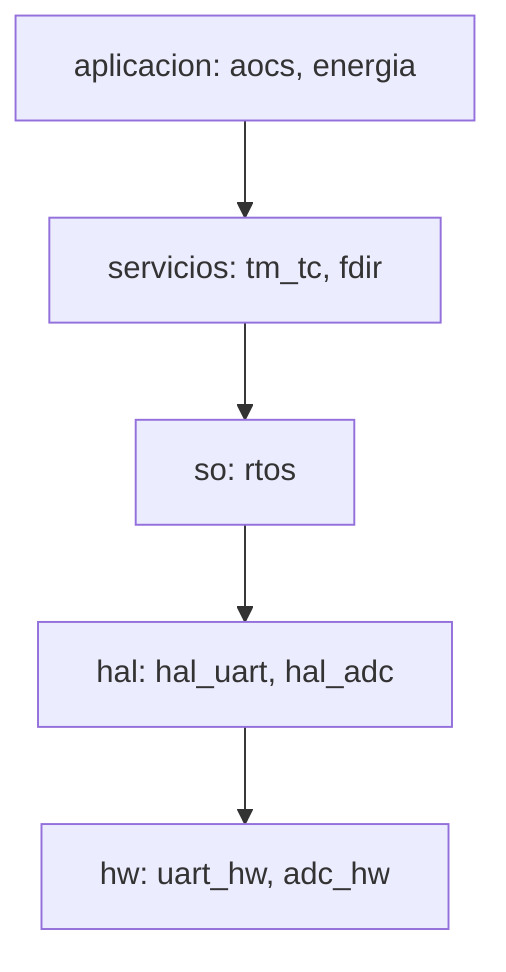

# B88-C23 — Arquitectura de software de vuelo: capas y ejecutivo

<!-- nav:top -->
[🏠 Programa](../../../../README.md) · [📚 Bloque B88](../../../tronco-comun/B88-avionica-y-software-critico-espacial.md) · [← Anterior: B88-C22 — Interrupciones y manejo de excepciones en el computador de vuelo](../B88-C22-interrupciones-y-manejo-de-excepciones-en-el-computador-de-vuelo/CLASE.md) · [Siguiente: B88-C24 — Capa de abstracción de hardware (HAL) y controladores →](../B88-C24-capa-de-abstraccion-de-hardware-hal-y-controladores/CLASE.md)
<!-- /nav -->

## 1. Ubicación, nivel y alcance

Clase 23 del bloque B88. Nivel N3. El software de vuelo se organiza en **capas** (hardware, abstracción, sistema operativo, servicios, aplicación) con una regla: cada capa solo depende de las inferiores. Aquí verificas esa regla sobre un grafo de dependencias **sintético** de 9 módulos, buscas ciclos, calculas el nivel topológico y armas un **ejecutivo cíclico** con ciclo menor y mayor. Todos los datos son **sintéticos** salvo los que se rotulan como consultados.

## 2. Por qué esta clase existe

Las dependencias hacia arriba y los ciclos hacen imposible probar un módulo por separado y convierten un cambio en riesgo global. La decisión central: **¿qué módulo depende de quién, y puede ordenarse el sistema en capas sin ciclos?**

## 3. Lo que podrás hacer al terminar

1. Describir las capas de un software de vuelo.
2. Detectar dependencias hacia arriba y saltos de capa.
3. Detectar ciclos de dependencia.
4. Calcular el nivel topológico de cada módulo.
5. Armar un ejecutivo cíclico y su carga por trama.
6. Separar lo sintético de lo consultado.

La evidencia es la **mapa de capas y cronograma de trama** del ejercicio 12 (sección 20).

## 4. Con qué llegas y cómo comprobarlo

1. ¿Qué es una capa?
2. ¿Qué es un grafo dirigido?
3. ¿Qué es un ciclo en un grafo?
4. ¿Qué es el mcd y el mcm?
5. ¿Qué es un ejecutivo cíclico?

<details>
<summary>Ver respuestas</summary>

1. Un conjunto de módulos con un mismo nivel de abstracción. 2. Nodos con aristas con sentido. 3. Un camino que vuelve a su origen. 4. Máximo común divisor y mínimo común múltiplo. 5. Un planificador que repite una tabla fija de tareas por tramas.
</details>

Con cuatro o cinco aciertos, sigue; si no, repasa los prerrequisitos.

## 5. Un caso de contexto y casos de referencia

9 módulos **sintéticos** y 10 dependencias. La dependencia `rtos → tm_tc` va hacia arriba y crea un ciclo; al quitarla no hay ciclo. Dos dependencias saltan más de una capa (`tm_tc → hal_uart`, `aocs → hal_adc`). El ejecutivo tiene ciclo menor de 100 ms, mayor de 400 ms y 4 tramas con cargas de 62, 12, 37 y 12 ms.

## 6. Vocabulario

La **capa** `hw < hal < so < servicios < aplicación`. Una **dependencia hacia arriba** viola la jerarquía. El **nivel topológico** es la longitud del camino más largo hasta el hardware. El **ciclo menor** es el `mcd` de los períodos y el **mayor** el `mcm`.

## 7. Modelo mental



*Descripción textual:* cada capa depende solo de la inmediata inferior; el hardware queda en la base.

Analogía: las capas son como los pisos de un edificio: cada uno se apoya en el de abajo y nunca al revés. Límite: saltarse un piso (llamar al HAL desde la aplicación) no cae el edificio pero acopla.

## 8. La explicación, paso a paso

### 8.1 Violaciones

`rtos → tm_tc` (capa 2 hacia 3) viola la jerarquía. Hay ciclo `rtos → tm_tc → rtos`. Sin esa arista, no hay ciclo.

### 8.2 Saltos

`tm_tc → hal_uart` (3 → 1) y `aocs → hal_adc` (4 → 1) saltan capas: se vigilan como acoplamiento.

### 8.3 Niveles

`uart_hw`, `adc_hw`: 0; `hal_*`: 1; `rtos`: 2; `tm_tc`, `fdir`: 3; `aocs`, `energia`: 4.

### 8.4 Ejecutivo cíclico

Tareas AOCS (100 ms, 12), energía (200, 10), tm_tc (200, 15), fdir (400, 25): `mcd = 100`, `mcm = 400`, 4 tramas. Cargas `62, 12, 37, 12 ms`: todas caben en 100 ms; la trama 0 queda al 62 %.

## 9. Magnitudes, símbolos y unidades

| Símbolo | Qué es | Unidad | Valor / nota |
|---|---|---|---|
| `n` | módulos | — | 9 |
| `viol` | dependencias hacia arriba | — | 1 |
| `T_menor` | ciclo menor | ms | 100 |
| `T_mayor` | ciclo mayor | ms | 400 |
| `carga` | ms por trama | ms | 62, 12, 37, 12 |

## 10. Convenciones y referencias

Capas ordenadas por índice; dependencia = «a usa b»; tiempos en ms; WCET fijo por tarea. Tolerancia: carga de cada trama ≤ ciclo menor. Todo **sintético**.

## 11. De dónde sale lo que afirmamos

| ID | Fuente | Localizador | Respalda | Estado |
|---|---|---|---|---|
| S1 | NASA, «Software Engineering and Assurance Handbook» NASA-HDBK-2203 — https://swehb.nasa.gov/ (consultada 2026-11-10) | página de inicio | guía informativa (no de requisitos) para cumplir NPR 7150.2D y NASA-STD-8739.8B para quien adquiere, desarrolla, asegura o mantiene software de la NASA | Consultada (solo la página de inicio) |
| S2 | ECSS, «ECSS-E-ST-40C — Software», 6 mar 2009 (reemplazada por la Rev.1 del 30 abr 2025) — https://ecss.nl/standard/ecss-e-st-40c-software-general-requirements/ (consultada 2026-11-10) | página de la norma (solo resumen y alcance; no el texto de requisitos) | alcance: software de producto de un sistema espacial en los segmentos espacial, de lanzamiento y de tierra, desde los requisitos hasta el mantenimiento | Consultada (solo la página) |
| — | Libros de texto de sistemas de tiempo real, tolerancia a fallos y comunicaciones digitales | — | — | No consultada |
| — | Relaciones y algoritmos estándar usados por el laboratorio (grafos de dependencia, orden topológico y mcd/mcm del ejecutivo cíclico) | — | los verifica el laboratorio con una segunda vía o con pruebas | No consultada en una fuente concreta |

Límites: no se consultó ninguna arquitectura de software de vuelo publicada (por ejemplo cFS u otras); las capas son didácticas. El ejecutivo ignora cambios de contexto y bloqueos. Lo simulado no se presenta como dato de vuelo ni como medición.

## 12. Cómo ver los resultados

| Trama | Carga (ms) | % de 100 ms |
|---|---|---|
| 0 | 62 | 62 |
| 1 | 12 | 12 |
| 2 | 37 | 37 |
| 3 | 12 | 12 |

Descripción larga: la trama 0 concentra las cuatro tareas y es el límite del diseño.

## 13. Ejemplo trabajado

**Paso 1 · Arista.** `rtos → tm_tc`: capa 2 usa capa 3.

**Paso 2 · Ciclo.** `tm_tc → rtos` ya existe: ciclo.

**Paso 3 · Corrección.** Se invierte con una devolución de llamada registrada por `tm_tc`.

**Paso 4 · Nivel.** `tm_tc` queda en 3.

## 14. Distintas formas de describir el problema

**Por grafo de dependencias:** esta clase. **Por herramienta de análisis de arquitectura:** (no consultado). **Por ejecutivo cíclico o planificador RTOS:** C05 y C06. El laboratorio verifica ambas vías sobre el mismo grafo.

## 15. Práctica guiada

**Ejercicio 1 · con los pasos indicados.** Calcula el `mcd` de 100, 200, 400.

<details><summary>Solución comentada</summary>

100.
</details>

**Ejercicio 2 · con una pista.** Calcula el `mcm` de 100, 200, 400.

<details><summary>Solución comentada</summary>

400.
</details>

**Ejercicio 3 · casi autónomo.** ¿Cuántas tramas hay?

<details><summary>Solución comentada</summary>

`400/100 = 4`.
</details>

## 16. Práctica autónoma, transferencia e integrador

**Ejercicio 4 · autónomo.** ¿Cuál es la carga de la trama 2?

<details><summary>Solución comentada</summary>

`10 + 15 + 12`? No: energía y tm_tc (cada 200) más AOCS: `12 + 10 + 15 = 37`.
</details>

**Ejercicio 5 · autónomo.** ¿Qué dependencia crea el ciclo?

<details><summary>Solución comentada</summary>

`rtos → tm_tc`.
</details>

**Ejercicio 6 · autónomo.** ¿Cómo romperías el ciclo?

<details><summary>Solución comentada</summary>

Con una devolución de llamada: `tm_tc` registra una función en el RTOS.
</details>

**Ejercicio 7 · autónomo.** ¿Qué nivel tiene `aocs`?

<details><summary>Solución comentada</summary>

4.
</details>

**Ejercicio 8 · autónomo.** ¿Por qué se vigilan los saltos de capa?

<details><summary>Solución comentada</summary>

Aumentan el acoplamiento con el hardware.
</details>

**Ejercicio 9 · transferencia.** **Transferencia.** Un colega dice que esta arquitectura vale para su nave. ¿Es válido?

<details><summary>Solución comentada</summary>

No: es un grafo sintético.
</details>

**Ejercicio 10 · transferencia.** **Transferencia.** ¿Qué cambia si `fdir` pasa a 100 ms?

<details><summary>Solución comentada</summary>

Su carga se suma a todas las tramas: 4×25 ms; la trama 0 pasaría a 62 ms y las otras a 37 o 62.
</details>

**Ejercicio 11 · transferencia.** **Transferencia.** ¿Qué ventaja tiene la ausencia de ciclos?

<details><summary>Solución comentada</summary>

Permite probar y ordenar módulos de abajo hacia arriba.
</details>

**Ejercicio 12 · integrador.** **Integrador.** Elabora tu *mapa de capas y cronograma de trama*: capas, violaciones, niveles, ejecutivo y lista de qué es sintético.

<details><summary>Solución comentada</summary>

Secciones 8.1–8.4 y la salida del laboratorio.
</details>

## 17. Laboratorio: capas, dependencias y ejecutivo cíclico

El script [capas_software.py](capas_software.py) verifica dependencias, ciclos y niveles de 9 módulos y calcula las tramas de un ejecutivo cíclico, y **comprueba** una violación única, ausencia de ciclo tras corregir y carga ≤ ciclo menor.

**Datos:** módulos y tareas **sintéticos**. **Predice antes de ejecutar:** ¿qué trama tiene mayor carga? (la 0, 62 ms). **Ejecución del 2026-11-10 (Python 3.12.9):**

```text
Python 3.12.9
Datos SINTETICOS: modulos y dependencias inventados
Modulos = 9 ; dependencias = 10
Dependencias hacia arriba (violan la capa): [('rtos', 'tm_tc')]
Saltos de mas de una capa (a vigilar): [('tm_tc', 'hal_uart'), ('aocs', 'hal_adc')]
Hay ciclo de dependencias: True
Tras quitar la dependencia hacia arriba: ciclo = False
Nivel topologico: {'uart_hw': 0, 'adc_hw': 0, 'hal_uart': 1, 'hal_adc': 1, 'rtos': 2, 'tm_tc': 3, 'fdir': 3, 'aocs': 4, 'energia': 4}
Ciclo menor = 100 ms ; ciclo mayor = 400 ms ; tramas = 4
  trama 0: carga = 62 ms ( 62.0 %)
  trama 1: carga = 12 ms ( 12.0 %)
  trama 2: carga = 37 ms ( 37.0 %)
  trama 3: carga = 12 ms ( 12.0 %)
Pruebas superadas.
```

```bash
python programa/clases/B88/B88-C23-arquitectura-de-software-de-vuelo-capas-y-ejecutivo/capas_software.py
```

**Límites:** sin cambios de contexto, bloqueos ni interrupciones.

## 18. Errores frecuentes y cómo corregirlos

**Permitir dependencias hacia arriba.** Usa devoluciones de llamada (8.1)

**Ignorar los saltos de capa.** Revísalos (8.2)

**Presentar el grafo como real.** Revisa la sección 10

## 19. Cómo sabrás que vas bien

Tras 8.1: ¿qué dependencia viola la jerarquía? Si dudas, repasa el ejemplo 13. Tras el laboratorio: ¿qué comprueba? (ver sección 17).

## 20. Qué entregas y cómo se evalúa

El producto es tu **mapa de capas y cronograma de trama** (ejercicio 12).

| Criterio | Inicial | En desarrollo | Logrado | Destacado |
|---|---|---|---|---|
| Conceptos | Los confunde | Parciales | Explica el método y su dominio | Explica los límites y las alternativas |
| Cálculo | Sin unidades | Con errores | Resultados con unidades y comprobados | Resuelve casos nuevos |
| Numérico | Sin comprobar | Un caso | Verifica con una segunda vía en varios casos | Interpreta las diferencias y los fallos |
| Fuentes | Sin fuente | Sin fecha | Fuentes con fecha y estado | Declara lo sintético y lo no consultado |
| Límites | No los nombra | Uno | Tres | Discute qué falta del modelo |

**Condiciones críticas (no se compensan con promedio):** rotular los datos como sintéticos; comprobar cada resultado con una segunda vía; citar solo lo consultado.

## 21. Ética, seguridad y límites

Clase educativa: los modelos son simplificados y los datos son sintéticos; ningún resultado describe una misión real, certifica conformidad con una norma ni sustituye la revisión de especialistas.  Accesibilidad: tablas equivalentes a las gráficas, fórmulas en texto, ejercicios sin conexión.

## 22. Para cerrar y seguir

Con una dependencia corregida el grafo queda sin ciclos y el ejecutivo cíclico cabe en tramas de 100 ms. Queda una pregunta: ¿cómo se aísla el software del hardware concreto?

**Glosario español–inglés.** capa · *layer*; dependencia · *dependency*; ejecutivo cíclico · *cyclic executive*; trama · *frame*; ciclo menor · *minor cycle*.

**Continuidad.** [B88-C24](../B88-C24-capa-de-abstraccion-de-hardware-hal-y-controladores/CLASE.md) trata la capa de abstracción de hardware.

**Referencias:** ver sección 11.

<!-- nav:bottom -->
---

[← Anterior: B88-C22 — Interrupciones y manejo de excepciones en el computador de vuelo](../B88-C22-interrupciones-y-manejo-de-excepciones-en-el-computador-de-vuelo/CLASE.md) · [📚 Bloque B88](../../../tronco-comun/B88-avionica-y-software-critico-espacial.md) · [Siguiente: B88-C24 — Capa de abstracción de hardware (HAL) y controladores →](../B88-C24-capa-de-abstraccion-de-hardware-hal-y-controladores/CLASE.md)
<!-- /nav -->
