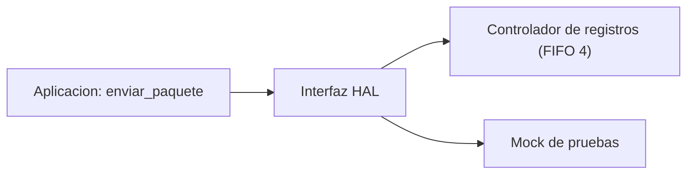

# B88-C24 — Capa de abstracción de hardware (HAL) y controladores

<!-- nav:top -->
[🏠 Programa](../../../../README.md) · [📚 Bloque B88](../../../tronco-comun/B88-avionica-y-software-critico-espacial.md) · [← Anterior: B88-C23 — Arquitectura de software de vuelo: capas y ejecutivo](../B88-C23-arquitectura-de-software-de-vuelo-capas-y-ejecutivo/CLASE.md) · [Siguiente: B88-C25 — Redundancia de procesamiento y ejecución en paralelo (lockstep) →](../B88-C25-redundancia-de-procesamiento-y-ejecucion-en-paralelo-lockstep/CLASE.md)
<!-- /nav -->

## 1. Ubicación, nivel y alcance

Clase 24 del bloque B88. Nivel N3. La **capa de abstracción de hardware (HAL)** aísla la aplicación de los registros concretos de un dispositivo. Aquí defines una interfaz de UART, dos implementaciones (un dispositivo virtual con FIFO de 4 bytes y un *mock* que registra llamadas) y compruebas que la misma aplicación funciona con ambas. Todo es **sintético**. Todos los datos son **sintéticos** salvo los que se rotulan como consultados.

## 2. Por qué esta clase existe

Si la aplicación toca registros, no se puede probar sin el hardware y cada cambio de componente la rompe. La decisión central: **¿qué interfaz mínima expone el dispositivo para que la aplicación no dependa de él?**

## 3. Lo que podrás hacer al terminar

1. Definir una interfaz de HAL.
2. Implementar un dispositivo con FIFO y estado.
3. Implementar un doble de prueba (*mock*).
4. Ejecutar la misma aplicación sobre ambos.
5. Tratar un dispositivo colgado con tiempo límite.
6. Separar lo sintético de lo consultado.

La evidencia es la **HAL con pruebas intercambiables** del ejercicio 12 (sección 20).

## 4. Con qué llegas y cómo comprobarlo

1. ¿Qué es una interfaz?
2. ¿Qué es un FIFO?
3. ¿Qué es un doble de prueba?
4. ¿Qué es un tiempo límite?
5. ¿Qué es un registro de estado?

<details>
<summary>Ver respuestas</summary>

1. El conjunto de operaciones visibles de un módulo. 2. Una cola de primero en entrar, primero en salir. 3. Un objeto que sustituye a un componente real en una prueba. 4. Un máximo de espera antes de abandonar. 5. Un registro que indica la situación del dispositivo.
</details>

Con cuatro o cinco aciertos, sigue; si no, repasa los prerrequisitos.

## 5. Un caso de contexto y casos de referencia

UART **sintética**: FIFO de 4 bytes, operaciones `tx_libre()`, `escribir(b)` y `avanzar()`. La aplicación envía 12 bytes. Con el dispositivo con FIFO: 12 enviados, 8 reintentos, 32 accesos; con el mock: 12 enviados, 0 reintentos, 24 accesos. Con un dispositivo colgado: 4 enviados, 21 reintentos y `TIMEOUT`.

## 6. Vocabulario

La **HAL** es la interfaz. Un **controlador** implementa la HAL para un dispositivo. Un **mock** registra llamadas sin hardware. El **reintento** espera a que `tx_libre()` sea verdadero. El **tiempo límite** evita esperas infinitas.

## 7. Modelo mental



*Descripción textual:* la aplicación solo conoce la interfaz; detrás puede haber el dispositivo virtual o el mock.

Analogía: la HAL es como un enchufe estándar: el aparato no sabe de qué central viene la energía. Límite: un enchufe no evita que la central falle; por eso el tiempo límite.

## 8. La explicación, paso a paso

### 8.1 La interfaz

`tx_libre()`, `escribir(b)`, `avanzar(n)`. La aplicación espera con `tx_libre()` y escribe.

### 8.2 Con FIFO

El dispositivo acepta 4 bytes y luego avanza: 12 bytes, 8 reintentos y 32 accesos.

### 8.3 Con el mock

No hay FIFO: 12 bytes, 0 reintentos, 24 accesos. La salida es idéntica a la del dispositivo con FIFO.

### 8.4 Dispositivo colgado

Nunca avanza: se envían 4 bytes y tras 21 reintentos la aplicación abandona con `TIMEOUT`.

## 9. Magnitudes, símbolos y unidades

| Símbolo | Qué es | Unidad | Valor / nota |
|---|---|---|---|
| `FIFO` | capacidad | B | 4 |
| `n` | bytes enviados | B | 12 |
| `reint` | reintentos | — | 8, 0, 21 |
| `acc` | accesos a la HAL | — | 32 y 24 |

## 10. Convenciones y referencias

Interfaz de tres operaciones; FIFO de 4 bytes; reintentos máximos 20. Tolerancia: salida idéntica en ambos controladores. Todo **sintético**.

## 11. De dónde sale lo que afirmamos

| ID | Fuente | Localizador | Respalda | Estado |
|---|---|---|---|---|
| S1 | NASA, «Software Engineering and Assurance Handbook» NASA-HDBK-2203 — https://swehb.nasa.gov/ (consultada 2026-11-10) | página de inicio | guía informativa (no de requisitos) para cumplir NPR 7150.2D y NASA-STD-8739.8B para quien adquiere, desarrolla, asegura o mantiene software de la NASA | Consultada (solo la página de inicio) |
| — | Libros de texto de sistemas de tiempo real, tolerancia a fallos y comunicaciones digitales | — | — | No consultada |
| — | Relaciones y algoritmos estándar usados por el laboratorio (patrón de interfaz con implementaciones intercambiables) | — | los verifica el laboratorio con una segunda vía o con pruebas | No consultada en una fuente concreta |

Límites: no se consultó ningún controlador real ni norma de HAL. El dispositivo virtual no modela interrupciones, errores de paridad ni DMA. Lo simulado no se presenta como dato de vuelo ni como medición.

## 12. Cómo ver los resultados

| Implementación | Enviados | Reintentos | Estado | Accesos |
|---|---|---|---|---|
| Registros (FIFO 4) | 12 | 8 | OK | 32 |
| Mock | 12 | 0 | OK | 24 |
| Colgado | 4 | 21 | TIMEOUT | — |

Descripción larga: la aplicación obtiene el mismo resultado con dos dispositivos distintos y un fallo controlado con uno colgado.

## 13. Ejemplo trabajado

**Paso 1 · Escribir.** 4 bytes llenan el FIFO.

**Paso 2 · Esperar.** `tx_libre()` falso: se llama `avanzar(1)`.

**Paso 3 · Seguir.** Cada avance libera un lugar.

**Paso 4 · Fin.** 12 bytes en 8 reintentos.

## 14. Distintas formas de describir el problema

**Por interfaz y mock:** esta clase. **Por simulador de dispositivo:** C42. **Por prueba con hardware:** C19. El laboratorio ejecuta la misma aplicación en ambos controladores.

## 15. Práctica guiada

**Ejercicio 1 · con los pasos indicados.** ¿Cuántos reintentos hay con FIFO 4 y 12 bytes?

<details><summary>Solución comentada</summary>

8 (observado).
</details>

**Ejercicio 2 · con una pista.** ¿Qué diferencia de accesos hay entre FIFO y mock?

<details><summary>Solución comentada</summary>

`32 − 24 = 8`.
</details>

**Ejercicio 3 · casi autónomo.** ¿Qué pasa si el FIFO fuera de 12?

<details><summary>Solución comentada</summary>

Ningún reintento.
</details>

## 16. Práctica autónoma, transferencia e integrador

**Ejercicio 4 · autónomo.** ¿Para qué sirve el mock en una prueba?

<details><summary>Solución comentada</summary>

Para comprobar las llamadas sin hardware y sin esperas.
</details>

**Ejercicio 5 · autónomo.** ¿Qué hace la aplicación si el dispositivo no avanza?

<details><summary>Solución comentada</summary>

Abandona con `TIMEOUT` tras 20 reintentos.
</details>

**Ejercicio 6 · autónomo.** ¿Qué dato debería registrar la HAL en ese caso?

<details><summary>Solución comentada</summary>

Un evento de error (C10).
</details>

**Ejercicio 7 · autónomo.** ¿Por qué la salida debe ser idéntica con ambos controladores?

<details><summary>Solución comentada</summary>

Muestra que la aplicación solo depende de la interfaz.
</details>

**Ejercicio 8 · autónomo.** ¿Qué operación añadirías para leer?

<details><summary>Solución comentada</summary>

`leer()` y `rx_disponible()`.
</details>

**Ejercicio 9 · transferencia.** **Transferencia.** Un colega dice que con el mock el código queda probado en hardware. ¿Es válido?

<details><summary>Solución comentada</summary>

No: el mock no reproduce temporización ni fallos reales (C19).
</details>

**Ejercicio 10 · transferencia.** **Transferencia.** ¿Qué cambia si la HAL añade interrupciones?

<details><summary>Solución comentada</summary>

La aplicación recibe devoluciones de llamada y hay que acotar la latencia (C22).
</details>

**Ejercicio 11 · transferencia.** **Transferencia.** ¿Por qué evitar registros en la aplicación?

<details><summary>Solución comentada</summary>

Porque ata el código a un chip y dificulta la prueba.
</details>

**Ejercicio 12 · integrador.** **Integrador.** Elabora tu *HAL con pruebas intercambiables*: interfaz, dos controladores, resultados, tiempo límite y lista de qué es sintético.

<details><summary>Solución comentada</summary>

Secciones 8.1–8.4 y la salida del laboratorio.
</details>

## 17. Laboratorio: HAL con dos controladores

El script [hal_uart.py](hal_uart.py) ejecuta una aplicación de envío sobre un dispositivo con FIFO, un mock y un dispositivo colgado y **comprueba** salidas idénticas y el `TIMEOUT` del colgado.

**Datos:** dispositivos **sintéticos**. **Predice antes de ejecutar:** ¿cuántos bytes envía con el dispositivo colgado? (4). **Ejecución del 2026-11-10 (Python 3.12.9):**

```text
Python 3.12.9
Datos SINTETICOS: UART virtual de 4 bytes de FIFO; sin hardware real
registros (FIFO 4)  : enviados=12 reintentos=8 estado=OK salida_ok=True accesos=32
mock                : enviados=12 reintentos=0 estado=OK salida_ok=True accesos=24
dispositivo colgado : enviados=4 reintentos=21 estado=TIMEOUT
Pruebas superadas.
```

```bash
python programa/clases/B88/B88-C24-capa-de-abstraccion-de-hardware-hal-y-controladores/hal_uart.py
```

**Límites:** sin interrupciones ni DMA.

## 18. Errores frecuentes y cómo corregirlos

**Escribir registros en la aplicación.** Usa la HAL (8.1)

**Esperar sin límite.** Define un tiempo límite (8.4)

**Presentar el dispositivo como real.** Revisa la sección 10

## 19. Cómo sabrás que vas bien

Tras 8.2: ¿cuántos reintentos esperabas? Si dudas, repasa el ejemplo 13. Tras el laboratorio: ¿qué comprueba? (ver sección 17).

## 20. Qué entregas y cómo se evalúa

El producto es tu **HAL con pruebas intercambiables** (ejercicio 12).

| Criterio | Inicial | En desarrollo | Logrado | Destacado |
|---|---|---|---|---|
| Conceptos | Los confunde | Parciales | Explica el método y su dominio | Explica los límites y las alternativas |
| Cálculo | Sin unidades | Con errores | Resultados con unidades y comprobados | Resuelve casos nuevos |
| Numérico | Sin comprobar | Un caso | Verifica con una segunda vía en varios casos | Interpreta las diferencias y los fallos |
| Fuentes | Sin fuente | Sin fecha | Fuentes con fecha y estado | Declara lo sintético y lo no consultado |
| Límites | No los nombra | Uno | Tres | Discute qué falta del modelo |

**Condiciones críticas (no se compensan con promedio):** rotular los datos como sintéticos; comprobar cada resultado con una segunda vía; citar solo lo consultado.

## 21. Ética, seguridad y límites

Clase educativa: los modelos son simplificados y los datos son sintéticos; ningún resultado describe una misión real, certifica conformidad con una norma ni sustituye la revisión de especialistas.  Accesibilidad: tablas equivalentes a las gráficas, fórmulas en texto, ejercicios sin conexión.

## 22. Para cerrar y seguir

La misma aplicación envía 12 bytes con dos controladores y falla de forma controlada con uno colgado. Queda una pregunta: ¿qué hacer cuando dos procesadores deben coincidir?

**Glosario español–inglés.** capa de abstracción de hardware · *hardware abstraction layer*; controlador · *driver*; doble de prueba · *test double*; tiempo límite · *timeout*.

**Continuidad.** [B88-C25](../B88-C25-redundancia-de-procesamiento-y-ejecucion-en-paralelo-lockstep/CLASE.md) trata la redundancia de procesamiento y el lockstep.

**Referencias:** ver sección 11.

<!-- nav:bottom -->
---

[← Anterior: B88-C23 — Arquitectura de software de vuelo: capas y ejecutivo](../B88-C23-arquitectura-de-software-de-vuelo-capas-y-ejecutivo/CLASE.md) · [📚 Bloque B88](../../../tronco-comun/B88-avionica-y-software-critico-espacial.md) · [Siguiente: B88-C25 — Redundancia de procesamiento y ejecución en paralelo (lockstep) →](../B88-C25-redundancia-de-procesamiento-y-ejecucion-en-paralelo-lockstep/CLASE.md)
<!-- /nav -->
