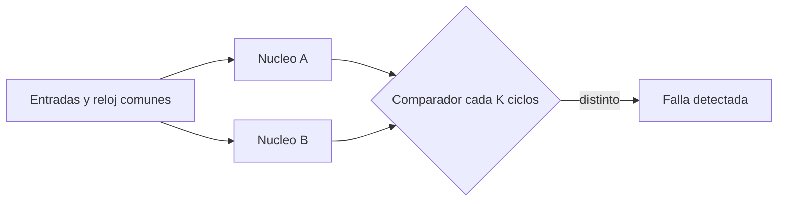

# B88-C25 — Redundancia de procesamiento y ejecución en paralelo (lockstep)

<!-- nav:top -->
[🏠 Programa](../../../../README.md) · [📚 Bloque B88](../../../tronco-comun/B88-avionica-y-software-critico-espacial.md) · [← Anterior: B88-C24 — Capa de abstracción de hardware (HAL) y controladores](../B88-C24-capa-de-abstraccion-de-hardware-hal-y-controladores/CLASE.md) · [Siguiente: B88-C26 — Latencia de interrupciones y jitter →](../B88-C26-latencia-de-interrupciones-y-jitter/CLASE.md)
<!-- /nav -->

## 1. Ubicación, nivel y alcance

Clase 25 del bloque B88. Nivel N3. En **lockstep**, dos núcleos ejecutan el mismo programa ciclo a ciclo y un comparador detecta cualquier diferencia. Aquí simulas dos núcleos de cuatro registros de 16 bits, inyectas 4000 inversiones de bit por intervalo de comparación y mides la **latencia de detección** y las fallas **enmascaradas**; también muestras la limitación frente a fallas comunes. Todo **sintético** (semilla 25). Todos los datos son **sintéticos** salvo los que se rotulan como consultados.

## 2. Por qué esta clase existe

Lockstep detecta fallos transitorios de un núcleo, pero no los corrige ni cubre causas comunes. La decisión central: **¿cada cuántos ciclos comparar, y qué fallas escapan?**

## 3. Lo que podrás hacer al terminar

1. Describir la arquitectura lockstep.
2. Inyectar fallos de un bit en un núcleo.
3. Medir detección, enmascaramiento y latencia por intervalo de comparación.
4. Mostrar que una falla común no se detecta.
5. Decidir el intervalo de comparación.
6. Separar lo sintético de lo consultado.

La evidencia es la **informe de cobertura de lockstep** del ejercicio 12 (sección 20).

## 4. Con qué llegas y cómo comprobarlo

1. ¿Qué es un comparador?
2. ¿Qué es una falla transitoria?
3. ¿Qué es la latencia de detección?
4. ¿Qué es una falla enmascarada?
5. ¿Qué es una falla de causa común?

<details>
<summary>Ver respuestas</summary>

1. Un circuito que indica si dos valores son iguales. 2. Un error momentáneo, como un SEU (C03). 3. El tiempo desde la falla hasta que se detecta. 4. Una que no llega a cambiar la salida. 5. Una que afecta a ambos núcleos a la vez.
</details>

Con cuatro o cinco aciertos, sigue; si no, repasa los prerrequisitos.

## 5. Un caso de contexto y casos de referencia

Programa **sintético** cíclico de 4 instrucciones sobre 4 registros de 16 bits. Se inyecta un bit en el núcleo B en un ciclo aleatorio de 200. Con comparación cada 1 ciclo: 4000 detectadas, latencia 0; cada 4: latencia media `1,52` y máxima 3; cada 16: media `7,22` y máxima 15. Una falla idéntica en ambos núcleos: 0 detectadas de 500.

## 6. Vocabulario

El **lockstep** ejecuta dos copias con el mismo reloj y entradas. El **intervalo de comparación** `K` es cada cuántos ciclos se compara. La **latencia** es `ciclo de detección − ciclo de falla`. La **falla común** afecta igual a ambos núcleos.

## 7. Modelo mental



*Descripción textual:* ambos núcleos reciben lo mismo; el comparador revisa sus estados cada `K` ciclos y señala la discrepancia.

Analogía: son dos contables que suman la misma columna y comparan resultados: si difieren, uno se equivocó. Límite: si ambos copian el mismo error de la hoja, coinciden y nadie lo nota.

## 8. La explicación, paso a paso

### 8.1 Detección

El comparador mira el estado completo cada `K` ciclos. Una inversión solo desaparece (enmascarada) si se sobrescribe antes de comparar; en las 12 000 inyecciones, ninguna se enmascaró.

### 8.2 Latencia

La latencia crece con `K`: `0` (K=1), `1,52` (K=4, máximo 3) y `7,22` (K=16, máximo 15). Es aproximadamente `(K−1)/2`.

### 8.3 Falla común

Si ambos núcleos sufren el mismo cambio, sus estados coinciden: `0` de 500 detectadas. Lockstep no cubre causas comunes (reloj, alimentación, error de diseño).

### 8.4 Decisión

Comparar cada ciclo da detección inmediata pero exige un comparador rápido; `K` mayor reduce el costo y aumenta la latencia, aceptable si la falla no se propaga a salidas.

## 9. Magnitudes, símbolos y unidades

| Símbolo | Qué es | Unidad | Valor / nota |
|---|---|---|---|
| `K` | intervalo de comparación | ciclos | 1, 4, 16 |
| `n` | inyecciones | — | 4000 por K |
| `L` | latencia media | ciclos | 0; 1,52; 7,22 |
| `det` | detectadas | — | 4000 |

## 10. Convenciones y referencias

Fallas de un bit en un registro del núcleo B; ciclo de falla uniforme en 200; semilla `25`. Comparación del estado completo. Todo **sintético**.

## 11. De dónde sale lo que afirmamos

| ID | Fuente | Localizador | Respalda | Estado |
|---|---|---|---|---|
| S1 | NASA, «Software Engineering and Assurance Handbook» NASA-HDBK-2203 — https://swehb.nasa.gov/ (consultada 2026-11-10) | página de inicio | guía informativa (no de requisitos) para cumplir NPR 7150.2D y NASA-STD-8739.8B para quien adquiere, desarrolla, asegura o mantiene software de la NASA | Consultada (solo la página de inicio) |
| — | Libros de texto de sistemas de tiempo real, tolerancia a fallos y comunicaciones digitales | — | — | No consultada |
| — | Relaciones y algoritmos estándar usados por el laboratorio (comparación de dos copias y latencia de detección por intervalo) | — | los verifica el laboratorio con una segunda vía o con pruebas | No consultada en una fuente concreta |

Límites: no se consultaron arquitecturas lockstep reales. El modelo compara el estado completo y no distingue entre fallas en registros y en lógica ni modela la resincronización tras la falla. Lo simulado no se presenta como dato de vuelo ni como medición.

## 12. Cómo ver los resultados

| K | Detectadas | Enmascaradas | Latencia media | Máxima |
|---|---|---|---|---|
| 1 | 4000 | 0 | 0,00 | 0 |
| 4 | 4000 | 0 | 1,52 | 3 |
| 16 | 4000 | 0 | 7,22 | 15 |

Descripción larga: la latencia sube con `K`, la detección no cambia.

## 13. Ejemplo trabajado

**Paso 1 · Falla.** Bit 5 de un registro de B en el ciclo 100.

**Paso 2 · Comparación.** Con `K = 16`, el siguiente múltiplo es el ciclo 111.

**Paso 3 · Latencia.** `111 − 100 = 11` ciclos.

**Paso 4 · Acción.** Se señala el fallo y se reinicia el par (C11, C12).

## 14. Distintas formas de describir el problema

**Por lockstep:** esta clase. **Por TMR:** tres copias con votación que corrige (C33). **Por procesador de monitoreo:** un segundo núcleo simplificado. El laboratorio mide solo el lockstep.

## 15. Práctica guiada

**Ejercicio 1 · con los pasos indicados.** Calcula la latencia esperada con `K = 4`.

<details><summary>Solución comentada</summary>

`(K−1)/2 = 1,5` ciclos (observado 1,52).
</details>

**Ejercicio 2 · con una pista.** Calcula la latencia máxima con `K = 16`.

<details><summary>Solución comentada</summary>

15 ciclos.
</details>

**Ejercicio 3 · casi autónomo.** ¿Qué detecta el lockstep?

<details><summary>Solución comentada</summary>

Diferencias entre núcleos por una falla transitoria en uno.
</details>

## 16. Práctica autónoma, transferencia e integrador

**Ejercicio 4 · autónomo.** ¿Qué no detecta?

<details><summary>Solución comentada</summary>

Fallas comunes a ambos núcleos.
</details>

**Ejercicio 5 · autónomo.** ¿Por qué ninguna falla se enmascaró?

<details><summary>Solución comentada</summary>

El programa no sobrescribe los registros antes de comparar y mantiene su estado.
</details>

**Ejercicio 6 · autónomo.** ¿Cuándo sí se enmascaría?

<details><summary>Solución comentada</summary>

Si la inyección cae en un valor que se sobrescribe antes de la comparación.
</details>

**Ejercicio 7 · autónomo.** ¿Qué sigue a la detección?

<details><summary>Solución comentada</summary>

Reinicio del par o paso a otra unidad (C32).
</details>

**Ejercicio 8 · autónomo.** ¿Por qué comparar solo salidas reduce la cobertura?

<details><summary>Solución comentada</summary>

Fallas internas que no salen no se ven hasta que se propagan.
</details>

**Ejercicio 9 · transferencia.** **Transferencia.** Un colega dice que lockstep da corrección. ¿Es válido?

<details><summary>Solución comentada</summary>

No: detecta; no sabe cuál de los dos núcleos falló.
</details>

**Ejercicio 10 · transferencia.** **Transferencia.** ¿Qué cambia si se añade un tercer núcleo?

<details><summary>Solución comentada</summary>

Con votación 2 de 3 la falla se corrige sin reiniciar (C33).
</details>

**Ejercicio 11 · transferencia.** **Transferencia.** ¿Qué falla común mitigarías con un retardo de reloj entre núcleos?

<details><summary>Solución comentada</summary>

Una perturbación de alimentación simultánea: el retardo hace que no afecte igual a ambos.
</details>

**Ejercicio 12 · integrador.** **Integrador.** Elabora tu *informe de cobertura de lockstep*: arquitectura, inyecciones, latencias, falla común y lista de qué es sintético.

<details><summary>Solución comentada</summary>

Secciones 8.1–8.4 y la salida del laboratorio.
</details>

## 17. Laboratorio: lockstep con inyección de fallos

El script [lockstep.py](lockstep.py) simula dos núcleos, inyecta 12 000 fallos de un bit con tres intervalos de comparación, mide latencias y prueba la falla común, y **comprueba** 0 fallas comunes detectadas.

**Datos:** programa y fallas **sintéticas**; semilla 25. **Predice antes de ejecutar:** ¿cuántas fallas comunes detectará? (ninguna). **Ejecución del 2026-11-10 (Python 3.12.9):**

```text
Python 3.12.9
Datos SINTETICOS: un 'programa' de 8 registros de 16 bit y fallos inyectados por el script
Comparacion cada  1 ciclos: detectados=4000 enmascarados=   0 latencia media= 0.00 ciclos max=0
Comparacion cada  4 ciclos: detectados=4000 enmascarados=   0 latencia media= 1.52 ciclos max=3
Comparacion cada 16 ciclos: detectados=4000 enmascarados=   0 latencia media= 7.22 ciclos max=15
Falla comun (identica en ambos nucleos): detectadas = 0 de 500
Pruebas superadas.
```

```bash
python programa/clases/B88/B88-C25-redundancia-de-procesamiento-y-ejecucion-en-paralelo-lockstep/lockstep.py
```

**Límites:** sin lógica interna ni resincronización; solo el estado de registros.

## 18. Errores frecuentes y cómo corregirlos

**Creer que lockstep corrige.** Solo detecta (ejercicio 9)

**Ignorar las fallas comunes.** Usa diversidad o retardos (ejercicio 11)

**Presentar el modelo como un procesador real.** Revisa la sección 10

## 19. Cómo sabrás que vas bien

Tras 8.2: ¿qué latencia esperabas con `K = 16`? Si dudas, repasa el ejemplo 13. Tras el laboratorio: ¿qué comprueba? (ver sección 17).

## 20. Qué entregas y cómo se evalúa

El producto es tu **informe de cobertura de lockstep** (ejercicio 12).

| Criterio | Inicial | En desarrollo | Logrado | Destacado |
|---|---|---|---|---|
| Conceptos | Los confunde | Parciales | Explica el método y su dominio | Explica los límites y las alternativas |
| Cálculo | Sin unidades | Con errores | Resultados con unidades y comprobados | Resuelve casos nuevos |
| Numérico | Sin comprobar | Un caso | Verifica con una segunda vía en varios casos | Interpreta las diferencias y los fallos |
| Fuentes | Sin fuente | Sin fecha | Fuentes con fecha y estado | Declara lo sintético y lo no consultado |
| Límites | No los nombra | Uno | Tres | Discute qué falta del modelo |

**Condiciones críticas (no se compensan con promedio):** rotular los datos como sintéticos; comprobar cada resultado con una segunda vía; citar solo lo consultado.

## 21. Ética, seguridad y límites

Clase educativa: los modelos son simplificados y los datos son sintéticos; ningún resultado describe una misión real, certifica conformidad con una norma ni sustituye la revisión de especialistas.  Accesibilidad: tablas equivalentes a las gráficas, fórmulas en texto, ejercicios sin conexión.

## 22. Para cerrar y seguir

Lockstep detecta el 100 % de las inyecciones de un bit en el ejemplo, con latencia media de `(K−1)/2`, pero no las fallas comunes. Queda una pregunta: ¿cuánto tarda en reaccionar una interrupción?

**Glosario español–inglés.** paso cerrado · *lockstep*; comparador · *comparator*; falla transitoria · *transient fault*; causa común · *common cause*; latencia de detección · *detection latency*.

**Continuidad.** [B88-C26](../B88-C26-latencia-de-interrupciones-y-jitter/CLASE.md) trata la latencia de interrupciones y el jitter.

**Referencias:** ver sección 11.

<!-- nav:bottom -->
---

[← Anterior: B88-C24 — Capa de abstracción de hardware (HAL) y controladores](../B88-C24-capa-de-abstraccion-de-hardware-hal-y-controladores/CLASE.md) · [📚 Bloque B88](../../../tronco-comun/B88-avionica-y-software-critico-espacial.md) · [Siguiente: B88-C26 — Latencia de interrupciones y jitter →](../B88-C26-latencia-de-interrupciones-y-jitter/CLASE.md)
<!-- /nav -->
