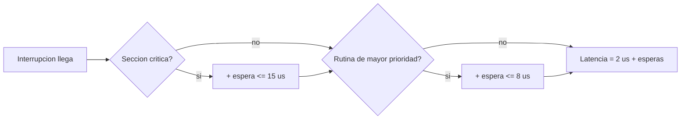

# B88-C26 — Latencia de interrupciones y jitter

<!-- nav:top -->
[🏠 Programa](../../../../README.md) · [📚 Bloque B88](../../../tronco-comun/B88-avionica-y-software-critico-espacial.md) · [← Anterior: B88-C25 — Redundancia de procesamiento y ejecución en paralelo (lockstep)](../B88-C25-redundancia-de-procesamiento-y-ejecucion-en-paralelo-lockstep/CLASE.md) · [Siguiente: B88-C27 — Exclusión mutua y semáforos →](../B88-C27-exclusion-mutua-y-semaforos/CLASE.md)
<!-- /nav -->

## 1. Ubicación, nivel y alcance

Clase 26 del bloque B88. Nivel N3. La **latencia de interrupción** es el tiempo entre la llegada y el inicio de su rutina; su **jitter** es la variación de esa latencia. Aquí modelas la latencia como una base fija más esperas por secciones críticas y por rutinas de mayor prioridad, simulas 200 000 eventos y comparas la **cota analítica de peor caso** con lo observado. Todo es **sintético** (µs, semilla 26). Todos los datos son **sintéticos** salvo los que se rotulan como consultados.

## 2. Por qué esta clase existe

Un requisito de tiempo se incumple por la cola de la distribución, no por la media. La decisión central: **¿cuál es la cota de peor caso y con qué frecuencia se supera un límite?**

## 3. Lo que podrás hacer al terminar

1. Descomponer la latencia en base, sección crítica y rutina mayor.
2. Calcular la cota analítica de peor caso.
3. Estimar media, mediana y percentiles.
4. Construir un histograma.
5. Calcular la fracción de eventos que superan un requisito.
6. Separar lo sintético de lo consultado.

La evidencia es la **histograma de latencia con cota analítica** del ejercicio 12 (sección 20).

## 4. Con qué llegas y cómo comprobarlo

1. ¿Qué es la mediana?
2. ¿Qué es un percentil?
3. ¿Qué es una sección crítica?
4. ¿Qué es el jitter?
5. ¿Qué es el peor caso?

<details>
<summary>Ver respuestas</summary>

1. El valor que deja la mitad de las muestras por debajo. 2. El valor bajo el cual cae un porcentaje de las muestras. 3. Un tramo con interrupciones enmascaradas. 4. La diferencia entre latencia máxima y mínima. 5. El mayor valor posible.
</details>

Con cuatro o cinco aciertos, sigue; si no, repasa los prerrequisitos.

## 5. Un caso de contexto y casos de referencia

Modelo **sintético**: base `2 µs`; con probabilidad 0,30 la interrupción llega durante una sección crítica de hasta `15 µs`; con 0,10, una rutina de mayor prioridad de hasta `8 µs`. En 200 000 muestras: mínima `2,000`, media `4,644`, mediana `2,000`, p99 `16,892`, p99,9 `22,175` y máxima `24,846 µs`. La cota es `25 µs`.

## 6. Vocabulario

La **latencia** `L = base + espera_crítica + espera_rutina`. La **cota de peor caso** suma los máximos: `2 + 15 + 8 = 25 µs`. El **p99** deja el 1 % por encima. El **jitter** `= L_max − L_min`.

## 7. Modelo mental



*Descripción textual:* la latencia parte de 2 µs y suma, con cierta probabilidad, la espera de una sección crítica y la de una rutina más prioritaria.

Analogía: es como llegar a una ventanilla: a veces no hay fila (2 µs), a veces hay una persona terminando un trámite y a veces una urgencia pasa antes. Límite: la fila de la vida real no es uniforme.

## 8. La explicación, paso a paso

### 8.1 Estadística

Mínima `2,000`, media `4,644`, mediana `2,000` (el 65,8 % de los eventos no espera). p99 `16,892`, p99,9 `22,175`, máxima `24,846 µs`.

### 8.2 Cota analítica

`2 + 15 + 8 = 25 µs`: ningún evento puede superarla en el modelo; el máximo observado (`24,846`) se acerca. El jitter observado es `22,846` frente a `23` teórico.

### 8.3 Histograma

`[2,3)` 65,77 %; `[3,5)` 5,43 %; `[5,8)` 8,37 %; `[8,12)` 9,64 %; `[12,17)` 10,00 %; `[17,26)` 0,79 %.

### 8.4 Requisito de 10 µs

La fracción con `L > 10 µs` es `0,1480`: a 1 kHz serían `532 746` eventos por hora: la media (4,6 µs) cumple pero la cola no.

## 9. Magnitudes, símbolos y unidades

| Símbolo | Qué es | Unidad | Valor / nota |
|---|---|---|---|
| `L` | latencia | µs | 2 a 24,8 |
| `L_cota` | peor caso analítico | µs | 25 |
| `p99` | percentil 99 | µs | 16,892 |
| `J` | jitter | µs | 22,846 |
| `f` | fracción > 10 µs | — | 0,1480 |

## 10. Convenciones y referencias

Esperas uniformes independientes; semilla `26`; 200 000 muestras; percentil por índice `⌊p(N−1)⌋` sobre las muestras ordenadas. Tolerancia: máxima observada ≤ cota. Todo **sintético**.

## 11. De dónde sale lo que afirmamos

| ID | Fuente | Localizador | Respalda | Estado |
|---|---|---|---|---|
| S1 | NASA, «Software Engineering and Assurance Handbook» NASA-HDBK-2203 — https://swehb.nasa.gov/ (consultada 2026-11-10) | página de inicio | guía informativa (no de requisitos) para cumplir NPR 7150.2D y NASA-STD-8739.8B para quien adquiere, desarrolla, asegura o mantiene software de la NASA | Consultada (solo la página de inicio) |
| — | Libros de texto de sistemas de tiempo real, tolerancia a fallos y comunicaciones digitales | — | — | No consultada |
| — | Relaciones y algoritmos estándar usados por el laboratorio (estadística descriptiva y suma de máximos como cota de peor caso) | — | los verifica el laboratorio con una segunda vía o con pruebas | No consultada en una fuente concreta |

Límites: no se midió ningún procesador ni se consultó su manual; la forma uniforme de las esperas es un supuesto. Las cotas reales requieren análisis de las secciones críticas del código (C30). Lo simulado no se presenta como dato de vuelo ni como medición.

## 12. Cómo ver los resultados

| Estadístico | µs |
|---|---|
| Mínima | 2,000 |
| Media | 4,644 |
| Mediana | 2,000 |
| p99 | 16,892 |
| p99,9 | 22,175 |
| Máxima | 24,846 |
| Cota | 25 |

Descripción larga: la media es 5 veces menor que el peor caso; la cola decide el requisito.

## 13. Ejemplo trabajado

**Paso 1 · Cota.** `2 + 15 + 8 = 25 µs`.

**Paso 2 · Cola.** El 0,79 % de los eventos supera 17 µs.

**Paso 3 · Requisito.** Con 10 µs, el 14,8 % lo supera.

**Paso 4 · Decisión.** Hay que acortar las secciones críticas o subir la prioridad.

## 14. Distintas formas de describir el problema

**Por cota analítica:** suma de máximos (esta clase). **Por medición en banco:** analizador lógico. **Por simulación:** muestras aleatorias (esta clase). El laboratorio compara las dos primeras.

## 15. Práctica guiada

**Ejercicio 1 · con los pasos indicados.** Calcula la cota si la sección crítica máxima es 10 µs.

<details><summary>Solución comentada</summary>

`2 + 10 + 8 = 20 µs`.
</details>

**Ejercicio 2 · con una pista.** ¿Por qué la mediana es 2 µs?

<details><summary>Solución comentada</summary>

El 65,8 % de los eventos no espera.
</details>

**Ejercicio 3 · casi autónomo.** Calcula el jitter teórico.

<details><summary>Solución comentada</summary>

`25 − 2 = 23 µs`.
</details>

## 16. Práctica autónoma, transferencia e integrador

**Ejercicio 4 · autónomo.** ¿Qué fracción cumple 5 µs?

<details><summary>Solución comentada</summary>

`65,77 % + 5,43 % ≈ 71,2 %` (los dos primeros intervalos).
</details>

**Ejercicio 5 · autónomo.** ¿Qué indica el p99 de 16,9 µs?

<details><summary>Solución comentada</summary>

El 1 % de los eventos tarda más.
</details>

**Ejercicio 6 · autónomo.** ¿Cuántos eventos por hora a 1 kHz superan 10 µs?

<details><summary>Solución comentada</summary>

`0,1480 × 3,6×10⁶ = 532 746`.
</details>

**Ejercicio 7 · autónomo.** ¿Cómo reducirías la cola?

<details><summary>Solución comentada</summary>

Acortando las secciones críticas y reordenando prioridades.
</details>

**Ejercicio 8 · autónomo.** ¿Por qué no basta la media?

<details><summary>Solución comentada</summary>

Los plazos se incumplen por los casos extremos.
</details>

**Ejercicio 9 · transferencia.** **Transferencia.** Un colega dice que 4,6 µs es la latencia de su equipo. ¿Es válido?

<details><summary>Solución comentada</summary>

No: es una media de un modelo sintético.
</details>

**Ejercicio 10 · transferencia.** **Transferencia.** ¿Qué cambia si las esperas no son uniformes?

<details><summary>Solución comentada</summary>

La cola cambia; la cota se mantiene si los máximos son los mismos.
</details>

**Ejercicio 11 · transferencia.** **Transferencia.** ¿Qué relación tiene esto con el watchdog (C11)?

<details><summary>Solución comentada</summary>

El jitter debe ser pequeño frente a la ventana.
</details>

**Ejercicio 12 · integrador.** **Integrador.** Elabora tu *histograma de latencia con cota analítica*: componentes, estadística, histograma, cota y lista de qué es sintético.

<details><summary>Solución comentada</summary>

Secciones 8.1–8.4 y la salida del laboratorio.
</details>

## 17. Laboratorio: latencia de interrupción y jitter

El script [latencia_jitter.py](latencia_jitter.py) simula 200 000 latencias, calcula media, percentiles, histograma y fracción sobre un requisito y **comprueba** que la máxima no supera la cota de 25 µs.

**Datos:** modelo **sintético**; semilla 26. **Predice antes de ejecutar:** ¿cuál será la mediana? (2,000 µs). **Ejecución del 2026-11-10 (Python 3.12.9):**

```text
Python 3.12.9
Datos SINTETICOS: modelo de latencia inventado (unidades: us)
Muestras = 200000 ; minima = 2.000 us ; media = 4.644 us ; mediana = 2.000 us
p99 = 16.892 us ; p99.9 = 22.175 us ; maxima observada = 24.846 us
Cota analitica de peor caso = 2.0 + 15.0 + 8.0 = 25.0 us
Jitter (max - min) observado = 22.846 us ; teorico = 23.0 us
Histograma (us):
  [ 2,  3)  131533  65.77 %
  [ 3,  5)   10869   5.43 %
  [ 5,  8)   16745   8.37 %
  [ 8, 12)   19284   9.64 %
  [12, 17)   19995  10.00 %
  [17, 26)    1574   0.79 %
Fraccion con latencia > 10 us = 0.1480 ; veces por hora a 1 kHz = 532746
Pruebas superadas.
```

```bash
python programa/clases/B88/B88-C26-latencia-de-interrupciones-y-jitter/latencia_jitter.py
```

**Límites:** esperas uniformes e independientes; sin medición real.

## 18. Errores frecuentes y cómo corregirlos

**Usar la media como requisito.** Mira la cola (8.4)

**Olvidar la espera de rutinas mayores.** Suma ese término (8.2)

**Presentar el modelo como real.** Revisa la sección 10

## 19. Cómo sabrás que vas bien

Tras 8.1: ¿qué mediana esperabas? Si dudas, repasa el ejemplo 13. Tras el laboratorio: ¿qué comprueba? (ver sección 17).

## 20. Qué entregas y cómo se evalúa

El producto es tu **histograma de latencia con cota analítica** (ejercicio 12).

| Criterio | Inicial | En desarrollo | Logrado | Destacado |
|---|---|---|---|---|
| Conceptos | Los confunde | Parciales | Explica el método y su dominio | Explica los límites y las alternativas |
| Cálculo | Sin unidades | Con errores | Resultados con unidades y comprobados | Resuelve casos nuevos |
| Numérico | Sin comprobar | Un caso | Verifica con una segunda vía en varios casos | Interpreta las diferencias y los fallos |
| Fuentes | Sin fuente | Sin fecha | Fuentes con fecha y estado | Declara lo sintético y lo no consultado |
| Límites | No los nombra | Uno | Tres | Discute qué falta del modelo |

**Condiciones críticas (no se compensan con promedio):** rotular los datos como sintéticos; comprobar cada resultado con una segunda vía; citar solo lo consultado.

## 21. Ética, seguridad y límites

Clase educativa: los modelos son simplificados y los datos son sintéticos; ningún resultado describe una misión real, certifica conformidad con una norma ni sustituye la revisión de especialistas.  Accesibilidad: tablas equivalentes a las gráficas, fórmulas en texto, ejercicios sin conexión.

## 22. Para cerrar y seguir

La latencia media de 4,6 µs oculta una cola que llega a 25 µs y un 14,8 % sobre 10 µs. Queda una pregunta: ¿cómo comparten datos las tareas sin corromperlos?

**Glosario español–inglés.** latencia de interrupción · *interrupt latency*; jitter · *jitter*; percentil · *percentile*; peor caso · *worst case*; sección crítica · *critical section*.

**Continuidad.** [B88-C27](../B88-C27-exclusion-mutua-y-semaforos/CLASE.md) trata la exclusión mutua y los semáforos.

**Referencias:** ver sección 11.

<!-- nav:bottom -->
---

[← Anterior: B88-C25 — Redundancia de procesamiento y ejecución en paralelo (lockstep)](../B88-C25-redundancia-de-procesamiento-y-ejecucion-en-paralelo-lockstep/CLASE.md) · [📚 Bloque B88](../../../tronco-comun/B88-avionica-y-software-critico-espacial.md) · [Siguiente: B88-C27 — Exclusión mutua y semáforos →](../B88-C27-exclusion-mutua-y-semaforos/CLASE.md)
<!-- /nav -->
