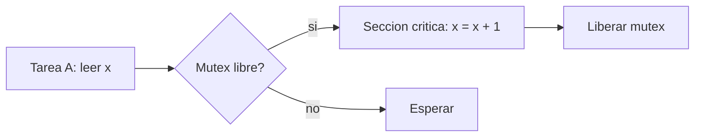

# B88-C27 — Exclusión mutua y semáforos

<!-- nav:top -->
[🏠 Programa](../../../../README.md) · [📚 Bloque B88](../../../tronco-comun/B88-avionica-y-software-critico-espacial.md) · [← Anterior: B88-C26 — Latencia de interrupciones y jitter](../B88-C26-latencia-de-interrupciones-y-jitter/CLASE.md) · [Siguiente: B88-C28 — Inversión de prioridad y deadlocks →](../B88-C28-inversion-de-prioridad-y-deadlocks/CLASE.md)
<!-- /nav -->

## 1. Ubicación, nivel y alcance

Clase 27 del bloque B88. Nivel N3. Cuando dos tareas comparten datos, una lectura–modificación–escritura puede intercalarse y perder una actualización (**condición de carrera**). Aquí simulas dos tareas que incrementan un contador con y sin **mutex**, y un productor–consumidor con **semáforos contadores**. Los planificadores son aleatorios con semilla, y todo es **sintético**. Todos los datos son **sintéticos** salvo los que se rotulan como consultados.

## 2. Por qué esta clase existe

Una carrera no falla siempre: falla de vez en cuando y no se reproduce. La decisión central: **¿qué mecanismo garantiza que el acceso a un dato compartido sea exclusivo y que un buffer no se desborde ni se vacíe?**

## 3. Lo que podrás hacer al terminar

1. Reproducir una condición de carrera.
2. Corregirla con un mutex.
3. Medir la pérdida de actualizaciones.
4. Implementar un productor–consumidor con semáforos.
5. Comprobar que el buffer nunca excede su capacidad.
6. Separar lo sintético de lo consultado.

La evidencia es la **demostración de carrera y su corrección** del ejercicio 12 (sección 20).

## 4. Con qué llegas y cómo comprobarlo

1. ¿Qué es una sección crítica?
2. ¿Qué es un mutex?
3. ¿Qué es un semáforo contador?
4. ¿Qué es una lectura–modificación–escritura?
5. ¿Qué es el intercalado?

<details>
<summary>Ver respuestas</summary>

1. Un tramo que no debe ejecutarse a la vez por dos tareas. 2. Un cerrojo de exclusión mutua. 3. Un contador de recursos disponibles. 4. Leer, calcular y escribir de vuelta. 5. El orden en que se mezclan los pasos de las tareas.
</details>

Con cuatro o cinco aciertos, sigue; si no, repasa los prerrequisitos.

## 5. Un caso de contexto y casos de referencia

Dos tareas **sintéticas** hacen 50 incrementos cada una sobre `x`. Sin mutex, las 200 corridas pierden actualizaciones (media `35,37` de 100); con mutex, cero. Un productor genera 1000 elementos para un consumidor con buffer de 4: llegan los 1000 en orden y el buffer nunca pasa de 4.

## 6. Vocabulario

La **carrera** es un resultado que depende del intercalado. El **mutex** permite un solo dueño. El **semáforo** `vacío` cuenta huecos y `lleno` cuenta elementos. El **intercalado** lo decide aquí un planificador aleatorio con semilla.

## 7. Modelo mental



*Descripción textual:* una tarea entra a la sección crítica solo si el mutex está libre; si no, espera; al terminar lo libera.

Analogía: el mutex es la llave de un baño: quien la tiene entra y los demás esperan. Límite: si quien tiene la llave se cuelga, todos esperan (C28).

## 8. La explicación, paso a paso

### 8.1 La carrera

Cada incremento lee `x`, cede y escribe `x + 1`. Si B lee entre la lectura y la escritura de A, ambas escriben el mismo valor: se pierde una actualización. Sin mutex, en 200 corridas hubo pérdida en las 200.

### 8.2 El mutex

Con mutex, nadie lee entre lectura y escritura de otro: `x = 100` siempre; pérdida 0 en 200 corridas.

### 8.3 Semáforos

`vacío = 4` (huecos), `lleno = 0`. El productor espera si `vacío = 0`; el consumidor, si `lleno = 0`. En tres semillas: 1000 elementos en orden y máximo en buffer `4`.

### 8.4 Lección

Probar con una sola semilla no demuestra ausencia de carreras: se necesita exclusión por diseño y muchas corridas para exponerlas.

## 9. Magnitudes, símbolos y unidades

| Símbolo | Qué es | Unidad | Valor / nota |
|---|---|---|---|
| `x` | contador compartido | — | 100 esperado |
| `pérdida` | actualizaciones perdidas | — | 35,37 media sin mutex |
| `cap` | capacidad del buffer | elementos | 4 |
| `n` | elementos producidos | — | 1000 |

## 10. Convenciones y referencias

Tareas cooperativas con cesión tras lectura y tras escritura; planificador uniforme con semilla `s`. 200 corridas por caso. Tolerancia: pérdida 0 con mutex; buffer ≤ 4. Todo **sintético**.

## 11. De dónde sale lo que afirmamos

| ID | Fuente | Localizador | Respalda | Estado |
|---|---|---|---|---|
| S1 | NASA, «Software Engineering and Assurance Handbook» NASA-HDBK-2203 — https://swehb.nasa.gov/ (consultada 2026-11-10) | página de inicio | guía informativa (no de requisitos) para cumplir NPR 7150.2D y NASA-STD-8739.8B para quien adquiere, desarrolla, asegura o mantiene software de la NASA | Consultada (solo la página de inicio) |
| S2 | G. J. Holzmann (NASA/JPL), «The Power of Ten — Rules for Developing Safety Critical Code» — https://spinroot.com/gerard/pdf/P10.pdf (consultada 2026-11-10 con PyMuPDF) | texto de las diez reglas | reglas: control de flujo simple sin recursión, bucles con cota fija, sin memoria dinámica tras la inicialización, funciones de unas 60 líneas, al menos dos aserciones por función, alcance mínimo de datos, comprobación de valores devueltos | Consultada (texto completo del PDF) |
| — | Libros de texto de sistemas de tiempo real, tolerancia a fallos y comunicaciones digitales | — | — | No consultada |
| — | Relaciones y algoritmos estándar usados por el laboratorio (modelo de tareas cooperativas con planificador aleatorio) | — | los verifica el laboratorio con una segunda vía o con pruebas | No consultada en una fuente concreta |

Límites: el planificador aleatorio explora pocas de las posibles intercalaciones y no es una verificación exhaustiva. No se modelan prioridades ni expulsión real (C28). Lo simulado no se presenta como dato de vuelo ni como medición.

## 12. Cómo ver los resultados

| Caso | Corridas con pérdida | Pérdida media (de 100) |
|---|---|---|
| Sin mutex | 200 | 35,37 |
| Con mutex | 0 | 0 |

Descripción larga: sin exclusión se pierde cerca de un tercio de las actualizaciones.

## 13. Ejemplo trabajado

**Paso 1 · A lee.** `x = 10`.

**Paso 2 · B lee.** `x = 10`.

**Paso 3 · A escribe.** `x = 11`.

**Paso 4 · B escribe.** `x = 11`: se perdió un incremento.

## 14. Distintas formas de describir el problema

**Por pruebas aleatorias:** esta clase. **Por verificación exhaustiva de modelos:** exploración completa de intercalados (no consultado). **Por reglas de diseño:** exclusión por construcción. El laboratorio solo usa pruebas aleatorias.

## 15. Práctica guiada

**Ejercicio 1 · con los pasos indicados.** Calcula la pérdida media como fracción.

<details><summary>Solución comentada</summary>

`35,37 %` de los 100 incrementos.
</details>

**Ejercicio 2 · con una pista.** ¿Cuántos incrementos esperabas?

<details><summary>Solución comentada</summary>

100.
</details>

**Ejercicio 3 · casi autónomo.** ¿Qué hace el mutex en el intercalado A-lee, B-lee?

<details><summary>Solución comentada</summary>

Impide que B lea mientras A tiene el mutex.
</details>

## 16. Práctica autónoma, transferencia e integrador

**Ejercicio 4 · autónomo.** ¿Qué mide el semáforo `vacío`?

<details><summary>Solución comentada</summary>

Los huecos libres del buffer.
</details>

**Ejercicio 5 · autónomo.** ¿Qué le pasa al productor si `vacío = 0`?

<details><summary>Solución comentada</summary>

Espera.
</details>

**Ejercicio 6 · autónomo.** ¿Qué le pasa al consumidor si `lleno = 0`?

<details><summary>Solución comentada</summary>

Espera.
</details>

**Ejercicio 7 · autónomo.** ¿Por qué el buffer no pasa de 4?

<details><summary>Solución comentada</summary>

El productor solo escribe si `vacío > 0`.
</details>

**Ejercicio 8 · autónomo.** ¿Por qué ejecutar 200 corridas?

<details><summary>Solución comentada</summary>

Para exponer carreras raras.
</details>

**Ejercicio 9 · transferencia.** **Transferencia.** Un colega dice que su código no tiene carreras porque pasó una vez. ¿Es válido?

<details><summary>Solución comentada</summary>

No: una carrera puede no aparecer en una corrida.
</details>

**Ejercicio 10 · transferencia.** **Transferencia.** ¿Qué cambia si la sección crítica es larga?

<details><summary>Solución comentada</summary>

Aumenta la espera y el riesgo de inversión de prioridad (C28).
</details>

**Ejercicio 11 · transferencia.** **Transferencia.** ¿Cómo evitar el mutex en un dato de 32 bits?

<details><summary>Solución comentada</summary>

Con operaciones atómicas del procesador, si existen.
</details>

**Ejercicio 12 · integrador.** **Integrador.** Elabora tu *demostración de carrera y su corrección*: carrera, mutex, semáforos, resultados y lista de qué es sintético.

<details><summary>Solución comentada</summary>

Secciones 8.1–8.4 y la salida del laboratorio.
</details>

## 17. Laboratorio: condición de carrera, mutex y semáforos

El script [exclusion_mutua.py](exclusion_mutua.py) ejecuta 200 corridas de dos tareas con y sin mutex y tres de un productor–consumidor, y **comprueba** pérdida 0 con mutex y buffer ≤ 4.

**Datos:** tareas **sintéticas**; semillas 0 a 199. **Predice antes de ejecutar:** ¿cuánto se pierde sin mutex? (más de un tercio de los incrementos). **Ejecución del 2026-11-10 (Python 3.12.9):**

```text
Python 3.12.9
Datos SINTETICOS: tareas cooperativas simuladas con generadores
sin mutex: corridas=200 con perdida=200 perdida media=35.37 de 100
con mutex: corridas=200 con perdida=0 perdida media=0.00 de 100
semilla 0: items entregados=1000 en orden=True maximo en buffer=4 (capacidad 4)
semilla 1: items entregados=1000 en orden=True maximo en buffer=4 (capacidad 4)
semilla 2: items entregados=1000 en orden=True maximo en buffer=4 (capacidad 4)
Pruebas superadas.
```

```bash
python programa/clases/B88/B88-C27-exclusion-mutua-y-semaforos/exclusion_mutua.py
```

**Límites:** planificador aleatorio; sin prioridades ni expulsión.

## 18. Errores frecuentes y cómo corregirlos

**Probar una sola vez.** Repite con muchas semillas (8.4)

**Olvidar liberar el mutex.** Libéralo siempre

**Presentar el resultado como general.** Revisa la sección 10

## 19. Cómo sabrás que vas bien

Tras 8.2: ¿qué pérdida esperabas con mutex? Si dudas, repasa el ejemplo 13. Tras el laboratorio: ¿qué comprueba? (ver sección 17).

## 20. Qué entregas y cómo se evalúa

El producto es tu **demostración de carrera y su corrección** (ejercicio 12).

| Criterio | Inicial | En desarrollo | Logrado | Destacado |
|---|---|---|---|---|
| Conceptos | Los confunde | Parciales | Explica el método y su dominio | Explica los límites y las alternativas |
| Cálculo | Sin unidades | Con errores | Resultados con unidades y comprobados | Resuelve casos nuevos |
| Numérico | Sin comprobar | Un caso | Verifica con una segunda vía en varios casos | Interpreta las diferencias y los fallos |
| Fuentes | Sin fuente | Sin fecha | Fuentes con fecha y estado | Declara lo sintético y lo no consultado |
| Límites | No los nombra | Uno | Tres | Discute qué falta del modelo |

**Condiciones críticas (no se compensan con promedio):** rotular los datos como sintéticos; comprobar cada resultado con una segunda vía; citar solo lo consultado.

## 21. Ética, seguridad y límites

Clase educativa: los modelos son simplificados y los datos son sintéticos; ningún resultado describe una misión real, certifica conformidad con una norma ni sustituye la revisión de especialistas.  Accesibilidad: tablas equivalentes a las gráficas, fórmulas en texto, ejercicios sin conexión.

## 22. Para cerrar y seguir

Sin mutex se pierde el 35 % de las actualizaciones; con mutex, ninguna, y el buffer respeta su capacidad. Queda una pregunta: ¿qué pasa si quien tiene el mutex es de baja prioridad?

**Glosario español–inglés.** condición de carrera · *race condition*; exclusión mutua · *mutual exclusion*; semáforo · *semaphore*; sección crítica · *critical section*; productor–consumidor · *producer–consumer*.

**Continuidad.** [B88-C28](../B88-C28-inversion-de-prioridad-y-deadlocks/CLASE.md) trata la inversión de prioridad y los bloqueos mutuos.

**Referencias:** ver sección 11.

<!-- nav:bottom -->
---

[← Anterior: B88-C26 — Latencia de interrupciones y jitter](../B88-C26-latencia-de-interrupciones-y-jitter/CLASE.md) · [📚 Bloque B88](../../../tronco-comun/B88-avionica-y-software-critico-espacial.md) · [Siguiente: B88-C28 — Inversión de prioridad y deadlocks →](../B88-C28-inversion-de-prioridad-y-deadlocks/CLASE.md)
<!-- /nav -->
