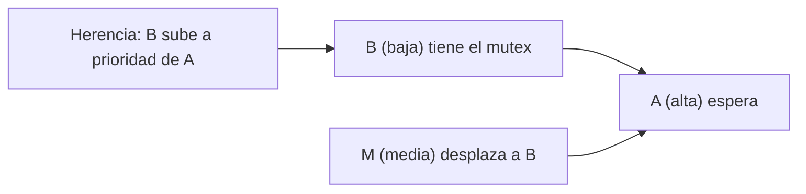

# B88-C28 — Inversión de prioridad y deadlocks

<!-- nav:top -->
[🏠 Programa](../../../../README.md) · [📚 Bloque B88](../../../tronco-comun/B88-avionica-y-software-critico-espacial.md) · [← Anterior: B88-C27 — Exclusión mutua y semáforos](../B88-C27-exclusion-mutua-y-semaforos/CLASE.md) · [Siguiente: B88-C29 — Gestión de memoria determinista en software de vuelo →](../B88-C29-gestion-de-memoria-determinista-en-software-de-vuelo/CLASE.md)
<!-- /nav -->

## 1. Ubicación, nivel y alcance

Clase 28 del bloque B88. Nivel N3. La **inversión de prioridad** ocurre cuando una tarea de alta prioridad espera un recurso que tiene una de baja, y una de prioridad media desplaza a la de baja. Aquí reconstruyes un escenario **sintético** inspirado en el relato de M. Jones sobre Mars Pathfinder (1997), aplicas **herencia de prioridad** y detectas un **bloqueo mutuo** con un grafo de espera. No es la nave real. Todos los datos son **sintéticos** salvo los que se rotulan como consultados.

## 2. Por qué esta clase existe

El caso Pathfinder mostró que un error de concurrencia puede aparecer solo en operación y provocar reinicios por watchdog. La decisión central: **¿cómo se garantiza que una tarea de alta prioridad no quede bloqueada indefinidamente por otras de menor prioridad?**

## 3. Lo que podrás hacer al terminar

1. Reconstruir una inversión de prioridad en un cronograma.
2. Aplicar herencia de prioridad y medir la mejora.
3. Detectar un bloqueo mutuo con el grafo de espera.
4. Prevenirlo con un orden total de recursos.
5. Relacionar el caso con el watchdog (C11).
6. Separar lo sintético de lo consultado.

La evidencia es la **reconstrucción de inversión y detección de bloqueo** del ejercicio 12 (sección 20).

## 4. Con qué llegas y cómo comprobarlo

1. ¿Qué es la prioridad?
2. ¿Qué es un mutex?
3. ¿Qué es un grafo de espera?
4. ¿Qué es un ciclo?
5. ¿Qué es un watchdog?

<details>
<summary>Ver respuestas</summary>

1. El orden de urgencia entre tareas. 2. Un cerrojo de exclusión mutua (C27). 3. Uno donde `T1 → T2` significa que T1 espera a T2. 4. Un camino que vuelve a su origen. 5. Un temporizador que reinicia si no recibe patadas (C11).
</details>

Con cuatro o cinco aciertos, sigue; si no, repasa los prerrequisitos.

## 5. Un caso de contexto y casos de referencia

Tres tareas **sintéticas**: B (baja) toma el mutex en t = 0 y necesita 6 ticks; A (alta) llega en 2 y necesita el mutex 2 ticks; M (media) llega en 3 y calcula 10 ticks. Sin herencia: A termina en 18 (espera 14 ticks). Con herencia: A termina en 8 (espera 4). Según Jones, en Pathfinder el mutex se había creado sin herencia y un watchdog reinició el sistema; se corrigió activándola.

## 6. Vocabulario

La **inversión de prioridad** retrasa a A por una tarea M de menor prioridad. La **herencia de prioridad** sube temporalmente la prioridad del dueño del mutex a la del que espera. El **bloqueo mutuo** (*deadlock*) es un ciclo de espera. El **orden total de recursos** evita ciclos.

## 7. Modelo mental



*Descripción textual:* A espera a B; M desplaza a B y alarga la espera de A; con herencia, B corre con la prioridad de A y M no puede desplazarla.

Analogía: es como un directivo que espera a un empleado con la llave de la sala mientras un visitante lo detiene a mitad de camino; la herencia es darle al empleado paso preferente. Límite: no sirve si el empleado ya está bloqueado esperando a otro.

## 8. La explicación, paso a paso

### 8.1 Sin herencia

`BBB MMMMMMMMMM BBB AA`: B corre 3 ticks, M llega y lo desplaza 10 ticks, B termina y recién entonces A usa el mutex. A termina en 18; espera 14 ticks.

### 8.2 Con herencia

`BBBBBB AA MMMMMMMMMM`: B hereda la prioridad de A y termina su sección crítica; A corre y termina en 8; M, la última, en 18. A espera 4 ticks: 10 ticks menos.

### 8.3 Bloqueo mutuo

T1 tiene R1 y pide R2; T2 tiene R2 y pide R1: el grafo de espera `T1 → T2 → T1` tiene ciclo.

### 8.4 Prevención

Si todos piden R1 y luego R2, T2 espera a T1 en R1, sin ciclo. Esto conecta con el caso real: el watchdog (C11) detectó la falta de progreso de A y reinició.

## 9. Magnitudes, símbolos y unidades

| Símbolo | Qué es | Unidad | Valor / nota |
|---|---|---|---|
| `fin_A` | fin de la tarea alta | ticks | 18 sin herencia / 8 con herencia |
| `espera_A` | ticks que A espera | ticks | 14 / 4 |
| `prio` | prioridad | — | A=3, M=2, B=1 |
| `ciclo` | ciclo de espera | — | T1 ↔ T2 |

## 10. Convenciones y referencias

Paso de 1 tick; prioridades fijas con expulsión; un solo mutex; herencia inmediata. Tolerancia: A termina antes con herencia. Todo **sintético**; no es la nave real.

## 11. De dónde sale lo que afirmamos

| ID | Fuente | Localizador | Respalda | Estado |
|---|---|---|---|---|
| S1 | M. Jones, «What really happened on Mars?» (mensaje del 7 dic 1997, copia en cs.cornell.edu) — https://www.cs.cornell.edu/courses/cs614/1999sp/papers/pathfinder.html (consultada 2026-11-10) | texto completo del mensaje | reinicios de Mars Pathfinder por inversión de prioridad: una tarea de baja prioridad con un mutex, otra de prioridad media que la desplaza y un watchdog que reinicia; se corrigió activando la herencia de prioridad | Consultada (relato del autor, no documento de la misión) |
| S2 | NASA, «Software Engineering and Assurance Handbook» NASA-HDBK-2203 — https://swehb.nasa.gov/ (consultada 2026-11-10) | página de inicio | guía informativa (no de requisitos) para cumplir NPR 7150.2D y NASA-STD-8739.8B para quien adquiere, desarrolla, asegura o mantiene software de la NASA | Consultada (solo la página de inicio) |
| — | Libros de texto de sistemas de tiempo real, tolerancia a fallos y comunicaciones digitales | — | — | No consultada |
| — | Relaciones y algoritmos estándar usados por el laboratorio (simulación por ticks de prioridades con expulsión y grafo de espera) | — | los verifica el laboratorio con una segunda vía o con pruebas | No consultada en una fuente concreta |

Límites: el relato de Jones es un mensaje del autor, no un informe oficial; no se consultó documentación de la misión ni de VxWorks. El escenario es una reconstrucción simplificada con números inventados. Lo simulado no se presenta como dato de vuelo ni como medición.

## 12. Cómo ver los resultados

| Caso | Fin de A | Espera de A | Fin de M | Fin de B |
|---|---|---|---|---|
| Sin herencia | 18 | 14 | 13 | 16 |
| Con herencia | 8 | 4 | 18 | 6 |

Descripción larga: la herencia adelanta A en 10 ticks y retrasa a M en 5.

## 13. Ejemplo trabajado

**Paso 1 · Estado.** B tiene el mutex; A espera.

**Paso 2 · M llega.** Sin herencia, M desplaza a B.

**Paso 3 · Herencia.** B pasa a prioridad 3: M no lo desplaza.

**Paso 4 · Resultado.** A empieza en 6 y termina en 8.

## 14. Distintas formas de describir el problema

**Por herencia de prioridad:** esta clase. **Por techo de prioridad:** el mutex tiene una prioridad máxima fija (no consultado). **Por no compartir:** diseño sin recursos compartidos. El laboratorio compara solo la herencia.

## 15. Práctica guiada

**Ejercicio 1 · con los pasos indicados.** Calcula cuánto antes termina A con herencia.

<details><summary>Solución comentada</summary>

`18 − 8 = 10` ticks.
</details>

**Ejercicio 2 · con una pista.** ¿Cuántos ticks espera A sin herencia?

<details><summary>Solución comentada</summary>

14.
</details>

**Ejercicio 3 · casi autónomo.** ¿Qué tarea desplaza a B sin herencia?

<details><summary>Solución comentada</summary>

M (prioridad media).
</details>

## 16. Práctica autónoma, transferencia e integrador

**Ejercicio 4 · autónomo.** ¿Qué prioridad hereda B?

<details><summary>Solución comentada</summary>

La de A (3).
</details>

**Ejercicio 5 · autónomo.** ¿Cuándo termina M con herencia?

<details><summary>Solución comentada</summary>

En 18.
</details>

**Ejercicio 6 · autónomo.** Dibuja el grafo de espera del bloqueo.

<details><summary>Solución comentada</summary>

`T1 → T2` y `T2 → T1`.
</details>

**Ejercicio 7 · autónomo.** ¿Cómo se evita el bloqueo con orden total?

<details><summary>Solución comentada</summary>

Todos piden R1 antes que R2: no hay ciclo.
</details>

**Ejercicio 8 · autónomo.** ¿Qué detecta el watchdog en este caso?

<details><summary>Solución comentada</summary>

La falta de progreso de la tarea alta.
</details>

**Ejercicio 9 · transferencia.** **Transferencia.** Un colega dice que la herencia elimina todo problema de bloqueo. ¿Es válido?

<details><summary>Solución comentada</summary>

No: no evita bloqueos mutuos ni secciones críticas largas.
</details>

**Ejercicio 10 · transferencia.** **Transferencia.** ¿Qué cambia si hay dos mutex anidados?

<details><summary>Solución comentada</summary>

La herencia debe propagarse en cadena y se puede crear un ciclo.
</details>

**Ejercicio 11 · transferencia.** **Transferencia.** ¿Qué aprendizaje de Jones usarías en un banco de pruebas?

<details><summary>Solución comentada</summary>

Probar con carga realista y activar los registros de eventos de planificación.
</details>

**Ejercicio 12 · integrador.** **Integrador.** Elabora tu *reconstrucción de inversión y detección de bloqueo*: cronogramas, herencia, grafo de espera y lista de qué es sintético.

<details><summary>Solución comentada</summary>

Secciones 8.1–8.4 y la salida del laboratorio.
</details>

## 17. Laboratorio: inversión de prioridad, herencia y bloqueo mutuo

El script [inversion_prioridad.py](inversion_prioridad.py) simula tres tareas con y sin herencia y analiza un grafo de espera con y sin orden de recursos, y **comprueba** que A termina antes con herencia y que el orden total elimina el ciclo.

**Datos:** tareas **sintéticas**. **Predice antes de ejecutar:** ¿cuántos ticks antes termina A con herencia? (10). **Ejecución del 2026-11-10 (Python 3.12.9):**

```text
Python 3.12.9
Datos SINTETICOS: tres tareas inventadas (unidades: ticks); no es la nave Pathfinder
Herencia no: fin A= 18 fin M= 13 fin B= 16 ; ticks que A espera el mutex = 14
   cronograma: BBBMMMMMMMMMMBBBAA--------------------------------------------------------------
Herencia si: fin A=  8 fin M= 18 fin B=  6 ; ticks que A espera el mutex = 4
   cronograma: BBBBBBAAMMMMMMMMMM--------------------------------------------------------------
A termina 10 ticks antes con herencia de prioridad
Espera T1->T2, T2->T1 : {'T1': 'T2', 'T2': 'T1'} | bloqueo mutuo = True
Con orden total R1<R2 : {'T2': 'T1'} | bloqueo mutuo = False
Pruebas superadas.
```

```bash
python programa/clases/B88/B88-C28-inversion-de-prioridad-y-deadlocks/inversion_prioridad.py
```

**Límites:** un solo mutex; prioridades fijas; sin techo de prioridad.

## 18. Errores frecuentes y cómo corregirlos

**Compartir un mutex sin herencia.** Actívala (8.2)

**Anidar bloqueos sin orden.** Define un orden total (8.4)

**Presentar el escenario como la misión.** Revisa la sección 10

## 19. Cómo sabrás que vas bien

Tras 8.1: ¿cuánto espera A sin herencia? Si dudas, repasa el ejemplo 13. Tras el laboratorio: ¿qué comprueba? (ver sección 17).

## 20. Qué entregas y cómo se evalúa

El producto es tu **reconstrucción de inversión y detección de bloqueo** (ejercicio 12).

| Criterio | Inicial | En desarrollo | Logrado | Destacado |
|---|---|---|---|---|
| Conceptos | Los confunde | Parciales | Explica el método y su dominio | Explica los límites y las alternativas |
| Cálculo | Sin unidades | Con errores | Resultados con unidades y comprobados | Resuelve casos nuevos |
| Numérico | Sin comprobar | Un caso | Verifica con una segunda vía en varios casos | Interpreta las diferencias y los fallos |
| Fuentes | Sin fuente | Sin fecha | Fuentes con fecha y estado | Declara lo sintético y lo no consultado |
| Límites | No los nombra | Uno | Tres | Discute qué falta del modelo |

**Condiciones críticas (no se compensan con promedio):** rotular los datos como sintéticos; comprobar cada resultado con una segunda vía; citar solo lo consultado.

## 21. Ética, seguridad y límites

Clase educativa: los modelos son simplificados y los datos son sintéticos; ningún resultado describe una misión real, certifica conformidad con una norma ni sustituye la revisión de especialistas.  Accesibilidad: tablas equivalentes a las gráficas, fórmulas en texto, ejercicios sin conexión.

## 22. Para cerrar y seguir

La herencia de prioridad adelanta a la tarea alta 10 ticks y un orden de recursos elimina el ciclo de espera. Queda una pregunta: ¿cómo se gestiona la memoria sin sorpresas?

**Glosario español–inglés.** inversión de prioridad · *priority inversion*; herencia de prioridad · *priority inheritance*; bloqueo mutuo · *deadlock*; grafo de espera · *wait-for graph*.

**Continuidad.** [B88-C29](../B88-C29-gestion-de-memoria-determinista-en-software-de-vuelo/CLASE.md) trata la gestión de memoria determinista.

**Referencias:** ver sección 11.

<!-- nav:bottom -->
---

[← Anterior: B88-C27 — Exclusión mutua y semáforos](../B88-C27-exclusion-mutua-y-semaforos/CLASE.md) · [📚 Bloque B88](../../../tronco-comun/B88-avionica-y-software-critico-espacial.md) · [Siguiente: B88-C29 — Gestión de memoria determinista en software de vuelo →](../B88-C29-gestion-de-memoria-determinista-en-software-de-vuelo/CLASE.md)
<!-- /nav -->
