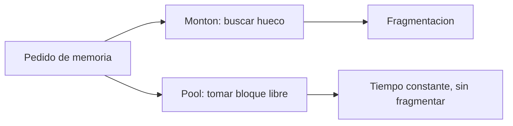

# B88-C29 — Gestión de memoria determinista en software de vuelo

<!-- nav:top -->
[🏠 Programa](../../../../README.md) · [📚 Bloque B88](../../../tronco-comun/B88-avionica-y-software-critico-espacial.md) · [← Anterior: B88-C28 — Inversión de prioridad y deadlocks](../B88-C28-inversion-de-prioridad-y-deadlocks/CLASE.md) · [Siguiente: B88-C30 — Análisis de peor caso de tiempo de ejecución (WCET) →](../B88-C30-analisis-de-peor-caso-de-tiempo-de-ejecucion-wcet/CLASE.md)
<!-- /nav -->

## 1. Ubicación, nivel y alcance

Clase 29 del bloque B88. Nivel N3. En software de vuelo, la memoria debe ser **predecible**: sin asignación dinámica tras la inicialización (regla R3 de Holzmann), sin fragmentación ni fugas. Aquí comparas un **montón de primer ajuste** con un **pool de bloques fijos** en 5000 pasos aleatorios, simulas una fuga y calculas la **pila máxima** con un grafo de llamadas. Todo **sintético** (semilla 29). Todos los datos son **sintéticos** salvo los que se rotulan como consultados.

## 2. Por qué esta clase existe

Un montón puede fallar después de horas por fragmentación aunque haya memoria libre; un pool de bloques fijos no. La decisión central: **¿qué esquema de memoria garantiza que una asignación nunca falle en vuelo?**

## 3. Lo que podrás hacer al terminar

1. Enunciar la regla de no usar memoria dinámica tras la inicialización.
2. Medir la fragmentación externa de un montón.
3. Dimensionar un pool de bloques fijos.
4. Detectar una fuga por conteo de bloques.
5. Calcular la pila máxima por el camino más caro.
6. Separar lo sintético de lo consultado.

La evidencia es la **comparativa de asignación determinista** del ejercicio 12 (sección 20).

## 4. Con qué llegas y cómo comprobarlo

1. ¿Qué es la fragmentación externa?
2. ¿Qué es un pool de bloques fijos?
3. ¿Qué es una fuga de memoria?
4. ¿Qué es la pila?
5. ¿Qué es un grafo de llamadas?

<details>
<summary>Ver respuestas</summary>

1. Memoria libre repartida en trozos pequeños inutilizables. 2. Un conjunto de bloques de igual tamaño asignables en tiempo constante. 3. Memoria asignada y nunca liberada. 4. La zona de llamadas a funciones. 5. Qué función llama a cuál.
</details>

Con cuatro o cinco aciertos, sigue; si no, repasa los prerrequisitos.

## 5. Un caso de contexto y casos de referencia

Memoria **sintética**: montón de 4096 B con primer ajuste y pool de 40 bloques de 64 B (2560 B) con a lo sumo 25 objetos vivos de 16 a 64 B. En 5000 pasos: el montón no falló pero llegó a `0,239` de fragmentación externa; el pool no falló. Una fuga que no libera 1 de 3 deja `6` bloques libres de 40. Pila desde `main`: `216 B`; con interrupción, `256 B`.

## 6. Vocabulario

La **regla R3** de Holzmann pide no usar memoria dinámica tras la inicialización. La **fragmentación externa** `1 − mayor_libre/total_libre`. El **pool** reparte bloques fijos. La **pila máxima** es el camino de llamadas con mayor suma de marcos.

## 7. Modelo mental



*Descripción textual:* un mismo pedido se atiende buscando un hueco en el montón (con riesgo de fragmentación) o tomando un bloque fijo del pool.

Analogía: el montón es un estacionamiento de autos de distinto tamaño que se va llenando de huecos sueltos; el pool es uno con plazas del mismo tamaño. Límite: el pool desperdicia espacio por usar siempre el tamaño máximo.

## 8. La explicación, paso a paso

### 8.1 Montón

Primer ajuste sobre 4096 B: 0 fallos en 5000 pasos, pero la fragmentación externa máxima fue `0,239`: casi un cuarto de la memoria libre no era contigua con el mayor hueco. Con más tiempo o tamaños distintos podría fallar.

### 8.2 Pool

40 bloques de 64 B: cualquier objeto ≤ 64 B cabe y la asignación es instantánea; 0 fallos. Costo: 2560 B reservados siempre.

### 8.3 Fuga

Si 1 de cada 3 ciclos no libera, tras 100 ciclos quedan 6 bloques libres de 40: el pool se agota en pocos ciclos más; el conteo de bloques vivos detecta la fuga.

### 8.4 Pila

`main (32) → tarea (64) → formatear (96) → crc (24) = 216 B`; una interrupción de 40 B da `256 B`. Sin recursión (R1) la cota existe.

## 9. Magnitudes, símbolos y unidades

| Símbolo | Qué es | Unidad | Valor / nota |
|---|---|---|---|
| `frag` | fragmentación externa máxima | — | 0,239 |
| `n_pool` | bloques de 64 B | — | 40 |
| `fuga` | bloques libres tras 100 ciclos | — | 6 |
| `pila` | pila máxima | B | 216 (256 con ISR) |

## 10. Convenciones y referencias

Tamaños de objeto 16, 24, 40, 56 y 64 B; a lo sumo 25 vivos; primer ajuste con fusión de huecos; semilla `29`. Tolerancia: 0 fallos en el pool. Todo **sintético**.

## 11. De dónde sale lo que afirmamos

| ID | Fuente | Localizador | Respalda | Estado |
|---|---|---|---|---|
| S1 | G. J. Holzmann (NASA/JPL), «The Power of Ten — Rules for Developing Safety Critical Code» — https://spinroot.com/gerard/pdf/P10.pdf (consultada 2026-11-10 con PyMuPDF) | texto de las diez reglas | reglas: control de flujo simple sin recursión, bucles con cota fija, sin memoria dinámica tras la inicialización, funciones de unas 60 líneas, al menos dos aserciones por función, alcance mínimo de datos, comprobación de valores devueltos | Consultada (texto completo del PDF) |
| — | Libros de texto de sistemas de tiempo real, tolerancia a fallos y comunicaciones digitales | — | — | No consultada |
| — | Relaciones y algoritmos estándar usados por el laboratorio (primer ajuste, pool de bloques fijos y camino más largo en un grafo acíclico) | — | los verifica el laboratorio con una segunda vía o con pruebas | No consultada en una fuente concreta |

Límites: se consultó el texto de la regla R3 de Holzmann, no la adopción por una agencia. El montón no modela alineación ni metadatos; los resultados dependen de la secuencia aleatoria de ejemplo. Lo simulado no se presenta como dato de vuelo ni como medición.

## 12. Cómo ver los resultados

| Esquema | Fallos | Observación |
|---|---|---|
| Montón 4096 B | 0 | fragmentación máx. 0,239 |
| Pool 40×64 B | 0 | 2560 B fijos |
| Pool con fuga | — | 6 libres tras 100 ciclos |

Descripción larga: el pool no falla mientras no haya más de 40 objetos vivos; el montón arriesga fragmentarse.

## 13. Ejemplo trabajado

**Paso 1 · Pedido.** 40 B.

**Paso 2 · Montón.** Busca el primer hueco ≥ 40 y lo parte.

**Paso 3 · Pool.** Toma un bloque de 64 B sin buscar.

**Paso 4 · Contabilidad.** El pool desperdicia 24 B por objeto.

## 14. Distintas formas de describir el problema

**Por pool estático:** esta clase. **Por montón con reglas:** reservas al inicio. **Por asignación en pila:** vida limitada a la función. El laboratorio compara las dos primeras.

## 15. Práctica guiada

**Ejercicio 1 · con los pasos indicados.** Calcula los bytes del pool.

<details><summary>Solución comentada</summary>

`40 × 64 = 2560`.
</details>

**Ejercicio 2 · con una pista.** Calcula el desperdicio de un objeto de 24 B en un bloque de 64.

<details><summary>Solución comentada</summary>

40 B (62,5 %).
</details>

**Ejercicio 3 · casi autónomo.** Calcula la pila máxima del grafo.

<details><summary>Solución comentada</summary>

`32 + 64 + 96 + 24 = 216 B`.
</details>

## 16. Práctica autónoma, transferencia e integrador

**Ejercicio 4 · autónomo.** ¿Cuál es el camino de máxima pila?

<details><summary>Solución comentada</summary>

`main → tarea → formatear → crc`.
</details>

**Ejercicio 5 · autónomo.** ¿Por qué no hay cota de pila con recursión?

<details><summary>Solución comentada</summary>

La profundidad depende de los datos.
</details>

**Ejercicio 6 · autónomo.** ¿Qué indica una fragmentación de 0,239?

<details><summary>Solución comentada</summary>

El mayor hueco es el 76,1 % de la memoria libre.
</details>

**Ejercicio 7 · autónomo.** ¿Cómo detectarías una fuga en vuelo?

<details><summary>Solución comentada</summary>

Contando bloques vivos y alertando si crece sin tope.
</details>

**Ejercicio 8 · autónomo.** ¿Qué regla de Holzmann evita fugas del montón?

<details><summary>Solución comentada</summary>

R3: sin memoria dinámica tras la inicialización.
</details>

**Ejercicio 9 · transferencia.** **Transferencia.** Un colega dice que el montón no falló en 5000 pasos, luego es seguro. ¿Es válido?

<details><summary>Solución comentada</summary>

No: la fragmentación puede producir un fallo después.
</details>

**Ejercicio 10 · transferencia.** **Transferencia.** ¿Qué cambia si un objeto necesita 100 B?

<details><summary>Solución comentada</summary>

No cabe en el pool de 64: se añade otro pool de mayor tamaño.
</details>

**Ejercicio 11 · transferencia.** **Transferencia.** ¿Qué incluirías en un presupuesto de memoria estático?

<details><summary>Solución comentada</summary>

Pools, pilas por tarea, tablas y colas con su tamaño máximo.
</details>

**Ejercicio 12 · integrador.** **Integrador.** Elabora tu *comparativa de asignación determinista*: montón, pool, fuga, pila y lista de qué es sintético.

<details><summary>Solución comentada</summary>

Secciones 8.1–8.4 y la salida del laboratorio.
</details>

## 17. Laboratorio: montón, pool, fuga y pila máxima

El script [memoria_determinista.py](memoria_determinista.py) simula 5000 pasos de asignación en un montón y un pool, una fuga y el camino de pila más profundo, y **comprueba** 0 fallos del pool y 216 B de pila.

**Datos:** secuencia aleatoria **sintética**; semilla 29. **Predice antes de ejecutar:** ¿cuántos fallos tendrá el pool? (ninguno). **Ejecución del 2026-11-10 (Python 3.12.9):**

```text
Python 3.12.9
Datos SINTETICOS: secuencias aleatorias de asignaciones con semilla 29
Pasos = 5000 ; max objetos vivos = 25
Montón (primer ajuste, 4096 B): asignaciones fallidas = 0 ; fragmentacion externa maxima = 0.239
Pool (40 bloques de 64 B): asignaciones fallidas = 0
Pool con fuga: tras 100 ciclos quedan 6 bloques libres ; fallos = 0
Pila maxima desde main = 216 B (camino main->tarea->formatear->crc) ; + isr = 256 B
Pruebas superadas.
```

```bash
python programa/clases/B88/B88-C29-gestion-de-memoria-determinista-en-software-de-vuelo/memoria_determinista.py
```

**Límites:** sin alineación ni metadatos; un solo patrón de tamaños.

## 18. Errores frecuentes y cómo corregirlos

**Usar malloc en vuelo.** Evita la memoria dinámica tras inicializar (R3)

**Olvidar la pila de las interrupciones.** Súmala (8.4)

**Presentar el montón como general.** Revisa la sección 10

## 19. Cómo sabrás que vas bien

Tras 8.2: ¿cuántos fallos esperabas del pool? Si dudas, repasa el ejemplo 13. Tras el laboratorio: ¿qué comprueba? (ver sección 17).

## 20. Qué entregas y cómo se evalúa

El producto es tu **comparativa de asignación determinista** (ejercicio 12).

| Criterio | Inicial | En desarrollo | Logrado | Destacado |
|---|---|---|---|---|
| Conceptos | Los confunde | Parciales | Explica el método y su dominio | Explica los límites y las alternativas |
| Cálculo | Sin unidades | Con errores | Resultados con unidades y comprobados | Resuelve casos nuevos |
| Numérico | Sin comprobar | Un caso | Verifica con una segunda vía en varios casos | Interpreta las diferencias y los fallos |
| Fuentes | Sin fuente | Sin fecha | Fuentes con fecha y estado | Declara lo sintético y lo no consultado |
| Límites | No los nombra | Uno | Tres | Discute qué falta del modelo |

**Condiciones críticas (no se compensan con promedio):** rotular los datos como sintéticos; comprobar cada resultado con una segunda vía; citar solo lo consultado.

## 21. Ética, seguridad y límites

Clase educativa: los modelos son simplificados y los datos son sintéticos; ningún resultado describe una misión real, certifica conformidad con una norma ni sustituye la revisión de especialistas.  Accesibilidad: tablas equivalentes a las gráficas, fórmulas en texto, ejercicios sin conexión.

## 22. Para cerrar y seguir

El pool de bloques fijos no falla y la pila máxima cuesta 216 B; el montón llegó a 24 % de fragmentación. Queda una pregunta: ¿cuánto puede tardar como máximo una función?

**Glosario español–inglés.** fragmentación · *fragmentation*; pool de memoria · *memory pool*; fuga de memoria · *memory leak*; pila · *stack*; grafo de llamadas · *call graph*.

**Continuidad.** [B88-C30](../B88-C30-analisis-de-peor-caso-de-tiempo-de-ejecucion-wcet/CLASE.md) trata el análisis de peor caso del tiempo de ejecución (WCET).

**Referencias:** ver sección 11.

<!-- nav:bottom -->
---

[← Anterior: B88-C28 — Inversión de prioridad y deadlocks](../B88-C28-inversion-de-prioridad-y-deadlocks/CLASE.md) · [📚 Bloque B88](../../../tronco-comun/B88-avionica-y-software-critico-espacial.md) · [Siguiente: B88-C30 — Análisis de peor caso de tiempo de ejecución (WCET) →](../B88-C30-analisis-de-peor-caso-de-tiempo-de-ejecucion-wcet/CLASE.md)
<!-- /nav -->
