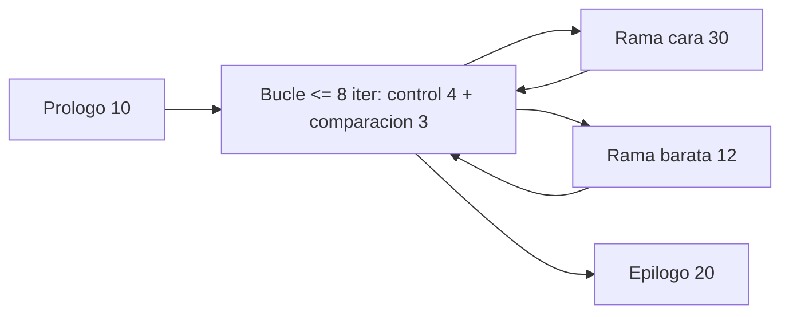

# B88-C30 — Análisis de peor caso de tiempo de ejecución (WCET)

<!-- nav:top -->
[🏠 Programa](../../../../README.md) · [📚 Bloque B88](../../../tronco-comun/B88-avionica-y-software-critico-espacial.md) · [← Anterior: B88-C29 — Gestión de memoria determinista en software de vuelo](../B88-C29-gestion-de-memoria-determinista-en-software-de-vuelo/CLASE.md) · [Siguiente: B88-C31 — Topologías de red de datos a bordo →](../B88-C31-topologias-de-red-de-datos-a-bordo/CLASE.md)
<!-- /nav -->

## 1. Ubicación, nivel y alcance

Clase 30 del bloque B88. Nivel N3. El **WCET** (*worst-case execution time*) es la cota superior del tiempo de ejecución de una función. Aquí lo calculas como el **camino más largo** de un grafo de flujo de control con cotas de bucle y lo contrastas con 100 000 mediciones simuladas. Los costes en ciclos son **sintéticos**. Todos los datos son **sintéticos** salvo los que se rotulan como consultados.

## 2. Por qué esta clase existe

El análisis de planificación (C05) necesita `C` de cada tarea, y medir no basta porque el peor camino puede no ejercitarse. La decisión central: **¿cuál es una cota segura del tiempo de ejecución y cuánto pesimismo trae?**

## 3. Lo que podrás hacer al terminar

1. Calcular el WCET como camino más largo con cotas de bucle.
2. Calcular el mejor caso.
3. Comparar la cota con mediciones.
4. Estimar el efecto de fallos de caché.
5. Convertir ciclos a microsegundos y utilización.
6. Separar lo sintético de lo consultado.

La evidencia es la **cota WCET frente a medición** del ejercicio 12 (sección 20).

## 4. Con qué llegas y cómo comprobarlo

1. ¿Qué es un grafo de flujo de control?
2. ¿Qué es una cota de bucle?
3. ¿Qué es un ciclo de reloj?
4. ¿Qué es un camino más largo?
5. ¿Qué es la utilización?

<details>
<summary>Ver respuestas</summary>

1. Los bloques de código y sus saltos. 2. El máximo de iteraciones. 3. La unidad de tiempo del procesador. 4. El de mayor suma de costes. 5. WCET dividido entre el período.
</details>

Con cuatro o cinco aciertos, sigue; si no, repasa los prerrequisitos.

## 5. Un caso de contexto y casos de referencia

Función **sintética**: prólogo 10 ciclos; bucle de hasta 8 iteraciones con control 4, comparación 3 y rama cara 30 o barata 12; epílogo 20. Cota: `10 + 8×(4+3+30) + 20 = 326` ciclos; mejor caso `30`. Entre 100 000 entradas aleatorias el máximo medido fue 326 (se ejerció el peor camino), la media 130,2.

## 6. Vocabulario

El **WCET** es la cota superior. El **BCET** es la inferior. El **camino más largo** maximiza ciclos con cotas de bucle. El **pesimismo** es `cota − máximo medido`. Un **fallo de caché** puede multiplicar el tiempo.

## 7. Modelo mental



*Descripción textual:* el prólogo da paso a un bucle acotado donde cada iteración elige una rama; luego el epílogo. El WCET toma siempre la rama cara.

Analogía: el WCET es como el tiempo del viaje más lento posible con todos los semáforos en rojo: puede no ocurrir nunca, pero el horario se arma con él. Límite: si el modelo omite un retraso (caché), el horario falla.

## 8. La explicación, paso a paso

### 8.1 La cota

`WCET = 10 + 8 × (4 + 3 + 30) + 20 = 326 ciclos`. Se toma la rama cara en cada una de las 8 iteraciones.

### 8.2 El mejor caso

Con 0 iteraciones: `10 + 20 = 30` ciclos.

### 8.3 Medición

100 000 entradas aleatorias: mínimo 30, media `130,2`, máximo `326`. El máximo coincide con la cota porque el azar generó las ocho ramas caras; con datos reales esto es improbable y por eso medir no basta. Pesimismo: `0`.

### 8.4 Caché y utilización

Con factor de fallos de caché 1,5: `489` ciclos (`4,89 µs` a 100 MHz); con 2,0: `652`. A 100 MHz, `3,26 µs` es `0,33 %` de un período de 1 ms.

## 9. Magnitudes, símbolos y unidades

| Símbolo | Qué es | Unidad | Valor / nota |
|---|---|---|---|
| `N` | iteraciones máximas | — | 8 |
| `WCET` | cota | ciclos | 326 |
| `BCET` | mejor caso | ciclos | 30 |
| `f` | frecuencia | MHz | 50, 100 |
| `U` | utilización en 1 ms | % | 0,33 a 0,65 |

## 10. Convenciones y referencias

Costes por bloque fijos; sin interferencia de caché ni de interrupciones en la cota base; entradas con condición `x mod 3 = 0` para la rama cara. Semilla `30`. Tolerancia: máximo medido ≤ WCET. Todo **sintético**.

## 11. De dónde sale lo que afirmamos

| ID | Fuente | Localizador | Respalda | Estado |
|---|---|---|---|---|
| S1 | NASA, «Software Engineering and Assurance Handbook» NASA-HDBK-2203 — https://swehb.nasa.gov/ (consultada 2026-11-10) | página de inicio | guía informativa (no de requisitos) para cumplir NPR 7150.2D y NASA-STD-8739.8B para quien adquiere, desarrolla, asegura o mantiene software de la NASA | Consultada (solo la página de inicio) |
| — | Libros de texto de sistemas de tiempo real, tolerancia a fallos y comunicaciones digitales | — | — | No consultada |
| — | Relaciones y algoritmos estándar usados por el laboratorio (camino más largo con cotas de bucle y conversión ciclos–tiempo) | — | los verifica el laboratorio con una segunda vía o con pruebas | No consultada en una fuente concreta |

Límites: no se consultó ninguna herramienta ni metodología WCET publicada. Los costes son inventados; el modelo no incluye caché, canalización ni interferencia de otras tareas, que en realidad dominan la cota. Lo simulado no se presenta como dato de vuelo ni como medición.

## 12. Cómo ver los resultados

| Magnitud | Ciclos |
|---|---|
| BCET | 30 |
| Media medida | 130,2 |
| Máximo medido | 326 |
| WCET estático | 326 |

Descripción larga: el máximo medido llegó a la cota solo porque el azar ejerció el peor camino.

## 13. Ejemplo trabajado

**Paso 1 · Iteración cara.** `4 + 3 + 30 = 37`.

**Paso 2 · Ocho iteraciones.** `8 × 37 = 296`.

**Paso 3 · Con extremos.** `296 + 10 + 20 = 326`.

**Paso 4 · Tiempo.** A 100 MHz: `3,26 µs`.

## 14. Distintas formas de describir el problema

**Por camino más largo:** esta clase. **Por medición:** máximo observado (peligrosa). **Por análisis híbrido:** medir bloques y componer. El laboratorio compara la primera y la segunda.

## 15. Práctica guiada

**Ejercicio 1 · con los pasos indicados.** Calcula el coste de una iteración barata.

<details><summary>Solución comentada</summary>

`4 + 3 + 12 = 19`.
</details>

**Ejercicio 2 · con una pista.** Calcula el WCET con 6 iteraciones máximas.

<details><summary>Solución comentada</summary>

`10 + 6×37 + 20 = 252`.
</details>

**Ejercicio 3 · casi autónomo.** Calcula el WCET en µs a 50 MHz.

<details><summary>Solución comentada</summary>

`326/50 = 6,52 µs`.
</details>

## 16. Práctica autónoma, transferencia e integrador

**Ejercicio 4 · autónomo.** Calcula la utilización en un período de 10 ms a 100 MHz.

<details><summary>Solución comentada</summary>

`3,26 µs/10 ms = 0,0326 %`.
</details>

**Ejercicio 5 · autónomo.** ¿Qué mide el pesimismo?

<details><summary>Solución comentada</summary>

Lo que la cota excede al máximo medido.
</details>

**Ejercicio 6 · autónomo.** ¿Por qué una cota segura no puede venir solo de mediciones?

<details><summary>Solución comentada</summary>

El peor camino puede no ejercitarse.
</details>

**Ejercicio 7 · autónomo.** ¿Qué efecto tiene un factor de caché de 2?

<details><summary>Solución comentada</summary>

El WCET se duplica: 652 ciclos.
</details>

**Ejercicio 8 · autónomo.** ¿Para qué se usa el WCET?

<details><summary>Solución comentada</summary>

Como `C` en el análisis de planificación (C05).
</details>

**Ejercicio 9 · transferencia.** **Transferencia.** Un colega dice que su función tarda 130 ciclos. ¿Es válido?

<details><summary>Solución comentada</summary>

No: es la media sintética; la cota es 326.
</details>

**Ejercicio 10 · transferencia.** **Transferencia.** ¿Qué cambia si el bucle no tiene cota?

<details><summary>Solución comentada</summary>

No hay WCET: la regla R2 lo exige (C15).
</details>

**Ejercicio 11 · transferencia.** **Transferencia.** ¿Cómo reducirías el WCET?

<details><summary>Solución comentada</summary>

Acotando el bucle, quitando la rama cara o precalculando.
</details>

**Ejercicio 12 · integrador.** **Integrador.** Elabora tu *cota WCET frente a medición*: grafo, cota, mejor caso, medición, efecto de caché y lista de qué es sintético.

<details><summary>Solución comentada</summary>

Secciones 8.1–8.4 y la salida del laboratorio.
</details>

## 17. Laboratorio: WCET por camino más largo frente a medición

El script [wcet.py](wcet.py) calcula el WCET y el BCET estáticos, mide 100 000 entradas aleatorias, estima el efecto de la caché y convierte a µs y utilización, y **comprueba** que el máximo medido no supera la cota.

**Datos:** costes y entradas **sintéticos**; semilla 30. **Predice antes de ejecutar:** ¿cuál será la cota estática? (326 ciclos). **Ejecución del 2026-11-10 (Python 3.12.9):**

```text
Python 3.12.9
Datos SINTETICOS: un grafo de flujo de control inventado; costes en ciclos
Cota estatica = 10 + 8x(4+3+30) + 20 = 326 ciclos
Mejor caso estatico (0 iteraciones) = 30 ciclos
Medicion con 100000 entradas aleatorias: min=30 media=130.2 max=326
Pesimismo de la cota sobre el maximo medido = 0 ciclos (0.0 %)
Entrada de peor caso (todas las ramas caras, 8 iteraciones) = 326 ciclos
  Factor de fallos de cache 1.0 -> WCET = 326 ciclos = 3.26 us a 100 MHz
  Factor de fallos de cache 1.5 -> WCET = 489 ciclos = 4.89 us a 100 MHz
  Factor de fallos de cache 2.0 -> WCET = 652 ciclos = 6.52 us a 100 MHz
  A 50 MHz: WCET = 6.52 us ; utilizacion en 1 ms = 0.65 %
  A 100 MHz: WCET = 3.26 us ; utilizacion en 1 ms = 0.33 %
Pruebas superadas.
```

```bash
python programa/clases/B88/B88-C30-analisis-de-peor-caso-de-tiempo-de-ejecucion-wcet/wcet.py
```

**Límites:** sin caché ni interferencias; costes inventados.

## 18. Errores frecuentes y cómo corregirlos

**Medir y llamar WCET al máximo.** Una cota se calcula (8.1)

**Olvidar la caché.** Añade un factor (8.4)

**Usar bucles sin cota.** Acota cada bucle (R2)

## 19. Cómo sabrás que vas bien

Tras 8.1: ¿qué cota esperabas? Si dudas, repasa el ejemplo 13. Tras el laboratorio: ¿qué comprueba? (ver sección 17).

## 20. Qué entregas y cómo se evalúa

El producto es tu **cota WCET frente a medición** (ejercicio 12).

| Criterio | Inicial | En desarrollo | Logrado | Destacado |
|---|---|---|---|---|
| Conceptos | Los confunde | Parciales | Explica el método y su dominio | Explica los límites y las alternativas |
| Cálculo | Sin unidades | Con errores | Resultados con unidades y comprobados | Resuelve casos nuevos |
| Numérico | Sin comprobar | Un caso | Verifica con una segunda vía en varios casos | Interpreta las diferencias y los fallos |
| Fuentes | Sin fuente | Sin fecha | Fuentes con fecha y estado | Declara lo sintético y lo no consultado |
| Límites | No los nombra | Uno | Tres | Discute qué falta del modelo |

**Condiciones críticas (no se compensan con promedio):** rotular los datos como sintéticos; comprobar cada resultado con una segunda vía; citar solo lo consultado.

## 21. Ética, seguridad y límites

Clase educativa: los modelos son simplificados y los datos son sintéticos; ningún resultado describe una misión real, certifica conformidad con una norma ni sustituye la revisión de especialistas.  Accesibilidad: tablas equivalentes a las gráficas, fórmulas en texto, ejercicios sin conexión.

## 22. Para cerrar y seguir

La cota de 326 ciclos se sostiene por cálculo y no por azar; la caché podría duplicarla. Queda una pregunta: ¿cómo se conectan los equipos de la nave entre sí?

**Glosario español–inglés.** tiempo de ejecución de peor caso · *worst-case execution time*; camino más largo · *longest path*; cota de bucle · *loop bound*; pesimismo · *pessimism*.

**Continuidad.** [B88-C31](../B88-C31-topologias-de-red-de-datos-a-bordo/CLASE.md) trata las topologías de red de datos a bordo.

**Referencias:** ver sección 11.

<!-- nav:bottom -->
---

[← Anterior: B88-C29 — Gestión de memoria determinista en software de vuelo](../B88-C29-gestion-de-memoria-determinista-en-software-de-vuelo/CLASE.md) · [📚 Bloque B88](../../../tronco-comun/B88-avionica-y-software-critico-espacial.md) · [Siguiente: B88-C31 — Topologías de red de datos a bordo →](../B88-C31-topologias-de-red-de-datos-a-bordo/CLASE.md)
<!-- /nav -->
