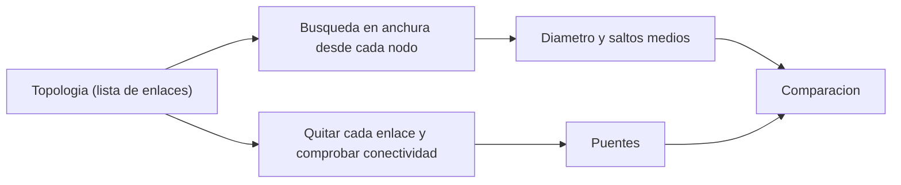

# B88-C31 — Topologías de red de datos a bordo

<!-- nav:top -->
[🏠 Programa](../../../../README.md) · [📚 Bloque B88](../../../tronco-comun/B88-avionica-y-software-critico-espacial.md) · [← Anterior: B88-C30 — Análisis de peor caso de tiempo de ejecución (WCET)](../B88-C30-analisis-de-peor-caso-de-tiempo-de-ejecucion-wcet/CLASE.md) · [Siguiente: B88-C32 — Redundancia fría y caliente: estrategias y conmutación →](../B88-C32-redundancia-fria-y-caliente-estrategias-y-conmutacion/CLASE.md)
<!-- /nav -->

## 1. Ubicación, nivel y alcance

Clase 31 del bloque B88. Nivel N3. La **topología** de la red de datos de a bordo define quién se conecta con quién y qué ocurre si falla un enlace. Aquí comparas cinco topologías de 7 nodos (estrella, anillo, árbol binario, doble estrella y malla completa) por número de enlaces, **diámetro**, saltos medios y **puentes** (enlaces cuya falla desconecta la red). La red es **sintética**; de ECSS-E-ST-50-12C solo se consultó la página. Todos los datos son **sintéticos** salvo los que se rotulan como consultados.

## 2. Por qué esta clase existe

Una red con un enlace crítico único pierde un subsistema entero con una sola falla. La decisión central: **¿qué topología da la tolerancia y la latencia necesarias con el menor número de enlaces?**

## 3. Lo que podrás hacer al terminar

1. Calcular enlaces, diámetro y saltos medios con búsqueda en anchura.
2. Detectar los puentes de una red.
3. Relacionar redundancia de enlaces con tolerancia a fallos.
4. Calcular el costo de enlaces de cada topología.
5. Elegir una topología según requisitos.
6. Separar lo sintético de lo consultado.

La evidencia es la **tabla de topologías con puentes y diámetros** del ejercicio 12 (sección 20).

## 4. Con qué llegas y cómo comprobarlo

1. ¿Qué es un grafo no dirigido?
2. ¿Qué es el diámetro?
3. ¿Qué es una búsqueda en anchura?
4. ¿Qué es un puente?
5. ¿Qué es un salto?

<details>
<summary>Ver respuestas</summary>

1. Nodos y aristas sin sentido. 2. La mayor distancia, en saltos, entre dos nodos. 3. Un recorrido por niveles desde un nodo. 4. Una arista cuya eliminación desconecta el grafo. 5. Un enlace recorrido.
</details>

Con cuatro o cinco aciertos, sigue; si no, repasa los prerrequisitos.

## 5. Un caso de contexto y casos de referencia

Siete nodos **sintéticos**, con el 0 como computador de vuelo. Estrella: 6 enlaces, diámetro 2, saltos medios `1,714`, 6 puentes. Anillo: 7 enlaces, diámetro 3, saltos medios `2,000`, 0 puentes. Árbol binario: 6 enlaces, diámetro 4, 6 puentes. Doble estrella: 11 enlaces, diámetro 2, 0 puentes. Malla completa: 21 enlaces, diámetro 1.

## 6. Vocabulario

La **topología** es el patrón de conexiones. El **diámetro** es la mayor distancia mínima entre pares. Los **saltos medios** son la media de distancias. Un **puente** es un enlace sin alternativa. La **malla completa** tiene `n(n−1)/2` enlaces; el **anillo**, `n`; la **estrella**, `n − 1`.

## 7. Modelo mental



*Descripción textual:* de la lista de enlaces salen las distancias (por búsqueda en anchura) y los puentes (quitando cada enlace); ambos alimentan la comparación.

Analogía: una estrella es una plaza con un solo cruce central; un anillo, una rotonda con dos sentidos; una malla, una red de calles con atajos para todo. Límite: más calles cuestan más y exigen más puertos por nodo.

## 8. La explicación, paso a paso

### 8.1 Métricas

| Topología | Enlaces | Diámetro | Saltos medios | Puentes |
|---|---|---|---|---|
| Estrella | 6 | 2 | 1,714 | 6 |
| Anillo | 7 | 3 | 2,000 | 0 |
| Árbol binario | 6 | 4 | 2,286 | 6 |
| Doble estrella | 11 | 2 | 1,476 | 0 |
| Malla completa | 21 | 1 | 1,000 | 0 |

### 8.2 Tolerancia

En la estrella y el árbol **todo enlace es puente**: una falla aísla un nodo. El anillo, la doble estrella y la malla soportan la falla de un enlace sin desconectar.

### 8.3 Costo

La malla cuesta `7·6/2 = 21` enlaces; la doble estrella, 11; el anillo, 7. El anillo logra 0 puentes con el menor costo, a cambio de diámetro 3.

### 8.4 Elección

Un anillo es el mínimo con tolerancia a un enlace; la doble estrella reduce el diámetro a 2 con dos concentradores.

## 9. Magnitudes, símbolos y unidades

| Símbolo | Qué es | Unidad | Valor / nota |
|---|---|---|---|
| `n` | nodos | — | 7 |
| `E` | enlaces | — | 6 a 21 |
| `D` | diámetro | saltos | 1 a 4 |
| `h̄` | saltos medios | saltos | 1,000 a 2,286 |
| `puentes` | enlaces críticos | — | 0 o 6 |

## 10. Convenciones y referencias

Grafo simple no dirigido, 7 nodos numerados 0–6; enlaces sin falla ni retardo; distancia en saltos. Tolerancia: resultados exactos por enumeración. Todo **sintético**.

## 11. De dónde sale lo que afirmamos

| ID | Fuente | Localizador | Respalda | Estado |
|---|---|---|---|---|
| S1 | ECSS, «ECSS-E-ST-50-12C Rev.1 — SpaceWire: links, nodes, routers and networks», 15 may 2019 — https://ecss.nl/standard/ecss-e-st-50-12c-rev-1-spacewire-links-nodes-routers-and-networks-15-may-2019/ (consultada 2026-11-10) | página de la norma (sin velocidades ni detalles de enlace) | SpaceWire nace de las necesidades de manejo de datos a bordo y busca compatibilidad y reutilización de equipos y su integración y prueba | Consultada (solo la página) |
| S2 | NASA, «Software Engineering and Assurance Handbook» NASA-HDBK-2203 — https://swehb.nasa.gov/ (consultada 2026-11-10) | página de inicio | guía informativa (no de requisitos) para cumplir NPR 7150.2D y NASA-STD-8739.8B para quien adquiere, desarrolla, asegura o mantiene software de la NASA | Consultada (solo la página de inicio) |
| — | Libros de texto de sistemas de tiempo real, tolerancia a fallos y comunicaciones digitales | — | — | No consultada |
| — | Relaciones y algoritmos estándar usados por el laboratorio (búsqueda en anchura, diámetro y detección de puentes por eliminación) | — | los verifica el laboratorio con una segunda vía o con pruebas | No consultada en una fuente concreta |

Límites: la página de ECSS-E-ST-50-12C solo describe el propósito de SpaceWire; no se consultaron encaminamiento ni tolerancia a fallos de la norma. No se modela la falla de nodos ni el retardo por salto. Lo simulado no se presenta como dato de vuelo ni como medición.

## 12. Cómo ver los resultados

| Topología | Costo (enlaces) | Tolera 1 falla de enlace |
|---|---|---|
| Estrella | 6 | No |
| Árbol | 6 | No |
| Anillo | 7 | Sí |
| Doble estrella | 11 | Sí |
| Malla | 21 | Sí |

Descripción larga: a partir de 7 enlaces se obtiene tolerancia a un enlace; más enlaces reducen el diámetro.

## 13. Ejemplo trabajado

**Paso 1 · Anillo.** 7 enlaces `(0,1)…(6,0)`.

**Paso 2 · Quitar `(0,1)`.** Aún se llega a todos por el otro lado.

**Paso 3 · Diámetro.** El más lejano de un nodo está a 3 saltos.

**Paso 4 · Lectura.** Tolera un enlace caído con latencia de hasta 3 saltos.

## 14. Distintas formas de describir el problema

**Por métricas de grafo:** esta clase. **Por simulación de tráfico y retardos:** exige un modelo de red. **Por especificación del estándar de red:** no consultada. El laboratorio calcula las dos primeras métricas.

## 15. Práctica guiada

**Ejercicio 1 · con los pasos indicados.** Calcula los enlaces de una malla de 7 nodos.

<details><summary>Solución comentada</summary>

`7·6/2 = 21`.
</details>

**Ejercicio 2 · con una pista.** Calcula los enlaces de un anillo de 7 nodos.

<details><summary>Solución comentada</summary>

7.
</details>

**Ejercicio 3 · casi autónomo.** ¿Cuál es el diámetro del anillo de 7 nodos?

<details><summary>Solución comentada</summary>

`⌊7/2⌋ = 3`.
</details>

## 16. Práctica autónoma, transferencia e integrador

**Ejercicio 4 · autónomo.** ¿Cuántos puentes tiene un árbol de 7 nodos?

<details><summary>Solución comentada</summary>

6: todos sus enlaces.
</details>

**Ejercicio 5 · autónomo.** ¿Qué pasa en la estrella si falla el concentrador?

<details><summary>Solución comentada</summary>

La red queda partida en nodos aislados.
</details>

**Ejercicio 6 · autónomo.** ¿Por qué la doble estrella no tiene puentes?

<details><summary>Solución comentada</summary>

Cada nodo llega a los dos concentradores.
</details>

**Ejercicio 7 · autónomo.** ¿Qué topología escogerías para minimizar la latencia desde el computador?

<details><summary>Solución comentada</summary>

Estrella, doble estrella o malla: 1 salto desde el nodo 0.
</details>

**Ejercicio 8 · autónomo.** ¿Qué costo extra tiene la malla?

<details><summary>Solución comentada</summary>

Más puertos por nodo (6) y más masa y consumo.
</details>

**Ejercicio 9 · transferencia.** **Transferencia.** Un colega dice que el anillo basta para toda falla. ¿Es válido?

<details><summary>Solución comentada</summary>

No: tolera un enlace; dos enlaces caídos o un nodo roto pueden partir el anillo.
</details>

**Ejercicio 10 · transferencia.** **Transferencia.** ¿Qué cambia si se considera la falla de nodos?

<details><summary>Solución comentada</summary>

Se buscan puntos de articulación, no solo puentes.
</details>

**Ejercicio 11 · transferencia.** **Transferencia.** ¿Cómo afecta el diámetro a la latencia?

<details><summary>Solución comentada</summary>

Cada salto suma un retardo: diámetro 4 implica hasta 4 retardos de enlace.
</details>

**Ejercicio 12 · integrador.** **Integrador.** Elabora tu *tabla de topologías con puentes y diámetros*: métricas, tolerancia, costo y lista de qué es sintético.

<details><summary>Solución comentada</summary>

Secciones 8.1–8.4 y la salida del laboratorio.
</details>

## 17. Laboratorio: topologías, diámetros y puentes

El script [topologias.py](topologias.py) calcula enlaces, diámetro, saltos medios y puentes de cinco topologías de 7 nodos y **comprueba** que el anillo no tiene puentes, la estrella tiene 6 y la malla 21 enlaces.

**Datos:** redes **sintéticas** de 7 nodos. **Predice antes de ejecutar:** ¿cuántos puentes tiene el árbol binario? (6). **Ejecución del 2026-11-10 (Python 3.12.9):**

```text
Python 3.12.9
Datos SINTETICOS: redes de 7 nodos inventadas; nodo 0 = computador de vuelo
topologia                enlaces diametro saltos_medios puentes  saltos_desde_0
estrella (hub=0)               6        2         1.714       6  1.000
anillo                         7        3         2.000       0  2.000
arbol binario                  6        4         2.286       6  1.667
doble estrella (0 y 1)        11        2         1.476       0  1.000
malla completa                21        1         1.000       0  1.000
Puentes (enlaces cuya falla desconecta) por topologia:
  estrella (hub=0)        : [(0, 1), (0, 2), (0, 3), (0, 4), (0, 5), (0, 6)]
  anillo                  : ninguno
  arbol binario           : [(0, 1), (0, 2), (1, 3), (1, 4), (2, 5), (2, 6)]
  doble estrella (0 y 1)  : ninguno
  malla completa          : ninguno
Enlaces: malla = n(n-1)/2 = 21 ; anillo = n = 7 ; estrella = n-1 = 6
Pruebas superadas.
```

```bash
python programa/clases/B88/B88-C31-topologias-de-red-de-datos-a-bordo/topologias.py
```

**Límites:** solo falla de enlaces; sin retardos ni tráfico.

## 18. Errores frecuentes y cómo corregirlos

**Elegir estrella por simple.** Es un punto único de falla (8.2)

**Confundir enlaces con nodos tolerados.** Revisa puentes y nodos

**Presentar la red como la de una nave.** Revisa la sección 10

## 19. Cómo sabrás que vas bien

Tras 8.1: ¿qué topología esperabas sin puentes y con menos enlaces? Si dudas, repasa el ejemplo 13. Tras el laboratorio: ¿qué comprueba? (ver sección 17).

## 20. Qué entregas y cómo se evalúa

El producto es tu **tabla de topologías con puentes y diámetros** (ejercicio 12).

| Criterio | Inicial | En desarrollo | Logrado | Destacado |
|---|---|---|---|---|
| Conceptos | Los confunde | Parciales | Explica el método y su dominio | Explica los límites y las alternativas |
| Cálculo | Sin unidades | Con errores | Resultados con unidades y comprobados | Resuelve casos nuevos |
| Numérico | Sin comprobar | Un caso | Verifica con una segunda vía en varios casos | Interpreta las diferencias y los fallos |
| Fuentes | Sin fuente | Sin fecha | Fuentes con fecha y estado | Declara lo sintético y lo no consultado |
| Límites | No los nombra | Uno | Tres | Discute qué falta del modelo |

**Condiciones críticas (no se compensan con promedio):** rotular los datos como sintéticos; comprobar cada resultado con una segunda vía; citar solo lo consultado.

## 21. Ética, seguridad y límites

Clase educativa: los modelos son simplificados y los datos son sintéticos; ningún resultado describe una misión real, certifica conformidad con una norma ni sustituye la revisión de especialistas.  Accesibilidad: tablas equivalentes a las gráficas, fórmulas en texto, ejercicios sin conexión.

## 22. Para cerrar y seguir

El anillo es la topología mínima sin puentes (7 enlaces), la doble estrella baja el diámetro a 2 con 11. Queda una pregunta: ¿cómo se conmutan las unidades redundantes?

**Glosario español–inglés.** topología · *topology*; diámetro · *diameter*; puente · *bridge*; enlace · *link*; malla · *mesh*.

**Continuidad.** [B88-C32](../B88-C32-redundancia-fria-y-caliente-estrategias-y-conmutacion/CLASE.md) trata la redundancia fría y caliente.

**Referencias:** ver sección 11.

<!-- nav:bottom -->
---

[← Anterior: B88-C30 — Análisis de peor caso de tiempo de ejecución (WCET)](../B88-C30-analisis-de-peor-caso-de-tiempo-de-ejecucion-wcet/CLASE.md) · [📚 Bloque B88](../../../tronco-comun/B88-avionica-y-software-critico-espacial.md) · [Siguiente: B88-C32 — Redundancia fría y caliente: estrategias y conmutación →](../B88-C32-redundancia-fria-y-caliente-estrategias-y-conmutacion/CLASE.md)
<!-- /nav -->
