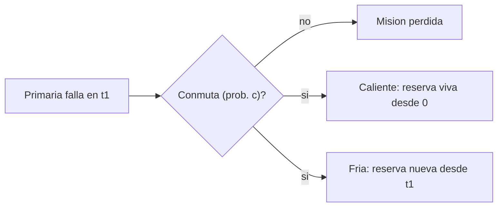

# B88-C32 — Redundancia fría y caliente: estrategias y conmutación

<!-- nav:top -->
[🏠 Programa](../../../../README.md) · [📚 Bloque B88](../../../tronco-comun/B88-avionica-y-software-critico-espacial.md) · [← Anterior: B88-C31 — Topologías de red de datos a bordo](../B88-C31-topologias-de-red-de-datos-a-bordo/CLASE.md) · [Siguiente: B88-C33 — Votación y redundancia modular triple (TMR) →](../B88-C33-votacion-y-redundancia-modular-triple-tmr/CLASE.md)
<!-- /nav -->

## 1. Ubicación, nivel y alcance

Clase 32 del bloque B88. Nivel N3. En **redundancia caliente** la reserva está encendida y envejece desde el inicio; en **fría** está apagada y solo se enciende al fallar la primaria. Aquí calculas la fiabilidad de ambas con **cobertura de conmutación** `c` y la verificas con Monte Carlo (200 000 corridas, semilla 32). Con `λ = 2×10⁻⁵ /h` y `T = 20 000 h`, todo **sintético**. Todos los datos son **sintéticos** salvo los que se rotulan como consultados.

## 2. Por qué esta clase existe

La reserva fría gana por no envejecer, pero depende de que la conmutación funcione. La decisión central: **¿qué cobertura de conmutación hace que la fría supere a la caliente y cuándo conviene cada una?**

## 3. Lo que podrás hacer al terminar

1. Deducir `R` de la caliente y de la fría con cobertura.
2. Verificar ambas con Monte Carlo.
3. Calcular la cobertura mínima de la fría.
4. Comparar ambas a igual cobertura.
5. Relacionar con la clase C01.
6. Separar lo sintético de lo consultado.

La evidencia es la **comparativa de fiabilidad con Monte Carlo** del ejercicio 12 (sección 20).

## 4. Con qué llegas y cómo comprobarlo

1. ¿Qué es `e^(−λT)`?
2. ¿Qué es la cobertura de conmutación?
3. ¿Qué es Monte Carlo?
4. ¿Qué es redundancia fría?
5. ¿Qué es un intervalo de confianza?

<details>
<summary>Ver respuestas</summary>

1. La fiabilidad de una unidad con tasa constante. 2. La probabilidad de que la conmutación funcione. 3. Estimar una probabilidad por simulación aleatoria. 4. Una reserva apagada hasta que se necesita. 5. Un rango plausible para una estimación.
</details>

Con cuatro o cinco aciertos, sigue; si no, repasa los prerrequisitos.

## 5. Un caso de contexto y casos de referencia

Con `λT = 0,4`: `r = 0,670320`. Con conmutación perfecta, la caliente da `0,891311` y la fría `0,938448`. Con `c = 0,90`: caliente `0,869212`, fría `0,911635`. La fría necesita `c ≥ 0,8242` para igualar a la caliente perfecta. Monte Carlo coincide con la teoría a menos de `0,004`.

## 6. Vocabulario

La **caliente** `R_h = r + (1 − r)·r·c`. La **fría** `R_f = r + c·λT·r`, con reserva apagada sin desgaste. La **cobertura** `c` incluye detección de la falla y conmutación. El **cruce** es la `c` donde ambas valen lo mismo.

## 7. Modelo mental



*Descripción textual:* si la primaria falla antes de T, la conmutación ocurre con probabilidad `c`; en la caliente la reserva ya acumuló desgaste, en la fría parte de cero.

Analogía: la reserva caliente es un motor de repuesto girando en vacío; la fría, uno guardado en la caja. El segundo no se desgasta pero hay que arrancarlo. Límite: arrancar puede fallar, y esa falla es la cobertura.

## 8. La explicación, paso a paso

### 8.1 Fórmulas

`R_h = r + (1 − r)·r·c` y `R_f = r + c·λT·r`. Con `λT = 0,4`: `r = 0,670320`; `λT·r = 0,268128`.

### 8.2 Resultados

| `c` | Caliente | Fría |
|---|---|---|
| 1,00 | 0,891311 | 0,938448 |
| 0,99 | 0,889101 | 0,935767 |
| 0,95 | 0,880262 | 0,925042 |
| 0,90 | 0,869212 | 0,911635 |
| 0,80 | 0,847113 | 0,884822 |

Monte Carlo concuerda con la teoría en todos los casos.

### 8.3 Cobertura mínima

La fría iguala a la caliente perfecta si `c ≥ (R_h(1) − r)/(λT·r) = 0,8242`.

### 8.4 Cuándo conviene cada una

La fría gana a igual cobertura en este caso (`+0,047` con `c = 1`); la caliente conviene cuando la conmutación es poco fiable o rápida es esencial (sin reinicio).

## 9. Magnitudes, símbolos y unidades

| Símbolo | Qué es | Unidad | Valor / nota |
|---|---|---|---|
| `λ` | tasa de fallo | 1/h | 2×10⁻⁵ |
| `T` | tiempo de misión | h | 20 000 |
| `r` | fiabilidad simple | — | 0,670320 |
| `c` | cobertura | — | 0,8 a 1 |
| `R` | fiabilidad | — | 0,85 a 0,94 |

## 10. Convenciones y referencias

Tasa constante, fallos independientes; reserva fría sin fallos en espera; conmutación instantánea con probabilidad `c`. Semilla `32`. Tolerancia: |teoría − MC| < 0,004. Todo **sintético**.

## 11. De dónde sale lo que afirmamos

| ID | Fuente | Localizador | Respalda | Estado |
|---|---|---|---|---|
| S1 | NASA, «Software Engineering and Assurance Handbook» NASA-HDBK-2203 — https://swehb.nasa.gov/ (consultada 2026-11-10) | página de inicio | guía informativa (no de requisitos) para cumplir NPR 7150.2D y NASA-STD-8739.8B para quien adquiere, desarrolla, asegura o mantiene software de la NASA | Consultada (solo la página de inicio) |
| — | Libros de texto de sistemas de tiempo real, tolerancia a fallos y comunicaciones digitales | — | — | No consultada |
| — | Relaciones y algoritmos estándar usados por el laboratorio (fiabilidad exponencial con reserva caliente/fría y simulación Monte Carlo) | — | los verifica el laboratorio con una segunda vía o con pruebas | No consultada en una fuente concreta |

Límites: no se consultaron tasas de fallo publicadas ni normas de fiabilidad. No se modelan fallos en espera de la fría, tiempo de conmutación ni reparación. Lo simulado no se presenta como dato de vuelo ni como medición.

## 12. Cómo ver los resultados

| Magnitud | Valor |
|---|---|
| Fiabilidad simple | 0,670320 |
| Caliente (c = 1) | 0,891311 |
| Fría (c = 1) | 0,938448 |
| Cobertura de cruce | 0,8242 |

Descripción larga: ambas redundancias elevan la fiabilidad; la fría es mejor mientras su cobertura supere 0,8242.

## 13. Ejemplo trabajado

**Paso 1 · `r`.** `e^(−0,4) = 0,670320`.

**Paso 2 · Fría, `c = 0,9`.** `0,670320 × (1 + 0,9 × 0,4) = 0,911635`.

**Paso 3 · Caliente, `c = 0,9`.** `0,670320 + 0,32968 × 0,670320 × 0,9 = 0,869212`.

**Paso 4 · Lectura.** La fría supera a la caliente con 0,9.

## 14. Distintas formas de describir el problema

**Por fórmula:** esta clase. **Por Monte Carlo:** esta clase. **Por cadenas de Markov:** estados y transiciones (no consultado). El laboratorio exige coincidencia de las dos primeras.

## 15. Práctica guiada

**Ejercicio 1 · con los pasos indicados.** Calcula `r`.

<details><summary>Solución comentada</summary>

`e^(−0,4) = 0,6703`.
</details>

**Ejercicio 2 · con una pista.** Calcula `R_f` con `c = 1`.

<details><summary>Solución comentada</summary>

`0,6703 × 1,4 = 0,9384`.
</details>

**Ejercicio 3 · casi autónomo.** Calcula `R_h` con `c = 1`.

<details><summary>Solución comentada</summary>

`0,6703 + 0,3297 × 0,6703 = 0,8913`.
</details>

## 16. Práctica autónoma, transferencia e integrador

**Ejercicio 4 · autónomo.** Calcula la diferencia fría − caliente con `c = 1`.

<details><summary>Solución comentada</summary>

`+0,0471`.
</details>

**Ejercicio 5 · autónomo.** ¿Qué `c` iguala a la fría con la caliente perfecta?

<details><summary>Solución comentada</summary>

`0,8242`.
</details>

**Ejercicio 6 · autónomo.** ¿Por qué la fría no envejece?

<details><summary>Solución comentada</summary>

La reserva está apagada y no acumula fallos.
</details>

**Ejercicio 7 · autónomo.** ¿Por qué la caliente tiene la reserva con probabilidad `r`?

<details><summary>Solución comentada</summary>

Porque ha estado operando desde `t = 0`.
</details>

**Ejercicio 8 · autónomo.** ¿Qué incluye la cobertura `c`?

<details><summary>Solución comentada</summary>

Detección del fallo, decisión y conmutación.
</details>

**Ejercicio 9 · transferencia.** **Transferencia.** Un colega dice que la fría siempre es mejor. ¿Es válido?

<details><summary>Solución comentada</summary>

No: con `c < 0,8242` la caliente (perfecta) la supera, y la fría tarda en arrancar.
</details>

**Ejercicio 10 · transferencia.** **Transferencia.** ¿Qué cambia si la reserva fría tiene una tasa de fallo latente?

<details><summary>Solución comentada</summary>

Se suma desgaste en espera: `R_f` baja.
</details>

**Ejercicio 11 · transferencia.** **Transferencia.** ¿Qué requisito de tiempo favorece a la caliente?

<details><summary>Solución comentada</summary>

Si no se puede tolerar el arranque, la caliente ya está operando.
</details>

**Ejercicio 12 · integrador.** **Integrador.** Elabora tu *comparativa de fiabilidad con Monte Carlo*: fórmulas, tabla por `c`, cobertura de cruce y lista de qué es sintético.

<details><summary>Solución comentada</summary>

Secciones 8.1–8.4 y la salida del laboratorio.
</details>

## 17. Laboratorio: redundancia fría y caliente con Monte Carlo

El script [redundancia_fria_caliente.py](redundancia_fria_caliente.py) calcula `R` caliente y fría con cinco coberturas, las simula con 200 000 corridas y calcula la cobertura de cruce, y **comprueba** que la diferencia teoría–simulación es menor que 0,004.

**Datos:** `λ`, `T` y `c` **sintéticos**; semilla 32. **Predice antes de ejecutar:** ¿qué cobertura iguala a la fría con la caliente perfecta? (0,8242). **Ejecución del 2026-11-10 (Python 3.12.9):**

```text
Python 3.12.9
Datos SINTETICOS: lambda y T inventados; fallos exponenciales independientes
lambda*T = 0.400 ; r = 0.670320
R simple = 0.670320
    c | caliente teor        MC | fria teor        MC
 1.00 |      0.891311  0.890950 |  0.938448  0.938000
 0.99 |      0.889101  0.887670 |  0.935767  0.936080
 0.95 |      0.880262  0.880325 |  0.925042  0.924935
 0.90 |      0.869212  0.868065 |  0.911635  0.912375
 0.80 |      0.847113  0.845775 |  0.884822  0.886120
A igual cobertura, fria - caliente = +0.047137 (x*r - (1-r)*r)
Cobertura de la fria para igualar a la caliente perfecta: c = 0.8242
Pruebas superadas.
```

```bash
python programa/clases/B88/B88-C32-redundancia-fria-y-caliente-estrategias-y-conmutacion/redundancia_fria_caliente.py
```

**Límites:** sin fallos en espera ni tiempo de conmutación.

## 18. Errores frecuentes y cómo corregirlos

**Suponer cobertura 1.** Calcula con `c < 1` (8.2)

**Olvidar que la caliente envejece.** Incluye el factor `r` de la reserva

**Presentar el resultado como general.** Revisa la sección 10

## 19. Cómo sabrás que vas bien

Tras 8.2: ¿cuál de las dos esperabas mejor con `c = 0,9`? Si dudas, repasa el ejemplo 13. Tras el laboratorio: ¿qué comprueba? (ver sección 17).

## 20. Qué entregas y cómo se evalúa

El producto es tu **comparativa de fiabilidad con Monte Carlo** (ejercicio 12).

| Criterio | Inicial | En desarrollo | Logrado | Destacado |
|---|---|---|---|---|
| Conceptos | Los confunde | Parciales | Explica el método y su dominio | Explica los límites y las alternativas |
| Cálculo | Sin unidades | Con errores | Resultados con unidades y comprobados | Resuelve casos nuevos |
| Numérico | Sin comprobar | Un caso | Verifica con una segunda vía en varios casos | Interpreta las diferencias y los fallos |
| Fuentes | Sin fuente | Sin fecha | Fuentes con fecha y estado | Declara lo sintético y lo no consultado |
| Límites | No los nombra | Uno | Tres | Discute qué falta del modelo |

**Condiciones críticas (no se compensan con promedio):** rotular los datos como sintéticos; comprobar cada resultado con una segunda vía; citar solo lo consultado.

## 21. Ética, seguridad y límites

Clase educativa: los modelos son simplificados y los datos son sintéticos; ningún resultado describe una misión real, certifica conformidad con una norma ni sustituye la revisión de especialistas.  Accesibilidad: tablas equivalentes a las gráficas, fórmulas en texto, ejercicios sin conexión.

## 22. Para cerrar y seguir

Con `λT = 0,4`, la reserva fría da 0,938 frente a 0,891 de la caliente si la conmutación es perfecta, y gana mientras `c > 0,824`. Queda una pregunta: ¿cómo se decide entre tres canales?

**Glosario español–inglés.** redundancia fría · *cold redundancy*; redundancia caliente · *hot redundancy*; cobertura · *coverage*; conmutación · *switchover*; Monte Carlo · *Monte Carlo*.

**Continuidad.** [B88-C33](../B88-C33-votacion-y-redundancia-modular-triple-tmr/CLASE.md) trata la votación y la redundancia modular triple.

**Referencias:** ver sección 11.

<!-- nav:bottom -->
---

[← Anterior: B88-C31 — Topologías de red de datos a bordo](../B88-C31-topologias-de-red-de-datos-a-bordo/CLASE.md) · [📚 Bloque B88](../../../tronco-comun/B88-avionica-y-software-critico-espacial.md) · [Siguiente: B88-C33 — Votación y redundancia modular triple (TMR) →](../B88-C33-votacion-y-redundancia-modular-triple-tmr/CLASE.md)
<!-- /nav -->
