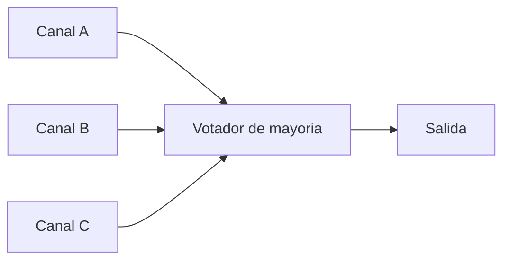

# B88-C33 — Votación y redundancia modular triple (TMR)

<!-- nav:top -->
[🏠 Programa](../../../../README.md) · [📚 Bloque B88](../../../tronco-comun/B88-avionica-y-software-critico-espacial.md) · [← Anterior: B88-C32 — Redundancia fría y caliente: estrategias y conmutación](../B88-C32-redundancia-fria-y-caliente-estrategias-y-conmutacion/CLASE.md) · [Siguiente: B88-C34 — Pruebas de inyección de fallos →](../B88-C34-pruebas-de-inyeccion-de-fallos/CLASE.md)
<!-- /nav -->

## 1. Ubicación, nivel y alcance

Clase 33 del bloque B88. Nivel N3. En la **redundancia modular triple (TMR)** tres canales hacen lo mismo y un **votador** de mayoría elige el resultado. Aquí calculas `R = 3r² − 2r³`, el efecto de un votador imperfecto, votas bit a bit y generalizas a 5 canales. Los valores son **sintéticos** (semilla 33). Todos los datos son **sintéticos** salvo los que se rotulan como consultados.

## 2. Por qué esta clase existe

TMR enmascara el fallo de un canal sin interrupción, pero solo si los canales son suficientemente fiables y el votador no es el punto débil. La decisión central: **¿para qué fiabilidad de módulo TMR mejora y cuánto aporta?**

## 3. Lo que podrás hacer al terminar

1. Deducir y calcular `R_TMR = 3r² − 2r³`.
2. Encontrar la fiabilidad de cruce `r = 0,5`.
3. Incluir la fiabilidad del votador.
4. Votar bit a bit y reconocer qué errores corrige.
5. Generalizar a `n` canales por mayoría.
6. Separar lo sintético de lo consultado.

La evidencia es la **curva de fiabilidad TMR** del ejercicio 12 (sección 20).

## 4. Con qué llegas y cómo comprobarlo

1. ¿Qué es la mayoría simple?
2. ¿Qué es la combinatoria `C(n,k)`?
3. ¿Qué es un votador?
4. ¿Qué es un enmascaramiento de fallo?
5. ¿Qué es un fallo de causa común?

<details>
<summary>Ver respuestas</summary>

1. El valor que repiten al menos 2 de 3. 2. El número de formas de elegir `k` de `n`. 3. Un circuito o rutina que elige el valor de mayoría. 4. Que el fallo no llegue a la salida. 5. Uno que afecta a varios canales a la vez.
</details>

Con cuatro o cinco aciertos, sigue; si no, repasa los prerrequisitos.

## 5. Un caso de contexto y casos de referencia

Con módulos de fiabilidad `r` e independientes: `r = 0,9 → R_TMR = 0,972` (+0,072); `r = 0,99 → 0,999702`; `r = 0,5 → 0,5`; `r = 0,4 → 0,352` (peor que un solo módulo). Con votador de `0,9999`: `0,971903`. Votación bit a bit: un canal con un bit erróneo se corrige; dos canales con el mismo bit erróneo, no.

## 6. Vocabulario

`R_TMR = 3r² − 2r³` (al menos 2 de 3 funcionan). El **votador** `v = (a∧b)∨(a∧c)∨(b∧c)` bit a bit. Con votador imperfecto `R = R_TMR·R_v`. La **mayoría de `k` de `n`** con `k = ⌊n/2⌋ + 1`. El **cruce** ocurre en `r = 0,5`.

## 7. Modelo mental



*Descripción textual:* los tres canales alimentan al votador, que entrega el valor de la mayoría.

Analogía: TMR es como pedir la hora a tres relojes y creer a los dos que coinciden. Límite: si dos relojes están igualmente mal, la mayoría se equivoca.

## 8. La explicación, paso a paso

### 8.1 Fórmula

Funciona si fallan 0 o 1 canal: `r³ + 3r²(1 − r) = 3r² − 2r³`.

### 8.2 Tabla

| `r` | `R_TMR` | Mejora | Con votador 0,9999 |
|---|---|---|---|
| 0,50 | 0,500000 | 0 | 0,499950 |
| 0,70 | 0,784000 | +0,084 | 0,783922 |
| 0,90 | 0,972000 | +0,072 | 0,971903 |
| 0,99 | 0,999702 | +0,0097 | 0,999602 |
| 0,999 | 0,999997 | +0,001 | 0,999897 |

TMR mejora si `r > 0,5`; con `r = 0,4` empeora en `0,048`.

### 8.3 Votación bit a bit

Un canal con un bit invertido se corrige; dos canales con bits **distintos** invertidos también (cada bit tiene mayoría); dos con el **mismo** bit invertido no se corrigen.

### 8.4 Más canales

Con `r = 0,9`: 3 canales `0,972`; 5 canales (mayoría de 3) `0,991440`. Monte Carlo (200 000, `r = 0,9`): `0,97153`.

## 9. Magnitudes, símbolos y unidades

| Símbolo | Qué es | Unidad | Valor / nota |
|---|---|---|---|
| `r` | fiabilidad del módulo | — | 0,4 a 0,999 |
| `R_TMR` | fiabilidad con votación | — | 0,972 (r=0,9) |
| `R_v` | fiabilidad del votador | — | 0,9999 |
| `n, k` | canales y mayoría | — | 3, 2 / 5, 3 |

## 10. Convenciones y referencias

Canales independientes; el votador falla con probabilidad `1 − R_v`; semilla `33`; 200 000 corridas; tolerancia 0,003. Todo **sintético**.

## 11. De dónde sale lo que afirmamos

| ID | Fuente | Localizador | Respalda | Estado |
|---|---|---|---|---|
| S1 | NASA, «Software Engineering and Assurance Handbook» NASA-HDBK-2203 — https://swehb.nasa.gov/ (consultada 2026-11-10) | página de inicio | guía informativa (no de requisitos) para cumplir NPR 7150.2D y NASA-STD-8739.8B para quien adquiere, desarrolla, asegura o mantiene software de la NASA | Consultada (solo la página de inicio) |
| — | Libros de texto de sistemas de tiempo real, tolerancia a fallos y comunicaciones digitales | — | — | No consultada |
| — | Relaciones y algoritmos estándar usados por el laboratorio (distribución binomial de mayoría y votación bit a bit) | — | los verifica el laboratorio con una segunda vía o con pruebas | No consultada en una fuente concreta |

Límites: no se consultó literatura de tolerancia a fallos; el modelo ignora fallas de causa común y la sincronización de canales. El votador se trata como un bloque serie. Lo simulado no se presenta como dato de vuelo ni como medición.

## 12. Cómo ver los resultados

| Canales | Mayoría | `R` con `r = 0,9` |
|---|---|---|
| 1 | 1 | 0,900000 |
| 3 | 2 | 0,972000 |
| 5 | 3 | 0,991440 |

Descripción larga: cada par de canales añadido aumenta la fiabilidad con rendimientos decrecientes.

## 13. Ejemplo trabajado

**Paso 1 · Fórmula.** `3(0,9)² − 2(0,9)³`.

**Paso 2 · Cálculo.** `2,43 − 1,458 = 0,972`.

**Paso 3 · Votador.** `0,972 × 0,9999 = 0,971903`.

**Paso 4 · Lectura.** Mejora +0,072 sobre un módulo.

## 14. Distintas formas de describir el problema

**Por fórmula:** esta clase. **Por simulación:** Monte Carlo (esta clase). **Por redundancia con detección:** lockstep (C25). El laboratorio compara las dos primeras.

## 15. Práctica guiada

**Ejercicio 1 · con los pasos indicados.** Calcula `R_TMR` con `r = 0,95`.

<details><summary>Solución comentada</summary>

`3(0,9025) − 2(0,857375) = 0,99275`.
</details>

**Ejercicio 2 · con una pista.** ¿Para qué `r` empeora TMR?

<details><summary>Solución comentada</summary>

`r < 0,5`.
</details>

**Ejercicio 3 · casi autónomo.** Calcula `R_TMR` con `r = 0,5`.

<details><summary>Solución comentada</summary>

`0,5`.
</details>

## 16. Práctica autónoma, transferencia e integrador

**Ejercicio 4 · autónomo.** Calcula el efecto de un votador de 0,999 con `r = 0,99`.

<details><summary>Solución comentada</summary>

`0,999702 × 0,999 = 0,998703`.
</details>

**Ejercicio 5 · autónomo.** Vota `(0b1010, 0b1010, 0b0110)`.

<details><summary>Solución comentada</summary>

Bit a bit: `0b1010`.
</details>

**Ejercicio 6 · autónomo.** ¿Qué pasa si dos canales fallan igual?

<details><summary>Solución comentada</summary>

La mayoría es errónea: TMR no lo corrige.
</details>

**Ejercicio 7 · autónomo.** Calcula `R` de 5 canales con `r = 0,9`.

<details><summary>Solución comentada</summary>

`0,991440`.
</details>

**Ejercicio 8 · autónomo.** ¿Por qué el votador es punto único de falla?

<details><summary>Solución comentada</summary>

Está en serie con todo el sistema.
</details>

**Ejercicio 9 · transferencia.** **Transferencia.** Un colega dice que TMR vale siempre. ¿Es válido?

<details><summary>Solución comentada</summary>

No: depende de `r > 0,5`, del votador y de la independencia.
</details>

**Ejercicio 10 · transferencia.** **Transferencia.** ¿Qué cambia si los canales comparten alimentación?

<details><summary>Solución comentada</summary>

Hay causa común: la fiabilidad real es menor que la calculada.
</details>

**Ejercicio 11 · transferencia.** **Transferencia.** ¿Cuándo preferirías lockstep a TMR?

<details><summary>Solución comentada</summary>

Cuando basta con detectar y reiniciar, y se quiere ahorrar un canal.
</details>

**Ejercicio 12 · integrador.** **Integrador.** Elabora tu *curva de fiabilidad TMR*: fórmula, tabla, votador, 5 canales y lista de qué es sintético.

<details><summary>Solución comentada</summary>

Secciones 8.1–8.4 y la salida del laboratorio.
</details>

## 17. Laboratorio: votación 2 de 3 y fiabilidad TMR

El script [tmr.py](tmr.py) calcula `R_TMR` para seis valores de `r`, el efecto del votador, una simulación de 200 000 corridas, la votación bit a bit y el caso de 5 canales, y **comprueba** la corrección de un canal con un bit erróneo.

**Datos:** `r` **sintéticos**; semilla 33. **Predice antes de ejecutar:** ¿cuánto vale `R_TMR` con `r = 0,9`? (0,972). **Ejecución del 2026-11-10 (Python 3.12.9):**

```text
Python 3.12.9
Datos SINTETICOS: fiabilidades por modulo inventadas; canales independientes
 r_modulo   R_TMR     R_simple  mejora   R_TMR*R_votador(0.9999)
   0.500   0.500000   0.500000  +0.000000  0.499950
   0.700   0.784000   0.700000  +0.084000  0.783922
   0.900   0.972000   0.900000  +0.072000  0.971903
   0.950   0.992750   0.950000  +0.042750  0.992651
   0.990   0.999702   0.990000  +0.009702  0.999602
   0.999   0.999997   0.999000  +0.000997  0.999897
r=0.40: TMR - simple = -0.048000
r=0.50: TMR - simple = +0.000000
r=0.60: TMR - simple = +0.048000
Monte Carlo r=0.9, 200000 corridas: R = 0.97153 (teorico 0.97200)
un canal con 1 bit            : voto = 10110100 correcto = True
dos canales, bits distintos   : voto = 10110100 correcto = True
dos canales, mismo bit        : voto = 10111100 correcto = False
3-modular con r=0.9 (mayoria de 2): R = 0.972000
5-modular con r=0.9 (mayoria de 3): R = 0.991440
Pruebas superadas.
```

```bash
python programa/clases/B88/B88-C33-votacion-y-redundancia-modular-triple-tmr/tmr.py
```

**Límites:** canales independientes; sin sincronización ni causa común.

## 18. Errores frecuentes y cómo corregirlos

**Olvidar el votador.** Multiplícalo (8.2)

**Usar TMR con `r < 0,5`.** Empeora (8.2)

**Suponer independencia sin discutir.** La causa común reduce `R`

## 19. Cómo sabrás que vas bien

Tras 8.2: ¿qué `r` esperabas que empeorara? Si dudas, repasa el ejemplo 13. Tras el laboratorio: ¿qué comprueba? (ver sección 17).

## 20. Qué entregas y cómo se evalúa

El producto es tu **curva de fiabilidad TMR** (ejercicio 12).

| Criterio | Inicial | En desarrollo | Logrado | Destacado |
|---|---|---|---|---|
| Conceptos | Los confunde | Parciales | Explica el método y su dominio | Explica los límites y las alternativas |
| Cálculo | Sin unidades | Con errores | Resultados con unidades y comprobados | Resuelve casos nuevos |
| Numérico | Sin comprobar | Un caso | Verifica con una segunda vía en varios casos | Interpreta las diferencias y los fallos |
| Fuentes | Sin fuente | Sin fecha | Fuentes con fecha y estado | Declara lo sintético y lo no consultado |
| Límites | No los nombra | Uno | Tres | Discute qué falta del modelo |

**Condiciones críticas (no se compensan con promedio):** rotular los datos como sintéticos; comprobar cada resultado con una segunda vía; citar solo lo consultado.

## 21. Ética, seguridad y límites

Clase educativa: los modelos son simplificados y los datos son sintéticos; ningún resultado describe una misión real, certifica conformidad con una norma ni sustituye la revisión de especialistas.  Accesibilidad: tablas equivalentes a las gráficas, fórmulas en texto, ejercicios sin conexión.

## 22. Para cerrar y seguir

TMR eleva la fiabilidad de 0,9 a 0,972 si los canales son independientes y el votador es bueno; con `r < 0,5` empeora. Queda una pregunta: ¿cómo se comprueba que todo esto funciona en la práctica?

**Glosario español–inglés.** redundancia modular triple · *triple modular redundancy*; votador · *voter*; mayoría · *majority*; enmascaramiento · *masking*; canal · *channel*.

**Continuidad.** [B88-C34](../B88-C34-pruebas-de-inyeccion-de-fallos/CLASE.md) trata las pruebas de inyección de fallos.

**Referencias:** ver sección 11.

<!-- nav:bottom -->
---

[← Anterior: B88-C32 — Redundancia fría y caliente: estrategias y conmutación](../B88-C32-redundancia-fria-y-caliente-estrategias-y-conmutacion/CLASE.md) · [📚 Bloque B88](../../../tronco-comun/B88-avionica-y-software-critico-espacial.md) · [Siguiente: B88-C34 — Pruebas de inyección de fallos →](../B88-C34-pruebas-de-inyeccion-de-fallos/CLASE.md)
<!-- /nav -->
