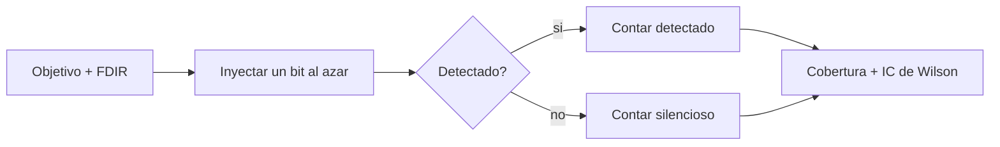

# B88-C34 — Pruebas de inyección de fallos

<!-- nav:top -->
[🏠 Programa](../../../../README.md) · [📚 Bloque B88](../../../tronco-comun/B88-avionica-y-software-critico-espacial.md) · [← Anterior: B88-C33 — Votación y redundancia modular triple (TMR)](../B88-C33-votacion-y-redundancia-modular-triple-tmr/CLASE.md) · [Siguiente: B88-C35 — Reinicio en caliente y persistencia de estado →](../B88-C35-reinicio-en-caliente-y-persistencia-de-estado/CLASE.md)
<!-- /nav -->

## 1. Ubicación, nivel y alcance

Clase 34 del bloque B88. Nivel N3. La **inyección de fallos** provoca fallos controlados para comprobar que el FDIR los detecta y los trata. Aquí inyectas inversiones de un bit en un objetivo **sintético** (12 bytes protegidos por CRC-8, un byte de CRC y 3 bytes sin protección), mides la **cobertura** y su **intervalo de Wilson** al 95 % y muestras qué la mejora. Todo con semilla 34. Todos los datos son **sintéticos** salvo los que se rotulan como consultados.

## 2. Por qué esta clase existe

Un FDIR no probado es una hipótesis. La decisión central: **¿cuántas inyecciones hacen falta para estimar la cobertura con una incertidumbre aceptable y qué fallas escapan?**

## 3. Lo que podrás hacer al terminar

1. Diseñar una campaña de inyección.
2. Clasificar resultados en detectado y silencioso.
3. Calcular la cobertura y su intervalo de Wilson.
4. Ver cómo el intervalo se estrecha con `N`.
5. Mejorar la cobertura al proteger más bytes.
6. Separar lo sintético de lo consultado.

La evidencia es la **informe de campaña de inyección** del ejercicio 12 (sección 20).

## 4. Con qué llegas y cómo comprobarlo

1. ¿Qué es la cobertura de un detector?
2. ¿Qué es un fallo silencioso?
3. ¿Qué es un intervalo de confianza?
4. ¿Qué es un CRC-8?
5. ¿Qué es una inyección de un bit?

<details>
<summary>Ver respuestas</summary>

1. La fracción de fallos que detecta. 2. Uno que corrompe sin ser detectado. 3. Un rango plausible del valor verdadero. 4. Un código de 8 bits para detectar errores. 5. Invertir un bit del estado.
</details>

Con cuatro o cinco aciertos, sigue; si no, repasa los prerrequisitos.

## 5. Un caso de contexto y casos de referencia

Objetivo **sintético** de 16 bytes: 12 de datos protegidos, 1 de CRC-8 y 3 sin protección. La cobertura teórica de un bit es `13/16 = 0,8125`. Resultados: `N = 100` → `0,85` IC `[0,7672; 0,9069]`; `N = 1000` → `0,82` IC `[0,7950; 0,8426]`; `N = 10 000` → `0,8034` IC `[0,7955; 0,8111]` (ancho `0,0156`). Con dos bits dentro de los 13 bytes: 10 000 de 10 000 detectados. Protegiendo los 15 bytes: 5000 de 5000.

## 6. Vocabulario

La **cobertura** `C = detectados/inyectados`. El **intervalo de Wilson** al 95 % para una proporción `p̂` con `n` pruebas. Un **fallo silencioso** pasa sin detección. La **campaña** es el conjunto de inyecciones con su criterio de resultado.

## 7. Modelo mental



*Descripción textual:* cada inyección cae en un bit al azar; el FDIR la detecta o no; los conteos dan la cobertura con su intervalo.

Analogía: inyectar fallos es probar la alarma de incendios con humo de prueba en cada habitación: las zonas sin detector aparecen enseguida. Límite: probar con un tipo de humo no dice nada de otro (otros tipos de fallo).

## 8. La explicación, paso a paso

### 8.1 Cobertura de un bit

El CRC-8 detecta todo error de un bit en los 13 bytes protegidos; los 3 sin protección no: `13/16 = 0,8125`.

### 8.2 Efecto de `N`

| `N` | Detectados | Cobertura | IC 95 % | Ancho |
|---|---|---|---|---|
| 100 | 85 | 0,85 | [0,7672; 0,9069] | 0,140 |
| 1000 | 820 | 0,82 | [0,7950; 0,8426] | 0,048 |
| 10 000 | 8034 | 0,8034 | [0,7955; 0,8111] | 0,016 |

El intervalo se estrecha `~1/√N`; el valor teórico `0,8125` cae dentro de los dos últimos.

### 8.3 Dos bits

Con dos bits invertidos en los 13 bytes: `10 000/10 000` detectados.

### 8.4 Mejora

Si el CRC cubre los 15 bytes: `5000/5000 = 1,0000` para un bit. La campaña mostró dónde estaba el hueco.

## 9. Magnitudes, símbolos y unidades

| Símbolo | Qué es | Unidad | Valor / nota |
|---|---|---|---|
| `N` | inyecciones | — | 100 a 10 000 |
| `C` | cobertura | — | 0,80 a 0,85 |
| `IC` | intervalo de Wilson 95 % | — | ancho 0,14 a 0,016 |
| `z` | cuantil normal | — | 1,96 |

## 10. Convenciones y referencias

Inversión de un bit uniforme en 16 bytes; criterio: detecta si el CRC de los 12 primeros no coincide; semilla `34`. Intervalo de Wilson con `z = 1,96`. Todo **sintético**.

## 11. De dónde sale lo que afirmamos

| ID | Fuente | Localizador | Respalda | Estado |
|---|---|---|---|---|
| S1 | NASA, «Software Assurance and Software Safety Standard» NASA-STD-8739.8B, 8 sep 2022 — https://standards.nasa.gov/standard/nasa/nasa-std-87398 (consultada 2026-11-10) | página de la norma | define requisitos para un enfoque sistemático de aseguramiento y seguridad del software y la verificación y validación independientes, desde la concepción hasta el retiro | Consultada (solo la página) |
| S2 | NASA, «Software Engineering and Assurance Handbook» NASA-HDBK-2203 — https://swehb.nasa.gov/ (consultada 2026-11-10) | página de inicio | guía informativa (no de requisitos) para cumplir NPR 7150.2D y NASA-STD-8739.8B para quien adquiere, desarrolla, asegura o mantiene software de la NASA | Consultada (solo la página de inicio) |
| — | Libros de texto de sistemas de tiempo real, tolerancia a fallos y comunicaciones digitales | — | — | No consultada |
| — | Relaciones y algoritmos estándar usados por el laboratorio (intervalo de Wilson para una proporción binomial y propiedades del CRC-8 para errores de un bit) | — | los verifica el laboratorio con una segunda vía o con pruebas | No consultada en una fuente concreta |

Límites: de las páginas de NASA-STD-8739.8B y del manual solo se consultó el contexto de aseguramiento; no se tomó una metodología de inyección. Las fallas inyectadas son de un bit, no de temporización ni de lógica. Lo simulado no se presenta como dato de vuelo ni como medición.

## 12. Cómo ver los resultados

| Estrategia | Cobertura de un bit |
|---|---|
| CRC sobre 12 bytes | 0,8125 (teórico) |
| CRC sobre 15 bytes | 1,0000 |

Descripción larga: proteger más bytes cierra el hueco que la campaña reveló.

## 13. Ejemplo trabajado

**Paso 1 · Campaña.** 1000 inyecciones: 820 detectadas.

**Paso 2 · Proporción.** `0,82`.

**Paso 3 · Wilson.** `[0,7950; 0,8426]`.

**Paso 4 · Lectura.** La cobertura teórica `0,8125` cabe en el intervalo.

## 14. Distintas formas de describir el problema

**Por campaña con intervalo:** esta clase. **Por análisis:** contar bits protegidos. **Por inyección en hardware:** pruebas con radiación (no consultado). El laboratorio compara la campaña con el análisis.

## 15. Práctica guiada

**Ejercicio 1 · con los pasos indicados.** Calcula la cobertura teórica.

<details><summary>Solución comentada</summary>

`13/16 = 0,8125`.
</details>

**Ejercicio 2 · con una pista.** Calcula la proporción con 820 de 1000.

<details><summary>Solución comentada</summary>

`0,82`.
</details>

**Ejercicio 3 · casi autónomo.** ¿Cómo cambia el ancho del IC al multiplicar `N` por 4?

<details><summary>Solución comentada</summary>

Se reduce a la mitad aproximadamente.
</details>

## 16. Práctica autónoma, transferencia e integrador

**Ejercicio 4 · autónomo.** ¿Cuántos bytes quedan sin protección?

<details><summary>Solución comentada</summary>

3.
</details>

**Ejercicio 5 · autónomo.** ¿Qué falla escapa a un CRC-8 sobre 12 bytes?

<details><summary>Solución comentada</summary>

Cualquiera en los 3 bytes sin proteger.
</details>

**Ejercicio 6 · autónomo.** ¿Por qué el IC de `N = 100` es tan ancho?

<details><summary>Solución comentada</summary>

Con pocas pruebas la incertidumbre es alta.
</details>

**Ejercicio 7 · autónomo.** ¿Qué detectaría una falla de dos bits?

<details><summary>Solución comentada</summary>

Casi siempre el CRC: 10 000 de 10 000.
</details>

**Ejercicio 8 · autónomo.** ¿Qué otro tipo de falla inyectarías?

<details><summary>Solución comentada</summary>

Retraso de mensajes, pérdida de paquetes y valores fuera de rango.
</details>

**Ejercicio 9 · transferencia.** **Transferencia.** Un colega dice que 100 inyecciones bastan. ¿Es válido?

<details><summary>Solución comentada</summary>

No: el IC mide 14 puntos de ancho.
</details>

**Ejercicio 10 · transferencia.** **Transferencia.** ¿Qué cambia si las fallas reales se agrupan en ráfagas?

<details><summary>Solución comentada</summary>

La cobertura de un bit no describe esas ráfagas: se inyectan ráfagas.
</details>

**Ejercicio 11 · transferencia.** **Transferencia.** ¿Cuándo detener una campaña?

<details><summary>Solución comentada</summary>

Cuando el ancho del IC cumple el criterio de aceptación acordado.
</details>

**Ejercicio 12 · integrador.** **Integrador.** Elabora tu *informe de campaña de inyección*: objetivo, resultados por `N`, intervalos, hueco y mejora y lista de qué es sintético.

<details><summary>Solución comentada</summary>

Secciones 8.1–8.4 y la salida del laboratorio.
</details>

## 17. Laboratorio: campaña de inyección de fallos con intervalo de Wilson

El script [inyeccion_fallos.py](inyeccion_fallos.py) inyecta fallos de un bit en 100, 1000 y 10 000 casos, calcula cobertura e intervalo de Wilson, prueba dos bits y mejora la protección, y **comprueba** más de 99 % de detección de dos bits y 100 % con los 15 bytes protegidos.

**Datos:** objetivo y fallas **sintéticos**; semilla 34. **Predice antes de ejecutar:** ¿qué cobertura tendrá la campaña? (alrededor de 0,81). **Ejecución del 2026-11-10 (Python 3.12.9):**

```text
Python 3.12.9
Datos SINTETICOS: un objetivo con 12 bytes protegidos por CRC-8, 1 byte de CRC y 3 bytes sin proteccion
N=   100: detectados=    85 silenciosos=    15 cobertura=0.8500 IC95%=[0.7672, 0.9069] ancho=0.1398
N=  1000: detectados=   820 silenciosos=   180 cobertura=0.8200 IC95%=[0.7950, 0.8426] ancho=0.0476
N= 10000: detectados=  8034 silenciosos=  1966 cobertura=0.8034 IC95%=[0.7955, 0.8111] ancho=0.0156
Cobertura teorica = 13/16 = 0.8125 (el CRC detecta todo error de un bit en 13 bytes; 3 bytes sin proteccion)
Dos bits dentro de los 13 bytes protegidos: detectados = 10000/10000
Con los 15 bytes protegidos: cobertura de un bit = 5000/5000 = 1.0000
Pruebas superadas.
```

```bash
python programa/clases/B88/B88-C34-pruebas-de-inyeccion-de-fallos/inyeccion_fallos.py
```

**Límites:** fallas de uno y dos bits; sin temporización ni lógica.

## 18. Errores frecuentes y cómo corregirlos

**Informar cobertura sin intervalo.** Añade el IC (8.2)

**Probar un solo tipo de falla.** Varía los tipos

**Presentar el objetivo como real.** Revisa la sección 10

## 19. Cómo sabrás que vas bien

Tras 8.2: ¿qué intervalo esperabas con `N = 1000`? Si dudas, repasa el ejemplo 13. Tras el laboratorio: ¿qué comprueba? (ver sección 17).

## 20. Qué entregas y cómo se evalúa

El producto es tu **informe de campaña de inyección** (ejercicio 12).

| Criterio | Inicial | En desarrollo | Logrado | Destacado |
|---|---|---|---|---|
| Conceptos | Los confunde | Parciales | Explica el método y su dominio | Explica los límites y las alternativas |
| Cálculo | Sin unidades | Con errores | Resultados con unidades y comprobados | Resuelve casos nuevos |
| Numérico | Sin comprobar | Un caso | Verifica con una segunda vía en varios casos | Interpreta las diferencias y los fallos |
| Fuentes | Sin fuente | Sin fecha | Fuentes con fecha y estado | Declara lo sintético y lo no consultado |
| Límites | No los nombra | Uno | Tres | Discute qué falta del modelo |

**Condiciones críticas (no se compensan con promedio):** rotular los datos como sintéticos; comprobar cada resultado con una segunda vía; citar solo lo consultado.

## 21. Ética, seguridad y límites

Clase educativa: los modelos son simplificados y los datos son sintéticos; ningún resultado describe una misión real, certifica conformidad con una norma ni sustituye la revisión de especialistas.  Accesibilidad: tablas equivalentes a las gráficas, fórmulas en texto, ejercicios sin conexión.

## 22. Para cerrar y seguir

La campaña reveló una cobertura de 0,80 ± 0,008 por los 3 bytes sin proteger; al protegerlos llegó al 100 %. Queda una pregunta: ¿qué estado sobrevive a un reinicio?

**Glosario español–inglés.** inyección de fallos · *fault injection*; cobertura · *coverage*; intervalo de confianza · *confidence interval*; fallo silencioso · *silent failure*.

**Continuidad.** [B88-C35](../B88-C35-reinicio-en-caliente-y-persistencia-de-estado/CLASE.md) trata el reinicio en caliente y la persistencia de estado.

**Referencias:** ver sección 11.

<!-- nav:bottom -->
---

[← Anterior: B88-C33 — Votación y redundancia modular triple (TMR)](../B88-C33-votacion-y-redundancia-modular-triple-tmr/CLASE.md) · [📚 Bloque B88](../../../tronco-comun/B88-avionica-y-software-critico-espacial.md) · [Siguiente: B88-C35 — Reinicio en caliente y persistencia de estado →](../B88-C35-reinicio-en-caliente-y-persistencia-de-estado/CLASE.md)
<!-- /nav -->
