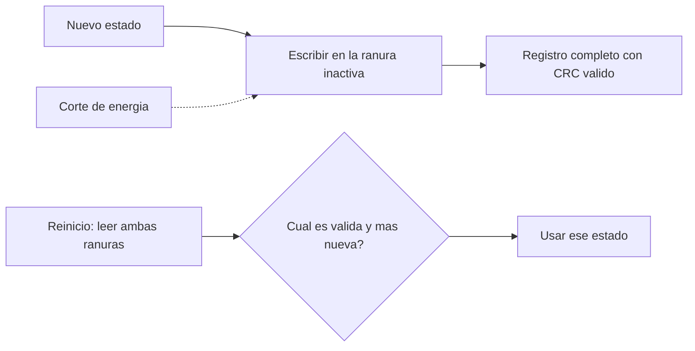

# B88-C35 — Reinicio en caliente y persistencia de estado

<!-- nav:top -->
[🏠 Programa](../../../../README.md) · [📚 Bloque B88](../../../tronco-comun/B88-avionica-y-software-critico-espacial.md) · [← Anterior: B88-C34 — Pruebas de inyección de fallos](../B88-C34-pruebas-de-inyeccion-de-fallos/CLASE.md) · [Siguiente: B88-C36 — Codificación defensiva y estándares de código seguro →](../B88-C36-codificacion-defensiva-y-estandares-de-codigo-seguro/CLASE.md)
<!-- /nav -->

## 1. Ubicación, nivel y alcance

Clase 35 del bloque B88. Nivel N3. Tras un **reinicio en caliente** (reset sin pérdida del resto de la nave), el software debe recuperar el estado guardado en memoria no volátil. Aquí implementas un esquema de **doble búfer** con número de secuencia y **CRC-16** y lo pruebas con un corte de energía en **cada byte** de la escritura. La memoria es virtual y **sintética**. Todos los datos son **sintéticos** salvo los que se rotulan como consultados.

## 2. Por qué esta clase existe

Un corte durante una escritura deja un registro a medias. La decisión central: **¿qué esquema garantiza que, cortes donde cortes, siempre haya un estado válido recuperable?**

## 3. Lo que podrás hacer al terminar

1. Describir el esquema de doble búfer.
2. Calcular un registro con secuencia y CRC.
3. Recuperar el estado más reciente válido.
4. Probar cortes en todos los puntos de la escritura.
5. Mostrar el fallo del esquema de ranura única.
6. Separar lo sintético de lo consultado.

La evidencia es la **prueba exhaustiva de corte de energía** del ejercicio 12 (sección 20).

## 4. Con qué llegas y cómo comprobarlo

1. ¿Qué es la memoria no volátil?
2. ¿Qué es una escritura atómica?
3. ¿Qué es un número de secuencia?
4. ¿Qué es un CRC-16?
5. ¿Qué es un reinicio en caliente?

<details>
<summary>Ver respuestas</summary>

1. La que conserva datos sin energía. 2. Una que ocurre entera o no ocurre. 3. Un contador que identifica la versión más reciente. 4. Una comprobación de 16 bits contra errores accidentales. 5. Un reinicio que conserva la memoria no volátil.
</details>

Con cuatro o cinco aciertos, sigue; si no, repasa los prerrequisitos.

## 5. Un caso de contexto y casos de referencia

Registro **sintético** de 12 bytes: secuencia (2), datos (8) y CRC-16 (2). Hay dos ranuras; el nuevo registro se escribe en la inactiva. Con un corte en cada uno de los 13 puntos (0 a 12 bytes escritos): 12 casos recuperan el viejo, 1 el nuevo y **0** quedan sin estado. Con una sola ranura sobrescrita: **10 de 13** cortes dejan sin estado válido.

## 6. Vocabulario

El **doble búfer** alterna entre dos ranuras. La **secuencia** identifica el más nuevo. El **CRC-16** valida el registro. La **recuperación** elige la ranura válida con mayor secuencia. Un **corte de energía** interrumpe la escritura en un byte.

## 7. Modelo mental



*Descripción textual:* el estado nuevo se escribe en la ranura inactiva; si hay corte, esa ranura queda inválida y la otra sigue siendo la última buena; al reiniciar se elige la válida más reciente.

Analogía: es como corregir un cuaderno copiando la hoja en una nueva y solo tirando la vieja cuando la nueva esté completa. Límite: si ambas hojas se dañan a la vez, no hay copia.

## 8. La explicación, paso a paso

### 8.1 El registro

`[seq(2) | datos(8) | crc(2)]`. El CRC-16 se calcula sobre los 10 primeros bytes. La probabilidad de que un registro corrupto pase el CRC por azar es `2⁻¹⁶ = 1,5×10⁻⁵`.

### 8.2 Doble búfer

La ranura 0 guarda `seq = 1`. El nuevo (`seq = 2`) se escribe en la ranura 1 byte a byte. Con corte tras `k` bytes (0 a 12): si `k < 12` el registro es inválido y se recupera el viejo (12 casos); con `k = 12`, el nuevo (1 caso): `0` sin estado.

### 8.3 Ranura única

Si se sobrescribe la única ranura, un corte deja un registro mezcla que casi nunca valida: `10 de 13` cortes quedan **sin estado**.

### 8.4 Tercera escritura

Escribir `seq = 3` sobre la ranura más vieja, con corte en cualquier byte, siempre deja un estado válido (`0 de 13` sin estado).

## 9. Magnitudes, símbolos y unidades

| Símbolo | Qué es | Unidad | Valor / nota |
|---|---|---|---|
| `seq` | número de secuencia | — | 1, 2, 3 |
| `L` | longitud del registro | B | 12 |
| `p_azar` | CRC válido por azar | — | 1,5×10⁻⁵ |
| `cortes` | puntos de corte probados | — | 13 |

## 10. Convenciones y referencias

Escritura byte a byte; corte tras `k` bytes (0 a 12); ranura sin escribir = `0xFF`; CRC-16 con polinomio `0x1021` e inicio `0xFFFF`. Tolerancia: 0 casos sin estado válido con doble búfer. Todo **sintético**.

## 11. De dónde sale lo que afirmamos

| ID | Fuente | Localizador | Respalda | Estado |
|---|---|---|---|---|
| S1 | NIST, «Platform Firmware Resiliency Guidelines», SP 800-193, mayo 2018 — https://csrc.nist.gov/pubs/sp/800/193/final (consultada 2026-11-10) | resumen | tres capacidades de resiliencia del firmware: protección, detección y recuperación | Consultada (solo el resumen) |
| S2 | NASA, «Software Engineering and Assurance Handbook» NASA-HDBK-2203 — https://swehb.nasa.gov/ (consultada 2026-11-10) | página de inicio | guía informativa (no de requisitos) para cumplir NPR 7150.2D y NASA-STD-8739.8B para quien adquiere, desarrolla, asegura o mantiene software de la NASA | Consultada (solo la página de inicio) |
| — | Libros de texto de sistemas de tiempo real, tolerancia a fallos y comunicaciones digitales | — | — | No consultada |
| — | Relaciones y algoritmos estándar usados por el laboratorio (CRC-16 y recuperación por secuencia en doble búfer) | — | los verifica el laboratorio con una segunda vía o con pruebas | No consultada en una fuente concreta |

Límites: de NIST SP 800-193 solo se consultó el resumen (recuperación del firmware). El laboratorio no modela la pérdida de bytes ya escritos, el desgaste de la memoria ni cortes durante la lectura. Lo simulado no se presenta como dato de vuelo ni como medición.

## 12. Cómo ver los resultados

| Esquema | Cortes sin estado válido |
|---|---|
| Doble búfer | 0 de 13 |
| Ranura única | 10 de 13 |
| Tercera escritura (doble búfer) | 0 de 13 |

Descripción larga: el doble búfer garantiza un estado válido en todos los cortes probados; la ranura única, no.

## 13. Ejemplo trabajado

**Paso 1 · Estado.** Ranura 0: `seq 1` válida.

**Paso 2 · Escritura.** `seq 2` en la ranura 1, 7 bytes escritos y corte.

**Paso 3 · Reinicio.** Ranura 1 inválida (CRC); ranura 0 válida.

**Paso 4 · Resultado.** Se recupera `seq 1`.

## 14. Distintas formas de describir el problema

**Por doble búfer:** esta clase. **Por registro con diario:** se anota la intención antes de escribir. **Por tres copias con votación:** C33. El laboratorio prueba el doble búfer y la ranura única.

## 15. Práctica guiada

**Ejercicio 1 · con los pasos indicados.** Calcula la longitud del registro.

<details><summary>Solución comentada</summary>

`2 + 8 + 2 = 12` bytes.
</details>

**Ejercicio 2 · con una pista.** ¿Qué recupera un corte tras 5 bytes?

<details><summary>Solución comentada</summary>

El registro viejo.
</details>

**Ejercicio 3 · casi autónomo.** ¿Y un corte tras 12 bytes?

<details><summary>Solución comentada</summary>

El nuevo.
</details>

## 16. Práctica autónoma, transferencia e integrador

**Ejercicio 4 · autónomo.** ¿Cuántos cortes dejan sin estado con ranura única?

<details><summary>Solución comentada</summary>

10 de 13.
</details>

**Ejercicio 5 · autónomo.** ¿Por qué la escritura va a la ranura inactiva?

<details><summary>Solución comentada</summary>

Para no destruir la última copia válida.
</details>

**Ejercicio 6 · autónomo.** ¿Qué probabilidad hay de aceptar un registro corrupto por azar?

<details><summary>Solución comentada</summary>

`2⁻¹⁶ = 1,5×10⁻⁵`.
</details>

**Ejercicio 7 · autónomo.** ¿Qué hace falta si ambas ranuras se corrompen?

<details><summary>Solución comentada</summary>

Un estado por defecto seguro y aviso a tierra.
</details>

**Ejercicio 8 · autónomo.** ¿Qué dato añadirías para detectar ranuras repetidas?

<details><summary>Solución comentada</summary>

El número de secuencia ya lo hace: mayor gana.
</details>

**Ejercicio 9 · transferencia.** **Transferencia.** Un colega dice que con esto el estado nunca se pierde. ¿Es válido?

<details><summary>Solución comentada</summary>

No: protege contra cortes en la escritura, no contra dos fallos simultáneos ni daño de la memoria.
</details>

**Ejercicio 10 · transferencia.** **Transferencia.** ¿Qué cambia si la escritura toma varios ciclos de borrado?

<details><summary>Solución comentada</summary>

Hay más puntos de corte; se prueba cada uno.
</details>

**Ejercicio 11 · transferencia.** **Transferencia.** ¿Qué estado guardarías y cuál no?

<details><summary>Solución comentada</summary>

Contadores, modo y configuración; no los datos transitorios.
</details>

**Ejercicio 12 · integrador.** **Integrador.** Elabora tu *prueba exhaustiva de corte de energía*: registro, esquema, cortes, resultados y lista de qué es sintético.

<details><summary>Solución comentada</summary>

Secciones 8.1–8.4 y la salida del laboratorio.
</details>

## 17. Laboratorio: estado persistente con corte en cada byte

El script [persistencia.py](persistencia.py) escribe un registro con CRC-16 en la ranura inactiva con un corte en cada punto y compara con la ranura única, y **comprueba** 0 casos sin estado válido con doble búfer.

**Datos:** memoria virtual y registros **sintéticos**. **Predice antes de ejecutar:** ¿cuántos cortes dejan sin estado con ranura única? (10 de 13). **Ejecución del 2026-11-10 (Python 3.12.9):**

```text
Python 3.12.9
Datos SINTETICOS: memoria no volatil virtual de dos ranuras de 12 bytes
Doble bufer, corte en cada byte (0..12): casos=13 recupera el viejo=12 recupera el nuevo=1 sin estado valido=0
Ranura unica sobrescrita, corte en cada byte: sin estado valido en 10 de 13 casos
Segunda escritura sobre la ranura vieja, corte en cada byte: sin estado valido en 0 de 13 casos
Probabilidad de CRC valido por azar = 2^-16 = 1.526e-05
Pruebas superadas.
```

```bash
python programa/clases/B88/B88-C35-reinicio-en-caliente-y-persistencia-de-estado/persistencia.py
```

**Límites:** sin desgaste ni cortes de lectura.

## 18. Errores frecuentes y cómo corregirlos

**Sobrescribir la única copia.** Usa dos ranuras (8.3)

**Olvidar la secuencia.** Sin ella no se sabe cuál es la nueva

**Presentar la memoria como real.** Revisa la sección 10

## 19. Cómo sabrás que vas bien

Tras 8.2: ¿qué se recupera con un corte a medias? Si dudas, repasa el ejemplo 13. Tras el laboratorio: ¿qué comprueba? (ver sección 17).

## 20. Qué entregas y cómo se evalúa

El producto es tu **prueba exhaustiva de corte de energía** (ejercicio 12).

| Criterio | Inicial | En desarrollo | Logrado | Destacado |
|---|---|---|---|---|
| Conceptos | Los confunde | Parciales | Explica el método y su dominio | Explica los límites y las alternativas |
| Cálculo | Sin unidades | Con errores | Resultados con unidades y comprobados | Resuelve casos nuevos |
| Numérico | Sin comprobar | Un caso | Verifica con una segunda vía en varios casos | Interpreta las diferencias y los fallos |
| Fuentes | Sin fuente | Sin fecha | Fuentes con fecha y estado | Declara lo sintético y lo no consultado |
| Límites | No los nombra | Uno | Tres | Discute qué falta del modelo |

**Condiciones críticas (no se compensan con promedio):** rotular los datos como sintéticos; comprobar cada resultado con una segunda vía; citar solo lo consultado.

## 21. Ética, seguridad y límites

Clase educativa: los modelos son simplificados y los datos son sintéticos; ningún resultado describe una misión real, certifica conformidad con una norma ni sustituye la revisión de especialistas.  Accesibilidad: tablas equivalentes a las gráficas, fórmulas en texto, ejercicios sin conexión.

## 22. Para cerrar y seguir

Con doble búfer, CRC y secuencia, ningún corte de los 13 probados deja la nave sin estado válido; con una sola ranura, 10 sí. Queda una pregunta: ¿cómo se escribe código que resista entradas inesperadas?

**Glosario español–inglés.** reinicio en caliente · *warm reset*; doble búfer · *double buffer*; persistencia · *persistence*; corte de energía · *power loss*; recuperación · *recovery*.

**Continuidad.** [B88-C36](../B88-C36-codificacion-defensiva-y-estandares-de-codigo-seguro/CLASE.md) trata la codificación defensiva.

**Referencias:** ver sección 11.

<!-- nav:bottom -->
---

[← Anterior: B88-C34 — Pruebas de inyección de fallos](../B88-C34-pruebas-de-inyeccion-de-fallos/CLASE.md) · [📚 Bloque B88](../../../tronco-comun/B88-avionica-y-software-critico-espacial.md) · [Siguiente: B88-C36 — Codificación defensiva y estándares de código seguro →](../B88-C36-codificacion-defensiva-y-estandares-de-codigo-seguro/CLASE.md)
<!-- /nav -->
