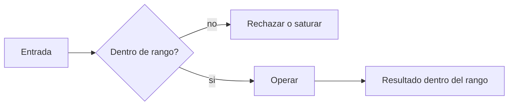

# B88-C36 — Codificación defensiva y estándares de código seguro

<!-- nav:top -->
[🏠 Programa](../../../../README.md) · [📚 Bloque B88](../../../tronco-comun/B88-avionica-y-software-critico-espacial.md) · [← Anterior: B88-C35 — Reinicio en caliente y persistencia de estado](../B88-C35-reinicio-en-caliente-y-persistencia-de-estado/CLASE.md) · [Siguiente: B88-C37 — Fuzzing autorizado de software embarcado en banco de pruebas →](../B88-C37-fuzzing-autorizado-de-software-embarcado-en-banco-de-pruebas/CLASE.md)
<!-- /nav -->

## 1. Ubicación, nivel y alcance

Clase 36 del bloque B88. Nivel N3. La **codificación defensiva** escribe el código para que sobreviva entradas inesperadas: aritmética de ancho fijo con **saturación** en vez de envoltura, validación de índices y longitudes y divisiones protegidas. Aquí emulas enteros de ancho fijo y verificas **propiedades** con 100 000 entradas aleatorias (semilla 36). Todo **sintético**; el texto de Holzmann (JPL) respalda las reglas de comprobar valores y datos de alcance mínimo. Todos los datos son **sintéticos** salvo los que se rotulan como consultados.

## 2. Por qué esta clase existe

Un desbordamiento silencioso convierte 35 000 en −30 536 y un comando de giro positivo en negativo. La decisión central: **¿qué operaciones aceptan cualquier entrada y devuelven siempre un resultado dentro del rango?**

## 3. Lo que podrás hacer al terminar

1. Emular enteros de ancho fijo con y sin signo.
2. Comparar suma envolvente y saturada.
3. Probar propiedades (rango, monotonía, conmutatividad).
4. Validar índice y longitud antes de leer.
5. Proteger una división.
6. Separar lo sintético de lo consultado.

La evidencia es la **biblioteca defensiva con pruebas** del ejercicio 12 (sección 20).

## 4. Con qué llegas y cómo comprobarlo

1. ¿Qué es el desbordamiento?
2. ¿Qué es el complemento a dos?
3. ¿Qué es la saturación?
4. ¿Qué es una propiedad de prueba?
5. ¿Qué es validar una entrada?

<details>
<summary>Ver respuestas</summary>

1. Pasarse del rango de un entero. 2. La representación de enteros con signo. 3. Limitar el resultado al valor máximo o mínimo. 4. Una ley que debe cumplirse para toda entrada. 5. Comprobar su rango antes de usarla.
</details>

Con cuatro o cinco aciertos, sigue; si no, repasa los prerrequisitos.

## 5. Un caso de contexto y casos de referencia

Suma `int16` **sintética**: `30000 + 5000` da `−30 536` envuelta y `32 767` saturada; `−30000 − 5000` da `30 536` envuelta y `−32 768` saturada; en `uint8`, `250 + 10` da `4` o `255`. Con 100 000 entradas aleatorias, la suma saturada no viola rango, monotonía ni conmutatividad; la envolvente viola la monotonía en `25,3 %` de los casos.

## 6. Vocabulario

La **envoltura** (*wraparound*) devuelve el resultado módulo `2ⁿ`. La **saturación** lo limita a `[mín, máx]`. La **monotonía** pide `b ≤ c ⇒ a+b ≤ a+c`. Una **propiedad** es una ley que se verifica con muchas entradas. El **alcance mínimo** pide declarar los datos en el ámbito más pequeño.

## 7. Modelo mental



*Descripción textual:* la entrada se comprueba antes de usarse; si está fuera de rango se rechaza o se satura, y el resultado siempre queda dentro del rango.

Analogía: es como un termostato con tope: si se pide 1000 °C, entrega el máximo permitido y no un valor absurdo. Límite: saturar oculta que hubo un exceso; conviene registrarlo.

## 8. La explicación, paso a paso

### 8.1 Envoltura y saturación

`int16`: rango `[−32 768, 32 767]`. `30000 + 5000`: envuelta `−30 536`, saturada `32 767`. `uint8`: `250 + 10` = `4` o `255`. Con saturación, el signo se conserva.

### 8.2 Propiedades

En 100 000 casos: rango fuera `0`, monotonía rota `0`, no conmutativa `0`. La suma envolvente rompe la monotonía en `25 314` casos (`25,3 %`).

### 8.3 Lecturas con límites

`leer(buf16, i, n)` exige `0 ≤ i`, `0 ≤ n` y `i + n ≤ 16`: `(15, 2)`, `(−1, 4)`, `(4, −2)` y `(8, 9)` se rechazan; `(0, 16)`, `(15, 1)`, `(16, 0)` y `(8, 8)` se aceptan.

### 8.4 División

`div_seg(7, 0) = 0` (valor por defecto); `div_seg(7, 2) = 3`. Se devuelve un valor seguro y se informa el error.

## 9. Magnitudes, símbolos y unidades

| Símbolo | Qué es | Unidad | Valor / nota |
|---|---|---|---|
| `rango int16` | valores permitidos | — | −32 768 a 32 767 |
| `viol` | violaciones de propiedad | — | 0 |
| `p` | monotonía rota (envolvente) | % | 25,3 |
| `N` | entradas aleatorias | — | 100 000 |

## 10. Convenciones y referencias

Enteros de ancho fijo emulados en Python; propiedades con semilla `36`. Tolerancia: 0 violaciones para la suma saturada. Todo **sintético**; las reglas de Holzmann son para C y aquí se usan como criterio.

## 11. De dónde sale lo que afirmamos

| ID | Fuente | Localizador | Respalda | Estado |
|---|---|---|---|---|
| S1 | G. J. Holzmann (NASA/JPL), «The Power of Ten — Rules for Developing Safety Critical Code» — https://spinroot.com/gerard/pdf/P10.pdf (consultada 2026-11-10 con PyMuPDF) | texto de las diez reglas | reglas: control de flujo simple sin recursión, bucles con cota fija, sin memoria dinámica tras la inicialización, funciones de unas 60 líneas, al menos dos aserciones por función, alcance mínimo de datos, comprobación de valores devueltos | Consultada (texto completo del PDF) |
| — | Libros de texto de sistemas de tiempo real, tolerancia a fallos y comunicaciones digitales | — | — | No consultada |
| — | Relaciones y algoritmos estándar usados por el laboratorio (aritmética de ancho fijo, saturación y pruebas de propiedades aleatorias) | — | los verifica el laboratorio con una segunda vía o con pruebas | No consultada en una fuente concreta |

Límites: se consultó el texto de las reglas de Holzmann, no un estándar de codificación seguro (por ejemplo MISRA o CERT, no consultados). La emulación en Python no reproduce el comportamiento indefinido de C. Lo simulado no se presenta como dato de vuelo ni como medición.

## 12. Cómo ver los resultados

| Operación | 30000 + 5000 | −30000 − 5000 | uint8: 250 + 10 |
|---|---|---|---|
| Envolvente | −30 536 | 30 536 | 4 |
| Saturada | 32 767 | −32 768 | 255 |
| Exacta | 35 000 | −35 000 | 260 |

Descripción larga: la envolvente invierte el signo; la saturada lo conserva.

## 13. Ejemplo trabajado

**Paso 1 · Suma.** `30000 + 5000 = 35000 > 32767`.

**Paso 2 · Envoltura.** `35000 − 65536 = −30536`.

**Paso 3 · Saturación.** `min(32767, 35000) = 32767`.

**Paso 4 · Efecto.** Un comando positivo pasa a negativo con envoltura.

## 14. Distintas formas de describir el problema

**Por saturación:** esta clase. **Por detección y error:** comprobar el desbordamiento y reportar. **Por tipos más anchos:** `int32` en cálculos intermedios. El laboratorio contrasta las dos primeras.

## 15. Práctica guiada

**Ejercicio 1 · con los pasos indicados.** Calcula `32767 + 1` envuelto en `int16`.

<details><summary>Solución comentada</summary>

`−32768`.
</details>

**Ejercicio 2 · con una pista.** Calcula `32767 + 1` saturado.

<details><summary>Solución comentada</summary>

`32767`.
</details>

**Ejercicio 3 · casi autónomo.** Calcula `0 − 1` en `uint8` saturado.

<details><summary>Solución comentada</summary>

`0`.
</details>

## 16. Práctica autónoma, transferencia e integrador

**Ejercicio 4 · autónomo.** Calcula `0 − 1` en `uint8` envuelto.

<details><summary>Solución comentada</summary>

`255`.
</details>

**Ejercicio 5 · autónomo.** ¿Cuántos valores tiene `int16`?

<details><summary>Solución comentada</summary>

`65 536`.
</details>

**Ejercicio 6 · autónomo.** ¿Qué rechaza `leer(buf16, 15, 2)`?

<details><summary>Solución comentada</summary>

Excede el final del búfer (`15 + 2 > 16`).
</details>

**Ejercicio 7 · autónomo.** ¿Por qué `leer(buf16, 16, 0)` es válido?

<details><summary>Solución comentada</summary>

Lee 0 bytes dentro del límite.
</details>

**Ejercicio 8 · autónomo.** ¿Qué devuelve `div_seg(9, 0)`?

<details><summary>Solución comentada</summary>

El valor por defecto 0.
</details>

**Ejercicio 9 · transferencia.** **Transferencia.** Un colega dice que saturar es siempre seguro. ¿Es válido?

<details><summary>Solución comentada</summary>

No: oculta el exceso; hay que registrarlo.
</details>

**Ejercicio 10 · transferencia.** **Transferencia.** ¿Qué cambia si el resultado intermedio se calcula en 32 bits?

<details><summary>Solución comentada</summary>

Se evita el desbordamiento intermedio y se satura al final.
</details>

**Ejercicio 11 · transferencia.** **Transferencia.** ¿Qué propiedad añadirías para la resta?

<details><summary>Solución comentada</summary>

`(a − b) + b = a` dentro del rango sin saturación.
</details>

**Ejercicio 12 · integrador.** **Integrador.** Elabora tu *biblioteca defensiva con pruebas*: operaciones, propiedades, validaciones y lista de qué es sintético.

<details><summary>Solución comentada</summary>

Secciones 8.1–8.4 y la salida del laboratorio.
</details>

## 17. Laboratorio: aritmética saturada y validación de entradas

El script [codigo_defensivo.py](codigo_defensivo.py) compara suma envolvente y saturada de `int16` y `uint8`, prueba tres propiedades con 100 000 entradas y valida lecturas y divisiones, y **comprueba** 0 violaciones de la suma saturada.

**Datos:** entradas **sintéticas**; semilla 36. **Predice antes de ejecutar:** ¿qué resultado da `30000 + 5000` envuelto en `int16`? (−30 536). **Ejecución del 2026-11-10 (Python 3.12.9):**

```text
Python 3.12.9
Datos SINTETICOS: funciones inventadas; aritmetica de ancho fijo emulada
Casos de desbordamiento (int16):
   30000 +   5000: envolvente = -30536 ; saturada =  32767 ; exacta = 35000
  -30000 +  -5000: envolvente =  30536 ; saturada = -32768 ; exacta = -35000
     100 +    200: envolvente =    300 ; saturada =    300 ; exacta = 300
uint8: 250 + 10 -> 4 (envuelve) / 255 (satura)
Propiedades de la suma saturada en 100000 casos aleatorios (violaciones): {'rango': 0, 'monotonia': 0, 'conmut': 0}
La suma envolvente viola la monotonia en 25314 de 100000 casos (25.3 %)
  leer(buf16,   0,  16) -> ok
  leer(buf16,  15,   1) -> ok
  leer(buf16,  15,   2) -> rechazado
  leer(buf16,  -1,   4) -> rechazado
  leer(buf16,   4,  -2) -> rechazado
  leer(buf16,  16,   0) -> ok
  leer(buf16,   8,   8) -> ok
  leer(buf16,   8,   9) -> rechazado
div_seg(7, 0) = 0 ; div_seg(7, 2) = 3
Pruebas superadas.
```

```bash
python programa/clases/B88/B88-C36-codificacion-defensiva-y-estandares-de-codigo-seguro/codigo_defensivo.py
```

**Límites:** emulación en Python; sin comportamiento indefinido de C.

## 18. Errores frecuentes y cómo corregirlos

**Dejar que el entero se envuelva.** Satura o detecta (8.1)

**Leer sin validar índice.** Valida `i + n ≤ len` (8.3)

**Dividir sin comprobar.** Protege la división (8.4)

## 19. Cómo sabrás que vas bien

Tras 8.1: ¿qué signo tiene el resultado envuelto? Si dudas, repasa el ejemplo 13. Tras el laboratorio: ¿qué comprueba? (ver sección 17).

## 20. Qué entregas y cómo se evalúa

El producto es tu **biblioteca defensiva con pruebas** (ejercicio 12).

| Criterio | Inicial | En desarrollo | Logrado | Destacado |
|---|---|---|---|---|
| Conceptos | Los confunde | Parciales | Explica el método y su dominio | Explica los límites y las alternativas |
| Cálculo | Sin unidades | Con errores | Resultados con unidades y comprobados | Resuelve casos nuevos |
| Numérico | Sin comprobar | Un caso | Verifica con una segunda vía en varios casos | Interpreta las diferencias y los fallos |
| Fuentes | Sin fuente | Sin fecha | Fuentes con fecha y estado | Declara lo sintético y lo no consultado |
| Límites | No los nombra | Uno | Tres | Discute qué falta del modelo |

**Condiciones críticas (no se compensan con promedio):** rotular los datos como sintéticos; comprobar cada resultado con una segunda vía; citar solo lo consultado.

## 21. Ética, seguridad y límites

Clase educativa: los modelos son simplificados y los datos son sintéticos; ningún resultado describe una misión real, certifica conformidad con una norma ni sustituye la revisión de especialistas.  Accesibilidad: tablas equivalentes a las gráficas, fórmulas en texto, ejercicios sin conexión.

## 22. Para cerrar y seguir

La suma saturada mantiene tres propiedades en 100 000 casos; la envolvente rompe la monotonía en una cuarta parte. Queda una pregunta: ¿cómo se buscan los fallos que no se esperan?

**Glosario español–inglés.** codificación defensiva · *defensive coding*; saturación · *saturation*; envoltura · *wraparound*; propiedad · *property*; validación · *validation*.

**Continuidad.** [B88-C37](../B88-C37-fuzzing-autorizado-de-software-embarcado-en-banco-de-pruebas/CLASE.md) trata el fuzzing autorizado en banco.

**Referencias:** ver sección 11.

<!-- nav:bottom -->
---

[← Anterior: B88-C35 — Reinicio en caliente y persistencia de estado](../B88-C35-reinicio-en-caliente-y-persistencia-de-estado/CLASE.md) · [📚 Bloque B88](../../../tronco-comun/B88-avionica-y-software-critico-espacial.md) · [Siguiente: B88-C37 — Fuzzing autorizado de software embarcado en banco de pruebas →](../B88-C37-fuzzing-autorizado-de-software-embarcado-en-banco-de-pruebas/CLASE.md)
<!-- /nav -->
