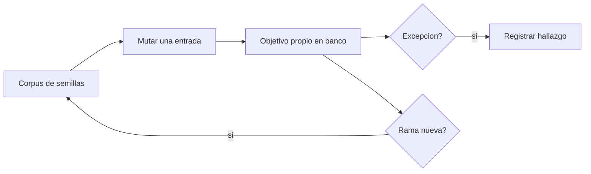

# B88-C37 — Fuzzing autorizado de software embarcado en banco de pruebas

<!-- nav:top -->
[🏠 Programa](../../../../README.md) · [📚 Bloque B88](../../../tronco-comun/B88-avionica-y-software-critico-espacial.md) · [← Anterior: B88-C36 — Codificación defensiva y estándares de código seguro](../B88-C36-codificacion-defensiva-y-estandares-de-codigo-seguro/CLASE.md) · [Siguiente: B88-C38 — Gestión de claves y secretos en aviónica →](../B88-C38-gestion-de-claves-y-secretos-en-avionica/CLASE.md)
<!-- /nav -->

## 1. Ubicación, nivel y alcance

Clase 37 del bloque B88. Nivel N3. El **fuzzing** alimenta a un programa con entradas inválidas o inesperadas para encontrar fallos. Aquí lo practicas **solo en banco y sobre un objetivo propio y sintético**: un analizador de mensajes con tres errores sembrados. Comparas fuzzing aleatorio con fuzzing **guiado por cobertura** (10 campañas de 20 000 ejecuciones, semilla 37). No hay técnicas contra sistemas reales ni de terceros. Todos los datos son **sintéticos** salvo los que se rotulan como consultados.

## 2. Por qué esta clase existe

Las pruebas diseñadas por una persona no prevén todas las combinaciones. La decisión central: **¿qué estrategia de entradas encuentra más fallos con menos ejecuciones en un banco autorizado?**

## 3. Lo que podrás hacer al terminar

1. Describir el fuzzing y su ámbito autorizado.
2. Implementar un mutador de entradas.
3. Medir cobertura de ramas.
4. Comparar aleatorio y guiado por cobertura.
5. Registrar el primer hallazgo y los errores distintos.
6. Separar lo sintético de lo consultado.

La evidencia es la **informe de campaña de fuzzing** del ejercicio 12 (sección 20).

## 4. Con qué llegas y cómo comprobarlo

1. ¿Qué es una entrada mutada?
2. ¿Qué es la cobertura de ramas?
3. ¿Qué es un corpus?
4. ¿Qué es una excepción?
5. ¿Qué es un objetivo autorizado?

<details>
<summary>Ver respuestas</summary>

1. Una copia con cambios pequeños. 2. Qué ramas del programa se ejecutaron. 3. El conjunto de entradas interesantes guardadas. 4. Un error que interrumpe el programa. 5. Un sistema propio o con permiso explícito.
</details>

Con cuatro o cinco aciertos, sigue; si no, repasa los prerrequisitos.

## 5. Un caso de contexto y casos de referencia

Analizador **sintético** de mensajes `[0xA5][tipo][longitud][carga][suma]` con tres errores sembrados (longitud mayor que el mensaje, división por longitud cero y una combinación rara de campos). Con fuzzing **aleatorio puro**: 2 hallazgos en 10 campañas y `5,2` de 13 ramas; primer hallazgo tras `10 513` ejecuciones. **Guiado por cobertura:** 2 errores en cada una de las 10 campañas, `11,0` de 13 ramas y primer hallazgo tras `40` ejecuciones.

## 6. Vocabulario

El **fuzzing** genera entradas masivas. El **corpus** guarda entradas que descubren ramas nuevas. La **mutación** cambia, invierte o inserta bytes. La **cobertura de ramas** cuenta ramas distintas ejecutadas. Un **hallazgo** es una excepción distinta del objetivo.

## 7. Modelo mental



*Descripción textual:* se muta una entrada del corpus y se ejecuta el objetivo; las excepciones se registran y las entradas que abren ramas nuevas pasan al corpus.

Analogía: el fuzzing guiado es como explorar una casa tocando todas las puertas y recordando las que se abren: el azar puro toca a ciegas. Límite: solo explora la casa que le dieron; no la de otros.

## 8. La explicación, paso a paso

### 8.1 El objetivo

Cuatro ramas por tipo de mensaje y tres errores: longitud mayor que el mensaje (tipo 1), división por cero (tipo 2, `n = 0`) y combinación rara (tipo 3, `d[3] = 0x7F` y `n = 3`).

### 8.2 Aleatorio puro

Casi nunca produce el byte de sincronía `0xA5`: `5,2/13` ramas y solo 2 hallazgos en 10 campañas de 20 000 ejecuciones.

### 8.3 Guiado por cobertura

Parte de tres semillas válidas y conserva las entradas que abren ramas: `11,0/13` ramas, 2 errores distintos por campaña (20 en total) y primer hallazgo a las `40` ejecuciones. El tercer error sembrado, que exige una coincidencia exacta de dos campos, no apareció.

### 8.4 Lectura

La guía por cobertura multiplicó por 10 los hallazgos y bajó 250 veces el tiempo al primero; pero no encontró todo: falta cubrir condiciones exactas.

## 9. Magnitudes, símbolos y unidades

| Símbolo | Qué es | Unidad | Valor / nota |
|---|---|---|---|
| `N` | ejecuciones por campaña | — | 20 000 |
| `ramas` | cobertura media | de 13 | 5,2 / 11,0 |
| `hallazgos` | errores distintos totales | — | 2 / 20 |
| `t₁` | primer hallazgo | ejecuciones | 10 513 / 40 |

## 10. Convenciones y referencias

Objetivo propio ejecutado en proceso, sin red ni archivos; semillas de campaña 0–9; entradas de hasta ~10 bytes. «Hallazgo» = tipo de excepción distinto. Todo **sintético** y en banco.

## 11. De dónde sale lo que afirmamos

| ID | Fuente | Localizador | Respalda | Estado |
|---|---|---|---|---|
| S1 | NASA, «Software Assurance and Software Safety Standard» NASA-STD-8739.8B, 8 sep 2022 — https://standards.nasa.gov/standard/nasa/nasa-std-87398 (consultada 2026-11-10) | página de la norma | define requisitos para un enfoque sistemático de aseguramiento y seguridad del software y la verificación y validación independientes, desde la concepción hasta el retiro | Consultada (solo la página) |
| S2 | NASA, «Software Engineering and Assurance Handbook» NASA-HDBK-2203 — https://swehb.nasa.gov/ (consultada 2026-11-10) | página de inicio | guía informativa (no de requisitos) para cumplir NPR 7150.2D y NASA-STD-8739.8B para quien adquiere, desarrolla, asegura o mantiene software de la NASA | Consultada (solo la página de inicio) |
| — | Libros de texto de sistemas de tiempo real, tolerancia a fallos y comunicaciones digitales | — | — | No consultada |
| — | Relaciones y algoritmos estándar usados por el laboratorio (mutación de bytes y cobertura de ramas por marcas en el código) | — | los verifica el laboratorio con una segunda vía o con pruebas | No consultada en una fuente concreta |

Límites: no se consultó literatura de fuzzing ni herramientas (AFL, libFuzzer). El objetivo es mínimo y los errores están sembrados a propósito, por lo que las tasas no se extrapolan a software real. Solo se usa sobre código propio y autorizado. Lo simulado no se presenta como dato de vuelo ni como medición.

## 12. Cómo ver los resultados

| Estrategia | Hallazgos (10 campañas) | Ramas medias | Primer hallazgo |
|---|---|---|---|
| Aleatorio | 2 | 5,2 / 13 | 10 513 |
| Guiado | 20 | 11,0 / 13 | 40 |

Descripción larga: la guía por cobertura da diez veces más hallazgos y llega mucho antes.

## 13. Ejemplo trabajado

**Paso 1 · Semilla.** `A5 01 02 09 09 00` (válida).

**Paso 2 · Mutación.** Se cambia `n` (byte 2) a `0xFF`.

**Paso 3 · Ejecución.** Rama del tipo 1: `n > len − 4`: **BUG1**.

**Paso 4 · Registro.** Hallazgo guardado con la entrada.

## 14. Distintas formas de describir el problema

**Por azar puro:** esta clase. **Por guía de cobertura:** esta clase. **Por ejecución simbólica:** resuelve condiciones exactas (no consultado). El laboratorio compara las dos primeras.

## 15. Práctica guiada

**Ejercicio 1 · con los pasos indicados.** Calcula la cobertura media guiada como porcentaje.

<details><summary>Solución comentada</summary>

`11,0/13 = 84,6 %`.
</details>

**Ejercicio 2 · con una pista.** ¿Cuántas veces menos ejecuciones al primer hallazgo?

<details><summary>Solución comentada</summary>

`10 513/40 ≈ 263`.
</details>

**Ejercicio 3 · casi autónomo.** ¿Por qué el azar puro rara vez ejecuta el tipo 1?

<details><summary>Solución comentada</summary>

Necesita `d[0] = 0xA5` (probabilidad 1/256) y un tipo concreto.
</details>

## 16. Práctica autónoma, transferencia e integrador

**Ejercicio 4 · autónomo.** ¿Qué conserva el corpus?

<details><summary>Solución comentada</summary>

Entradas que abren ramas nuevas.
</details>

**Ejercicio 5 · autónomo.** ¿Qué bug exige una coincidencia exacta?

<details><summary>Solución comentada</summary>

El tercero: `d[3] = 0x7F` y `n = 3`.
</details>

**Ejercicio 6 · autónomo.** ¿Por qué no se prueba el fuzzing contra sistemas de terceros?

<details><summary>Solución comentada</summary>

Está fuera del ámbito autorizado y puede causar daño.
</details>

**Ejercicio 7 · autónomo.** ¿Qué registrarías de cada hallazgo?

<details><summary>Solución comentada</summary>

La entrada, la excepción y la versión probada.
</details>

**Ejercicio 8 · autónomo.** ¿Cuántas campañas harías para confiar en el resultado?

<details><summary>Solución comentada</summary>

Varias semillas, como las 10 de la clase.
</details>

**Ejercicio 9 · transferencia.** **Transferencia.** Un colega dice que sin hallazgos el código es seguro. ¿Es válido?

<details><summary>Solución comentada</summary>

No: solo muestra que no se encontró nada con esa campaña.
</details>

**Ejercicio 10 · transferencia.** **Transferencia.** ¿Qué cambia si el objetivo usa un CRC sobre toda la entrada?

<details><summary>Solución comentada</summary>

El mutador rara vez produce CRC válido: hay que recalcularlo en el arnés.
</details>

**Ejercicio 11 · transferencia.** **Transferencia.** ¿Cómo combinarías fuzzing y análisis estático?

<details><summary>Solución comentada</summary>

El análisis marca zonas de riesgo y el fuzzing las ejercita.
</details>

**Ejercicio 12 · integrador.** **Integrador.** Elabora tu *informe de campaña de fuzzing*: objetivo, estrategias, cobertura, hallazgos, límites y lista de qué es sintético.

<details><summary>Solución comentada</summary>

Secciones 8.1–8.4 y la salida del laboratorio.
</details>

## 17. Laboratorio: fuzzing aleatorio y guiado en banco

El script [fuzzing_banco.py](fuzzing_banco.py) ejecuta 10 campañas de 20 000 entradas con fuzzing aleatorio y guiado por cobertura sobre un analizador propio y **comprueba** que el guiado encuentra al menos tantos errores como el aleatorio.

**Datos:** objetivo **sintético** con errores sembrados; semillas 0–9. **Predice antes de ejecutar:** ¿qué estrategia llegará antes al primer hallazgo? (la guiada). **Ejecución del 2026-11-10 (Python 3.12.9):**

```text
Python 3.12.9
Datos SINTETICOS: analizador de mensajes inventado, ejecutado en proceso; solo objetivo propio del banco
aleatorio puro        : bugs distintos por campana (10 semillas) = [0, 0, 1, 0, 0, 0, 0, 1, 0, 0] ; ramas medias = 5.2/13 ; primer hallazgo medio = 10513 ejecuciones
guiado por cobertura  : bugs distintos por campana (10 semillas) = [2, 2, 2, 2, 2, 2, 2, 2, 2, 2] ; ramas medias = 11.0/13 ; primer hallazgo medio = 40 ejecuciones
Total de hallazgos: aleatorio = 2, guiado = 20
Pruebas superadas.
```

```bash
python programa/clases/B88/B88-C37-fuzzing-autorizado-de-software-embarcado-en-banco-de-pruebas/fuzzing_banco.py
```

**Límites:** objetivo mínimo y propio; sin ejecución simbólica; no se extrapola a software real.

## 18. Errores frecuentes y cómo corregirlos

**Fuzzear sistemas ajenos.** Solo objetivos propios y autorizados

**Fiarse de una sola campaña.** Repite con varias semillas (8.2)

**Presentar los hallazgos como de un sistema real.** Revisa la sección 10

## 19. Cómo sabrás que vas bien

Tras 8.3: ¿qué estrategia esperabas más rápida? Si dudas, repasa el ejemplo 13. Tras el laboratorio: ¿qué comprueba? (ver sección 17).

## 20. Qué entregas y cómo se evalúa

El producto es tu **informe de campaña de fuzzing** (ejercicio 12).

| Criterio | Inicial | En desarrollo | Logrado | Destacado |
|---|---|---|---|---|
| Conceptos | Los confunde | Parciales | Explica el método y su dominio | Explica los límites y las alternativas |
| Cálculo | Sin unidades | Con errores | Resultados con unidades y comprobados | Resuelve casos nuevos |
| Numérico | Sin comprobar | Un caso | Verifica con una segunda vía en varios casos | Interpreta las diferencias y los fallos |
| Fuentes | Sin fuente | Sin fecha | Fuentes con fecha y estado | Declara lo sintético y lo no consultado |
| Límites | No los nombra | Uno | Tres | Discute qué falta del modelo |

**Condiciones críticas (no se compensan con promedio):** rotular los datos como sintéticos; comprobar cada resultado con una segunda vía; citar solo lo consultado.

## 21. Ética, seguridad y límites

Clase educativa: los modelos son simplificados y los datos son sintéticos; ningún resultado describe una misión real, certifica conformidad con una norma ni sustituye la revisión de especialistas. El fuzzing se hace únicamente sobre el objetivo sintético del banco; no se ofrece método alguno contra sistemas reales ni de terceros. Accesibilidad: tablas equivalentes a las gráficas, fórmulas en texto, ejercicios sin conexión.

## 22. Para cerrar y seguir

La guía por cobertura encontró 20 hallazgos frente a 2 del azar puro, pero no el error de coincidencia exacta. Queda una pregunta: ¿cómo se protegen las claves que autentican los comandos?

**Glosario español–inglés.** fuzzing · *fuzzing*; corpus · *corpus*; mutación · *mutation*; cobertura de ramas · *branch coverage*; objetivo autorizado · *authorized target*.

**Continuidad.** [B88-C38](../B88-C38-gestion-de-claves-y-secretos-en-avionica/CLASE.md) trata la gestión de claves y secretos.

**Referencias:** ver sección 11.

<!-- nav:bottom -->
---

[← Anterior: B88-C36 — Codificación defensiva y estándares de código seguro](../B88-C36-codificacion-defensiva-y-estandares-de-codigo-seguro/CLASE.md) · [📚 Bloque B88](../../../tronco-comun/B88-avionica-y-software-critico-espacial.md) · [Siguiente: B88-C38 — Gestión de claves y secretos en aviónica →](../B88-C38-gestion-de-claves-y-secretos-en-avionica/CLASE.md)
<!-- /nav -->
