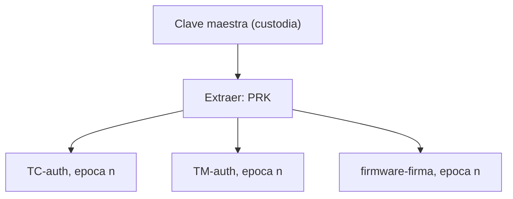

# B88-C38 — Gestión de claves y secretos en aviónica

<!-- nav:top -->
[🏠 Programa](../../../../README.md) · [📚 Bloque B88](../../../tronco-comun/B88-avionica-y-software-critico-espacial.md) · [← Anterior: B88-C37 — Fuzzing autorizado de software embarcado en banco de pruebas](../B88-C37-fuzzing-autorizado-de-software-embarcado-en-banco-de-pruebas/CLASE.md) · [Siguiente: B88-C39 — Normas de aseguramiento de software (ECSS, DO-178C) →](../B88-C39-normas-de-aseguramiento-de-software-ecss-do-178c/CLASE.md)
<!-- /nav -->

## 1. Ubicación, nivel y alcance

Clase 38 del bloque B88. Nivel N3. La seguridad de los comandos y del firmware depende de cómo se **generan, derivan, rotan y custodian las claves**. Aquí construyes una jerarquía de claves **de juguete**: una clave maestra de la que se derivan claves por propósito y por época con **HKDF** (extracción y expansión con HMAC-SHA256), y calculas los límites de uso de un contador de 32 bits y los calendarios de rotación. De NIST SP 800-57 Parte 1 solo se consultó el resumen. Nada es una clave real. Todos los datos son **sintéticos** salvo los que se rotulan como consultados.

## 2. Por qué esta clase existe

Una clave filtrada o reutilizada anula toda la autenticación. La decisión central: **¿cómo se separan las claves por función y época para que el compromiso de una no arrastre a las demás?**

## 3. Lo que podrás hacer al terminar

1. Describir una jerarquía maestra → derivadas.
2. Derivar claves por contexto y época con HKDF.
3. Comprobar la separación de claves y la determinación.
4. Calcular cuándo se agota un contador de 32 bits.
5. Calcular el número de épocas de un calendario de rotación.
6. Separar lo sintético de lo consultado.

La evidencia es la **plan de claves con rotación** del ejercicio 12 (sección 20).

## 4. Con qué llegas y cómo comprobarlo

1. ¿Qué es una función de derivación de claves?
2. ¿Qué es HMAC?
3. ¿Qué es la rotación de claves?
4. ¿Qué es la separación de claves?
5. ¿Qué es un contador de 32 bits?

<details>
<summary>Ver respuestas</summary>

1. Una que obtiene claves nuevas a partir de una clave y un contexto. 2. Un código de autenticación con función hash y clave. 3. Reemplazar una clave por otra tras un tiempo o uso. 4. Usar claves distintas para propósitos distintos. 5. Uno que se agota tras `2³²` valores.
</details>

Con cuatro o cinco aciertos, sigue; si no, repasa los prerrequisitos.

## 5. Un caso de contexto y casos de referencia

Una clave maestra **de juguete** deriva seis claves de 32 bytes (`TC-auth`, `TM-auth` y `firmware-firma` para las épocas 1 y 2); las seis son distintas y la derivación es determinista. Un contador de 32 bits a 1 comando/s dura `136,19` años; a 1000/s, `0,14` años. Con rotación cada 90 días, 5 años dan 21 épocas.

## 6. Vocabulario

La **extracción** `PRK = HMAC(sal, IKM)`. La **expansión** produce `n` bytes con `T(i) = HMAC(PRK, T(i−1) ‖ info ‖ i)`. El **contexto** (`info`) distingue propósito y época. La **separación de claves** exige una clave por función. La **rotación** cambia de época.

## 7. Modelo mental



*Descripción textual:* la clave maestra se extrae a una clave intermedia y de ella se expanden claves distintas por propósito y época.

Analogía: la maestra es una llave de edificio guardada en una caja fuerte y las derivadas son llaves de cada oficina por trimestre: perder una no abre las demás. Límite: si la caja fuerte (la maestra) cae, cae todo.

## 8. La explicación, paso a paso

### 8.1 Derivación

Se extrae con una sal y se expande con el contexto `propósito|época=n`. Seis claves distintas; mismas entradas, misma clave.

### 8.2 Separación

Las claves de `TC-auth` y `TM-auth` son distintas: comprometer una no revela la otra ni la maestra (por la unidireccionalidad del hash).

### 8.3 Límite de uso

Un contador de 32 bits se agota en `2³²/tasa`: `1361,93` años a 0,1/s; `136,19` a 1/s; `13,62` a 10/s; `0,14` a 1000/s. Se rota antes de agotarlo.

### 8.4 Calendario

Rotación cada 30, 90 y 365 días: 61, 21 y 6 épocas en 5 años. Más épocas implican más claves que gestionar (y más ocasiones de error).

## 9. Magnitudes, símbolos y unidades

| Símbolo | Qué es | Unidad | Valor / nota |
|---|---|---|---|
| `K` | clave derivada | B | 32 |
| `ep` | época | — | 1, 2 |
| `2³²` | valores del contador | — | 4,29×10⁹ |
| `tasa` | comandos por segundo | 1/s | 0,1 a 1000 |

## 10. Convenciones y referencias

HMAC-SHA256 de la biblioteca estándar; sal fija del banco; contexto en bytes. Claves **de juguete**. Tolerancia: seis claves distintas y derivación idéntica en dos llamadas. Todo **sintético**.

## 11. De dónde sale lo que afirmamos

| ID | Fuente | Localizador | Respalda | Estado |
|---|---|---|---|---|
| S1 | E. Barker, NIST SP 800-57 Parte 1 Rev. 5, «Recommendation for Key Management: General», mayo 2020 — https://csrc.nist.gov/pubs/sp/800/57/pt1/r5/final (consultada 2026-11-10) | resumen | la publicación trata tipos de claves, su protección y las funciones de la gestión de claves | Consultada (solo el resumen) |
| S2 | NIST, «Platform Firmware Resiliency Guidelines», SP 800-193, mayo 2018 — https://csrc.nist.gov/pubs/sp/800/193/final (consultada 2026-11-10) | resumen | tres capacidades de resiliencia del firmware: protección, detección y recuperación | Consultada (solo el resumen) |
| — | Libros de texto de sistemas de tiempo real, tolerancia a fallos y comunicaciones digitales | — | — | No consultada |
| — | Relaciones y algoritmos estándar usados por el laboratorio (HKDF (extracción y expansión con HMAC) y aritmética de agotamiento de contadores) | — | los verifica el laboratorio con una segunda vía o con pruebas | No consultada en una fuente concreta |

Límites: de NIST SP 800-57 y 800-193 solo se consultó el resumen. No se comprobó la implementación con vectores de prueba oficiales (no consultados). El laboratorio no cubre almacenamiento seguro, generación aleatoria ni destrucción de claves. Lo simulado no se presenta como dato de vuelo ni como medición.

## 12. Cómo ver los resultados

| Tasa | Agotamiento del contador (años) |
|---|---|
| 0,1/s | 1361,93 |
| 1/s | 136,19 |
| 10/s | 13,62 |
| 1000/s | 0,14 |

Descripción larga: a tasas altas el contador de 32 bits dura menos que una misión.

## 13. Ejemplo trabajado

**Paso 1 · Contexto.** `TC-auth|epoca=1`.

**Paso 2 · Derivar.** `expand(PRK, contexto, 32)`.

**Paso 3 · Época 2.** Contexto distinto: otra clave.

**Paso 4 · Contador.** `2³²/1 s = 136,19` años.

## 14. Distintas formas de describir el problema

**Por derivación jerárquica:** esta clase. **Por claves independientes por función:** más a custodiar. **Por módulos de seguridad de hardware:** custodia en hardware (no consultado). El laboratorio verifica separación y determinismo.

## 15. Práctica guiada

**Ejercicio 1 · con los pasos indicados.** Calcula `2³²`.

<details><summary>Solución comentada</summary>

`4 294 967 296`.
</details>

**Ejercicio 2 · con una pista.** ¿Cuántos años dura el contador a 10 mensajes/s?

<details><summary>Solución comentada</summary>

`4,29×10⁹/10 s = 13,62` años.
</details>

**Ejercicio 3 · casi autónomo.** ¿Cuántas épocas con rotación anual en 5 años?

<details><summary>Solución comentada</summary>

6.
</details>

## 16. Práctica autónoma, transferencia e integrador

**Ejercicio 4 · autónomo.** ¿Qué ventaja da derivar por contexto?

<details><summary>Solución comentada</summary>

Claves distintas por propósito con una sola maestra.
</details>

**Ejercicio 5 · autónomo.** ¿Qué pasa si se reutiliza la misma clave para TC y TM?

<details><summary>Solución comentada</summary>

Una filtración compromete ambos.
</details>

**Ejercicio 6 · autónomo.** ¿Por qué la maestra no se usa directamente?

<details><summary>Solución comentada</summary>

Para limitar su exposición.
</details>

**Ejercicio 7 · autónomo.** ¿Qué mide la longitud de 32 bytes?

<details><summary>Solución comentada</summary>

256 bits de clave.
</details>

**Ejercicio 8 · autónomo.** ¿Qué haces antes de agotar el contador?

<details><summary>Solución comentada</summary>

Rotar la clave y reiniciar el contador.
</details>

**Ejercicio 9 · transferencia.** **Transferencia.** Un colega dice que con HKDF no hay que custodiar la maestra. ¿Es válido?

<details><summary>Solución comentada</summary>

No: la maestra es el secreto raíz.
</details>

**Ejercicio 10 · transferencia.** **Transferencia.** ¿Qué cambia si la nave no puede recibir claves nuevas?

<details><summary>Solución comentada</summary>

Se preinstalan épocas futuras o se amplía el contador.
</details>

**Ejercicio 11 · transferencia.** **Transferencia.** ¿Qué dato nunca debe ir en un registro o telemetría?

<details><summary>Solución comentada</summary>

Las claves.
</details>

**Ejercicio 12 · integrador.** **Integrador.** Elabora tu *plan de claves con rotación*: jerarquía, contextos, límites de uso, calendario y lista de qué es sintético.

<details><summary>Solución comentada</summary>

Secciones 8.1–8.4 y la salida del laboratorio.
</details>

## 17. Laboratorio: jerarquía de claves, HKDF y límites de uso

El script [gestion_claves.py](gestion_claves.py) deriva seis claves de juguete por propósito y época, comprueba separación y determinismo y calcula agotamiento de contadores y calendarios de rotación, y **comprueba** seis claves distintas.

**Datos:** clave maestra de juguete **sintética**. **Predice antes de ejecutar:** ¿cuántas claves distintas obtendrás? (seis). **Ejecución del 2026-11-10 (Python 3.12.9):**

```text
Python 3.12.9
Datos SINTETICOS: clave maestra de juguete; NUNCA usar claves reales en codigo ni en banco compartido
Claves derivadas (primeros 8 hex):
  TC-auth         epoca 1: 235e3dd1  longitud=32 B
  TC-auth         epoca 2: 427ac763  longitud=32 B
  TM-auth         epoca 1: 95186bb3  longitud=32 B
  TM-auth         epoca 2: bab4b9da  longitud=32 B
  firmware-firma  epoca 1: 481440e2  longitud=32 B
  firmware-firma  epoca 2: edc3b1c7  longitud=32 B
Todas las claves derivadas son distintas: True
Derivacion determinista: dos llamadas iguales = True
HKDF-Expand de 64 B: longitud = 64 ; primeros 32 B == derivacion de 32 B: True
Contador de 32 bit a    0.1 comandos/s: se agota en      1361.93 anios
Contador de 32 bit a    1.0 comandos/s: se agota en       136.19 anios
Contador de 32 bit a   10.0 comandos/s: se agota en        13.62 anios
Contador de 32 bit a 1000.0 comandos/s: se agota en         0.14 anios
Rotacion cada  30 dias: epocas durante 5 anios = 61
Rotacion cada  90 dias: epocas durante 5 anios = 21
Rotacion cada 365 dias: epocas durante 5 anios = 6
Comprometer la clave de TC-auth epoca 1 no da la de TM-auth ni la maestra (por diseno de HKDF): claves distintas = True
Pruebas superadas.
```

```bash
python programa/clases/B88/B88-C38-gestion-de-claves-y-secretos-en-avionica/gestion_claves.py
```

**Límites:** sin vectores de prueba oficiales, sin custodia ni generación aleatoria.

## 18. Errores frecuentes y cómo corregirlos

**Usar la misma clave para todo.** Sepárala por función (8.2)

**No rotar antes del agotamiento.** Calcula la vida del contador (8.3)

**Guardar claves reales en el código.** Solo de juguete aquí

## 19. Cómo sabrás que vas bien

Tras 8.3: ¿cuánto dura el contador a 1/s? Si dudas, repasa el ejemplo 13. Tras el laboratorio: ¿qué comprueba? (ver sección 17).

## 20. Qué entregas y cómo se evalúa

El producto es tu **plan de claves con rotación** (ejercicio 12).

| Criterio | Inicial | En desarrollo | Logrado | Destacado |
|---|---|---|---|---|
| Conceptos | Los confunde | Parciales | Explica el método y su dominio | Explica los límites y las alternativas |
| Cálculo | Sin unidades | Con errores | Resultados con unidades y comprobados | Resuelve casos nuevos |
| Numérico | Sin comprobar | Un caso | Verifica con una segunda vía en varios casos | Interpreta las diferencias y los fallos |
| Fuentes | Sin fuente | Sin fecha | Fuentes con fecha y estado | Declara lo sintético y lo no consultado |
| Límites | No los nombra | Uno | Tres | Discute qué falta del modelo |

**Condiciones críticas (no se compensan con promedio):** rotular los datos como sintéticos; comprobar cada resultado con una segunda vía; citar solo lo consultado.

## 21. Ética, seguridad y límites

Clase educativa: los modelos son simplificados y los datos son sintéticos; ningún resultado describe una misión real, certifica conformidad con una norma ni sustituye la revisión de especialistas. El laboratorio usa solo claves de juguete y no contiene técnicas contra sistemas reales. Accesibilidad: tablas equivalentes a las gráficas, fórmulas en texto, ejercicios sin conexión.

## 22. Para cerrar y seguir

Una maestra de juguete deriva seis claves separadas; el contador de 32 bits dura 136 años a 1/s y 0,14 a 1000/s. Queda una pregunta: ¿qué normas se aplican a todo este software?

**Glosario español–inglés.** gestión de claves · *key management*; derivación · *derivation*; rotación · *rotation*; época · *epoch*; secreto · *secret*.

**Continuidad.** [B88-C39](../B88-C39-normas-de-aseguramiento-de-software-ecss-do-178c/CLASE.md) trata las normas de aseguramiento de software.

**Referencias:** ver sección 11.

<!-- nav:bottom -->
---

[← Anterior: B88-C37 — Fuzzing autorizado de software embarcado en banco de pruebas](../B88-C37-fuzzing-autorizado-de-software-embarcado-en-banco-de-pruebas/CLASE.md) · [📚 Bloque B88](../../../tronco-comun/B88-avionica-y-software-critico-espacial.md) · [Siguiente: B88-C39 — Normas de aseguramiento de software (ECSS, DO-178C) →](../B88-C39-normas-de-aseguramiento-de-software-ecss-do-178c/CLASE.md)
<!-- /nav -->
