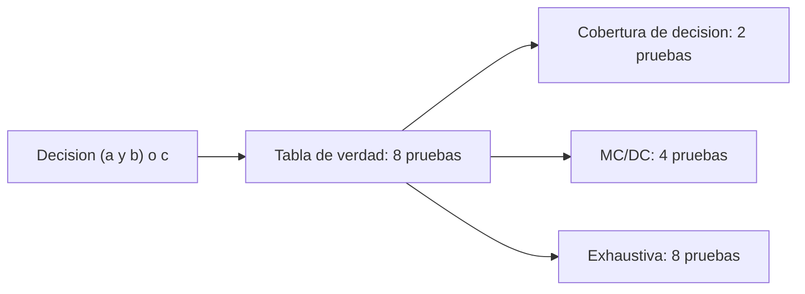

# B88-C39 — Normas de aseguramiento de software (ECSS, DO-178C)

<!-- nav:top -->
[🏠 Programa](../../../../README.md) · [📚 Bloque B88](../../../tronco-comun/B88-avionica-y-software-critico-espacial.md) · [← Anterior: B88-C38 — Gestión de claves y secretos en aviónica](../B88-C38-gestion-de-claves-y-secretos-en-avionica/CLASE.md) · [Siguiente: B88-C40 — Auditoría de software espacial →](../B88-C40-auditoria-de-software-espacial/CLASE.md)
<!-- /nav -->

## 1. Ubicación, nivel y alcance

Clase 39 del bloque B88. Nivel N3. Las normas de aseguramiento de software (ECSS-E-ST-40C, NASA-STD-8739.8B y, en aviación, DO-178C) exigen distintos grados de rigor según la **criticidad**. Aquí se lee lo que las páginas consultadas dicen de su alcance y se estudia **lo que se puede calcular**: cuántas pruebas pide cobertura de decisión frente a **MC/DC** en una decisión booleana. Los niveles de exigencia son **didácticos**: DO-178C no se consultó. Todos los datos son **sintéticos** salvo los que se rotulan como consultados.

## 2. Por qué esta clase existe

Elegir el nivel de cobertura determina el esfuerzo de prueba. La decisión central: **¿qué cobertura piden los distintos niveles y cuánto cuesta cada una en pruebas?**

## 3. Lo que podrás hacer al terminar

1. Describir el alcance de ECSS-E-ST-40C y NASA-STD-8739.8B según sus páginas.
2. Enumerar la tabla de verdad de una decisión.
3. Calcular conjuntos que cumplen decisión y MC/DC.
4. Hallar el tamaño mínimo de un conjunto MC/DC.
5. Comparar `n+1` frente a `2ⁿ`.
6. Separar lo sintético de lo consultado.

La evidencia es la **matriz de cobertura exigible** del ejercicio 12 (sección 20).

## 4. Con qué llegas y cómo comprobarlo

1. ¿Qué es una decisión booleana?
2. ¿Qué es la cobertura de sentencia?
3. ¿Qué es la cobertura de decisión?
4. ¿Qué es MC/DC?
5. ¿Qué es la criticidad?

<details>
<summary>Ver respuestas</summary>

1. Una expresión como `(a ∧ b) ∨ c` que da verdadero o falso. 2. Cada sentencia se ejecuta al menos una vez. 3. La decisión toma verdadero y falso. 4. Cada condición se muestra que afecta sola al resultado. 5. La gravedad de las consecuencias de un fallo de software.
</details>

Con cuatro o cinco aciertos, sigue; si no, repasa los prerrequisitos.

## 5. Un caso de contexto y casos de referencia

Decisión **sintética** `D = (a ∧ b) ∨ c`. Las 8 combinaciones la cubren con 2ⁿ pruebas. El mínimo de MC/DC es `4 = n + 1`, y de los 70 posibles subconjuntos de 4 pruebas, 2 lo cumplen. El conjunto `{(1,1,0), (0,0,0)}` cubre decisión pero no MC/DC.

## 6. Vocabulario

La **cobertura de decisión** exige `D = V` y `D = F`. **MC/DC** (condición/decisión modificada) exige para cada condición un par de pruebas que difieran solo en ella y cambien `D`. El **tamaño mínimo** es `n + 1`. La **exhaustiva** requiere `2ⁿ`.

## 7. Modelo mental



*Descripción textual:* de la misma decisión salen tres conjuntos de prueba de tamaños distintos según el criterio.

Analogía: la decisión es una cerradura con tres cerrojos: la cobertura de decisión prueba que abre y que no abre; MC/DC prueba además que cada cerrojo por sí solo importa. Límite: cubrir no prueba que el diseño de la cerradura sea el correcto.

## 8. La explicación, paso a paso

### 8.1 Lo que dicen las páginas

La página de ECSS-E-ST-40C describe su alcance: software de producto de un sistema espacial, de los requisitos al mantenimiento. La de NASA-STD-8739.8B: requisitos para aseguramiento y seguridad del software. **No se consultó** el texto de requisitos de cobertura ni la asignación por criticidad.

### 8.2 Tabla de verdad

`D` es verdadera en 5 de las 8 combinaciones: `(0,0,1)`, `(0,1,1)`, `(1,0,1)`, `(1,1,0)`, `(1,1,1)`.

### 8.3 Conjuntos

Decisión: bastan 2 pruebas (una `V`, una `F`). MC/DC mínimo: `4`; el conjunto `{(0,1,0), (0,1,1), (1,0,0), (1,1,0)}` lo cumple. `{(1,1,0), (0,0,0)}` y `{(1,1,1), (0,0,0)}` cubren decisión y no MC/DC.

### 8.4 Crecimiento

`n = 3`: 8 exhaustivas frente a 4 MC/DC; `n = 8`: 256 frente a 9; `n = 12`: 4096 frente a 13. MC/DC crece linealmente.

## 9. Magnitudes, símbolos y unidades

| Símbolo | Qué es | Unidad | Valor / nota |
|---|---|---|---|
| `n` | condiciones | — | 3 (hasta 12) |
| `2ⁿ` | pruebas exhaustivas | — | 8 a 4096 |
| `n+1` | mínimo MC/DC | — | 4 a 13 |
| `D` | decisión | — | (a∧b)∨c |

## 10. Convenciones y referencias

Condiciones independientes y sin cortocircuito (para simplificar); decisión sin variables repetidas. Tolerancia: mínimo MC/DC exacto por búsqueda exhaustiva. Todo **sintético**; niveles de exigencia **didácticos**.

## 11. De dónde sale lo que afirmamos

| ID | Fuente | Localizador | Respalda | Estado |
|---|---|---|---|---|
| S1 | ECSS, «ECSS-E-ST-40C — Software», 6 mar 2009 (reemplazada por la Rev.1 del 30 abr 2025) — https://ecss.nl/standard/ecss-e-st-40c-software-general-requirements/ (consultada 2026-11-10) | página de la norma (solo resumen y alcance; no el texto de requisitos) | alcance: software de producto de un sistema espacial en los segmentos espacial, de lanzamiento y de tierra, desde los requisitos hasta el mantenimiento | Consultada (solo la página) |
| S2 | NASA, «Software Assurance and Software Safety Standard» NASA-STD-8739.8B, 8 sep 2022 — https://standards.nasa.gov/standard/nasa/nasa-std-87398 (consultada 2026-11-10) | página de la norma | define requisitos para un enfoque sistemático de aseguramiento y seguridad del software y la verificación y validación independientes, desde la concepción hasta el retiro | Consultada (solo la página) |
| S3 | NASA, «Software Engineering and Assurance Handbook» NASA-HDBK-2203 — https://swehb.nasa.gov/ (consultada 2026-11-10) | página de inicio | guía informativa (no de requisitos) para cumplir NPR 7150.2D y NASA-STD-8739.8B para quien adquiere, desarrolla, asegura o mantiene software de la NASA | Consultada (solo la página de inicio) |
| — | RTCA DO-178C / EUROCAE ED-12C | — | — | No consultada |
| — | ECSS-Q-ST-80C (aseguramiento de producto de software) y normas de seguridad ECSS | — | — | No consultada |
| — | Libros de texto de sistemas de tiempo real, tolerancia a fallos y comunicaciones digitales | — | — | No consultada |
| — | Relaciones y algoritmos estándar usados por el laboratorio (tabla de verdad, pares de independencia y búsqueda exhaustiva del mínimo) | — | los verifica el laboratorio con una segunda vía o con pruebas | No consultada en una fuente concreta |

Límites: no se consultó DO-178C ni el texto de ECSS-E-ST-40C o de NASA-STD-8739.8B: la correspondencia entre nivel de criticidad y cobertura exigida no se afirma. La clase no certifica conformidad con ninguna norma. Lo simulado no se presenta como dato de vuelo ni como medición.

## 12. Cómo ver los resultados

| Criterio | Pruebas mínimas (n = 3) |
|---|---|
| Decisión | 2 |
| MC/DC | 4 |
| Exhaustiva | 8 |

Descripción larga: MC/DC cuesta el doble de la cobertura de decisión y la mitad de la exhaustiva en este caso.

## 13. Ejemplo trabajado

**Paso 1 · Condición `a`.** Par `(0,1,0)` y `(1,1,0)`: solo cambia `a` y `D` cambia.

**Paso 2 · Condición `b`.** Par `(1,0,0)` y `(1,1,0)`.

**Paso 3 · Condición `c`.** Par `(0,1,0)` y `(0,1,1)`.

**Paso 4 · Unión.** Cuatro pruebas distintas.

## 14. Distintas formas de describir el problema

**Por tabla y búsqueda:** esta clase. **Por herramientas de cobertura estructural:** (no consultado). **Por exigencia de norma:** (no consultado). El laboratorio calcula tamaños y conjuntos.

## 15. Práctica guiada

**Ejercicio 1 · con los pasos indicados.** Cuenta las combinaciones donde `D` es verdadera.

<details><summary>Solución comentada</summary>

5 de 8.
</details>

**Ejercicio 2 · con una pista.** ¿Cuántas pruebas mínimas pide la cobertura de decisión?

<details><summary>Solución comentada</summary>

2.
</details>

**Ejercicio 3 · casi autónomo.** ¿Cuántas pide MC/DC con 3 condiciones?

<details><summary>Solución comentada</summary>

4.
</details>

## 16. Práctica autónoma, transferencia e integrador

**Ejercicio 4 · autónomo.** Calcula `2ⁿ` para `n = 8`.

<details><summary>Solución comentada</summary>

256.
</details>

**Ejercicio 5 · autónomo.** Calcula `n + 1` para `n = 8`.

<details><summary>Solución comentada</summary>

9.
</details>

**Ejercicio 6 · autónomo.** ¿Por qué `{(1,1,0), (0,0,0)}` no cumple MC/DC?

<details><summary>Solución comentada</summary>

No hay pares que muestren la independencia de cada condición.
</details>

**Ejercicio 7 · autónomo.** ¿Cuántos subconjuntos de 4 pruebas hay entre 8?

<details><summary>Solución comentada</summary>

`C(8,4) = 70`.
</details>

**Ejercicio 8 · autónomo.** ¿Cuántos de ellos cumplen MC/DC?

<details><summary>Solución comentada</summary>

2.
</details>

**Ejercicio 9 · transferencia.** **Transferencia.** Un colega dice que con esta clase su software queda certificado. ¿Es válido?

<details><summary>Solución comentada</summary>

No: la clase no certifica ninguna conformidad.
</details>

**Ejercicio 10 · transferencia.** **Transferencia.** ¿Qué cambia si hay una condición repetida en la decisión?

<details><summary>Solución comentada</summary>

La definición de independencia se complica y hay variantes de MC/DC.
</details>

**Ejercicio 11 · transferencia.** **Transferencia.** ¿Cuál es el valor de calcular el tamaño mínimo?

<details><summary>Solución comentada</summary>

Estimar el esfuerzo de prueba antes de escribir los casos.
</details>

**Ejercicio 12 · integrador.** **Integrador.** Elabora tu *matriz de cobertura exigible*: decisión, conjuntos, tamaños, límites de lo consultado y lista de qué es sintético.

<details><summary>Solución comentada</summary>

Secciones 8.1–8.4 y la salida del laboratorio.
</details>

## 17. Laboratorio: cobertura de decisión y MC/DC

El script [cobertura_mcdc.py](cobertura_mcdc.py) enumera la tabla de verdad de `(a ∧ b) ∨ c`, busca el tamaño mínimo de un conjunto MC/DC y cuenta cuántos lo cumplen, y **comprueba** que el mínimo es 4 y que un par de pruebas puede cubrir decisión sin MC/DC.

**Datos:** decisión **sintética**. **Predice antes de ejecutar:** ¿cuántas pruebas mínimas pide MC/DC con 3 condiciones? (4). **Ejecución del 2026-11-10 (Python 3.12.9):**

```text
Python 3.12.9
Datos SINTETICOS: la decision (a and b) or c; los niveles de exigencia son DIDACTICOS (no consultados en DO-178C)
Tabla de verdad (a, b, c -> D):
   (False, False, False) -> False
   (False, False, True) -> True
   (False, True, False) -> False
   (False, True, True) -> True
   (True, False, False) -> False
   (True, False, True) -> True
   (True, True, False) -> True
   (True, True, True) -> True
Tamano minimo de un conjunto MC/DC = 4 (n+1 = 4 para n = 3 condiciones)
  Conjunto: ((False, True, False), (False, True, True), (True, False, False), (True, True, False))
Numero de conjuntos MC/DC de ese tamano = 2 de 70
Conjunto [(True, True, False), (False, False, False)]: decision=True MC/DC=False
Conjunto [(True, True, True), (False, False, False)]: decision=True MC/DC=False
Cobertura de condiciones exhaustiva (todas las combinaciones) = 8 pruebas ; MC/DC = 4
  n =  3: exhaustiva =     8 ; MC/DC minimo = n+1 = 4
  n =  5: exhaustiva =    32 ; MC/DC minimo = n+1 = 6
  n =  8: exhaustiva =   256 ; MC/DC minimo = n+1 = 9
  n = 12: exhaustiva =  4096 ; MC/DC minimo = n+1 = 13
Pruebas superadas.
```

```bash
python programa/clases/B88/B88-C39-normas-de-aseguramiento-de-software-ecss-do-178c/cobertura_mcdc.py
```

**Límites:** sin cortocircuito ni condiciones repetidas; no se consultó DO-178C.

## 18. Errores frecuentes y cómo corregirlos

**Confundir cobertura con corrección.** Mide detección (C14)

**Afirmar el nivel exigido sin norma.** Consulta la norma

**Presentar la clase como certificación.** Revisa la sección 21

## 19. Cómo sabrás que vas bien

Tras 8.3: ¿cuántas pruebas mínimas esperabas para MC/DC? Si dudas, repasa el ejemplo 13. Tras el laboratorio: ¿qué comprueba? (ver sección 17).

## 20. Qué entregas y cómo se evalúa

El producto es tu **matriz de cobertura exigible** (ejercicio 12).

| Criterio | Inicial | En desarrollo | Logrado | Destacado |
|---|---|---|---|---|
| Conceptos | Los confunde | Parciales | Explica el método y su dominio | Explica los límites y las alternativas |
| Cálculo | Sin unidades | Con errores | Resultados con unidades y comprobados | Resuelve casos nuevos |
| Numérico | Sin comprobar | Un caso | Verifica con una segunda vía en varios casos | Interpreta las diferencias y los fallos |
| Fuentes | Sin fuente | Sin fecha | Fuentes con fecha y estado | Declara lo sintético y lo no consultado |
| Límites | No los nombra | Uno | Tres | Discute qué falta del modelo |

**Condiciones críticas (no se compensan con promedio):** rotular los datos como sintéticos; comprobar cada resultado con una segunda vía; citar solo lo consultado.

## 21. Ética, seguridad y límites

Clase educativa: los modelos son simplificados y los datos son sintéticos; ningún resultado describe una misión real, certifica conformidad con una norma ni sustituye la revisión de especialistas.  Accesibilidad: tablas equivalentes a las gráficas, fórmulas en texto, ejercicios sin conexión.

## 22. Para cerrar y seguir

MC/DC cuesta `n + 1` pruebas frente a `2ⁿ` de la exhaustiva; la exigencia por nivel de criticidad debe leerse en la norma. Queda una pregunta: ¿cómo revisa un tercero que todo esto se hizo?

**Glosario español–inglés.** aseguramiento de software · *software assurance*; criticidad · *criticality*; cobertura de decisión · *decision coverage*; MC/DC · *MC/DC*.

**Continuidad.** [B88-C40](../B88-C40-auditoria-de-software-espacial/CLASE.md) trata la auditoría de software espacial.

**Referencias:** ver sección 11.

<!-- nav:bottom -->
---

[← Anterior: B88-C38 — Gestión de claves y secretos en aviónica](../B88-C38-gestion-de-claves-y-secretos-en-avionica/CLASE.md) · [📚 Bloque B88](../../../tronco-comun/B88-avionica-y-software-critico-espacial.md) · [Siguiente: B88-C40 — Auditoría de software espacial →](../B88-C40-auditoria-de-software-espacial/CLASE.md)
<!-- /nav -->
