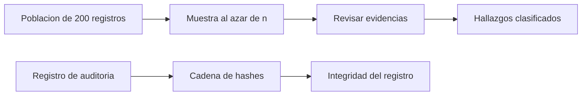

# B88-C40 — Auditoría de software espacial

<!-- nav:top -->
[🏠 Programa](../../../../README.md) · [📚 Bloque B88](../../../tronco-comun/B88-avionica-y-software-critico-espacial.md) · [← Anterior: B88-C39 — Normas de aseguramiento de software (ECSS, DO-178C)](../B88-C39-normas-de-aseguramiento-de-software-ecss-do-178c/CLASE.md) · [Siguiente: B88-C41 — Pruebas SIL y PIL del software de vuelo →](../B88-C41-pruebas-sil-y-pil-del-software-de-vuelo/CLASE.md)
<!-- /nav -->

## 1. Ubicación, nivel y alcance

Clase 40 del bloque B88. Nivel N3. Una **auditoría** de software es una revisión independiente de procesos y evidencias. Aquí calculas el **tamaño de muestra** para detectar desviaciones, la probabilidad de detección en una población de 200 registros con la distribución hipergeométrica (verificada por Monte Carlo) y una **cadena de hashes** que hace evidente la alteración de un registro de auditoría. Los datos son **sintéticos**; NASA-STD-8739.8B solo se consultó en su página. Todos los datos son **sintéticos** salvo los que se rotulan como consultados.

## 2. Por qué esta clase existe

No se puede revisar todo; se revisa una muestra. La decisión central: **¿qué tamaño de muestra da una probabilidad aceptable de detectar desviaciones y cómo se protege el registro de lo auditado?**

## 3. Lo que podrás hacer al terminar

1. Calcular el tamaño de muestra para confianza dada.
2. Calcular la probabilidad de detección en población finita.
3. Verificarla con Monte Carlo.
4. Encadenar registros con hashes.
5. Detectar la alteración de un registro.
6. Separar lo sintético de lo consultado.

La evidencia es la **plan de auditoría con muestreo** del ejercicio 12 (sección 20).

## 4. Con qué llegas y cómo comprobarlo

1. ¿Qué es una auditoría independiente?
2. ¿Qué es una muestra?
3. ¿Qué es la distribución hipergeométrica?
4. ¿Qué es un hash encadenado?
5. ¿Qué es un hallazgo?

<details>
<summary>Ver respuestas</summary>

1. Una revisión hecha por alguien ajeno al desarrollo. 2. Un subconjunto elegido al azar. 3. La de éxitos en un muestreo sin reemplazo. 4. Un hash que incluye el hash anterior. 5. Una desviación detectada.
</details>

Con cuatro o cinco aciertos, sigue; si no, repasa los prerrequisitos.

## 5. Un caso de contexto y casos de referencia

Población **sintética** de 200 registros de evidencia. Para confianza del 95 % de ver al menos una desviación, con tasa tolerable `p = 5 %` se necesitan `59` registros sin defectos. Con 10 defectuosos y muestra de 30, la detección es `0,811` (Monte Carlo `0,8110`). Una cadena de 10 entradas cambia desde la entrada alterada y en las 7 siguientes.

## 6. Vocabulario

El **tamaño de muestra** `n = ⌈ln 0,05 / ln(1 − p)⌉`. La **detección** hipergeométrica `1 − C(N−D, n)/C(N, n)`. La **cadena de hashes** `hᵢ = H(hᵢ₋₁ ‖ entradaᵢ)`. Un **hallazgo mayor** afecta un requisito crítico.

## 7. Modelo mental



*Descripción textual:* de la población se toma una muestra, se revisa y se clasifican los hallazgos; el registro de auditoría se protege con una cadena de hashes.

Analogía: auditar una muestra es probar unos pocos frascos de un lote: si ninguno está malo, es probable (no seguro) que el lote esté bien. Límite: la cadena de hashes prueba que el registro no cambió, no que la auditoría fue buena.

## 8. La explicación, paso a paso

### 8.1 Tamaño de muestra

Con confianza 95 %: `p = 10 %` → `29`; `5 %` → `59`; `2 %` → `149` registros sin defectos.

### 8.2 Población finita

N = 200: con 10 defectuosos y `n = 30`, la detección es `0,811`; con `n = 60`, `0,974`. Con 4 defectuosos y `n = 30`, solo `0,481`.

### 8.3 Verificación

Monte Carlo (100 000, semilla 40): `0,8110` frente a `0,8111` teórico.

### 8.4 Cadena de hashes

Al alterar la entrada 3 de 10, la cadena difiere desde la entrada 3 y en las 7 siguientes: la alteración queda en evidencia. Hallazgos sintéticos: 2 mayores, 7 menores y 11 observaciones (20).

## 9. Magnitudes, símbolos y unidades

| Símbolo | Qué es | Unidad | Valor / nota |
|---|---|---|---|
| `p` | tasa de desviación tolerable | — | 0,02 a 0,10 |
| `n` | tamaño de muestra | — | 29, 59, 149 |
| `N` | población | — | 200 |
| `P_det` | prob. de detección | — | 0,811 |

## 10. Convenciones y referencias

Muestreo simple al azar sin reemplazo; confianza 95 %; defectos independientes de su posición. SHA-256. Semilla `40`. Tolerancia: MC − teórico < 0,01. Todo **sintético**.

## 11. De dónde sale lo que afirmamos

| ID | Fuente | Localizador | Respalda | Estado |
|---|---|---|---|---|
| S1 | NASA, «Software Assurance and Software Safety Standard» NASA-STD-8739.8B, 8 sep 2022 — https://standards.nasa.gov/standard/nasa/nasa-std-87398 (consultada 2026-11-10) | página de la norma | define requisitos para un enfoque sistemático de aseguramiento y seguridad del software y la verificación y validación independientes, desde la concepción hasta el retiro | Consultada (solo la página) |
| S2 | NASA, «Software Engineering and Assurance Handbook» NASA-HDBK-2203 — https://swehb.nasa.gov/ (consultada 2026-11-10) | página de inicio | guía informativa (no de requisitos) para cumplir NPR 7150.2D y NASA-STD-8739.8B para quien adquiere, desarrolla, asegura o mantiene software de la NASA | Consultada (solo la página de inicio) |
| S3 | ECSS, «ECSS-E-ST-40C — Software», 6 mar 2009 (reemplazada por la Rev.1 del 30 abr 2025) — https://ecss.nl/standard/ecss-e-st-40c-software-general-requirements/ (consultada 2026-11-10) | página de la norma (solo resumen y alcance; no el texto de requisitos) | alcance: software de producto de un sistema espacial en los segmentos espacial, de lanzamiento y de tierra, desde los requisitos hasta el mantenimiento | Consultada (solo la página) |
| — | Libros de texto de sistemas de tiempo real, tolerancia a fallos y comunicaciones digitales | — | — | No consultada |
| — | Relaciones y algoritmos estándar usados por el laboratorio (tamaño de muestra, distribución hipergeométrica y hash encadenado) | — | los verifica el laboratorio con una segunda vía o con pruebas | No consultada en una fuente concreta |

Límites: de NASA-STD-8739.8B solo se consultó la página (alcance de aseguramiento, incluida la verificación independiente); no se consultaron los procedimientos de auditoría de las normas. La cadena de hashes no autentica a quien la creó (necesita firma, C13). Lo simulado no se presenta como dato de vuelo ni como medición.

## 12. Cómo ver los resultados

| Defectuosos | n = 10 | n = 30 | n = 60 |
|---|---|---|---|
| 4 | 0,187 | 0,481 | 0,763 |
| 10 | 0,409 | 0,811 | 0,974 |
| 20 | 0,660 | 0,968 | 0,999 |

Descripción larga: la detección sube con la muestra y con la cantidad de defectos.

## 13. Ejemplo trabajado

**Paso 1 · Muestra.** `n = 30` de 200 con 10 defectuosos.

**Paso 2 · Probabilidad de no ver ninguno.** `C(190,30)/C(200,30) = 0,189`.

**Paso 3 · Detección.** `1 − 0,189 = 0,811`.

**Paso 4 · Lectura.** 19 % de probabilidad de no detectar nada.

## 14. Distintas formas de describir el problema

**Por fórmula:** esta clase. **Por Monte Carlo:** esta clase. **Por muestreo por unidad monetaria o riesgo:** (no consultado). El laboratorio compara las dos primeras.

## 15. Práctica guiada

**Ejercicio 1 · con los pasos indicados.** Calcula `n` para `p = 5 %`.

<details><summary>Solución comentada</summary>

`ln 0,05/ln 0,95 = 58,4 → 59`.
</details>

**Ejercicio 2 · con una pista.** Calcula `n` para `p = 10 %`.

<details><summary>Solución comentada</summary>

`28,4 → 29`.
</details>

**Ejercicio 3 · casi autónomo.** ¿Qué detección da `D = 20`, `n = 30`?

<details><summary>Solución comentada</summary>

`0,968`.
</details>

## 16. Práctica autónoma, transferencia e integrador

**Ejercicio 4 · autónomo.** ¿Cuál es la probabilidad de no ver nada con `D = 10`, `n = 30`?

<details><summary>Solución comentada</summary>

`1 − 0,811 = 0,189`.
</details>

**Ejercicio 5 · autónomo.** ¿Por qué crece la detección con `D`?

<details><summary>Solución comentada</summary>

Hay más defectos que encontrar.
</details>

**Ejercicio 6 · autónomo.** ¿Cómo detecta la cadena una alteración?

<details><summary>Solución comentada</summary>

Los hashes posteriores cambian.
</details>

**Ejercicio 7 · autónomo.** ¿Qué no prueba la cadena?

<details><summary>Solución comentada</summary>

Quién la creó ni la calidad de la auditoría.
</details>

**Ejercicio 8 · autónomo.** ¿Qué haces con un hallazgo mayor?

<details><summary>Solución comentada</summary>

Registrar, asignar responsable y verificar el cierre.
</details>

**Ejercicio 9 · transferencia.** **Transferencia.** Un colega dice que 59 registros sin defectos prueban que no hay defectos. ¿Es válido?

<details><summary>Solución comentada</summary>

No: con 95 % de confianza la tasa es menor de 5 %.
</details>

**Ejercicio 10 · transferencia.** **Transferencia.** ¿Qué cambia si se muestrea por riesgo en vez de al azar?

<details><summary>Solución comentada</summary>

Se revisan más los módulos críticos; el cálculo de confianza cambia.
</details>

**Ejercicio 11 · transferencia.** **Transferencia.** ¿Cómo mantendrías la independencia del auditor?

<details><summary>Solución comentada</summary>

Sin dependencia jerárquica ni participación en el desarrollo auditado.
</details>

**Ejercicio 12 · integrador.** **Integrador.** Elabora tu *plan de auditoría con muestreo*: población, muestra, detección, cadena de hashes, hallazgos y lista de qué es sintético.

<details><summary>Solución comentada</summary>

Secciones 8.1–8.4 y la salida del laboratorio.
</details>

## 17. Laboratorio: muestreo de auditoría y cadena de hashes

El script [auditoria_muestreo.py](auditoria_muestreo.py) calcula tamaños de muestra y detección hipergeométrica, la verifica por Monte Carlo y encadena un registro con SHA-256, y **comprueba** que la alteración se detecta desde su entrada.

**Datos:** población y registros **sintéticos**; semilla 40. **Predice antes de ejecutar:** ¿qué detección tendrá `D = 10`, `n = 30`? (0,811). **Ejecución del 2026-11-10 (Python 3.12.9):**

```text
Python 3.12.9
Datos SINTETICOS: poblacion de 200 registros de evidencia inventados
Tasa de desviacion tolerable 0.10: muestra (sin defectos) n = 29
Tasa de desviacion tolerable 0.05: muestra (sin defectos) n = 59
Tasa de desviacion tolerable 0.02: muestra (sin defectos) n = 149
Probabilidad de detectar al menos un registro defectuoso (N=200):
  defectuosos = 4 n=10: 0.187 n=30: 0.481 n=60: 0.763
  defectuosos = 10 n=10: 0.409 n=30: 0.811 n=60: 0.974
  defectuosos = 20 n=10: 0.660 n=30: 0.968 n=60: 0.999
Monte Carlo D=10, n=30: detectado = 0.8110 (hipergeometrica 0.8111)
Cadena original, ultimos 8 hex: 7f7fec91
Alterar la entrada 3: la cadena difiere desde la entrada 3 y en las 7 siguientes
Hallazgos: {'mayor': 2, 'menor': 7, 'observacion': 11} ; total = 20 ; proporcion de mayores = 0.1
Pruebas superadas.
```

```bash
python programa/clases/B88/B88-C40-auditoria-de-software-espacial/auditoria_muestreo.py
```

**Límites:** muestreo simple; sin riesgo por módulo; sin firma del registro.

## 18. Errores frecuentes y cómo corregirlos

**Muestrear sin aleatoriedad.** Elige al azar (8.2)

**Confundir ausencia de hallazgos con ausencia de defectos.** Informa la confianza (ejercicio 9)

**Presentar la cadena como firma.** No autentica (8.4)

## 19. Cómo sabrás que vas bien

Tras 8.2: ¿qué detección esperabas? Si dudas, repasa el ejemplo 13. Tras el laboratorio: ¿qué comprueba? (ver sección 17).

## 20. Qué entregas y cómo se evalúa

El producto es tu **plan de auditoría con muestreo** (ejercicio 12).

| Criterio | Inicial | En desarrollo | Logrado | Destacado |
|---|---|---|---|---|
| Conceptos | Los confunde | Parciales | Explica el método y su dominio | Explica los límites y las alternativas |
| Cálculo | Sin unidades | Con errores | Resultados con unidades y comprobados | Resuelve casos nuevos |
| Numérico | Sin comprobar | Un caso | Verifica con una segunda vía en varios casos | Interpreta las diferencias y los fallos |
| Fuentes | Sin fuente | Sin fecha | Fuentes con fecha y estado | Declara lo sintético y lo no consultado |
| Límites | No los nombra | Uno | Tres | Discute qué falta del modelo |

**Condiciones críticas (no se compensan con promedio):** rotular los datos como sintéticos; comprobar cada resultado con una segunda vía; citar solo lo consultado.

## 21. Ética, seguridad y límites

Clase educativa: los modelos son simplificados y los datos son sintéticos; ningún resultado describe una misión real, certifica conformidad con una norma ni sustituye la revisión de especialistas.  Accesibilidad: tablas equivalentes a las gráficas, fórmulas en texto, ejercicios sin conexión.

## 22. Para cerrar y seguir

Con 30 de 200 registros se detecta el 81 % de los casos con 10 defectuosos; la cadena de hashes revela cualquier alteración posterior. Queda una pregunta: ¿cómo se prueba el software sin el hardware?

**Glosario español–inglés.** auditoría · *audit*; muestra · *sample*; hallazgo · *finding*; cadena de hashes · *hash chain*; verificación independiente · *independent verification*.

**Continuidad.** [B88-C41](../B88-C41-pruebas-sil-y-pil-del-software-de-vuelo/CLASE.md) trata las pruebas SIL y PIL.

**Referencias:** ver sección 11.

<!-- nav:bottom -->
---

[← Anterior: B88-C39 — Normas de aseguramiento de software (ECSS, DO-178C)](../B88-C39-normas-de-aseguramiento-de-software-ecss-do-178c/CLASE.md) · [📚 Bloque B88](../../../tronco-comun/B88-avionica-y-software-critico-espacial.md) · [Siguiente: B88-C41 — Pruebas SIL y PIL del software de vuelo →](../B88-C41-pruebas-sil-y-pil-del-software-de-vuelo/CLASE.md)
<!-- /nav -->
