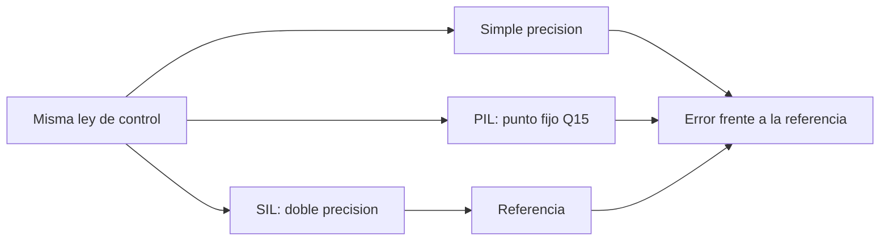

# B88-C41 — Pruebas SIL y PIL del software de vuelo

<!-- nav:top -->
[🏠 Programa](../../../../README.md) · [📚 Bloque B88](../../../tronco-comun/B88-avionica-y-software-critico-espacial.md) · [← Anterior: B88-C40 — Auditoría de software espacial](../B88-C40-auditoria-de-software-espacial/CLASE.md) · [Siguiente: B88-C42 — Simuladores y mocks de sensores para pruebas →](../B88-C42-simuladores-y-mocks-de-sensores-para-pruebas/CLASE.md)
<!-- /nav -->

## 1. Ubicación, nivel y alcance

Clase 41 del bloque B88. Nivel N3. En **SIL** (*software-in-the-loop*) el software de control corre en un computador de desarrollo contra una planta simulada; en **PIL** (*processor-in-the-loop*) corre en el procesador objetivo o en un modelo de su aritmética. Aquí ejecutas una misma ley PD en doble precisión (SIL), simple precisión y **punto fijo Q15** (aritmética tipo PIL) y mides el error acumulado frente a la referencia. Todo **sintético**. Todos los datos son **sintéticos** salvo los que se rotulan como consultados.

## 2. Por qué esta clase existe

La aritmética del procesador objetivo puede ser distinta de la del escritorio. La decisión central: **¿cuánto se aparta la respuesta con la precisión del objetivo y cumple la tolerancia?**

## 3. Lo que podrás hacer al terminar

1. Describir SIL y PIL frente a HIL.
2. Simular la misma ley con tres aritméticas.
3. Medir error máximo y final frente a la referencia.
4. Relacionar el error con el épsilon y el LSB.
5. Decidir con una tolerancia explícita.
6. Separar lo sintético de lo consultado.

La evidencia es la **presupuesto de error numérico SIL/PIL** del ejercicio 12 (sección 20).

## 4. Con qué llegas y cómo comprobarlo

1. ¿Qué es doble precisión?
2. ¿Qué es simple precisión?
3. ¿Qué es punto fijo Q15?
4. ¿Qué es el LSB?
5. ¿Qué es una referencia numérica?

<details>
<summary>Ver respuestas</summary>

1. Números de 64 bits con épsilon `2,2×10⁻¹⁶`. 2. Números de 32 bits con épsilon `1,2×10⁻⁷`. 3. Enteros de 16 bits que representan fracciones en `[−1, 1)`. 4. El menor paso representable. 5. El resultado de la implementación más precisa.
</details>

Con cuatro o cinco aciertos, sigue; si no, repasa los prerrequisitos.

## 5. Un caso de contexto y casos de referencia

Ley PD **sintética** (`I = 1`, `Kp = Kd = 4`, referencia 1 rad, paso 0,05 s, 20 s). Valor final: `1,000000000` (f64), `0,999999702` (f32) y `0,999023` (Q15). Error máximo frente a f64: `2,98×10⁻⁷ rad` (f32) y `9,77×10⁻⁴ rad` (Q15). Con tolerancia `10⁻³ rad`, ambas cumplen; la Q15 queda cerca del límite.

## 6. Vocabulario

**SIL**: software en el computador de desarrollo. **PIL**: en el procesador objetivo o en un modelo de su aritmética. **HIL**: con el hardware real conectado (C19). El **épsilon** de la máquina es el menor incremento relativo. El **LSB** de Q15 con escala 8 vale `8/32768 = 2,44×10⁻⁴`.

## 7. Modelo mental



*Descripción textual:* la misma ley se ejecuta con tres aritméticas; los resultados de las menos precisas se comparan con la de doble precisión.

Analogía: es calcular una cuenta con calculadora de 15 dígitos, de 7 y de 4: el resultado casi coincide, pero con menos dígitos el error se acumula. Límite: en un lazo cerrado, el error puede amplificarse, no solo sumarse.

## 8. La explicación, paso a paso

### 8.1 Resultados

| Aritmética | Valor final | Error máx. vs f64 |
|---|---|---|
| f64 (SIL) | 1,000000000 | 0 |
| f32 | 0,999999702 | 2,98×10⁻⁷ |
| Q15 | 0,999023 | 9,77×10⁻⁴ |

### 8.2 Interpretación

El error de f32 es del orden de 2,5 épsilon de f32; el de Q15, de 4 LSB (`2,44×10⁻⁴`). El lazo cerrado no amplifica el error en este caso: el valor final se estaciona dentro del LSB de la referencia.

### 8.3 Criterio

Con `10⁻³ rad` ambas cumplen. Si el requisito fuera `10⁻⁴`, Q15 no cumpliría: habría que ampliar el ancho o cambiar la escala.

### 8.4 SIL, PIL y HIL

SIL encuentra errores lógicos; PIL, de aritmética y de tamaño de datos; HIL, de temporización (C19). Cada nivel acerca más al hardware.

## 9. Magnitudes, símbolos y unidades

| Símbolo | Qué es | Unidad | Valor / nota |
|---|---|---|---|
| `ε₃₂` | épsilon de simple precisión | — | 1,19×10⁻⁷ |
| `ε₆₄` | épsilon de doble precisión | — | 2,22×10⁻¹⁶ |
| `LSB_Q15` | paso de Q15 (escala 8) | rad | 2,44×10⁻⁴ |
| `e_máx` | error máximo | rad | 2,98×10⁻⁷ / 9,77×10⁻⁴ |

## 10. Convenciones y referencias

Planta integrada con Euler explícito con paso 0,05 s; ganancias exactas en las tres aritméticas; Q15 con escala 8 y saturación. Tolerancia de aceptación `10⁻³ rad`. Todo **sintético**.

## 11. De dónde sale lo que afirmamos

| ID | Fuente | Localizador | Respalda | Estado |
|---|---|---|---|---|
| S1 | NASA, «Software Engineering and Assurance Handbook» NASA-HDBK-2203 — https://swehb.nasa.gov/ (consultada 2026-11-10) | página de inicio | guía informativa (no de requisitos) para cumplir NPR 7150.2D y NASA-STD-8739.8B para quien adquiere, desarrolla, asegura o mantiene software de la NASA | Consultada (solo la página de inicio) |
| — | Libros de texto de sistemas de tiempo real, tolerancia a fallos y comunicaciones digitales | — | — | No consultada |
| — | Relaciones y algoritmos estándar usados por el laboratorio (comparación de la misma ley con aritmética de 64, 32 y 16 bits) | — | los verifica el laboratorio con una segunda vía o con pruebas | No consultada en una fuente concreta |

Límites: la Q15 es una emulación en enteros de Python, no el código de un procesador real; no se simula el redondeo de instrucciones específicas ni el efecto de la compilación. No se consultó ninguna guía de PIL. Lo simulado no se presenta como dato de vuelo ni como medición.

## 12. Cómo ver los resultados

| Aritmética | Error máx. (rad) | ¿< 10⁻³? |
|---|---|---|
| f32 | 2,98×10⁻⁷ | Sí |
| Q15 | 9,77×10⁻⁴ | Sí (al límite) |

Descripción larga: el error crece al reducir la precisión; Q15 queda cerca de la tolerancia.

## 13. Ejemplo trabajado

**Paso 1 · LSB.** `8/32768 = 2,44×10⁻⁴ rad`.

**Paso 2 · Error.** `9,77×10⁻⁴ = 4 LSB`.

**Paso 3 · Comparación.** `9,77×10⁻⁴ < 10⁻³`.

**Paso 4 · Margen.** Solo 2,3 % de margen: poco.

## 14. Distintas formas de describir el problema

**Por simulación con aritmética emulada:** esta clase. **Por ejecución en el procesador (PIL real):** exige hardware. **Por análisis de error numérico:** cotas teóricas (no consultado). El laboratorio usa la primera.

## 15. Práctica guiada

**Ejercicio 1 · con los pasos indicados.** Calcula el LSB de Q15 con escala 8.

<details><summary>Solución comentada</summary>

`8/32768 = 2,44×10⁻⁴`.
</details>

**Ejercicio 2 · con una pista.** ¿Cuántos LSB mide el error de Q15?

<details><summary>Solución comentada</summary>

`9,77×10⁻⁴/2,44×10⁻⁴ = 4`.
</details>

**Ejercicio 3 · casi autónomo.** ¿Cuántos épsilon de f32 mide el error de f32?

<details><summary>Solución comentada</summary>

`2,98×10⁻⁷/1,19×10⁻⁷ ≈ 2,5`.
</details>

## 16. Práctica autónoma, transferencia e integrador

**Ejercicio 4 · autónomo.** ¿Cumple Q15 un requisito de `10⁻⁴`?

<details><summary>Solución comentada</summary>

No.
</details>

**Ejercicio 5 · autónomo.** ¿Cómo mejorarías Q15?

<details><summary>Solución comentada</summary>

Mayor ancho (Q31) o menor escala.
</details>

**Ejercicio 6 · autónomo.** ¿Qué diferencia hay entre SIL y PIL?

<details><summary>Solución comentada</summary>

SIL en el computador de desarrollo; PIL en el procesador objetivo o su modelo.
</details>

**Ejercicio 7 · autónomo.** ¿Qué error de otro tipo detecta HIL y no PIL?

<details><summary>Solución comentada</summary>

Temporización e interrupciones (C19).
</details>

**Ejercicio 8 · autónomo.** Un colega dice que SIL basta. ¿Es válido?

<details><summary>Solución comentada</summary>

No: no ve el redondeo ni la temporización del objetivo.
</details>

**Ejercicio 9 · transferencia.** **Transferencia.** ¿Qué cambia si la ley tiene una integral?

<details><summary>Solución comentada</summary>

El error puede acumularse; se prueban tiempos largos.
</details>

**Ejercicio 10 · transferencia.** **Transferencia.** ¿Qué dato necesitas antes de aceptar la tolerancia?

<details><summary>Solución comentada</summary>

El requisito de precisión del lazo y su margen de estabilidad.
</details>

**Ejercicio 11 · transferencia.** **Transferencia.** ¿Para qué sirve la doble precisión como referencia?

<details><summary>Solución comentada</summary>

Es la mejor aproximación de la solución exacta.
</details>

**Ejercicio 12 · integrador.** **Integrador.** Elabora tu *presupuesto de error numérico SIL/PIL*: aritméticas, error máximo y final, tolerancia, conclusión y lista de qué es sintético.

<details><summary>Solución comentada</summary>

Secciones 8.1–8.4 y la salida del laboratorio.
</details>

## 17. Laboratorio: ley de control en tres aritméticas

El script [sil_pil.py](sil_pil.py) simula la ley PD en doble precisión, simple y Q15 y mide el error frente a la referencia, y **comprueba** que el error de simple precisión es menor que `10⁻³ rad`.

**Datos:** planta y ganancias **sintéticas**. **Predice antes de ejecutar:** ¿qué error máximo tendrá Q15? (unos 4 LSB, `9,77×10⁻⁴ rad`). **Ejecución del 2026-11-10 (Python 3.12.9):**

```text
Python 3.12.9 | numpy 2.4.4
Datos SINTETICOS: inercia 1 kg m^2, PD con Kp=4, Kd=4, referencia 1 rad, paso 0,05 s
Valor final: f64 = 1.000000000 ; f32 = 0.999999702 ; Q15 = 0.999023
Error maximo |f32 - f64| = 2.980e-07 rad
Error maximo |Q15 - f64| = 9.766e-04 rad
Error final |f32 - f64| = 2.980e-07 ; |Q15 - f64| = 9.766e-04
epsilon f32 = 1.192e-07 ; epsilon f64 = 2.220e-16 ; LSB Q15 (escala 8) = 2.441e-04
Criterio de aceptacion |error| < 1e-03 rad: f32 = True ; Q15 = True
Pruebas superadas.
```

```bash
python programa/clases/B88/B88-C41-pruebas-sil-y-pil-del-software-de-vuelo/sil_pil.py
```

**Límites:** emulación de Q15 en Python; sin compilador ni procesador reales.

## 18. Errores frecuentes y cómo corregirlos

**Comparar sin tolerancia.** Fija un criterio (8.3)

**Creer que SIL basta.** Hace falta PIL y HIL (8.4)

**Presentar la emulación como el procesador.** Revisa la sección 10

## 19. Cómo sabrás que vas bien

Tras 8.1: ¿qué error esperabas para Q15? Si dudas, repasa el ejemplo 13. Tras el laboratorio: ¿qué comprueba? (ver sección 17).

## 20. Qué entregas y cómo se evalúa

El producto es tu **presupuesto de error numérico SIL/PIL** (ejercicio 12).

| Criterio | Inicial | En desarrollo | Logrado | Destacado |
|---|---|---|---|---|
| Conceptos | Los confunde | Parciales | Explica el método y su dominio | Explica los límites y las alternativas |
| Cálculo | Sin unidades | Con errores | Resultados con unidades y comprobados | Resuelve casos nuevos |
| Numérico | Sin comprobar | Un caso | Verifica con una segunda vía en varios casos | Interpreta las diferencias y los fallos |
| Fuentes | Sin fuente | Sin fecha | Fuentes con fecha y estado | Declara lo sintético y lo no consultado |
| Límites | No los nombra | Uno | Tres | Discute qué falta del modelo |

**Condiciones críticas (no se compensan con promedio):** rotular los datos como sintéticos; comprobar cada resultado con una segunda vía; citar solo lo consultado.

## 21. Ética, seguridad y límites

Clase educativa: los modelos son simplificados y los datos son sintéticos; ningún resultado describe una misión real, certifica conformidad con una norma ni sustituye la revisión de especialistas.  Accesibilidad: tablas equivalentes a las gráficas, fórmulas en texto, ejercicios sin conexión.

## 22. Para cerrar y seguir

La ley en simple precisión se aparta `3×10⁻⁷ rad` y en Q15 `10⁻³ rad`, justo en la tolerancia. Queda una pregunta: ¿cómo se simulan los sensores para probar todo esto?

**Glosario español–inglés.** software en el lazo · *software-in-the-loop*; procesador en el lazo · *processor-in-the-loop*; punto fijo · *fixed point*; épsilon · *epsilon*.

**Continuidad.** [B88-C42](../B88-C42-simuladores-y-mocks-de-sensores-para-pruebas/CLASE.md) trata los simuladores y mocks de sensores.

**Referencias:** ver sección 11.

<!-- nav:bottom -->
---

[← Anterior: B88-C40 — Auditoría de software espacial](../B88-C40-auditoria-de-software-espacial/CLASE.md) · [📚 Bloque B88](../../../tronco-comun/B88-avionica-y-software-critico-espacial.md) · [Siguiente: B88-C42 — Simuladores y mocks de sensores para pruebas →](../B88-C42-simuladores-y-mocks-de-sensores-para-pruebas/CLASE.md)
<!-- /nav -->
