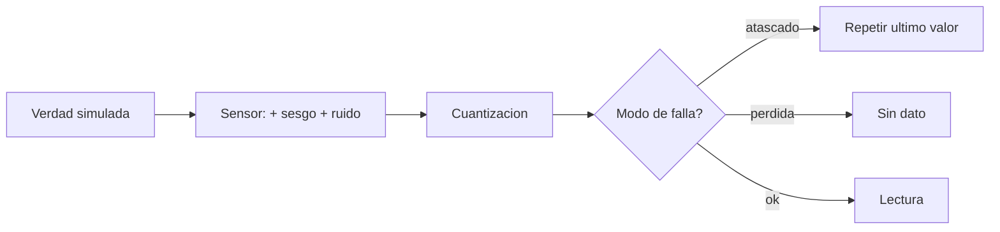

# B88-C42 — Simuladores y mocks de sensores para pruebas

<!-- nav:top -->
[🏠 Programa](../../../../README.md) · [📚 Bloque B88](../../../tronco-comun/B88-avionica-y-software-critico-espacial.md) · [← Anterior: B88-C41 — Pruebas SIL y PIL del software de vuelo](../B88-C41-pruebas-sil-y-pil-del-software-de-vuelo/CLASE.md) · [Siguiente: B88-C43 — Pruebas de carga y estrés del software de vuelo →](../B88-C43-pruebas-de-carga-y-estres-del-software-de-vuelo/CLASE.md)
<!-- /nav -->

## 1. Ubicación, nivel y alcance

Clase 42 del bloque B88. Nivel N3. Un **doble de sensor** (simulador o *mock*) reproduce el comportamiento de un sensor con sesgo, ruido, cuantización y fallos para probar el software sin hardware. Aquí modelas un giroscopio **sintético**, pruebas un detector de lectura atascada y estimas la **desviación de Allan** de ruido blanco. Todo con semilla 42. Todos los datos son **sintéticos** salvo los que se rotulan como consultados.

## 2. Por qué esta clase existe

Para probar el FDIR hace falta provocar fallos que el sensor real no da a pedido. La decisión central: **¿qué características del sensor debe reproducir el doble para que la prueba sea válida?**

## 3. Lo que podrás hacer al terminar

1. Modelar sesgo, ruido, cuantización, atasco y pérdida de dato.
2. Verificar las propiedades estadísticas del doble.
3. Probar un detector de lectura atascada.
4. Calcular la desviación de Allan.
5. Comparar con la pendiente `−1/2` del ruido blanco.
6. Separar lo sintético de lo consultado.

La evidencia es la **biblioteca de dobles de sensor** del ejercicio 12 (sección 20).

## 4. Con qué llegas y cómo comprobarlo

1. ¿Qué es el sesgo?
2. ¿Qué es el ruido blanco?
3. ¿Qué es la cuantización?
4. ¿Qué es una lectura atascada?
5. ¿Qué es la desviación de Allan?

<details>
<summary>Ver respuestas</summary>

1. Un desplazamiento constante de la medida. 2. Variaciones aleatorias independientes. 3. Redondear a múltiplos del LSB. 4. Un valor que no cambia aunque la magnitud sí. 5. Una medida de estabilidad según el tiempo de promediado.
</details>

Con cuatro o cinco aciertos, sigue; si no, repasa los prerrequisitos.

## 5. Un caso de contexto y casos de referencia

Sensor **sintético**: sesgo `0,005 rad/s`, ruido `0,01`, LSB `0,001`. En 20 000 lecturas, media `0,00496` y desviación `0,00999` (esperada `0,01000`). El detector (5 lecturas idénticas) detecta el atasco en 200 de 200 corridas, con 0 falsas alarmas y latencia media `2,99` muestras. La desviación de Allan pasa de `0,010008` a `0,000292` al promediar de 0,1 s a 100 s.

## 6. Vocabulario

El **doble** reproduce las salidas. El **atasco** repite el último valor. La **pérdida de dato** entrega `None`. La **desviación de Allan** `σ_A(m)` es la raíz de la mitad de la media del cuadrado de diferencias entre promedios consecutivos de `m` muestras. Para ruido blanco, `σ_A ∝ 1/√m`.

## 7. Modelo mental



*Descripción textual:* la verdad simulada se transforma con sesgo y ruido, se cuantiza y, según el modo de falla, se entrega, se repite o se omite.

Analogía: un doble de sensor es un actor que imita al sensor y puede «enfermarse» cuando se le pide. Límite: no sabe enfermedades que no se le enseñaron.

## 8. La explicación, paso a paso

### 8.1 Propiedades

Media `0,00496` (programada `0,005`); desviación `0,00999` frente a `√(0,01² + 0,001²/12) = 0,01000`.

### 8.2 Detector de atasco

Al fijar el modo `atascado` en la muestra 30, el detector (5 valores idénticos) dispara en 200/200 corridas, con 0 antes de la falla y latencia media `2,99` muestras sobre una señal senoidal.

### 8.3 Pérdida de dato

El modo `perdida` entrega `None`; el software debe manejarlo (C36).

### 8.4 Desviación de Allan

Con ruido blanco de 0,01, sobre 100 000 muestras a 0,1 s: `0,010008` (0,1 s), `0,003211` (1 s), `0,000990` (10 s), `0,000292` (100 s). La teoría `0,01/√m` da `0,010000`, `0,003162`, `0,001000`, `0,000316`.

## 9. Magnitudes, símbolos y unidades

| Símbolo | Qué es | Unidad | Valor / nota |
|---|---|---|---|
| `b` | sesgo | rad/s | 0,005 |
| `σ` | ruido | rad/s | 0,01 |
| `LSB` | cuantización | rad/s | 0,001 |
| `σ_A` | desviación de Allan | rad/s | 0,010 a 0,0003 |
| `m` | muestras por promedio | — | 1 a 1000 |

## 10. Convenciones y referencias

Ruido gaussiano independiente; lecturas a 10 Hz; detector con 5 lecturas idénticas; semilla `42`. Tolerancia: Allan dentro de 10 % de la teoría. Todo **sintético**; no es la hoja de datos de un giroscopio.

## 11. De dónde sale lo que afirmamos

| ID | Fuente | Localizador | Respalda | Estado |
|---|---|---|---|---|
| S1 | NASA, «Software Engineering and Assurance Handbook» NASA-HDBK-2203 — https://swehb.nasa.gov/ (consultada 2026-11-10) | página de inicio | guía informativa (no de requisitos) para cumplir NPR 7150.2D y NASA-STD-8739.8B para quien adquiere, desarrolla, asegura o mantiene software de la NASA | Consultada (solo la página de inicio) |
| — | Libros de texto de sistemas de tiempo real, tolerancia a fallos y comunicaciones digitales | — | — | No consultada |
| — | Relaciones y algoritmos estándar usados por el laboratorio (modelos de error de sensor y desviación de Allan de ruido blanco) | — | los verifica el laboratorio con una segunda vía o con pruebas | No consultada en una fuente concreta |

Límites: no se consultó ninguna hoja de datos ni estándar de caracterización de sensores. El modelo solo tiene ruido blanco, sesgo constante y fallas tipo atasco o pérdida; no hay deriva (*random walk*) ni dependencia de temperatura. Lo simulado no se presenta como dato de vuelo ni como medición.

## 12. Cómo ver los resultados

| τ (s) | Allan observada | Teórica |
|---|---|---|
| 0,1 | 0,010008 | 0,010000 |
| 1 | 0,003211 | 0,003162 |
| 10 | 0,000990 | 0,001000 |
| 100 | 0,000292 | 0,000316 |

Descripción larga: la desviación baja como `1/√m`, la firma del ruido blanco.

## 13. Ejemplo trabajado

**Paso 1 · Promedios.** Grupos de `m = 100` muestras (10 s).

**Paso 2 · Diferencias.** Entre promedios consecutivos.

**Paso 3 · Allan.** `√(½ · media(diferencias²)) = 0,000990`.

**Paso 4 · Teoría.** `0,01/√100 = 0,001`.

## 14. Distintas formas de describir el problema

**Por modelo de errores:** esta clase. **Por datos reales de banco:** exigen un sensor. **Por simulador de dinámica completa:** C19. El laboratorio valida el modelo con estadística y Allan.

## 15. Práctica guiada

**Ejercicio 1 · con los pasos indicados.** Calcula la desviación esperada con LSB 0,001 y ruido 0,01.

<details><summary>Solución comentada</summary>

`√(10⁻⁴ + 10⁻⁶/12) = 0,01000`.
</details>

**Ejercicio 2 · con una pista.** Calcula la Allan teórica con `m = 10`.

<details><summary>Solución comentada</summary>

`0,01/√10 = 0,003162`.
</details>

**Ejercicio 3 · casi autónomo.** ¿Qué detecta el detector de atasco?

<details><summary>Solución comentada</summary>

5 lecturas idénticas seguidas.
</details>

## 16. Práctica autónoma, transferencia e integrador

**Ejercicio 4 · autónomo.** ¿Por qué no hay falsas alarmas?

<details><summary>Solución comentada</summary>

El ruido hace que 5 valores idénticos seguidos sean improbables.
</details>

**Ejercicio 5 · autónomo.** ¿Qué pasaría si la señal real fuese constante?

<details><summary>Solución comentada</summary>

El detector daría falsas alarmas: el criterio exige que la señal varíe.
</details>

**Ejercicio 6 · autónomo.** ¿Qué mide la latencia de 2,99 muestras?

<details><summary>Solución comentada</summary>

Las 5 lecturas necesarias menos las 2 previas (≈ 3 desde la falla).
</details>

**Ejercicio 7 · autónomo.** ¿Qué cambia si el sensor tiene `random walk`?

<details><summary>Solución comentada</summary>

La Allan deja de bajar como `1/√m` y sube a tiempos largos.
</details>

**Ejercicio 8 · autónomo.** ¿Qué fallas más añadirías al doble?

<details><summary>Solución comentada</summary>

Saltos de escala, deriva térmica y datos fuera de rango.
</details>

**Ejercicio 9 · transferencia.** **Transferencia.** Un colega dice que el doble basta para validar el FDIR. ¿Es válido?

<details><summary>Solución comentada</summary>

No: valida contra los fallos modelados; faltan los no previstos.
</details>

**Ejercicio 10 · transferencia.** **Transferencia.** ¿Por qué la `None` obliga a revisar el código?

<details><summary>Solución comentada</summary>

Si el software supone un número, falla con `None`.
</details>

**Ejercicio 11 · transferencia.** **Transferencia.** ¿Qué relación hay con la clase C12?

<details><summary>Solución comentada</summary>

El doble es la fuente de fallos para probar monitores.
</details>

**Ejercicio 12 · integrador.** **Integrador.** Elabora tu *biblioteca de dobles de sensor*: modelo, modos de falla, estadística, Allan y lista de qué es sintético.

<details><summary>Solución comentada</summary>

Secciones 8.1–8.4 y la salida del laboratorio.
</details>

## 17. Laboratorio: doble de sensor y desviación de Allan

El script [dobles_sensor.py](dobles_sensor.py) simula un sensor con sesgo, ruido y cuantización, prueba un detector de atasco en 200 corridas y calcula la desviación de Allan, y **comprueba** que coincide con la teoría a menos del 10 %.

**Datos:** sensor **sintético**; semilla 42. **Predice antes de ejecutar:** ¿cómo cambia la desviación de Allan al promediar 100 veces más? (baja 10 veces). **Ejecución del 2026-11-10 (Python 3.12.9):**

```text
Python 3.12.9
Datos SINTETICOS: un sensor de velocidad angular inventado (rad/s)
Media medida = 0.00496 (sesgo programado 0.005) ; desviacion = 0.00999 (ruido 0.01 + cuantizacion)
Desviacion esperada = 0.01000
Detector de atascado (5 lecturas identicas): detectado en 200/200 ; falsas alarmas antes de la falla = 0 ; latencia media = 2.99 muestras
Lectura con perdida de dato: None
tau [s]   desv. de Allan   teorico 0.01/sqrt(m)
    0.1         0.010008         0.010000
    1.0         0.003211         0.003162
   10.0         0.000990         0.001000
  100.0         0.000292         0.000316
Pruebas superadas.
```

```bash
python programa/clases/B88/B88-C42-simuladores-y-mocks-de-sensores-para-pruebas/dobles_sensor.py
```

**Límites:** solo ruido blanco, sesgo y dos fallos; sin deriva ni temperatura.

## 18. Errores frecuentes y cómo corregirlos

**Modelar solo el caso nominal.** Añade modos de falla (8.2)

**Confundir ruido con sesgo.** El sesgo no baja al promediar

**Presentar el doble como un sensor real.** Revisa la sección 10

## 19. Cómo sabrás que vas bien

Tras 8.4: ¿qué pendiente esperabas en la Allan? Si dudas, repasa el ejemplo 13. Tras el laboratorio: ¿qué comprueba? (ver sección 17).

## 20. Qué entregas y cómo se evalúa

El producto es tu **biblioteca de dobles de sensor** (ejercicio 12).

| Criterio | Inicial | En desarrollo | Logrado | Destacado |
|---|---|---|---|---|
| Conceptos | Los confunde | Parciales | Explica el método y su dominio | Explica los límites y las alternativas |
| Cálculo | Sin unidades | Con errores | Resultados con unidades y comprobados | Resuelve casos nuevos |
| Numérico | Sin comprobar | Un caso | Verifica con una segunda vía en varios casos | Interpreta las diferencias y los fallos |
| Fuentes | Sin fuente | Sin fecha | Fuentes con fecha y estado | Declara lo sintético y lo no consultado |
| Límites | No los nombra | Uno | Tres | Discute qué falta del modelo |

**Condiciones críticas (no se compensan con promedio):** rotular los datos como sintéticos; comprobar cada resultado con una segunda vía; citar solo lo consultado.

## 21. Ética, seguridad y límites

Clase educativa: los modelos son simplificados y los datos son sintéticos; ningún resultado describe una misión real, certifica conformidad con una norma ni sustituye la revisión de especialistas.  Accesibilidad: tablas equivalentes a las gráficas, fórmulas en texto, ejercicios sin conexión.

## 22. Para cerrar y seguir

El doble reproduce sesgo, ruido y cuantización y permite probar atascos; su Allan sigue `1/√m`. Queda una pregunta: ¿qué carga aguanta el software antes de saturarse?

**Glosario español–inglés.** doble de prueba · *test double*; sesgo · *bias*; cuantización · *quantization*; desviación de Allan · *Allan deviation*; atasco · *stuck-at*.

**Continuidad.** [B88-C43](../B88-C43-pruebas-de-carga-y-estres-del-software-de-vuelo/CLASE.md) trata las pruebas de carga y estrés.

**Referencias:** ver sección 11.

<!-- nav:bottom -->
---

[← Anterior: B88-C41 — Pruebas SIL y PIL del software de vuelo](../B88-C41-pruebas-sil-y-pil-del-software-de-vuelo/CLASE.md) · [📚 Bloque B88](../../../tronco-comun/B88-avionica-y-software-critico-espacial.md) · [Siguiente: B88-C43 — Pruebas de carga y estrés del software de vuelo →](../B88-C43-pruebas-de-carga-y-estres-del-software-de-vuelo/CLASE.md)
<!-- /nav -->
